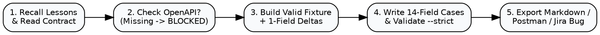

# goodNstay API QA Testing & Cross-Service Contract Skill

## Overview

This skill enforces the official **goodNstay QA Guide — How to Write API Test Cases (v1.0 EN / v3.0 VI)** and **Cross-Service Contract Acceptance (`OP-1593` / `OP-1505` / `OP-1589`–`OP-1592`)**.

**Core principle:** Every API test case verifies **one clear outcome** using a **complete valid fixture with a single-variable mutation**, grounded in the **deployed OpenAPI & Error Registry**, verified through **persistence readback**, and **never guesses missing contract details**. Violating the letter of these rules is violating the spirit of these rules.

## The 6 Iron Laws of goodNstay API Testing

1. **NO GUESSING (`BLOCKED — API contract missing`)**:
   Never invent endpoint URLs, JSON field names, HTTP status codes, `errorCode`s, `messageKey`s, or validation rules. Never use the guide's learning URL (`https://api.example.test/v2/partner-registrations`) as a STAGING target. When the live OpenAPI spec or Error Registry is not yet confirmed, use `{{baseUrl}}{{registrationPath}}`, `<CHECK_OPENAPI>`, `<CHECK_ERROR_REGISTRY>`, set status to `BLOCKED — API contract missing` (or `NOT VERIFIED` if only runtime execution is pending), and state which owner (`QA Lead` / `Partner BE` / `Gateway BE`) provides it.
2. **MANDATORY 14-FIELD TEST CASE CONTRACT + SECTION 5.2 RESULT RECORD**:
   Every API test case MUST include all 14 fields from the QA Guide (`Test Case ID`, `Title`, `Requirement`, `Priority / Test layer`, `Environment`, `Preconditions`, `Method + URL`, `Headers / Auth / Parameters`, `Payload / Test data`, `Steps`, `Expected response`, `Expected data result`, `Actual result`, `Status and evidence`) plus the Section 5.2 JSON result record.
3. **ONE COMPLETE VALID FIXTURE + SINGLE-VARIABLE MUTATION**:
   Always start with one complete, approved valid request fixture (`valid-registration-v2.json`) containing all required fields, canonical Location L1/L2 codes, finalized Media `assetId`s/`uploadReceipt`s, and acknowledgements. For any negative/boundary test, **mutate ONE field only** so error attribution is unambiguous. Never send truncated "learning snippet" JSONs in real tests.
4. **RESPONSE + PERSISTENCE READBACK VERIFICATION**:
   - **On 2xx Success:** Verify HTTP status, response envelope (`requestCode`/`registrationId`/`partnerRequestId`), AND execute an allowed `GET` / Admin Reviewer readback to confirm lossless persistence (including ordered `businessDocument[]` and `gallery[]` refs).
   - **On 4xx/5xx Error:** Verify HTTP status, `errorCode`, `messageKey`, and `fieldErrors` (confirming Partner→Gateway error-code parity with zero degradation to generic `DOWNSTREAM_CLIENT_ERROR`), AND verify **zero unintended records** were created or mutated.
   - **On Timeout / Unknown Outcome:** Do not immediately mark failed—verify via readback or same `Idempotency-Key` replay whether the server persisted the record.
5. **STRICT 4-STATUS GATE & DEPLOYED SHA VERIFICATION**:
   Only four statuses are valid: `PASS`, `FAIL`, `NOT VERIFIED`, `BLOCKED` (never `NOT RUN`, `PENDING`, or `ASSUMED`). Branch merges (`main`/`stag` PRs) or FE mocks are **NOT** runtime deployment: record deployed commit SHA/image per service before marking `PASS` or `FAIL`. Unexecuted cases MUST have `actualHttpStatus: "NOT_RUN"` and `status: "NOT VERIFIED"` (or `BLOCKED`).
6. **ZERO SECRET & PII LEAKAGE**:
   Never place real passwords, Bearer/JWT tokens, `MEDIA_INTERNAL_BEARER`, private presigned URLs, real customer/intern names/emails (`baominh.internship@...`), or real legal documents in test cases, fixtures, Confluence, or Jira. Always use sanitized QA fixtures (`QA Sample Hotel`, `QA Tester`, `qa-sample@example.test`, `+84900000000`, `Bearer <REDACTED_QA_TOKEN>`).

---

## Skill Components

- **CLI Validator, Generator & Exporter ([`scripts/api_test_helper.py`](./scripts/api_test_helper.py))**:
  Zero-dependency Python 3 tool for pre-flight lesson recall (`lessons`), strict 14-field + contract validation (`validate --strict`), suite scaffolding (`scaffold`), 14-field Markdown generation (`export-markdown`), Postman Collection v2.1 export (`export-postman`), `FAIL`-to-Jira bug payload conversion (`to-jira-bug`), and continuous learning (`log-feedback`).
- **QA Guide Standard Reference ([`references/api_test_case_standard.md`](./references/api_test_case_standard.md))**:
  Complete 14-field template, Section 5.2 JSON result schema, 7 API test types, Postman 8-step execution checklist, status decision matrix, and QA Lead 7-point review checklist.
- **OP-1593 Registration V2 Cross-Service Matrix ([`references/op1593_regv2_contract_matrix.md`](./references/op1593_regv2_contract_matrix.md))**:
  Full field, validation, Media G-08 (`1–5` docs, `2–5` photos, `5 MiB`/`20 MiB`), Location L1/L2, phone ISO/E.164, Partner→Gateway error parity (`OP-1591`), idempotency, and Admin reviewer readback (`OP-1592`) contracts.
- **Gold-Standard OP-1593 Examples ([`examples/`](./examples/))**:
  Validated 10-case `OP-1593` suite ([`op1593_regv2_test_suite.json`](./examples/op1593_regv2_test_suite.json)), 14-field Markdown report ([`op1593_regv2_test_cases.md`](./examples/op1593_regv2_test_cases.md)), Postman Collection v2.1 ([`op1593_regv2.postman_collection.json`](./examples/op1593_regv2.postman_collection.json)), and single-delta JSON fixtures ([`examples/fixtures/`](./examples/fixtures/)).
- **Self-Learning Memory ([`memory/lessons_learned.md`](./memory/lessons_learned.md) & [`memory/feedback_log.jsonl`](./memory/feedback_log.jsonl))**:
  Persistent repository of QA Lead corrections, contract gaps, and API testing guardrails.

---

## Mandatory Workflow (Every API Testing Task)



### Step 1: Pre-Flight Recall & Contract Discovery
Before drafting any API test case or payload, load accumulated lessons and read the relevant reference:
```bash
python3 /Users/iannwendy/Desktop/goodNstay/.agents/skills/api-qa-testing/scripts/api_test_helper.py lessons
```
- Read [`references/api_test_case_standard.md`](./references/api_test_case_standard.md) for the 14-field schema and Section 5.2 JSON format.
- When testing Partner Onboarding / Accommodation Registration V2 (`OP-1593`, `OP-1505`, `OP-1589`–`OP-1592`), read [`references/op1593_regv2_contract_matrix.md`](./references/op1593_regv2_contract_matrix.md).

### Step 2: Pre-Test Contract & Environment Audit (No Guessing Gate)
Verify all 7 pre-test inputs before marking any expectation as confirmed:
1. **Jira Requirement & AC** (e.g., `OP-1593`, `OP-1589`, `OP-1590`, `OP-1591`, `OP-1592`)
2. **Deployed OpenAPI Document** for the target environment (`DEV` / `STAGING`)
3. **Real Base URL** (`{{baseUrl}}` — never `https://api.example.test`)
4. **Exact Method & Endpoint Path** (`POST {{baseUrl}}{{registrationPath}}`)
5. **Auth / Headers / Idempotency** (Public vs Bearer token, `Idempotency-Key`, `MEDIA_INTERNAL_BEARER`)
6. **Approved Test Fixtures** (Canonical `countryCode` L1, `administrativeAreaCode` L2, finalized Media `assetId`s + `uploadReceipt`s)
7. **Deployed Build Version / Commit SHA** across FE, Gateway, Partner, Media, Location, Admin

> [!IMPORTANT]
> If the live STAGING OpenAPI URL, exact endpoint path, HTTP status, or error registry is missing, **DO NOT invent draft endpoints or error codes**. Keep `{{baseUrl}}{{registrationPath}}`, `<CHECK_OPENAPI>`, `<CHECK_ERROR_REGISTRY>`, and explicitly flag the missing contract item and its owner.

### Step 3: Design Complete Valid Fixture + Single-Variable Mutations
1. Create or load the complete valid fixture (`fixtures/valid-registration-v2.json`).
2. For each negative or boundary case, clone the valid fixture and change **exactly one variable**:
   - `missing-phone-country.json`: Remove only `primaryContact.phoneCountry` while keeping `primaryContact.phone` in valid E.164 (`+84900000000`) and keeping all other fields identical.
   - `invalid-location-child.json`: Change only `administrativeAreaCode` to a code not belonging to `countryCode: "VN"`.
   - `zero-business-documents.json`: Set `businessDocument: []` while keeping `gallery` valid (`2–5` photos).
   - `single-gallery-photo.json`: Set `gallery` to `1` photo while keeping `businessDocument` valid (`1–5` docs).
   - `idempotency-conflict-payload.json`: Reuse the same `Idempotency-Key` with a single mutated field (`propertyName`).

### Step 4: Author 14-Field Test Suite & Run Strict Validation
Author or scaffold the test suite JSON and validate it with `--strict`:
```bash
python3 /Users/iannwendy/Desktop/goodNstay/.agents/skills/api-qa-testing/scripts/api_test_helper.py \
  validate /absolute/path/to/test_suite.json --strict
```
Fix **all** `ERROR`s and `WARN`s before exporting or presenting to the user.

### Step 5: Automated Live Execution, Readback, Export & Jira Bug Escalation
1. **Execute Live Suite Automatically (`run-suite` — No Manual Postman Clicking Needed):**
   Once the real STAGING `baseUrl`, endpoint path, and deployed SHA are available, run the entire suite end-to-end (sends HTTP requests, captures `requestId`/status/`errorCode`, runs `GET` readback verification, saves sanitized `evidence/<CASE_ID>_response.json`, updates Markdown/Postman, and auto-generates `bugs/BUG-<CASE_ID>.json` for any `FAIL`):
   ```bash
   python3 /Users/iannwendy/Desktop/goodNstay/.agents/skills/api-qa-testing/scripts/api_test_helper.py \
     run-suite /absolute/path/to/test_suite.json \
     --base-url "https://<real-staging-gateway-host>" \
     --registration-path "/api/v2/partner/registrations" \
     --admin-readback-path "/api/v1/admin/partner-requests" \
     --deployed-sha "fe=<sha>,gw=<sha>,partner=<sha>,media=<sha>,location=<sha>" \
     --openapi-url "https://<real-staging-openapi-url>"
   ```
2. **Export Deliverables (14-Field Markdown, Postman v2.1, or Single Jira Bug):**
   Generate human-readable Markdown tables and executable Postman v2.1 collections from the validated JSON suite:
   ```bash
   # Export 14-field Markdown Test Cases + QA Lead Checklist
   python3 /Users/iannwendy/Desktop/goodNstay/.agents/skills/api-qa-testing/scripts/api_test_helper.py \
     export-markdown /absolute/path/to/test_suite.json \
     --output /absolute/path/to/test_cases.md

   # Export Postman Collection v2.1 with automated pm.test() assertions
   python3 /Users/iannwendy/Desktop/goodNstay/.agents/skills/api-qa-testing/scripts/api_test_helper.py \
     export-postman /absolute/path/to/test_suite.json \
     --output /absolute/path/to/collection.postman_collection.json
   ```
3. **Upload Failed Cases to Jira Board `#135` (`Internship Program 2026`):**
   Use the `jira-bug-reporter` skill on each generated `bugs/BUG-<CASE_ID>.json` (or convert a single case via `to-jira-bug`):
   ```bash
   python3 /Users/iannwendy/Desktop/goodNstay/.agents/skills/api-qa-testing/scripts/api_test_helper.py \
     to-jira-bug /absolute/path/to/test_suite.json \
     --case-id REGV2-API-002 \
     --output /absolute/path/to/BUG-REGV2-002.json
   ```

---

## Rationalization Counter-Table (Bulletproofed Against Baseline Failures)

| Excuse / Rationalization | Why It Violates goodNstay QA Standards | Mandatory Action |
| :--- | :--- | :--- |
| *"We don't have the STAGING OpenAPI link yet, so I'll write `POST /api/v2/accommodations/register` and mark it `(Assumed)`."* | Guessing endpoints/schemas creates false test contracts that fail or test the wrong route. QA Guide §2 explicitly forbids creating your own URL, field names, error codes, or rules. | Use `POST {{baseUrl}}{{registrationPath}}`, `<CHECK_OPENAPI>`, `<CHECK_ERROR_REGISTRY>`, and mark `BLOCKED — API contract missing` (or `NOT VERIFIED` with explicit contract placeholders). |
| *"I'll use a short 8-line JSON snippet so the table is easy to read."* | QA Guide §5.1 & §6: Incomplete payloads trigger unrelated required-field errors instead of isolating the field under test. | Reference the complete valid V2 fixture (`valid-registration-v2.json`) and specify the exact **Single-Variable Delta** removed/mutated. |
| *"When testing missing `phoneCountry`, I'll also use a local phone number `901234567` and change the email."* | Mutating 2+ fields breaks single-cause isolation. Also, `OP-1589`/`OP-1505` specifically require rejecting missing `phoneCountry` **even when `phone` is valid E.164 (`+84900000000`)**. | Change **one thing only**: remove `primaryContact.phoneCountry` while keeping `primaryContact.phone: "+84900000000"` and all other fields identical to the valid fixture. |
| *"I'll use `baominh.internship+op1593@gmail.com` and my real name in the sample payload."* | QA Guide §5 & §9 forbid personal/real contact info or credentials in Confluence/Jira/test artifacts. | Use fake QA fixture data (`QA Sample Hotel`, `QA Tester`, `qa-sample@example.test`, `+84900000000`). |
| *"The PRs (#217, #218, #195) are merged to `main`, so I can mark the test cases `PASS`."* | `OP-1593` & `OP-1505`: Source merge or FE mock is **never** runtime acceptance. `PASS` requires live execution + GET/Admin readback on deployed SHA. | Keep status `NOT VERIFIED` (`actualHttpStatus: "NOT_RUN"`) until executed on STAGING with recorded commit SHA and readback evidence. |
| *"A 10-column summary table is faster for standup than the 14-field format."* | Omitting `Priority / Test layer`, `Steps`, `Expected data result` (readback), or Section 5.2 JSON fields violates QA Guide §4 & §10. | Always output all 14 mandatory fields + Section 5.2 result record and verify with `api_test_helper.py validate --strict`. |

## Red Flags — STOP and Fix Immediately

If you catch yourself doing any of the following, **STOP and fix before responding**:
- Writing `https://api.example.test/...` as an executable STAGING endpoint or inventing `/api/v2/...` paths without an OpenAPI citation
- Guessing `400`/`422` or inventing error codes like `VALIDATION_ERROR` / `ERR_MISSING_PHONE` when the error registry is unconfirmed
- Mutating more than one field in a negative/boundary test fixture
- Omitting the post-request **GET / Admin Reviewer readback** (`Expected data result`) on positive or negative tests
- Using statuses outside `{"PASS", "FAIL", "NOT VERIFIED", "BLOCKED"}` (such as `NOT RUN`, `PENDING`, `TODO`, `DRAFT`)
- Including unredacted `Authorization: Bearer eyJ...` headers or real personal emails/phones in payloads

---

## Self-Learning & Continuous Improvement Loop

Whenever the user or QA Lead provides feedback on API test cases, uncovers a new contract nuance, or reports a gap:
1. Fix the test suite and re-run `api_test_helper.py validate <file> --strict`.
2. Record and promote the rule into persistent memory:
   ```bash
   python3 /Users/iannwendy/Desktop/goodNstay/.agents/skills/api-qa-testing/scripts/api_test_helper.py \
     log-feedback \
     --suite "path/to/test_suite.json" \
     --type contract_rule \
     --issue "Short description of the mistake or newly discovered API contract rule" \
     --rule "Concrete, enforceable rule for all future API test suites" \
     --promote
   ```
