# BÁO CÁO KIỂM THỬ LỖI FRONTEND, CONSOLE/NETWORK (F12) & RESPONSIVE — goodNstay Global Home (`/vi-VN/home`)

- **Ngày thực hiện / Date**: `03/11/2026`
- **URL kiểm thử / Target URL**: `https://goodnstay.com/vi-VN/home`
- **Môi trường / Environment**: Production (`goodnstay.com`) — Next.js App Router (`data-gns-home-root="cutover"`, `data-gns-home-responsive="provisional"`)
- **Trình duyệt / Browser**: Google Chrome 156.0.0.0 (macOS Sonoma `10_15_7`) + Chrome DevTools (F12 Elements, Console, Network, Device Emulation)
- **Tài khoản kiểm thử / Test Accounts**:
  - **Guest Session**: Chưa đăng nhập (`data-gns-home-session="guest"`)
  - **Signed-In Session**: `TEST_BAOMINH` (`baominh.internship@gmail.com` — `data-gns-home-session="signed-in"`)
- **Thiết bị & Độ phân giải kiểm thử / Viewports Tested**:
  - **Desktop**: `1440×900` (MacBook Pro), `1280×800` (Laptop chuẩn)
  - **Tablet**: `1024×768` (iPad Landscape), `768×1024` (iPad Mini / iPad Portrait)
  - **Mobile**: `412×915` (Samsung Galaxy S23 / Pixel 7), `390×844` (iPhone 14 / 15 Pro), `375×667` (iPhone SE)
- **Thư mục lưu trữ báo cáo & ảnh minh chứng**: `/Users/iannwendy/Desktop/goodNstay/bug_report_3-11-2026/`

---

## TỔNG QUAN DANH SÁCH LỖI (EXECUTIVE SUMMARY)

| Mã Bug | Tiêu đề lỗi (Standardized QA Title) | Phân loại (Category) | Mức độ (Severity) | Thiết bị / Viewport bị ảnh hưởng | Ảnh minh chứng (Evidence) |
| :--- | :--- | :--- | :--- | :--- | :--- |
| **BUG-01** | `[Global Home - Mobile Drawer] Hamburger Drawer Covers 100vw×100dvh Without Close Button or Backdrop Area, Trapping Mobile Users & Crushing Partner CTA Height` | Functional / Responsive / UX | **S1 — Critical (Blocker)** | Mobile `≤ 429px` (`390×844`, `375×667`, `412×915`) | [bug01_mobile_drawer_trap_390x844.png](file:///Users/iannwendy/Desktop/goodNstay/bug_report_3-11-2026/bug01_mobile_drawer_trap_390x844.png) |
| **BUG-02** | `[Global Home - Currency & Language Selector] Dropdown Clipped Off-Screen in Mobile Drawer (470px Overflow / 118px Crushed Height) & Require Double-Click Due to State Desync` | Functional / Responsive / UI | **S2 — Major** | Desktop `1440×900` & Mobile `390×844`, `375×667` | [bug02a_drawer_currency_overflow_390x844.png](file:///Users/iannwendy/Desktop/goodNstay/bug_report_3-11-2026/bug02a_drawer_currency_overflow_390x844.png), [bug02b_drawer_language_offscreen_375x667.png](file:///Users/iannwendy/Desktop/goodNstay/bug_report_3-11-2026/bug02b_drawer_language_offscreen_375x667.png) |
| **BUG-03** | `[Global Home - Header & Drawer Links] "Đăng ký làm Đối Tác" Points to Staging URL (partners.stag.goodnstay.com/en-US) & Support/About Links Hardcode en-US on /vi-VN/home` | Functional / Routing / Localization | **S2 — Major** | Tất cả thiết bị (`1440×900`, `768×1024`, `390×844`) | [bug03_staging_url_and_locale_mismatch_1440x900.png](file:///Users/iannwendy/Desktop/goodNstay/bug_report_3-11-2026/bug03_staging_url_and_locale_mismatch_1440x900.png) |
| **BUG-04** | `[Global Home - Guest Drawer] Clicking "Lịch sử" (History) as Guest Silently Closes Drawer with Zero Feedback or Redirect` | Functional / Auth Flow | **S2 — Major** | Tất cả thiết bị (Guest Session) | [bug04_guest_history_silent_noop_1440x900.png](file:///Users/iannwendy/Desktop/goodNstay/bug_report_3-11-2026/bug04_guest_history_silent_noop_1440x900.png) |
| **BUG-05** | `[Global Home - Hero Request Form] Empty Check-in/Check-out Bypasses Validation, Missing Date Error Text in Home Mode, 14-Day Max Date Lock & Squashed Inline Error on <1440px` | Functional / Validation / Responsive | **S2 — Major** | Desktop `1440×900`, Tablet `768×1024`, Mobile `390×844` | [bug05a_hero_form_date_validation_and_14day_lock_1440x900.png](file:///Users/iannwendy/Desktop/goodNstay/bug_report_3-11-2026/bug05a_hero_form_date_validation_and_14day_lock_1440x900.png), [bug05b_inline_error_squashed_768x1024.png](file:///Users/iannwendy/Desktop/goodNstay/bug_report_3-11-2026/bug05b_inline_error_squashed_768x1024.png) |
| **BUG-06** | `[Global Home - Hero Responsive] "Lưu trú ›" Button Hardcoded at 466px Width Overflows Mobile Viewport (+92px) & Hero Copy/Form Have 0px Horizontal Padding on <1440px` | Responsive / CSS Layout | **S2 — Major** | Mobile `≤ 757px` (`390×844`, `375×667`) & Tablet/Laptop `< 1440px` | [bug06_mobile_hero_overflow_466px_390x844.png](file:///Users/iannwendy/Desktop/goodNstay/bug_report_3-11-2026/bug06_mobile_hero_overflow_466px_390x844.png), [bug05b_inline_error_squashed_768x1024.png](file:///Users/iannwendy/Desktop/goodNstay/bug_report_3-11-2026/bug05b_inline_error_squashed_768x1024.png) |
| **BUG-07** | `[Global Home - Destination Carousel] Unclamped Parallax Shifts Photos Out of Bounds (73px Blank Strip) & Card Flip Reveals Empty Back Face with Disabled CTA` | UI / Visual / Functional | **S2 — Major** | Tất cả thiết bị (`1440×900`, `768×1024`, `390×844`) | [bug07_dest_carousel_parallax_gap_and_broken_flip_1440x900.png](file:///Users/iannwendy/Desktop/goodNstay/bug_report_3-11-2026/bug07_dest_carousel_parallax_gap_and_broken_flip_1440x900.png) |
| **BUG-08** | `[Global Home - Section CTAs & Cards] Partner Network Cards, Inspiration/Community CTAs & Marketplace Cards Are Non-Functional (aria-disabled="true") with Zero Feedback` | Functional / UX | **S2 — Major** | Tất cả thiết bị (`1440×900`, `768×1024`, `390×844`) | [bug08_dead_ctas_inspire_partner_marketplace_1440x900.png](file:///Users/iannwendy/Desktop/goodNstay/bug_report_3-11-2026/bug08_dead_ctas_inspire_partner_marketplace_1440x900.png) |
| **BUG-09** | `[Global Home - Signed-In Notifications & F12] Hardcoded Drawer Badge ("1" vs Actual "2"), Unclipped Floating Bell Button, Duplicate Notification API Calls & FocusTrap Warning` | Functional / API / Console / UI | **S2 — Major** | Tất cả thiết bị (Signed-In `TEST_BAOMINH`) | [bug09_signed_in_hardcoded_badge_and_floating_bell_1440x900.png](file:///Users/iannwendy/Desktop/goodNstay/bug_report_3-11-2026/bug09_signed_in_hardcoded_badge_and_floating_bell_1440x900.png), [bug09b_drawer_hardcoded_badge_1_signed_in_1440x900.png](file:///Users/iannwendy/Desktop/goodNstay/bug_report_3-11-2026/bug09b_drawer_hardcoded_badge_1_signed_in_1440x900.png) |

---

## CHI TIẾT TỪNG LỖI (DETAILED BUG REPORTS)

---

### BUG-01: `[Global Home - Mobile Drawer] Hamburger Drawer Covers 100vw×100dvh Without Close Button or Backdrop Area, Trapping Mobile Users & Crushing Partner CTA Height`

1. **Title**: `[Global Home - Mobile Drawer] Hamburger Drawer Covers 100vw×100dvh Without Close Button or Backdrop Area, Trapping Mobile Users & Crushing Partner CTA Height`
2. **Environment**:
   - **URL**: `https://goodnstay.com/vi-VN/home`
   - **Browser**: Chrome 156.0.0.0 (Mobile Emulation & Touch Mode)
   - **Viewports**: Tất cả màn hình điện thoại `≤ 429px` (iPhone 14/15 `390×844`, iPhone SE `375×667`, Galaxy S23 `360×800` / `412×915`)
   - **Test Time**: `03/11/2026 11:28 ICT`
3. **Steps to Reproduce**:
   1. Mở `https://goodnstay.com/vi-VN/home` trên thiết bị di động (ví dụ `390×844` iPhone 14 hoặc `375×667` iPhone SE).
   2. Nhấn vào nút **Hamburger Menu** (`.gns-home-header-menu`, `aria-label="Mở điều hướng toàn cục"`) ở góc trên bên phải Header.
   3. Quan sát giao diện Drawer mở ra và thử đóng Drawer để quay lại trang chủ bằng thao tác chạm (touch).
   4. Quan sát nút CTA màu xanh **"Đăng ký làm Đối Tác"** (`.gns-home-drawer-join`) ở phần Footer của Drawer.
4. **Actual Result**:
   - Trên màn hình `≤ 429px`, `<aside class="gns-home-drawer">` chiếm trọn 100% khung nhìn (`width: 390px; height: 844px; top: 0px; left: 0px`), đè hoàn toàn lên nút Hamburger trên Header và che kín toàn bộ lớp nền `.gns-home-drawer-boundary` phía sau.
   - Bên trong `.gns-home-drawer` **không có nút Đóng (`X` / Close button)**. Do thiết bị di động không có phím vật lý `Esc`, người dùng **bị kẹt hoàn toàn (navigation trap)** bên trong menu, không thể đóng menu để quay lại trang chủ trừ khi tải lại trang (Refresh) hoặc chuyển sang trang khác.
   - Ngoài ra, nút CTA chính **"Đăng ký làm Đối Tác"** (`.gns-home-drawer-join`) bị ép chiều cao xuống còn **`21.75px`** (thay vì `51px`), khiến chữ và mũi tên bị bó sát vào viền nút.
5. **Expected Result**:
   - Drawer phải hiển thị nút đóng `X` rõ ràng ở góc trên bên phải (`aria-label={content.nav.a11y.closeDrawer}`) để người dùng trên mọi thiết bị có thể đóng menu dễ dàng.
   - Nút `.gns-home-drawer-join` phải giữ `min-height: 44px–51px` và `padding` hợp lý trên thiết bị di động.
6. **Chrome DevTools (F12) Console, Network & DOM/CSS Diagnostic**:
   - **JS Bundle (`_next/static/chunks/0y6prjzi0mbdc.js`)**: Chuỗi dịch `nav.a11y.closeDrawer` đã được khai báo và nạp trong `GlobalHomePageClient`, nhưng component `t8` (Drawer) chỉ render `<button class="gns-home-drawer-boundary">` (lớp nền phía sau) và `<aside class="gns-home-drawer">` mà **quên render nút Close (`<button class="gns-home-drawer-close">`)** bên trong `<aside>`.
   - **CSS Rule**:
     - `@media (max-width: 429px) { .gns-home .gns-home-drawer { width: 100vw; max-width: 100vw; height: 100dvh; max-height: 100dvh; border-radius: 0px; top: 0px; right: 0px; } }`
     - `@media (max-width: 757px), (max-height: 820px) { .gns-home .gns-home-drawer-join { height: auto; padding: 0px 18px; } }` -> làm chiều cao nút sụt từ `51px` xuống `21.75px`.
7. **Evidence**:
   - File ảnh: [bug01_mobile_drawer_trap_390x844.png](file:///Users/iannwendy/Desktop/goodNstay/bug_report_3-11-2026/bug01_mobile_drawer_trap_390x844.png)
   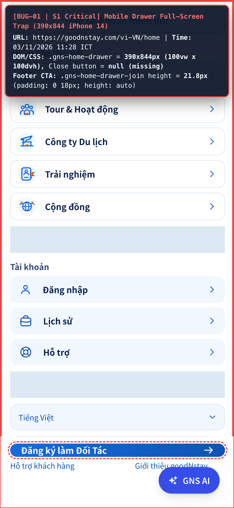
8. **Classification**:
   - **Category**: Functional / Responsive / Accessibility
   - **Fault Type**: Missing UI Control & Media Query Regression
9. **Severity & Reproducibility**:
   - **Severity**: **S1 — Critical (Blocker trên Mobile)**
   - **Reproducibility**: Luôn luôn (100% — 5/5 lần thử)

---

### BUG-02: `[Global Home - Currency & Language Selector] Dropdown Clipped Off-Screen in Mobile Drawer (470px Overflow / 118px Crushed Height) & Require Double-Click Due to State Desync`

1. **Title**: `[Global Home - Currency & Language Selector] Dropdown Clipped Off-Screen in Mobile Drawer (470px Overflow / 118px Crushed Height) & Require Double-Click Due to State Desync`
2. **Environment**:
   - **URL**: `https://goodnstay.com/vi-VN/home`
   - **Browser**: Chrome 156.0.0.0
   - **Viewports**: Desktop (`1440×900`) & Mobile (`390×844` iPhone 14, `375×667` iPhone SE)
   - **Test Time**: `03/11/2026 11:29–11:30 ICT`
3. **Steps to Reproduce**:
   - **Phần A (Lỗi Double-Click trên cả Desktop & Mobile)**:
     1. Nhấn vào nút **`USD $`** (`.gns-home-header-currency`) trên Header -> menu tiền tệ mở ra.
     2. Nhấn ra ngoài vùng trống (hoặc chọn 1 loại tiền tệ) để đóng menu.
     3. Nhấn lại vào nút **`USD $`** một lần nữa.
   - **Phần B (Lỗi tràn màn hình / cắt cụt menu trong Drawer trên Mobile)**:
     1. Trên màn hình `390×844` (iPhone 14), mở Hamburger Drawer và nhấn vào nút **`USD $`** (`.gns-home-drawer-pref-currency`) ở cuối Drawer.
     2. Trên màn hình `375×667` (iPhone SE), mở Hamburger Drawer, cuộn xuống và nhấn vào nút **`Tiếng Việt`** (`.gns-home-drawer-pref-language`).
4. **Actual Result**:
   - **Phần A**: Khi nhấn lại nút **`USD $`** ở bước 3, menu tiền tệ **không mở ra** ở lần nhấn đầu tiên. Người dùng buộc phải **nhấn đúp (2 lần liên tiếp)** mới mở lại được menu tiền tệ.
   - **Phần B (Currency Menu trên `390×844`)**: Danh sách tiền tệ cao `530px` mở xuống phía dưới tại toạ độ `top: 785px`, kéo dài tới `bottom: 1315px` trên màn hình chỉ cao `844px` (trong khi `body` đang bị khoá cuộn `overflow: hidden`). Kết quả là **470px (11/13 loại tiền tệ)** bị tràn khuất hoàn toàn bên dưới đáy màn hình và không thể cuộn tới để chọn.
   - **Phần B (Language Menu trên `375×667`)**: Khi chưa cuộn Drawer, nút `Tiếng Việt` nằm ở `bottom: 715px` nên menu ngôn ngữ mở ở `top: 723px` (nằm khuất 100% dưới màn hình `667px`). Khi cuộn Drawer xuống đáy, menu luôn mở hướng xuống dưới ở `top: 532.5px` và bị ép `max-height: 118.5px`, đè lên nút "Đăng ký làm Đối Tác" và cắt khuất danh sách ngôn ngữ.
5. **Expected Result**:
   - Đóng menu tiền tệ bằng cách click ra ngoài hoặc chọn item phải đồng bộ state `D = null` để lần click tiếp theo mở lại menu ngay ở lần nhấn đầu tiên.
   - Khi nút trigger nằm gần đáy màn hình (như trong Drawer), menu Tiền tệ và Ngôn ngữ phải tự động lật ngược lên trên (flip upward) hoặc kẹp toạ độ `top` trong khung nhìn kèm `max-height` và thanh cuộn nội bộ.
6. **Chrome DevTools (F12) Console, Network & DOM/CSS Diagnostic**:
   - **Root Cause (State Desync — `0y6prjzi0mbdc.js`)**: Khi `D === "currency"`, `GlobalHomePageClient` mount `<CurrencySelector />` và tự động `.click()` nút ẩn bên trong. Khi người dùng click ra ngoài, `<CurrencySelector />` tự đóng state nội bộ của nó nhưng **không gọi callback báo về `GlobalHomePageClient`**, khiến `D` vẫn giữ giá trị `"currency"`. Lần click tiếp theo vào `.gns-home-header-currency` chỉ chạy `changeCurrency: () => R(e => "currency" === e ? null : "currency")` (đổi `"currency"` về `null`), cần thêm lần click thứ 2 mới đổi từ `null` sang `"currency"`.
   - **Root Cause (Viewport Overflow — `rb()` trong `0y6prjzi0mbdc.js`)**:
     - Hàm tính toạ độ `rb()` viết: `if ("start" !== e && l + r.height > s.height - o) { l = Math.max(o, s.height - o - r.height); }` -> **bỏ qua hoàn toàn việc kẹp toạ độ theo chiều dọc (`l`) khi `align === "start"`**!
     - Hơn nữa, `e.offsetHeight` của `.gns-home-host-preference-currency` luôn bằng `0` (do menu con dùng `position: absolute`), nên hàm luôn truyền `height: 160` thay vì chiều cao thật `530px`.
7. **Evidence**:
   - File ảnh 2A: [bug02a_drawer_currency_overflow_390x844.png](file:///Users/iannwendy/Desktop/goodNstay/bug_report_3-11-2026/bug02a_drawer_currency_overflow_390x844.png)
   - File ảnh 2B: [bug02b_drawer_language_offscreen_375x667.png](file:///Users/iannwendy/Desktop/goodNstay/bug_report_3-11-2026/bug02b_drawer_language_offscreen_375x667.png)
   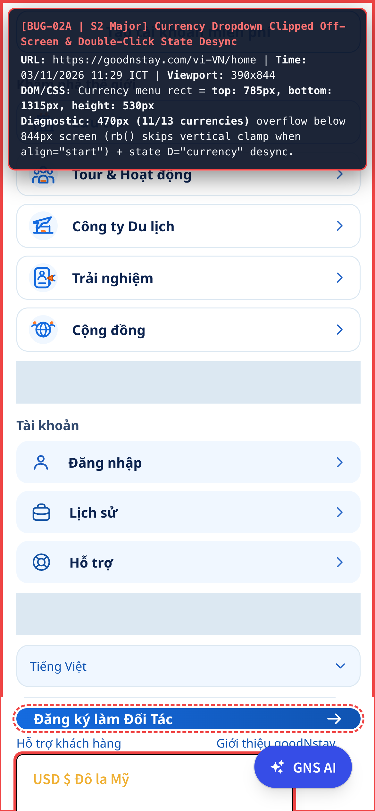
   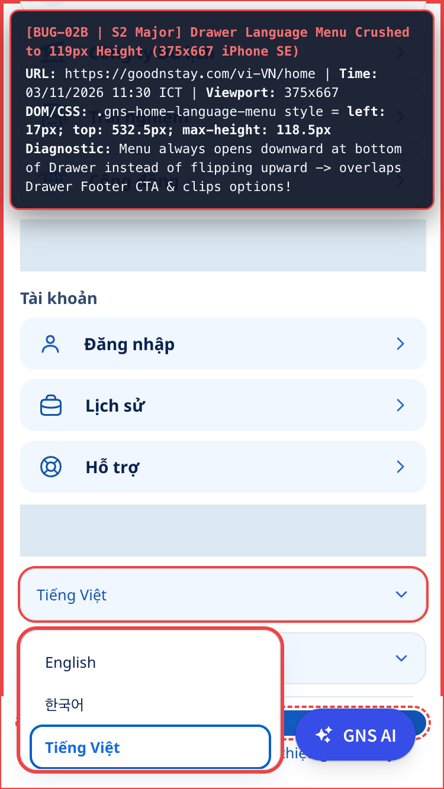
8. **Classification**:
   - **Category**: Functional / Responsive / State Management
9. **Severity & Reproducibility**:
   - **Severity**: **S2 — Major**
   - **Reproducibility**: Luôn luôn (100% — 5/5 lần thử)

---

### BUG-03: `[Global Home - Header & Drawer Links] "Đăng ký làm Đối Tác" Points to Staging URL (partners.stag.goodnstay.com/en-US) & Support/About Links Hardcode en-US on /vi-VN/home`

1. **Title**: `[Global Home - Header & Drawer Links] "Đăng ký làm Đối Tác" Points to Staging URL (partners.stag.goodnstay.com/en-US) & Support/About Links Hardcode en-US on /vi-VN/home`
2. **Environment**:
   - **URL**: `https://goodnstay.com/vi-VN/home`
   - **Browser**: Chrome 156.0.0.0
   - **Viewport**: `1440×900` (và mọi kích thước màn hình)
   - **Test Time**: `03/11/2026 11:33 ICT`
3. **Steps to Reproduce**:
   1. Truy cập `https://goodnstay.com/vi-VN/home` (ngôn ngữ Tiếng Việt `vi-VN`).
   2. Nhấn vào nút **"Đăng ký làm Đối Tác"** trên Header (`.gns-home-header-join`) hoặc trong Drawer (`.gns-home-drawer-join`), và so sánh với link **"Đăng ký làm Đối Tác"** ở dưới Footer.
   3. Mở Hamburger Drawer và nhấn lần lượt vào:
      - **"Hỗ trợ"** (`.gns-home-drawer-account-support`)
      - **"Hỗ trợ khách hàng"** (`.gns-home-drawer-legal-link`)
      - **"Giới thiệu goodNstay"** (`.gns-home-drawer-legal-about`)
4. **Actual Result**:
   - Nút **"Đăng ký làm Đối Tác"** ở cả Header và Drawer đều mở sang **môi trường Staging (STAG) bằng tiếng Anh**: `https://partners.stag.goodnstay.com/en-US` (trong khi link "Đăng ký làm Đối Tác" ở Footer trên cùng trang lại dẫn đúng tới trang Production tiếng Việt `https://goodnstay.com/vi-VN/partner-portal`).
   - Toàn bộ các nút hỗ trợ/giới thiệu trong Drawer đều bị hardcode locale `/en-US` bất chấp người dùng đang ở `/vi-VN/home`:
     - **"Hỗ trợ"** -> mở `https://goodnstay.com/en-US/support/travel-support-assistant`
     - **"Hỗ trợ khách hàng"** -> mở `https://goodnstay.com/en-US/support/faqs`
     - **"Giới thiệu goodNstay"** -> mở `https://optibide.co.kr/en-US/our-product` (trong khi dưới Footer dẫn đúng tới `https://optibide.co.kr/vi-VN/our-product`).
5. **Expected Result**:
   - Trên môi trường Production (`goodnstay.com`), nút **"Đăng ký làm Đối Tác"** ở Header & Drawer phải trỏ về URL Production đúng theo ngôn ngữ hiện tại (`/vi-VN/partner-portal`), đồng nhất với Footer.
   - Các link **"Hỗ trợ"**, **"Hỗ trợ khách hàng"**, và **"Giới thiệu goodNstay"** trong Drawer phải sử dụng biến `locale` động (`/${locale}/...`) thay vì hardcode `/en-US/`.
6. **Chrome DevTools (F12) Console, Network & DOM/CSS Diagnostic**:
   - **JS Bundle (`_next/static/chunks/0y6prjzi0mbdc.js` — hàm `t6(e, t, r)`)**:
     ```js
     case "join-partner":
       return { id: e, kind: "external", label: r, href: "https://partners.stag.goodnstay.com/en-US", note: "English STAG destination from OP-1626 handoff. Do not swap to production.", owningIssue: "OP-1626" };
     case "support":
       return { id: e, kind: "external", label: r, href: "/en-US/support/travel-support-assistant", owningIssue: "OP-1626" };
     case "help-center":
       return { id: e, kind: "external", label: r, href: "/en-US/support/faqs", owningIssue: "OP-1626" };
     case "about":
       return { id: e, kind: "external", label: r, href: "https://optibide.co.kr/en-US/our-product", owningIssue: "OP-1626" };
     ```
7. **Evidence**:
   - File ảnh: [bug03_staging_url_and_locale_mismatch_1440x900.png](file:///Users/iannwendy/Desktop/goodNstay/bug_report_3-11-2026/bug03_staging_url_and_locale_mismatch_1440x900.png)
   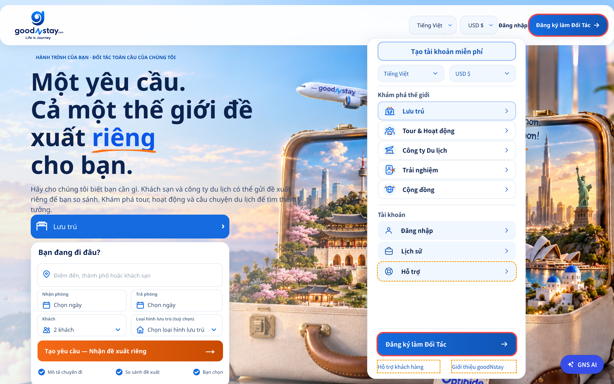
8. **Classification**:
   - **Category**: Functional / Routing / Environment Configuration & i18n
9. **Severity & Reproducibility**:
   - **Severity**: **S2 — Major**
   - **Reproducibility**: Luôn luôn (100% — 5/5 lần thử)

---

### BUG-04: `[Global Home - Guest Drawer] Clicking "Lịch sử" (History) as Guest Silently Closes Drawer with Zero Feedback or Redirect`

1. **Title**: `[Global Home - Guest Drawer] Clicking "Lịch sử" (History) as Guest Silently Closes Drawer with Zero Feedback or Redirect`
2. **Environment**:
   - **URL**: `https://goodnstay.com/vi-VN/home` (Guest Session — chưa đăng nhập)
   - **Browser**: Chrome 156.0.0.0
   - **Viewport**: `1440×900` (và mọi thiết bị)
   - **Test Time**: `03/11/2026 11:33 ICT`
3. **Steps to Reproduce**:
   1. Mở `https://goodnstay.com/vi-VN/home` ở trạng thái chưa đăng nhập (`Guest`).
   2. Nhấn nút Hamburger Menu để mở Drawer.
   3. Nhấn vào mục **"Lịch sử"** (`.gns-home-drawer-account-history`) dưới phần *TÀI KHOẢN & HỖ TRỢ*.
4. **Actual Result**:
   - Drawer tự động đóng lại trong im lặng: **không chuyển hướng sang màn hình Đăng nhập**, **không hiển thị thông báo (toast/modal)** yêu cầu đăng nhập, và **không phát sinh bất kỳ request mạng nào**.
5. **Expected Result**:
   - Khi người dùng chưa đăng nhập nhấn vào **"Lịch sử"**, hệ thống cần chuyển hướng tới luồng Đăng nhập (`signin`) hoặc hiển thị thông báo yêu cầu đăng nhập để xem lịch sử đặt phòng.
6. **Chrome DevTools (F12) Console, Network & DOM/CSS Diagnostic**:
   - **JS Bundle (`_next/static/chunks/0y6prjzi0mbdc.js`)**:
     ```js
     case "history":
       if ("guest" === t) return {
         id: e,
         kind: "guest-history-unresolved",
         label: r,
         note: "UNRESOLVED — Guest History is a Gate A open decision. Row is rendered from Figma 931:175. Do not invent auth redirects or grant access.",
         owningIssue: "OP-1626"
       };
     ```
   - Hàm xử lý `reportGuestHistoryUnresolved: () => { $(!0), M(!1) }` chỉ đổi attribute DOM trên `.gns-home-root` thành `data-gns-home-guest-history="unresolved"` và đóng Drawer (`M(false)`).
7. **Evidence**:
   - File ảnh: [bug04_guest_history_silent_noop_1440x900.png](file:///Users/iannwendy/Desktop/goodNstay/bug_report_3-11-2026/bug04_guest_history_silent_noop_1440x900.png)
   
8. **Classification**:
   - **Category**: Functional / UX / Unfinished Implementation (`OP-1626`)
9. **Severity & Reproducibility**:
   - **Severity**: **S2 — Major**
   - **Reproducibility**: Luôn luôn (100% — 5/5 lần thử)

---

### BUG-05: `[Global Home - Hero Request Form] Empty Check-in/Check-out Bypasses Validation, Missing Date Error Text in Home Mode, 14-Day Max Date Lock & Squashed Inline Error on <1440px`

1. **Title**: `[Global Home - Hero Request Form] Empty Check-in/Check-out Bypasses Validation, Missing Date Error Text in Home Mode, 14-Day Max Date Lock & Squashed Inline Error on <1440px`
2. **Environment**:
   - **URL**: `https://goodnstay.com/vi-VN/home`
   - **Browser**: Chrome 156.0.0.0
   - **Viewports**: Desktop (`1440×900`), Tablet (`768×1024`), Mobile (`390×844`)
   - **Test Time**: `03/11/2026 11:32–11:34 ICT`
3. **Steps to Reproduce**:
   - **Lỗi 5.1 (Bỏ qua kiểm tra ngày khi để trống cả Nhận phòng & Trả phòng)**:
     1. Chọn một Điểm đến hợp lệ từ gợi ý (ví dụ: `Seoul`).
     2. Để trống cả 2 ô **Nhận phòng (`Chọn ngày`)** và **Trả phòng (`Chọn ngày`)**.
     3. Nhấn nút **"Tạo yêu cầu — Nhận đề xuất riêng →"** (`.gns-home-hero-cta`).
   - **Lỗi 5.2 (Thiếu dòng thông báo lỗi khi chỉ chọn ngày Nhận phòng)**:
     1. Chọn Điểm đến và chỉ chọn ngày **Nhận phòng**, không chọn ngày **Trả phòng**, đóng lịch rồi nhấn **"Tạo yêu cầu — Nhận đề xuất riêng →"**.
   - **Lỗi 5.3 (Khoá cứng lịch chỉ cho phép đặt trong vòng 14 ngày tới)**:
     1. Nhấn vào ô **Nhận phòng** để mở lịch (`Stay Calendar`) và thử chọn ngày sau ngày `17/11/2026` (> 14 ngày kể từ ngày hiện tại `03/11/2026`).
   - **Lỗi 5.4 (Vỡ bố cục thông báo lỗi inline trên màn hình `< 1440px`)**:
     1. Trên màn hình `768×1024` (iPad) hoặc `1280×800` (Laptop), để trống hoặc nhập tên điểm đến chưa chọn gợi ý rồi nhấn **"Tạo yêu cầu — Nhận đề xuất riêng →"**.
4. **Actual Result**:
   - **Lỗi 5.1**: Form **không báo lỗi thiếu ngày**, lưu `checkInDate: undefined, checkOutDate: undefined` vào `homePendingBid` và chuyển hướng thẳng sang `/vi-VN/accommodation`.
   - **Lỗi 5.2**: Ô **Trả phòng** chỉ đổi viền sang màu đỏ (`data-invalid="true"`) nhưng **không hiển thị câu thông báo lỗi** `"Vui lòng chọn ngày trả phòng"` trên giao diện.
   - **Lỗi 5.3**: Toàn bộ các ngày trên lịch sau **14 ngày kể từ hôm nay** (`> 17/11/2026`) đều bị vô hiệu hoá (`disabled`), khiến khách du lịch không thể lên kế hoạch đặt phòng trước более 2 tuần.
   - **Lỗi 5.4**: Trên mọi màn hình `< 1440px`, thông báo lỗi `.gns-home-hero-inline-error` (`"Hãy chọn một điểm đến từ gợi ý."`) bị đặt `position: static` nằm ngang cùng hàng flex với thẻ `<input>` bên trong ô `.gns-home-hero-field-destination` cao `54px`, làm ép nhỏ ô nhập liệu và bó chữ thành 2 dòng chật hẹp.
5. **Expected Result**:
   - Bắt buộc kiểm tra cả **Nhận phòng** và **Trả phòng** trước khi cho phép gửi form.
   - Hiển thị đầy đủ text thông báo lỗi cho các trường ngày (`E || D`) ở chế độ `"home"`.
   - Cho phép khách chọn ngày nhận/trả phòng trong tương lai xa (ví dụ 6–12 tháng) thay vì khoá cứng `today + 14 days`.
   - Hiển thị `.gns-home-hero-inline-error` bên dưới ô input hoặc dạng badge tách biệt không làm co hẹp vùng nhập liệu trên màn hình `< 1440px`.
6. **Chrome DevTools (F12) Console, Network & DOM/CSS Diagnostic**:
   - **Bypass Empty Dates (`0y6prjzi0mbdc.js`)**: Trong hàm `O(e, t, r, o)`:
     ```js
     let s = {}, i = v(e), a = v(t);
     if (!(i || a)) return s; // Nếu cả checkIn và checkOut đều rỗng thì trả về {} (không có lỗi)!
     ```
   - **Missing Error Text (`41g5mea609dt7.js`)**: Trong nhánh `if ("home" === R)`, biến lỗi `E = t.checkIn` và `D = t.checkOut` chỉ được dùng để gán `"data-invalid": !!E || void 0` và `"data-invalid": !!D || void 0`, hoàn toàn không được render ra JSX.
   - **14-Day Max Date Lock (`0y6prjzi0mbdc.js`)**:
     ```js
     maxDate: new Date(N.getFullYear(), N.getMonth(), N.getDate() + 14)
     ```
   - **Inline Error CSS (`< 1440px`)**: `@media (max-width: 1439px) { .gns-home .gns-home-hero-inline-error { position: static; transform: none; margin-left: auto; } }` bên trong `.gns-home-hero-field-destination { display: flex; align-items: center; height: 54px; }`.
7. **Evidence**:
   - File ảnh 5A: [bug05a_hero_form_date_validation_and_14day_lock_1440x900.png](file:///Users/iannwendy/Desktop/goodNstay/bug_report_3-11-2026/bug05a_hero_form_date_validation_and_14day_lock_1440x900.png)
   - File ảnh 5B: [bug05b_inline_error_squashed_768x1024.png](file:///Users/iannwendy/Desktop/goodNstay/bug_report_3-11-2026/bug05b_inline_error_squashed_768x1024.png)
   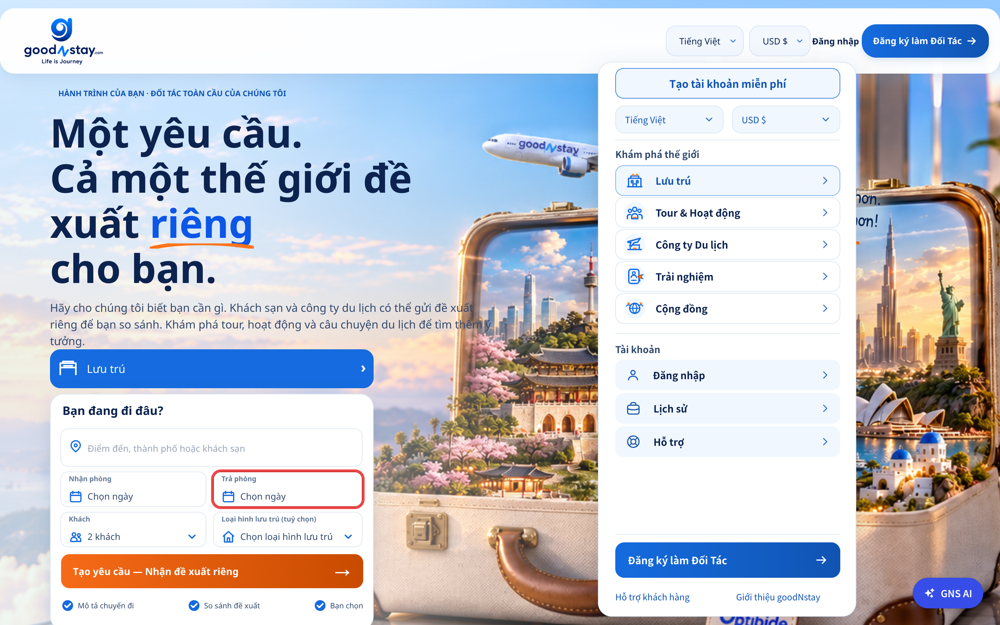
   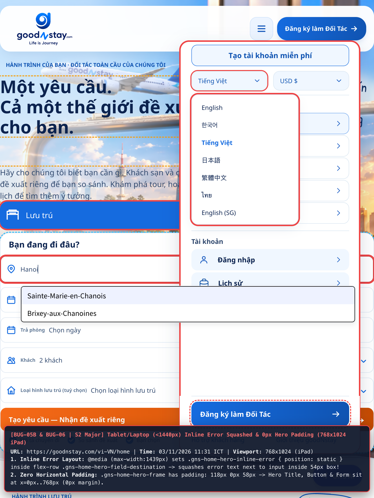
8. **Classification**:
   - **Category**: Functional / Form Validation / Responsive UI
9. **Severity & Reproducibility**:
   - **Severity**: **S2 — Major**
   - **Reproducibility**: Luôn luôn (100% — 5/5 lần thử)

---

### BUG-06: `[Global Home - Hero Responsive] "Lưu trú ›" Button Hardcoded at 466px Width Overflows Mobile Viewport (+92px) & Hero Copy/Form Have 0px Horizontal Padding on <1440px`

1. **Title**: `[Global Home - Hero Responsive] "Lưu trú ›" Button Hardcoded at 466px Width Overflows Mobile Viewport (+92px) & Hero Copy/Form Have 0px Horizontal Padding on <1440px`
2. **Environment**:
   - **URL**: `https://goodnstay.com/vi-VN/home`
   - **Browser**: Chrome 156.0.0.0
   - **Viewports**: Mobile `≤ 757px` (`390×844` iPhone 14, `375×667` iPhone SE, `412×915` Galaxy S23) & Tablet/Laptop `< 1440px` (`768×1024`, `1024×768`, `1280×800`)
   - **Test Time**: `03/11/2026 11:31 ICT`
3. **Steps to Reproduce**:
   1. Mở `https://goodnstay.com/vi-VN/home` trên thiết bị di động `390×844` (iPhone 14) hoặc `375×667` (iPhone SE).
   2. Quan sát phần tiêu đề Hero (`H1`), đoạn mô tả và nút chọn hành trình **"Lưu trú ›"** (`.gns-home-hero-journey`), cùng khung Form bên dưới.
   3. Chuyển sang màn hình Tablet `768×1024` hoặc Laptop `1280×800` và quan sát khoảng cách lề trái/phải của toàn bộ khối Hero.
4. **Actual Result**:
   - **Tràn nút "Lưu trú ›" ra khỏi màn hình Mobile (`≤ 757px`)**: Nút `.gns-home-hero-journey` bị cố định chiều rộng **`width: 466px`** (`left: 16px`, `right: 482px`). Trên màn hình `390px`, nút này **tràn ra ngoài mép phải màn hình 92px** (trên iPhone SE `375px` tràn **107px**), làm mất hoàn toàn phần viền phải và mũi tên `›`.
   - **Mất toàn bộ lề trái/phải (`left: 0px`) cho tiêu đề Hero trên Mobile & Tablet/Laptop (`< 1440px`)**:
     - Trên màn hình `< 1440px`, `.gns-home-hero-frame` có `padding: 118px 0px 58px` (**`0px` padding ngang**).
     - Trên màn hình `≤ 1023px`, `.gns-home-hero-copy` được gán `display: contents`, khiến thuộc tính `margin-left: 16px` của nó trên mobile hoàn toàn vô tác dụng. Hậu quả là dòng chữ *"ĐẶT PHÒNG ĐẤU GIÁ NGƯỢC"*, tiêu đề chính `H1` và đoạn mô tả nằm **sát rạt mép trái màn hình tại `x = 0px`**.
   - **Lệch lề trái/phải của khung Form trên Mobile (`≤ 757px`)**: Khối `.gns-home-hero-request-column` có `margin-left: 16px` cộng thêm `.gns-home-hero-form` có `margin: 8px 12px 0px`, tạo ra **lề trái `28px`** nhưng **lề phải chỉ còn `4px`** (`x: 28px` tới `right: 386px` trên màn hình `390px`).
5. **Expected Result**:
   - Nút `.gns-home-hero-journey` trên màn hình `< 1440px` phải co giãn vừa khít khung chứa (`width: calc(100% - 32px)` hoặc `width: 100%` trong container có padding), hiển thị đầy đủ mũi tên `›`.
   - Khối Hero (`.gns-home-hero-frame`) phải có `padding-inline: 16px` (trên Mobile) và `24px–48px` (trên Tablet/Laptop) để chữ và form căn đều hai bên.
6. **Chrome DevTools (F12) Console, Network & DOM/CSS Diagnostic**:
   - **Xung đột độ ưu tiên CSS (Specificity Conflict)**:
     - Rule gốc: `.gns-home .gns-home-hero-request-column .gns-home-hero-journey { width: 466px; }` -> Specificity = **`(0, 3, 0)`**.
     - Media query: `@media (max-width: 757px) { .gns-home .gns-home-hero-journey { width: 100%; } }` -> Specificity = **`(0, 2, 0)`** (thấp hơn `(0, 3, 0)` nên bị rule `width: 466px` đè hoàn toàn!).
   - **`display: contents` vô hiệu hoá margin**:
     - `@media (max-width: 1023px) { .gns-home .gns-home-hero-copy { display: contents; } }` làm phần tử `.gns-home-hero-copy` không tạo box, nên `margin-left: 16px` trong `@media (max-width: 757px)` không có tác dụng.
7. **Evidence**:
   - File ảnh: [bug06_mobile_hero_overflow_466px_390x844.png](file:///Users/iannwendy/Desktop/goodNstay/bug_report_3-11-2026/bug06_mobile_hero_overflow_466px_390x844.png)
   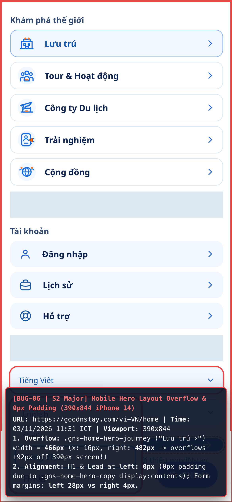
8. **Classification**:
   - **Category**: Responsive / CSS Specificity & Box Model Bug
9. **Severity & Reproducibility**:
   - **Severity**: **S2 — Major**
   - **Reproducibility**: Luôn luôn (100% — 5/5 lần thử)

---

### BUG-07: `[Global Home - Destination Carousel] Unclamped Parallax Shifts Photos Out of Bounds (73px Blank Strip) & Card Flip Reveals Empty Back Face with Disabled CTA`

1. **Title**: `[Global Home - Destination Carousel] Unclamped Parallax Shifts Photos Out of Bounds (73px Blank Strip) & Card Flip Reveals Empty Back Face with Disabled CTA`
2. **Environment**:
   - **URL**: `https://goodnstay.com/vi-VN/home`
   - **Browser**: Chrome 156.0.0.0
   - **Viewport**: `1440×900` (và mọi kích thước màn hình)
   - **Test Time**: `03/11/2026 11:34 ICT`
3. **Steps to Reproduce**:
   1. Cuộn xuống section **"NHỮNG NƠI KHIẾN BẠN MUỐN LÊN ĐƯỜNG"** (`.gns-home-dest-viewport`).
   2. Quan sát ảnh nền của các thẻ điểm đến nằm ở phía bên phải carousel (ví dụ thẻ **Barcelona** và **Athens**).
   3. Nhấn chuột vào bất kỳ thẻ điểm đến nào (ví dụ **Barcelona** hoặc **Rome**) để lật thẻ (`flip`).
4. **Actual Result**:
   - **Hở khoảng trống đen bên trong thẻ ảnh (Parallax Blank Gap)**: Ảnh nền bên trong thẻ **Barcelona** bị dịch sang trái `-57.33px` (để lộ **vệt trống 32px** bên phải thẻ), và thẻ **Athens** bị dịch sang trái **`-98.19px`**, để lộ **một mảng trống màu tối rộng tới `73px` (chiếm hơn 1/3 chiều rộng thẻ `211px`)** không có ảnh!
   - **Lật thẻ ra mặt sau trống rỗng & nút CTA bị ẩn/vô hiệu hoá**: Khi nhấn vào thẻ, thẻ xoay 3D (`rotateY(180deg)`) sang mặt sau (`.gns-home-dest-face-back`), nhưng mặt sau chỉ hiển thị một nền màu xanh đậm trống trơn lặp lại đúng dòng chữ tiêu đề mặt trước, còn nút **`"Chọn điểm đến này"`** (`button.gns-home-dest-cta`) bị ẩn hoàn toàn (`display: none`) và `aria-disabled="true"`.
5. **Expected Result**:
   - Hiệu ứng dịch chuyển ảnh parallax (`translateX`) phải được giới hạn (`Math.max(-maxShift, Math.min(maxShift, g))`) trong phạm vi tràn biên (`inset: 0 -12%` tương đương `±25px`) để ảnh luôn phủ kín 100% diện tích thẻ.
   - Mặt sau của thẻ khi lật phải hiển thị thông tin mô tả điểm đến cùng nút CTA **"Chọn điểm đến này"** hoạt động được (điền điểm đến vào Hero Form hoặc chuyển sang trang tìm kiếm).
6. **Chrome DevTools (F12) Console, Network & DOM/CSS Diagnostic**:
   - **JS Bundle (`0y6prjzi0mbdc.js` — hàm `Q()`)**:
     ```js
     let u = 0 === r ? 620 : 211,
         g = (a / 2 - (m + e + u / 2)) * .18;
     c.style.transform = `translate3d(${g.toFixed(2)}px, 0, 0)`;
     ```
     Giá trị `g` không hề được clamp theo biên độ `12%` (`211 * 0.12 = 25.32px`) của `.gns-home-dest-photo-shift { inset: 0px -12%; }`. Với thẻ Athens, `g = -98.19px`, vượt quá biên dự phòng `25.32px` tới **`72.87px`**! Ngoài ra trên mobile (`≤ 1439px`), tất cả các thẻ đều rộng `220px` nhưng hàm `Q()` vẫn tính cứng thẻ đầu tiên rộng `620px`, làm lệch tâm parallax trên toàn bộ thiết bị di động và tablet.
   - **CSS & DOM Mặt sau thẻ**: `.gns-home .gns-home-dest-cta { display: none; }` và `<button class="gns-home-dest-cta" aria-disabled="true">Chọn điểm đến này</button>`.
7. **Evidence**:
   - File ảnh: [bug07_dest_carousel_parallax_gap_and_broken_flip_1440x900.png](file:///Users/iannwendy/Desktop/goodNstay/bug_report_3-11-2026/bug07_dest_carousel_parallax_gap_and_broken_flip_1440x900.png)
   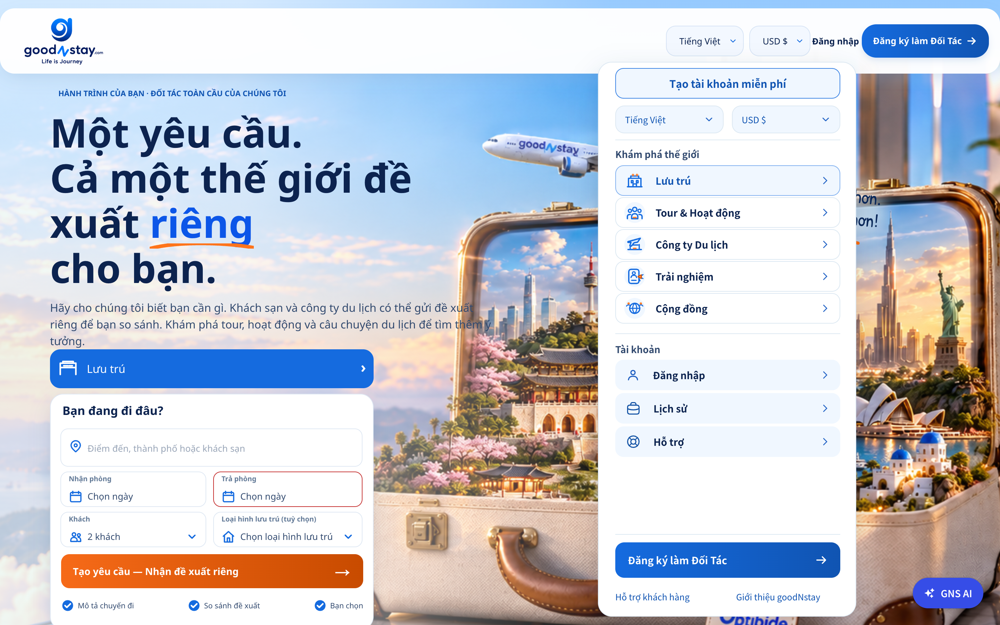
8. **Classification**:
   - **Category**: UI / Visual Math Bug / Unfinished Interaction
9. **Severity & Reproducibility**:
   - **Severity**: **S2 — Major**
   - **Reproducibility**: Luôn luôn (100% — 5/5 lần thử)

---

### BUG-08: `[Global Home - Section CTAs & Cards] Partner Network Cards, Inspiration/Community CTAs & Marketplace Cards Are Non-Functional (aria-disabled="true") with Zero Feedback`

1. **Title**: `[Global Home - Section CTAs & Cards] Partner Network Cards, Inspiration/Community CTAs & Marketplace Cards Are Non-Functional (aria-disabled="true") with Zero Feedback`
2. **Environment**:
   - **URL**: `https://goodnstay.com/vi-VN/home`
   - **Browser**: Chrome 156.0.0.0
   - **Viewport**: `1440×900` (và mọi thiết bị)
   - **Test Time**: `03/11/2026 11:35 ICT`
3. **Steps to Reproduce**:
   1. Cuộn tới section **"CẢM HỨNG & CỘNG ĐỒNG"** và nhấn vào 2 nút CTA lớn:
      - **"Khám phá cảm hứng du lịch →"** (`button.gns-home-inspire-cta`)
      - **"Khám phá cộng đồng →"** (`button.gns-home-inspire-cta-warm`)
   2. Cuộn tới section **"PHÁT TRIỂN CÙNG goodNstay · MẠNG LƯỚI ĐỐI TÁC"** (nơi có dòng hướng dẫn *"Chọn loại hình kinh doanh để xem lộ trình hợp tác phù hợp"*) và nhấn vào 4 thẻ/nút mũi tên `→` (**Lưu trú**, **Tour & Hoạt động**, **Công ty Du lịch**, **Trải nghiệm**).
   3. Cuộn tới section **"KHÁM PHÁ MARKETPLACE goodNstay"** và nhấn vào 5 thẻ dịch vụ.
4. **Actual Result**:
   - Tất cả các nút và thẻ nêu trên đều **hoàn toàn chết (dead buttons)**: khi nhấn vào không có bất kỳ phản hồi nào (không mở trang, không mở modal "Sắp ra mắt", không cuộn trang), dù giao diện hiển thị như các nút bấm chính thức hoặc có hiệu ứng nghiêng 3D khi rê chuột.
   - Đáng chú ý, khi nhấn vào *Trải nghiệm* hoặc *Cộng đồng* ở Header/Drawer/Footer thì hệ thống mở modal **"Sắp ra mắt"** (`showComingSoon`), nhưng 2 nút CTA chính **"Khám phá cảm hứng du lịch →"** và **"Khám phá cộng đồng →"** ngay giữa trang chủ lại bị vô hiệu hoá im lặng.
5. **Expected Result**:
   - Các nút CTA thuộc tính năng sắp ra mắt (*Cảm hứng du lịch*, *Cộng đồng*, *Tour & Hoạt động*, *Công ty Du lịch*) phải kích hoạt modal **"Sắp ra mắt"** (`showComingSoon`) đồng nhất với Header/Footer, và thẻ **Lưu trú** / **Đối tác** phải điều hướng tới luồng Lưu trú hoặc trang Đối tác (`/vi-VN/partner-portal`).
6. **Chrome DevTools (F12) Console, Network & DOM/CSS Diagnostic**:
   - Toàn bộ thẻ gốc `.gns-home-root` có attribute `data-gns-home-pending="section-interactions"`.
   - Trong `0y6prjzi0mbdc.js`, các nút `.gns-home-inspire-cta`, `.gns-home-partner-arrow`, `.gns-home-market-arrow`, `.gns-home-dest-cta` đều được render qua helper component `<E>`:
     ```js
     function E({children: e, className: r, ...o}) {
       return (0, t.jsx)("button", { ...o, "aria-disabled": "true", className: r, type: "button", children: e });
     }
     ```
     không gắn `onClick` handler và bị CSS gán `cursor: default`.
7. **Evidence**:
   - File ảnh: [bug08_dead_ctas_inspire_partner_marketplace_1440x900.png](file:///Users/iannwendy/Desktop/goodNstay/bug_report_3-11-2026/bug08_dead_ctas_inspire_partner_marketplace_1440x900.png)
   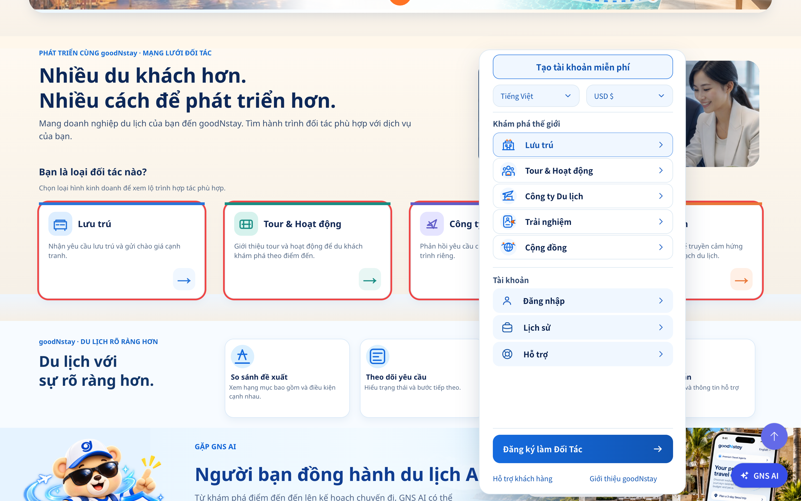
8. **Classification**:
   - **Category**: Functional / UX / Unwired Section Interactions
9. **Severity & Reproducibility**:
   - **Severity**: **S2 — Major**
   - **Reproducibility**: Luôn luôn (100% — 5/5 lần thử)

---

### BUG-09: `[Global Home - Signed-In Notifications & F12] Hardcoded Drawer Badge ("1" vs Actual "2"), Unclipped Floating Bell Button, Duplicate Notification API Calls & FocusTrap Warning`

1. **Title**: `[Global Home - Signed-In Notifications & F12] Hardcoded Drawer Badge ("1" vs Actual "2"), Unclipped Floating Bell Button, Duplicate Notification API Calls & FocusTrap Warning`
2. **Environment**:
   - **URL**: `https://goodnstay.com/vi-VN/home`
   - **Account**: `TEST_BAOMINH` (`baominh.internship@gmail.com` — `data-gns-home-session="signed-in"`)
   - **Browser**: Chrome 156.0.0.0
   - **Viewport**: `1440×900` (và mọi thiết bị khi đã đăng nhập)
   - **Test Time**: `03/11/2026 11:40–11:42 ICT`
3. **Steps to Reproduce**:
   1. Đăng nhập với tài khoản `TEST_BAOMINH` và truy cập `https://goodnstay.com/vi-VN/home`.
   2. Mở Chrome DevTools (**F12** -> tab **Console** & **Network**).
   3. Nhấn nút Hamburger Menu để mở Drawer và quan sát số badge màu xanh bên cạnh mục **"Thông báo"** (`.gns-home-drawer-account-notifications`).
   4. Nhấn vào mục **"Thông báo"** trong Drawer và quan sát:
      - Góc trên bên phải màn hình (`top: 120px, right: 72px`) nơi bảng thông báo mở ra.
      - Các request mạng trong tab **F12 Network** và cảnh báo trong tab **F12 Console**.
      - Nhấn ra ngoài hoặc nhấn vào biểu tượng chuông để đóng danh sách thông báo và cuộn trang.
4. **Actual Result**:
   - **Lỗi 9.1 (Hardcode số thông báo chưa đọc `badge: 1` trong Drawer)**: Trong Drawer, mục **"Thông báo"** luôn hiển thị số **`1`** (`<span class="gns-home-drawer-badge">1</span>`), trong khi API thực tế trả về **`2`** thông báo chưa đọc (`{"data":{"count":2}}`). Kể cả khi người dùng có `0` hay `99` thông báo, Drawer vẫn luôn hiển thị số `1` giả định.
   - **Lỗi 9.2 (Nút chuông thông báo trôi nổi lơ lửng giữa màn hình không biến mất)**: Khi nhấn **"Thông báo"** trong Drawer, Drawer đóng lại và hệ thống mount `<NotificationBell />` tại vị trí cố định `position: fixed; top: 120px; right: 72px;`. Do thiếu CSS ẩn nút trigger nội bộ (không giống `.gns-home-host-preference-currency` đã được clip `1x1px`), một **nút hình quả chuông màu trắng kích thước `36×36px` xuất hiện lơ lửng giữa không trung** đè lên ảnh Hero bên dưới Header. Khi đóng danh sách thông báo, nút chuông lơ lửng này **vẫn dính cứng vĩnh viễn trên màn hình** khi người dùng cuộn trang!
   - **Lỗi 9.3 (Gọi trùng lặp API Notification & trả về nội dung/deepLink tiếng Anh trên trang Tiếng Việt)**:
     - Tab **F12 Network** ghi nhận hệ thống bắn **2 lần liên tiếp (duplicate requests)** cho cả `GET /api/v1/notifications/unread-count` và `GET /api/v1/notifications?limit=5` ngay khi mở thông báo.
     - Request `GET /api/v1/notifications/unread-count` gửi thiếu header `accept-language: vi-VN` (chỉ gửi mặc định `en-US,en;q=0.9`).
     - Dù `GET /api/v1/notifications?limit=5` có gửi `accept-language: vi-VN`, nội dung thông báo hiển thị toàn bộ bằng tiếng Anh (`"Request cancelled"`, `"You cancelled this accommodation request..."`) và trường `data.deepLink` bị gán cứng `"/en-US"` (khi click vào thông báo sẽ bị đá từ `/vi-VN` sang `/en-US`).
   - **Lỗi 9.4 (Cảnh báo F12 Console `<FocusTrap />`)**: Tab **F12 Console** xuất hiện cảnh báo:
     `[warn] There are no focusable elements inside the <FocusTrap />` (`3rp131fq4h0w7.js:43:6336`).
5. **Expected Result**:
   - Số badge ở mục **"Thông báo"** trong Drawer phải lấy dữ liệu thực từ API `GET /api/v1/notifications/unread-count` (ẩn badge nếu `count === 0`).
   - Nút trigger nội bộ của `<NotificationBell />` bên trong `.gns-home-host-preference-notifications` phải được ẩn bằng CSS (tương tự `.gns-home-host-preference-currency > div > button`) và unmount khi người dùng đóng bảng thông báo.
   - Không gọi trùng lặp API thông báo; nội dung thông báo và `deepLink` phải tôn trọng ngôn ngữ hiện tại (`/vi-VN`).
6. **Chrome DevTools (F12) Console, Network & DOM/CSS Diagnostic**:
   - **Hardcoded Badge (`_next/static/chunks/0y6prjzi0mbdc.js`)**:
     ```js
     { id: "notifications", icon: "icon-notifications.svg", badge: 1 }
     ```
   - **Missing CSS Clip cho Notification Host**:
     - Đã có: `.gns-home .gns-home-host-preference-currency > div > button { clip: rect(0px, 0px, 0px, 0px); width: 1px; height: 1px; padding: 0px; position: absolute; overflow: hidden; }`
     - Bị thiếu: Rule tương ứng cho `.gns-home .gns-home-host-preference-notifications > div > button`.
   - **F12 Network Log**:
     - `reqid=874 GET https://services.goodnstay.com/api/v1/notifications/unread-count [200]` -> `{"data":{"count":2}}`
     - `reqid=875 GET https://services.goodnstay.com/api/v1/notifications?limit=5 [200]`
     - `reqid=876 GET https://services.goodnstay.com/api/v1/notifications/unread-count [200]` (Duplicate)
     - `reqid=877 GET https://services.goodnstay.com/api/v1/notifications?limit=5 [200]` (Duplicate)
   - **F12 Console Log**:
     - `warn> There are no focusable elements inside the <FocusTrap /> (at 3rp131fq4h0w7.js:43:6336)`
7. **Evidence**:
   - File ảnh 9A: [bug09_signed_in_hardcoded_badge_and_floating_bell_1440x900.png](file:///Users/iannwendy/Desktop/goodNstay/bug_report_3-11-2026/bug09_signed_in_hardcoded_badge_and_floating_bell_1440x900.png)
   - File ảnh 9B: [bug09b_drawer_hardcoded_badge_1_signed_in_1440x900.png](file:///Users/iannwendy/Desktop/goodNstay/bug_report_3-11-2026/bug09b_drawer_hardcoded_badge_1_signed_in_1440x900.png)
   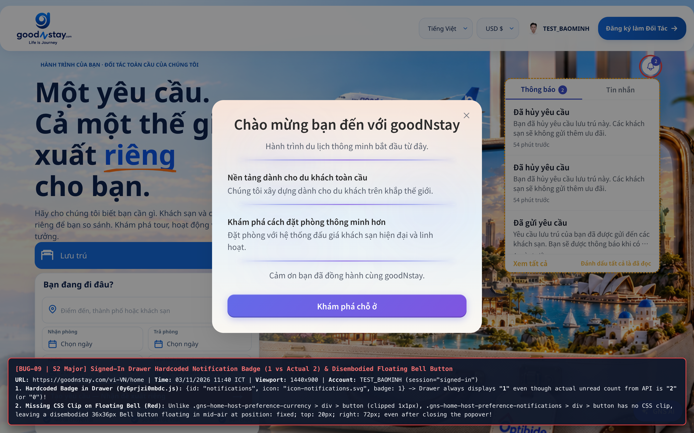
   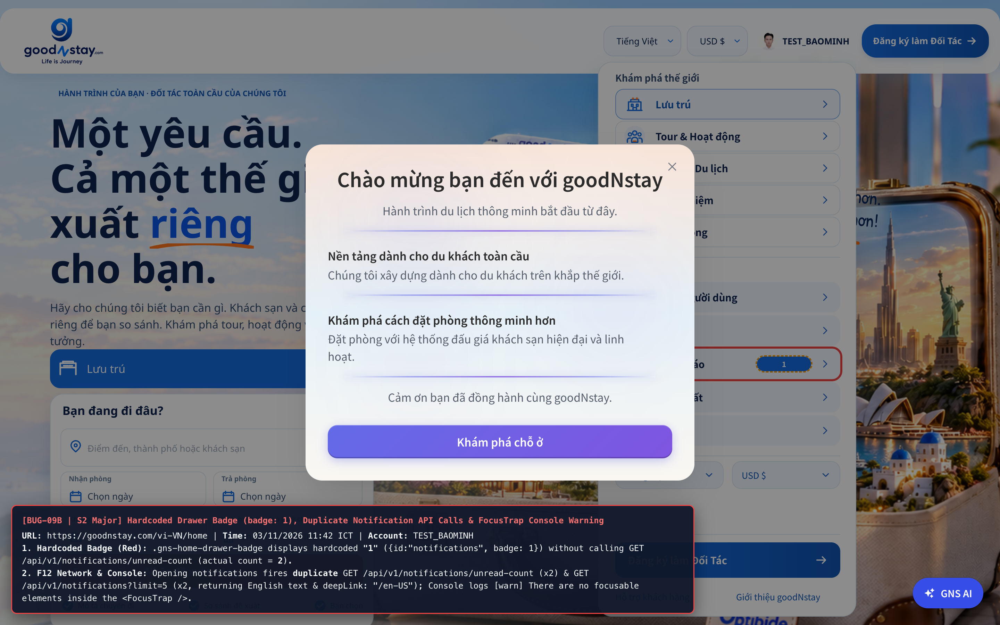
8. **Classification**:
   - **Category**: Functional / API Integration / CSS / Console Warning
9. **Severity & Reproducibility**:
   - **Severity**: **S2 — Major**
   - **Reproducibility**: Luôn luôn (100% — 5/5 lần thử)
