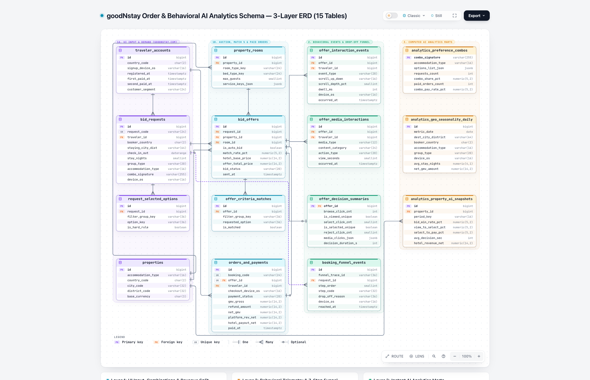
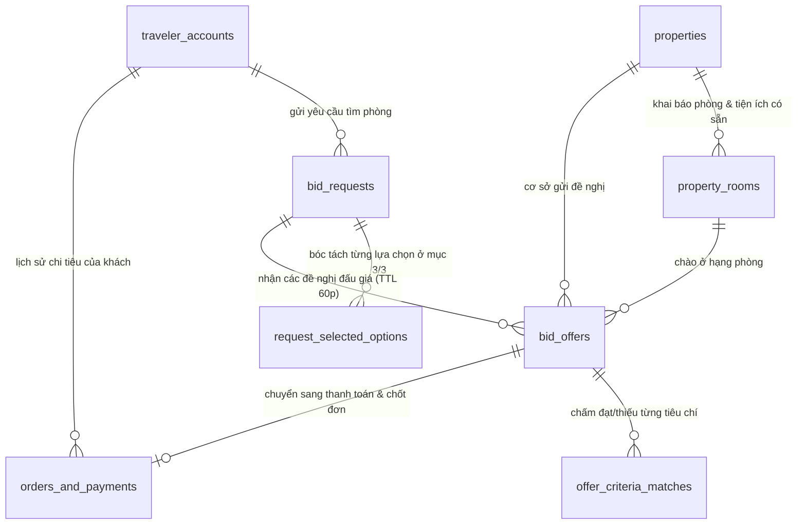
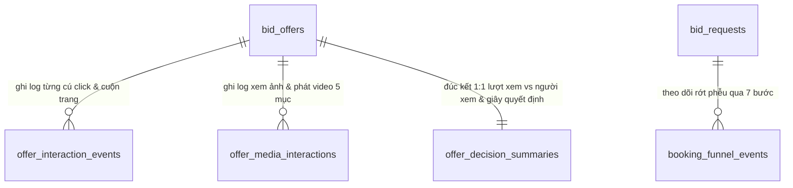

# Đặc Tả Hệ Thống Bảng Dữ Liệu & ERD Phục Vụ AI Phân Tích Hành Vi, Đấu Giá & Đơn Hàng (`goodNstay.com` $\rightarrow$ AI Analytics)

> **Mục tiêu tài liệu**: Thiết kế bộ bảng cơ sở dữ liệu chuẩn hóa (tách thành **3 nhóm dữ liệu: Giao diện · Hành vi · Tính toán**, gồm **15 bảng cốt lõi**) lấy trực tiếp từ luồng đặt phòng trên `goodNstay.com` (`/accommodation`, bao gồm toàn bộ các mục chọn ở bước `1/3`, `2/3`, `3/3` như hình chụp thực tế) nhằm lưu trữ đầy đủ nguồn dữ liệu cho **AI phân tích và trả lời chính xác 16 bài toán kinh doanh**.

---

## 0. Bộ Sơ Đồ ERD Trực Quan Đính Kèm

- **Sơ đồ ERD Tương tác 3 Tầng Dữ Liệu (HTML độc lập — bấm lọc riêng từng tầng *1. UI Input & Orders*, *2. Behavioral & Funnel*, *3. Computed AI Marts*, hỗ trợ Sáng/Tối)**:  
  [`goodnstay_ai_analytics_erd.html`](../diagrams/goodnstay_ai_analytics_erd.html)
- **File Thiết kế `Draw.io` 2 Trang (Trang 1: Kiến trúc 3 nhóm dữ liệu giải quyết 16 bài toán · Trang 2: Sơ đồ ERD 15 bảng chi tiết)**:  
  [`goodnstay_ai_analytics_erd.drawio`](../diagrams/goodnstay_ai_analytics_erd.drawio)
- **Ảnh Poster ERD Độ Phân Giải Cao (`2048×1320`)**:  
  - Nền sáng: [`goodnstay_ai_analytics_erd.png`](../diagrams/goodnstay_ai_analytics_erd.png) · Nền tối: [`goodnstay_ai_analytics_erd_dark.png`](../diagrams/goodnstay_ai_analytics_erd_dark.png)

---

## 1. Ma Trận Truy Vết 16 Câu Hỏi Kinh Doanh $\leftrightarrow$ Bảng & Trường Lưu Trữ Chính Xác

Mọi câu hỏi của Ban điều hành và mô-đun AI đều có điểm lấy dữ liệu xác định, không suy đoán:

| # | Nhóm phân tích | Câu hỏi kinh doanh cần giải quyết | Bảng lưu trữ gốc & Bảng tổng hợp AI | Trường dữ liệu trả lời trực tiếp |
| :---: | :--- | :--- | :--- | :--- |
| **1** | **Hành vi người dùng** | Khách click nút `Xem`, `Chọn`, `Từ chối` bao nhiêu lần? *(Tách lượt click vs người/đề nghị duy nhất)* | `offer_interaction_events` $\rightarrow$ `offer_decision_summaries` | `event_type` (`CLICK_BROWSE`, `CLICK_SELECT`, `CLICK_REJECT`), `browse_click_cnt` vs `is_viewed_unique` |
| **2** | **Tương tác nội dung** | Khách xem ảnh, video *(khuôn viên, tiện ích, ẩm thực, phòng, gần đó)*, đọc mô tả & cuộn lên/xuống bao nhiêu lần? | `offer_media_interactions` + `offer_interaction_events` | `media_type` (`image`/`video`), `content_category` (5 mục), `scroll_up_count`, `scroll_down_count`, `dwell_ms` |
| **3** | **Thời gian quyết định** | Khách mất bao lâu từ lúc xem đề nghị đến khi bấm Chọn hoặc Từ chối? | `offer_decision_summaries` | `first_viewed_at`, `final_decision_at`, `decision_duration_seconds` |
| **4** | **Đấu giá** | Tỷ lệ đấu giá thành công và thất bại là bao nhiêu? | `bid_offers` $\rightarrow$ `analytics_property_ai_snapshots` | `bid_status` (`accepted_paid` vs `rejected`, `expired`, `selected_unpaid`, `cancelled`) |
| **5** | **Chuyển đổi (Phễu)** | Khách thường bỏ cuộc ở bước nào trước khi thanh toán? | `booking_funnel_events` | `step_order` (`1..7`), `step_code`, `drop_off_reason` |
| **6** | **Khách hàng mới** | Từ lúc bấm đăng ký đến thanh toán đầu tiên mất bao lâu? *(Khách thật hay tạo TK để đó?)* | `traveler_accounts` | `registered_at`, `first_paid_at`, `days_to_first_payment`, `customer_segment` (`dormant_signup`...) |
| **7** | **Khách hàng quay lại** | Khoảng cách giữa lần thanh toán thứ nhất và thứ hai là bao lâu? | `traveler_accounts` + `orders_and_payments` | `first_paid_at`, `second_paid_at`, `days_between_1st_2nd_payment` |
| **8** | **Sở thích lưu trú** | Loại hình `Hotel`, `Apartment`, `Villa`, `Resort` hay `Pension` được chọn nhiều nhất? | `bid_requests` + `orders_and_payments` | `accommodation_type` (`hotel` \| `apartment` \| `villa` \| `resort` \| `pension`) |
| **9** | **Tổ hợp tiện ích** | Những tổ hợp *(VD: Hotel + Standard + Giường đôi + Thú cưng + Hồ bơi + Thang máy)* phổ biến nhất? | `request_selected_options` + `bid_requests` $\rightarrow$ `analytics_preference_combos` | `filter_group_key`, `option_key`, `combo_signature`, `combo_share_pct` |
| **10** | **Quy mô nhóm** | Khách thường đi một mình, cặp đôi, gia đình hay nhóm đông? | `bid_requests` $\rightarrow$ `analytics_geo_seasonality_daily` | `adults_count`, `children_count`, `infants_count`, `pets_count`, `room_count` $\rightarrow$ `group_type` |
| **11** | **Doanh thu** | Tổng giá trị đặt phòng (`GMV`), doanh thu nền tảng và doanh thu thực nhận khách sạn là bao nhiêu? | `orders_and_payments` | `gmv_gross`, `refund_amount`, `net_gmv`, `platform_rev_net`, `hotel_payout_net` *(chỉ cộng đơn `paid`)* |
| **12** | **Mức độ phù hợp** | Đề nghị của khách sạn khớp bao nhiêu phần trăm với yêu cầu khách? | `bid_offers` + `offer_criteria_matches` | `matched_criteria_count`, `total_criteria_count`, `match_rate_pct`, `is_matched` |
| **13** | **Thiết bị** | Điện thoại `Android` hay `iOS` có tỷ lệ chốt thanh toán cao hơn? | `bid_requests` + `booking_funnel_events` + `orders_and_payments` | `device_os` / `checkout_device_os` (`ios` \| `android` \| `desktop_web` \| `mobile_web`) |
| **14** | **Địa lý** | Quốc gia, thành phố, quận nào được đặt nhiều nhất? Và khách từ quốc gia nào đặt nhiều nhất? | `bid_requests` + `orders_and_payments` $\rightarrow$ `analytics_geo_seasonality_daily` | **Điểm đến**: `staying_country/province/city/district` · **Người đặt**: `booker_country_code` |
| **15** | **Mùa vụ** | Khách thường đặt phòng và đi du lịch vào khoảng thời gian nào trong năm? | `bid_requests` + `orders_and_payments` | Mùa đặt: `created_at` / `paid_at` · Mùa đi: `check_in_date` · Đặt trước: `lead_time_days` |
| **16** | **Thời gian lưu trú** | Khách thường ở bao nhiêu đêm? | `bid_requests` + `orders_and_payments` | `stay_nights` (`= check_out_date - check_in_date`) |

---

## 2. Ba Ranh Giới Dữ Liệu Bắt Buộc Tách Bạch Trong Thiết Kế Bảng (Tránh Sai Lệch Số Liệu AI)

1. **Phân biệt `Lượt xem (Total Clicks)` $\neq$ `Người xem (Unique Viewers)` $\neq$ `Đề nghị được xem (Unique Viewed Offers)`**:
   - Một du khách mở ra đóng vào nút **`Browse (Xem)`** trên cùng 1 đề nghị 5 lần $\rightarrow$ `browse_click_cnt = 5` (*5 lượt click*), nhưng `is_viewed_unique = true` (*1 đề nghị được xem*) và `COUNT(DISTINCT traveler_id) = 1` (*1 người xem*). Mọi công thức tỷ lệ chuyển đổi `%` bắt buộc lấy theo **đơn vị duy nhất (`Unique`)** để không bao giờ xảy ra tỷ lệ vượt quá `100%` hoặc bị loãng mẫu số.
2. **Phân biệt `Đề nghị được chọn (Selected Offer)` $\neq$ `Booking đã thanh toán (Paid Booking)`**:
   - Bấm nút **`Select (Chọn)`** chỉ mới mở màn hình thanh toán (`bid_offers.bid_status = 'selected_unpaid'` hoặc `orders_and_payments.payment_status = 'initiated'/'abandoned'`).
   - Chỉ khi tiền đã thu thành công (`orders_and_payments.payment_status IN ('paid', 'refunded_partial')`) mới được tính là **Booking đã thanh toán** và mới được cộng vào sản lượng doanh thu.
3. **Phân biệt 3 Tầng Tiền Tệ (`GMV` $\neq$ `Doanh thu Nền tảng` $\neq$ `Doanh thu Khách sạn`)**:
   - **`GMV` (`net_gmv`)**: Tổng số tiền du khách đã thanh toán thành công (bao gồm giá gốc phòng + phí nền tảng + thuế GTGT), **đã trừ đi phần tiền hoàn lại (`refund_amount`)** nếu phát sinh hủy/hoàn hợp lệ.
   - **`Doanh thu Nền tảng` (`platform_rev_net`)**: Phần phí dịch vụ/hoa hồng nền tảng thực sự giữ lại sau khi điều chỉnh hoàn tiền (không gộp tiền trả hộ cho khách sạn hay thuế hộ).
   - **`Doanh thu Thực nhận của Khách sạn` (`hotel_payout_net`)**: 100% phần giá phòng gốc (`hotel_base_price`) của các đơn đã thanh toán thành công (trừ hoàn tiền ngoại lệ nếu có).

---

## 3. Chi Tiết Cấu Trúc 15 Bảng Chia Theo 3 Nhóm Dữ Liệu

---

### NHÓM 1: Dữ Liệu Giao Diện & Đơn Hàng Gốc Từ `goodNstay.com` (8 Bảng)
*(Thu thập toàn bộ thông tin tài khoản, lựa chọn trên form `1/3 - 2/3 - 3/3`, đề nghị chào giá của khách sạn, độ khớp từng tiêu chí và kết quả thanh toán)*

#### 3.1.1 Sơ đồ ERD Nhóm 1

#### 3.1.2 Đặc tả chi tiết 8 bảng Nhóm 1

##### Bảng 1: `traveler_accounts` — Hồ sơ & Chu kỳ Chuyển đổi Khách hàng
*Giải quyết câu hỏi: Từ lúc đăng ký đến thanh toán đầu tiên mất bao lâu? Tạo tài khoản xong để đó hay khách thật? Khoảng cách giữa lần thanh toán thứ 1 và thứ 2?*

| Tên trường | Kiểu dữ liệu | Khóa | Ý nghĩa & Cách dùng cho AI phân tích |
| :--- | :--- | :---: | :--- |
| `id` | `bigint` | `PK` | Mã định danh duy nhất của người dùng trên `goodNstay.com`. |
| `country_code` | `char(2)` | — | Quốc gia đăng ký trong hồ sơ người dùng (`VN`, `KR`, `US`, `JP`...). |
| `signup_device_os` | `varchar(16)` | — | Hệ điều hành lúc tạo tài khoản (`ios` \| `android` \| `desktop_web` \| `mobile_web`). |
| `registered_at` | `timestamptz` | — | Thời điểm bấm hoàn tất đăng ký tài khoản. |
| `first_request_at` | `timestamptz` | — | Thời điểm gửi yêu cầu đấu giá đầu tiên (`NULL` nếu tạo TK xong chưa từng hỏi phòng). |
| `first_paid_at` | `timestamptz` | — | Thời điểm hoàn tất **thanh toán thành công đầu tiên** (`First Payment`). |
| `second_paid_at` | `timestamptz` | — | Thời điểm hoàn tất **thanh toán thành công lần thứ 2** (đo lường khách quay lại). |
| `days_to_first_payment` | `numeric(8,2)` | — | Số ngày (hoặc giờ `/24`) từ `registered_at` đến `first_paid_at`. |
| `days_between_1st_2nd_payment` | `numeric(8,2)` | — | Khoảng cách ngày giữa `second_paid_at` và `first_paid_at`. |
| `paid_orders_count` | `int` | — | Tổng số đơn đã thanh toán thành công lũy kế. |
| `customer_segment` | `varchar(24)` | — | Phân tệp tự động: `'dormant_signup'` *(tạo TK để đó)*, `'request_only_unpaid'` *(có hỏi phòng nhưng chưa mua)*, `'one_time_buyer'`, `'repeat_buyer'`. |

---

##### Bảng 2: `bid_requests` — Thông tin Yêu cầu Đặt phòng Khách nhập trên Form (`1/3`, `2/3`, `3/3`)
*Giải quyết câu hỏi: Địa lý điểm đến vs quốc gia người đặt, Mùa vụ đặt & đi, Thời gian lưu trú (mấy đêm), Quy mô nhóm (1 mình / cặp đôi / gia đình / nhóm đông), Loại lưu trú (`Hotel / Apartment / Villa / Resort / Pension`), Chữ ký Tổ hợp tiện ích & Thiết bị!*

| Tên trường | Kiểu dữ liệu | Khóa | Ý nghĩa & Cách dùng cho AI phân tích |
| :--- | :--- | :---: | :--- |
| `id` | `bigint` | `PK` | ID yêu cầu gốc (VD: `1502`). |
| `request_code` | `varchar(24)` | `UK` | Mã yêu cầu hiển thị (`CRQ-8UBWIBVP`). |
| `traveler_id` | `bigint` | `FK` | Tham chiếu `traveler_accounts.id`. |
| `booker_country_code` | `char(2)` | — | Quốc gia của người đặt tại thời điểm tạo đơn (`VN`, `KR`, `US`...). |
| `staying_country_code` | `char(2)` | — | Quốc gia điểm đến khách muốn ở (`KR`, `VN`... — lấy từ mục `1/3`). |
| `staying_province_code` | `varchar(32)` | — | Tỉnh / Thành phố trực thuộc TW (`KR-11` Seoul, `VN-DN` Đà Nẵng...). |
| `staying_city_code` | `varchar(40)` | — | Thành phố / Quận huyện cấp 2. |
| `staying_district_code` | `varchar(48)` | — | Quận / Huyện (`Jung-gu`, `Gangnam-gu`, `Sơn Trà`, `Hải Châu`...). |
| `staying_ward_code` | `varchar(64)` | — | Phường / Xã / Eup-Myeon-Dong (nullable). |
| `check_in_date` | `date` | — | Ngày nhận phòng (dùng phân tích **mùa vụ đi du lịch trong năm**). |
| `check_out_date` | `date` | — | Ngày trả phòng. |
| `stay_nights` | `smallint` | — | **Thời gian lưu trú** (`= check_out_date - check_in_date`, VD: `1, 2, 3...` đêm). |
| `lead_time_days` | `smallint` | — | Đặt trước bao nhiêu ngày (`= check_in_date - DATE(created_at)`). |
| `room_count` | `smallint` | — | Tổng số phòng khách cần đặt (`1..4+`). |
| `total_guests` | `smallint` | — | Tổng số người lưu trú (`adults + children + infants`). |
| `adults_count` | `smallint` | — | Số người lớn (mục `2/3`). |
| `children_count` | `smallint` | — | Số trẻ em. |
| `infants_count` | `smallint` | — | Số em bé sơ sinh. |
| `pets_count` | `smallint` | — | Số thú cưng đi kèm (`> 0` chứng tỏ nhóm khách mang thú cưng). |
| `group_type` | `varchar(20)` | — | Phân loại tự động quy mô nhóm: • `'solo'`: `total_guests = 1` • `'couple'`: `adults_count = 2 AND children_count = 0 AND infants_count = 0 AND room_count = 1` • `'family'`: `children_count > 0 OR infants_count > 0` • `'group'`: `adults_count >= 3 OR room_count >= 2` |
| `accommodation_type` | `varchar(16)` | — | Đúng 5 loại hình trên `goodNstay.com` (mục `3/3`): `'hotel'` \| `'apartment'` \| `'villa'` \| `'resort'` \| `'pension'`. |
| `combo_signature` | `varchar(255)` | — | Chuỗi chuẩn hóa sắp xếp A–Z toàn bộ lựa chọn mục `3/3` (VD: `hotel\|bed:double\|room:standard\|svc:elevator,petAllow,swimmingPool`) để gom nhóm đếm **Tổ hợp phổ biến nhất** tức thì! |
| `device_os` | `varchar(16)` | — | Thiết bị lúc bấm gửi yêu cầu (`ios` \| `android` \| `desktop_web` \| `mobile_web`). |
| `request_status` | `varchar(20)` | — | `'open'` \| `'completed_paid'` \| `'cancelled'` \| `'expired'` \| `'no_matched_hotel'`. |
| `created_at` | `timestamptz` | — | Thời điểm gửi yêu cầu (dùng phân tích **mùa đặt phòng & khung giờ đặt trong ngày**). |

---

##### Bảng 3: `request_selected_options` — Bảng Con Bóc Tách Từng Ô Chọn Ở Bước `3/3` (Khớp 100% Với Ảnh Giao Diện)
*Tại sao bắt buộc phải tách bảng con này bên cạnh `bid_requests`?*: Trên giao diện mục `3/3` (như ảnh chụp màn hình), mỗi mục `Room type`, `Bed type`, `Service type` đều cho phép khách tích chọn **1 hoặc nhiều ô cùng lúc** (`isMultiSelect: true`), và mỗi loại hình (`Hotel` vs `Apartment` vs `Villa` vs `Resort` vs `Pension`) lại có bộ nhóm tiêu chí riêng. Lưu phẳng thành mảng JSON sẽ rất khó thống kê chéo hoặc tính mẫu số `% khớp`. Tách thành bảng con giúp AI truy vấn bất kỳ chiều nào trong tích tắc:

| Tên trường | Kiểu dữ liệu | Khóa | Tập giá trị chuẩn trích xuất trực tiếp từ `goodNstay.com` (`system-configs`) |
| :--- | :--- | :---: | :--- |
| `id` | `bigint` | `PK` | Khóa chính tự tăng. |
| `request_id` | `bigint` | `FK` | Tham chiếu `bid_requests.id`. |
| `filter_group_key` | `varchar(36)` | — | Nhóm tiêu chí trên màn hình `3/3`: • `'accommodation.room'` *(Loại phòng - Hotel)* • `'accommodation.bed'` *(Loại giường - Hotel)* • `'accommodation.service'` *(Dịch vụ & Tiện ích - cả 5 loại hình)* • `'accommodation.roomCount'` *(Quy mô số phòng ngủ - Apartment/Villa/Resort/Pension)* • `'accommodation.bathroom'` / `'accommodation.toilet'` *(Số phòng tắm/WC)* • `'accommodation.floor'` *(Tầng căn hộ: `1to10_floor`, `11plus_floor`...)* |
| `option_key` | `varchar(36)` | — | Mã ô tích chọn chính xác: • **Room type**: `standard`, `deluxe`, `executive`, `suite`, `superior`, `anyRoom` • **Bed type**: `single`, `doubleSingle` *(Standard)*, `twin`, `double`, `queen`, `doubleQueenKing`, `anyBed` • **Service type**: `breakfast`, `swimmingPool`, `wifi`, `parkingLot`, `petAllow`, `lateCheckout`, `amenities`, `OTT`, `laundry`, `wheelChair`, `elevator`, `cleanService`, `BBQ`, `airportTransfer`, `sauna`, `freeBreakfast` |
| `is_hard_rule` | `boolean` | — | `true` nếu thuộc nhóm lọc cứng bắt buộc (VD: `accommodation.room` hoặc `accommodation.roomCount`), `false` nếu là tiêu chí mềm tính điểm phù hợp. |

---

##### Bảng 4 & 5: `properties` & `property_rooms` — Cơ sở Lưu trú & Cấu hình Phòng Đối ứng
*Lưu thông tin phía Cung để đối chiếu độ khớp (`Match %`) và thống kê doanh thu theo loại hình/khu vực:*
- **`properties`**: `id` (`PK`), `name`, `accommodation_type` (`hotel | apartment | villa | resort | pension`), `country_code`, `province_code`, `city_code`, `district_code`, `base_currency` (`VND | KRW | USD`).
- **`property_rooms`**: `id` (`PK`), `property_id` (`FK -> properties.id`), `room_type_key` (`standard | deluxe | executive | suite | superior`), `bed_type_key`, `max_guests`, `standard_rate`, `min_floor_rate`, `service_keys_json` *(danh sách dịch vụ/tiện ích thực tế phòng đó có)*.

---

##### Bảng 6 & 7: `bid_offers` & Bảng Con `offer_criteria_matches` — Đấu Giá Thành Công/Thất Bại & Tỷ Lệ Khớp Yêu Cầu
*Giải quyết câu hỏi: Tôi đấu giá thành công hay thất bại? Đề nghị của khách sạn khớp bao nhiêu phần trăm với yêu cầu của người dùng?*

- **Bảng `bid_offers`**:
  - `id` (`PK`), `request_id` (`FK -> bid_requests.id`), `property_id` (`FK -> properties.id`), `room_id` (`FK -> property_rooms.id`)
  - `is_auto_bid` (`boolean`: báo giá tự động hay thủ công), `offered_rooms_qty` (`smallint`), `stay_nights` (`smallint`)
  - `currency` (`char(3)`), `hotel_base_price` *(giá gốc khách sạn nhận)*, `platform_fee_amount`, `vat_amount`, `offer_total_price` *(tổng giá khách thấy)*
  - `matched_criteria_count` (`smallint` — tử số tiêu chí đáp ứng), `total_criteria_count` (`smallint` — mẫu số tổng tiêu chí khách tích chọn ở `request_selected_options`), **`match_rate_pct`** (`numeric(5,2)` = `matched / total * 100`)
  - **`bid_status`** *(Kết quả đấu giá rõ ràng)*:
    - `'waiting'` *(Đang trong 60 phút chờ khách quyết định)*
    - **`'accepted_paid'`** *(**Đấu giá THÀNH CÔNG**: Khách đã chọn VÀ hoàn tất thanh toán)*
    - `'selected_unpaid'` *(Đấu giá thất bại ở bước thanh toán: Khách đã bấm Chọn nhưng bỏ dở không trả tiền)*
    - `'rejected'` *(Đấu giá thất bại: Khách chủ động bấm nút Từ chối)*
    - `'expired'` *(Đấu giá thất bại: Quá 60 phút khách không chọn)*
    - `'cancelled'` *(Khách hủy yêu cầu tìm phòng)*
  - `sent_at`, `expires_at`, `decided_at`.

- **Bảng con `offer_criteria_matches`** *(1:N từ `bid_offers`)*:
  - `id` (`PK`), `offer_id` (`FK -> bid_offers.id`), `filter_group_key`, `requested_option_key`, `is_matched` (`boolean`: `true` = đáp ứng, `false` = thiếu).
  - *Tại sao cần bảng con này?*: Giúp AI chỉ thẳng ra nguyên nhân rớt thầu — ví dụ: *"Đề nghị đạt độ khớp 80% (4/5 tiêu chí), nhưng bị từ chối vì thiếu đúng tiêu chí `petAllow` (Cho phép thú cưng) mà khách đã tích chọn"*.

---

##### Bảng 8: `orders_and_payments` — Đơn Đặt Phòng, Thiết Bị Chốt & Bóc Tách GMV / Doanh Thu Thực Tế
*Giải quyết câu hỏi: Tôi đang kiếm được bao nhiêu tiền? Phân biệt đề nghị được chọn vs booking đã thanh toán; tách GMV, hoàn tiền, doanh thu nền tảng và doanh thu khách sạn; so sánh tỷ lệ chốt trên Android vs iOS!*

| Tên trường | Kiểu dữ liệu | Khóa | Ý nghĩa & Công thức tài chính chuẩn |
| :--- | :--- | :---: | :--- |
| `id` | `bigint` | `PK` | ID đơn đặt phòng. |
| `booking_code` | `varchar(24)` | `UK` | Mã đơn chính thức trên `goodNstay.com` (`OB-A-000082`). |
| `offer_id` | `bigint` | `UK, FK` | Tham chiếu `bid_offers.id` (1 đề nghị thắng sinh tối đa 1 đơn). |
| `request_id` | `bigint` | `FK` | Tham chiếu `bid_requests.id`. |
| `traveler_id` | `bigint` | `FK` | Tham chiếu `traveler_accounts.id`. |
| `property_id` | `bigint` | `FK` | Tham chiếu `properties.id`. |
| `checkout_device_os` | `varchar(16)` | — | Thiết bị lúc thực hiện thanh toán: `'ios'` \| `'android'` \| `'desktop_web'` \| `'mobile_web'`. |
| `payment_gateway` | `varchar(16)` | — | Cổng thanh toán (`KCP` \| `PAYPAL` \| `STRIPE`...). |
| `payment_status` | `varchar(20)` | — | `'initiated'` *(mới bấm Chọn)* \| `'pending'` \| **`'paid'`** *(đã thu tiền)* \| `'failed'` \| `'abandoned'` \| `'refunded_partial'` \| `'refunded_full'`. |
| `stay_status` | `varchar(20)` | — | `'upcoming'` \| `'in_house'` \| `'checked_out'` \| `'cancelled'`. |
| `reporting_currency` | `char(3)` | — | Đồng tiền quy chuẩn báo cáo (VD: `USD` hoặc `VND` kèm tỷ giá khóa lúc trả tiền `locked_fx_rate`). |
| `gmv_gross` | `numeric(14,2)` | — | Tổng giá trị khách thanh toán ban đầu (`Base + Phí sàn + VAT`). |
| `refund_amount` | `numeric(14,2)` | — | Tổng tiền đã hoàn trả cho khách (mặc định `0`). |
| `net_gmv` | `numeric(14,2)` | — | **Giá trị đặt phòng thực tế (`GMV`)** = `gmv_gross - refund_amount`. |
| `platform_rev_net` | `numeric(14,2)` | — | **Doanh thu nền tảng thực hưởng** (phần phí dịch vụ/hoa hồng sau điều chỉnh hoàn tiền). |
| `hotel_payout_net` | `numeric(14,2)` | — | **Doanh thu thực nhận của khách sạn** (phần giá gốc khách sạn được hưởng sau điều chỉnh). |
| `selected_at` | `timestamptz` | — | Thời điểm khách bấm nút `Chọn (Select)`. |
| `paid_at` | `timestamptz` | — | Thời điểm thanh toán thành công (`NULL` nếu khách bỏ cuộc trước khi trả tiền). |

---

### NHÓM 2: Dữ Liệu Hành Vi Tương Tác & Phễu Chuyển Đổi (4 Bảng Con Telemetry)
*(Thu thập toàn bộ hành vi click nút `Xem / Chọn / Từ chối`, click ảnh/video 5 khu vực, cuộn lên/xuống đọc mô tả, thời gian ra quyết định và bước dừng trên sơ đồ phễu)*

#### 3.2.1 Sơ đồ ERD Nhóm 2

#### 3.2.2 Đặc tả chi tiết 4 bảng Nhóm 2

##### Bảng 9: `offer_interaction_events` — Nhật Ký Click Nút `Xem / Chọn / Từ chối`, Đọc Mô Tả & Cuộn Trang
| Tên trường | Kiểu dữ liệu | Khóa | Ý nghĩa & Cách thu thập trên giao diện |
| :--- | :--- | :---: | :--- |
| `id` | `bigint` | `PK` | ID sự kiện hành vi. |
| `offer_id` | `bigint` | `FK` | Đề nghị khách sạn đang được tương tác (`bid_offers.id`). |
| `traveler_id` | `bigint` | `FK` | Người dùng thực hiện thao tác (`traveler_accounts.id`). |
| `view_session_id` | `varchar(36)` | — | Mã phiên xem để gom chuỗi hành động trong cùng 1 lần mở trang. |
| `event_type` | `varchar(28)` | — | Mã hành động chuẩn: • `'OFFER_IMPRESSION'` *(Thẻ đề nghị xuất hiện trong tầm nhìn màn hình)* • `'CLICK_BROWSE'` *(Click nút **Xem / Browse** mở chi tiết đề nghị)* • `'READ_SCRIPT_DWELL'` *(Dừng mắt đọc phần chữ mô tả phòng/khách sạn)* • `'SCROLL_MODAL'` *(Cuộn nội dung bên trong popup chi tiết đề nghị)* • `'CLICK_SELECT'` *(Click nút **Chọn / Select**)* • `'CLICK_REJECT'` *(Click nút **Từ chối / Reject**)* |
| `scroll_up_count` | `smallint` | — | Số lần người dùng cuộn ngược lên đọc lại kỹ thông tin trong phiên mở popup. |
| `scroll_down_count` | `smallint` | — | Số lần người dùng cuộn xuống xem tiếp nội dung bên dưới. |
| `max_scroll_depth_pct` | `smallint` | — | Độ sâu cuộn tối đa đạt được (`0% .. 100%` chiều cao popup chi tiết). |
| `dwell_ms` | `int` | — | Thời gian dừng đọc (mili-giây) tại khối nội dung trước khi đóng hoặc bấm nút tiếp theo. |
| `device_os` | `varchar(16)` | — | `'ios'` \| `'android'` \| `'desktop_web'` \| `'mobile_web'`. |
| `occurred_at` | `timestamptz` | — | Mốc thời gian chính xác tới mili-giây. |

---

##### Bảng 10: `offer_media_interactions` — Tương Tác Hình Ảnh & Video Theo Đúng 5 Danh Mục Nội Dung
*Trả lời chính xác câu hỏi: Khách click vào **ảnh** hay **video** của **khuôn viên, tiện ích, ẩm thực, phòng, điểm tham quan gần đó** bao nhiêu lần?*

| Tên trường | Kiểu dữ liệu | Khóa | Ý nghĩa & Phân loại nội dung chuẩn |
| :--- | :--- | :---: | :--- |
| `id` | `bigint` | `PK` | ID lượt tương tác media. |
| `offer_id` | `bigint` | `FK` | Tham chiếu `bid_offers.id`. |
| `traveler_id` | `bigint` | `FK` | Tham chiếu `traveler_accounts.id`. |
| `media_asset_id` | `bigint` | — | ID tấm ảnh hoặc video cụ thể trong Gallery của cơ sở. |
| `media_type` | `varchar(12)` | — | `'image'` *(Hình ảnh)* \| `'video'` *(Video clip)*. |
| `content_category` | `varchar(24)` | — | Đúng 5 nhóm nội dung cần phân tích: • `'HOTEL_GROUNDS'` *(Khuôn viên / Ngoại cảnh tòa nhà)* • `'FACILITY'` *(Tiện ích chung: Hồ bơi, sảnh, phòng gym, bãi xe...)* • `'DINING'` *(Ẩm thực: Nhà hàng, quầy buffet sáng, quầy bar...)* • `'ROOM'` *(Không gian phòng ngủ, giường, phòng tắm)* • `'NEARBY_ATTRACTION'` *(Điểm tham quan / Biển / Phố đi bộ gần đó)* |
| `action_type` | `varchar(20)` | — | `'CLICK_THUMBNAIL'` \| `'LIGHTBOX_NEXT'` \| `'VIDEO_PLAY'` \| `'VIDEO_COMPLETE'`. |
| `view_seconds` | `smallint` | — | Thời lượng dừng xem bức ảnh đó hoặc số giây xem video. |
| `occurred_at` | `timestamptz` | — | Thời điểm click. |

---

##### Bảng 11: `offer_decision_summaries` — Bảng Đúc Kết 1:1 Hành Vi & Thời Gian Quyết Định Trên Từng Đề Nghị
*Tại sao phải có bảng này?*: Gom sẵn dữ liệu từ Bảng 9 & Bảng 10 về mức **1 dòng / 1 đề nghị (`offer_id`)** để tách rạch ròi **tổng lượt click** với **đề nghị duy nhất được xem/chọn**, và tính sẵn **thời gian suy nghĩ quyết định**:

| Tên trường | Kiểu dữ liệu | Khóa | Ý nghĩa & Công thức tính |
| :--- | :--- | :---: | :--- |
| `offer_id` | `bigint` | `PK, FK` | Khóa chính kiêm khóa ngoại 1:1 tới `bid_offers.id`. |
| `impression_cnt` | `int` | — | Tổng số lần thẻ đề nghị hiển thị trên màn hình. |
| `browse_click_cnt` | `int` | — | **Tổng số lượt click nút Xem** (1 người bấm mở 3 lần $\rightarrow$ đếm = `3`). |
| `is_viewed_unique` | `boolean` | — | **Đề nghị đã được xem hay chưa** (`true` nếu `browse_click_cnt >= 1` $\rightarrow$ dùng làm mẫu số tính *Tỷ lệ Xem $\rightarrow$ Chọn*!). |
| `select_click_cnt` | `smallint` | — | **Tổng số lượt click nút Chọn**. |
| `is_selected_unique` | `boolean` | — | **Đề nghị đã được chọn hay chưa** (`true` nếu khách từng bấm Chọn $\rightarrow$ tử số *Tỷ lệ Xem $\rightarrow$ Chọn* và mẫu số *Tỷ lệ Chọn $\rightarrow$ Thanh toán*!). |
| `reject_click_cnt` | `smallint` | — | Lượt bấm nút `Từ chối`. |
| `total_scroll_ups` | `smallint` | — | Tổng số lần cuộn lên. |
| `total_scroll_downs` | `smallint` | — | Tổng số lần cuộn xuống. |
| `script_read_seconds` | `int` | — | Tổng số giây đọc mô tả chữ. |
| `media_clicks_by_cat_json` | `jsonb` | — | Đếm nhanh theo 5 mục: `{"HOTEL_GROUNDS": 2, "FACILITY": 4, "DINING": 1, "ROOM": 6, "NEARBY_ATTRACTION": 1, "video_plays": 1}`. |
| `first_viewed_at` | `timestamptz` | — | Mốc đầu tiên khách mở xem đề nghị này (`MIN(occurred_at)` của `CLICK_BROWSE` / `IMPRESSION`). |
| `final_decision_at` | `timestamptz` | — | Mốc khách bấm `CLICK_SELECT` hoặc `CLICK_REJECT` chốt quyết định. |
| `decision_duration_s` | `int` | — | **Thời gian quyết định (giây)** = `EXTRACT(EPOCH FROM (final_decision_at - first_viewed_at))`. |

---

##### Bảng 12: `booking_funnel_events` — Bảng Phễu Chuyển Đổi 7 Bước (Tìm Điểm Nghẽn Bỏ Cuộc Trước Thanh Toán)
*Giải quyết câu hỏi: Sơ đồ phễu — người dùng thường dừng lại không thanh toán ở phần nào là nhiều nhất?*

| Thứ tự `step_order` | Mã bước `step_code` | Ý nghĩa nghiệp vụ trên hành trình khách hàng | Mã lý do bỏ cuộc phổ biến (`drop_off_reason`) |
| :---: | :--- | :--- | :--- |
| **`1`** | `STEP_1_FILL_STAY_FORM` | Khách bắt đầu điền địa điểm, ngày nhận/trả phòng, số khách (`1/3 - 2/3`). | `EXIT_BEFORE_SUBMIT`, `INVALID_LOCATION_INPUT` |
| **`2`** | `STEP_2_SUBMIT_REQUEST` | Khách chọn xong loại hình & tiện ích (`3/3`), bấm **`REQUEST A BID`**. | `NO_MATCHED_HOTEL_IN_AREA`, `USER_CANCELLED_EARLY` |
| **`3`** | `STEP_3_OFFER_RECEIVED` | Có ít nhất 1 cơ sở lưu trú gửi đề nghị chào giá về cho khách. | `NEVER_OPENED_OFFERS_60M_EXPIRED` |
| **`4`** | `STEP_4_OFFER_VIEWED` | Khách bấm nút **`Browse (Xem)`** để xem ảnh, giá, độ khớp của đề nghị. | `CLICKED_REJECT_PRICE_HIGH`, `VIEWED_ONLY_NO_SELECT` |
| **`5`** | `STEP_5_OFFER_SELECTED` | Khách bấm nút **`Select (Chọn)`** để mở màn hình thông tin đặt phòng & thanh toán. | `ABANDONED_GUEST_INFO_FORM`, `HESITATED_AT_FX_PRICE` |
| **`6`** | `STEP_6_PAYMENT_OPENED` | Khách chọn cổng (`KCP`/`PayPal`) và bấm mở cửa sổ thanh toán giữ chỗ 10 phút. | `CLOSED_PAYMENT_POPUP`, `GATEWAY_CARD_ERROR`, `HOLD_10M_TIMEOUT` |
| **`7`** | `STEP_7_PAYMENT_COMPLETED` | Thu tiền thành công $\rightarrow$ Tạo Booking hoàn tất! | *(Thành công 100% — Không rớt)* |

---

### NHÓM 3: Dữ Liệu Tính Toán & Bảng Tổng Hợp Cho AI Phân Tích (3 Bảng AI Marts)
*(Tính toán định kỳ / Near-real-time từ Nhóm 1 & Nhóm 2 để AI truy xuất kết quả chỉ trong vài mili-giây)*

1. **`analytics_preference_combos` (Bảng Xếp hạng Tổ hợp Lưu trú & Tiện ích)**:
   - Khóa chính `combo_signature` + `accommodation_type` (`hotel | apartment | villa | resort | pension`), `options_list_json` (mảng tiêu chí dễ đọc), `requests_count`, `combo_share_pct` (*Tỷ lệ tổ hợp phổ biến*), `offers_selected_count`, `paid_orders_count`, `combo_pay_rate_pct` (*Tỷ lệ chốt thành tiền của tổ hợp đó*).
2. **`analytics_geo_seasonality_daily` (Bảng Đa chiều Địa lý · Mùa vụ · Quy mô nhóm · Thiết bị · Số đêm)**:
   - Gom theo `metric_date` (cả chiều ngày đặt đơn và chiều ngày check-in), `staying_country_code`, `staying_city_code`, `staying_district_code`, `booker_country_code`, `accommodation_type`, `group_type` (`solo | couple | family | group`), `device_os` (`ios | android | web`) $\rightarrow$ lưu sẵn `requests_count`, `unique_viewers`, `selected_count`, `paid_bookings_count`, `avg_stay_nights`, `net_gmv_amount`, `platform_rev_net`, `hotel_payout_net`.
3. **`analytics_property_ai_snapshots` (Bảng Hồ sơ Hiệu suất Đấu giá & Nội dung của từng Cơ sở lưu trú)**:
   - Gom theo `property_id` và kỳ (`today | 7d | 30d | month`) $\rightarrow$ lưu sẵn `bids_sent`, `bids_won_paid`, `bid_win_rate_pct`, `avg_match_rate_pct`, `view_to_select_pct`, `select_to_pay_pct`, `avg_decision_sec`, `top_viewed_media_category` (VD khách xem ảnh `FACILITY` nhiều nhưng ít xem `ROOM`), `net_gmv`, `hotel_revenue_net`.

---

## 4. Bảng Công Thức Chuẩn & Truy Vấn SQL Cho Toàn Bộ KPI Phân Tích

Dưới đây là công thức toán học ánh xạ trực tiếp vào tên bảng và tên cột đã thiết kế ở Mục 3 để lập trình viên Backend / Data / AI sử dụng đồng nhất 100%:

| STT | Chỉ số KPI | Công thức chuẩn | Biểu thức tính trực tiếp trên các bảng đã thiết kế |
| :---: | :--- | :--- | :--- |
| **1** | **Tỷ lệ Xem $\rightarrow$ Chọn** | $\frac{\text{Số đề nghị được chọn}}{\text{Số đề nghị được xem}} \times 100\%$ | `COUNT(*) FILTER (WHERE is_selected_unique) * 100.0 / NULLIF(COUNT(*) FILTER (WHERE is_viewed_unique), 0)` *(trên `offer_decision_summaries`)* |
| **2** | **Tỷ lệ Chọn $\rightarrow$ Thanh toán** | $\frac{\text{Số booking thanh toán thành công}}{\text{Số đề nghị/booking được chọn}} \times 100\%$ | `COUNT(*) FILTER (WHERE payment_status IN ('paid','refunded_partial')) * 100.0 / NULLIF(COUNT(*), 0)` *(trên `orders_and_payments`)* |
| **3** | **Tỷ lệ Chuyển đổi từng bước Phễu** | $\frac{\text{Số người đến bước } k}{\text{Số người ở bước } k-1} \times 100\%$ | `COUNT(DISTINCT funnel_trace_id) WHERE step_order = k * 100.0 / NULLIF(COUNT(DISTINCT funnel_trace_id) WHERE step_order = k-1, 0)` *(trên `booking_funnel_events`)* |
| **4** | **Tỷ lệ Đấu giá Thành công / Thất bại** | $\frac{\text{Số đề nghị thắng đã thanh toán}}{\text{Tổng đề nghị đã kết thúc}} \times 100\%$ | • **Thành công**: `COUNT(*) FILTER (WHERE bid_status = 'accepted_paid') / COUNT(*)` • **Thất bại**: `100% - Tỷ lệ thành công` *(bóc tách tiếp % `rejected`, % `expired`, % `selected_unpaid` trên `bid_offers`)* |
| **5** | **Tỷ lệ Khớp yêu cầu (`Match %`)** | $\frac{\text{Số tiêu chí đáp ứng}}{\text{Tổng tiêu chí khách chọn}} \times 100\%$ | `COUNT(*) FILTER (WHERE is_matched = true) * 100.0 / NULLIF(COUNT(*), 0)` *(trên `offer_criteria_matches` cho mỗi `offer_id`)* |
| **6** | **Tỷ lệ Tổ hợp phổ biến** | $\frac{\text{Số yêu cầu chứa tổ hợp}}{\text{Tổng yêu cầu cùng loại lưu trú}} \times 100\%$ | `COUNT(*)_of_combo_signature * 100.0 / SUM(COUNT(*)) OVER (PARTITION BY accommodation_type)` *(trên `bid_requests`)* |
| **7** | **Thời gian quyết định trung bình** | $\text{Avg}(\text{Thời điểm Chọn/Từ chối} - \text{Thời điểm Xem đầu tiên})$ | `AVG(decision_duration_s) FILTER (WHERE decision_duration_s IS NOT NULL)` *(trên `offer_decision_summaries`)* |
| **8** | **Thời gian lưu trú (`LOS`)** | $\text{Ngày trả phòng} - \text{Ngày nhận phòng}$ | `check_out_date - check_in_date` *(lưu tại `stay_nights` trên `bid_requests` & `orders_and_payments`)* |
| **9** | **Tốc độ Chuyển đổi Khách mới & Quay lại** | • Mới: `first_paid_at - registered_at` • Quay lại: `second_paid_at - first_paid_at` | Truy vấn trực tiếp `AVG(days_to_first_payment)`, tỷ lệ `customer_segment = 'dormant_signup'` và `AVG(days_between_1st_2nd_payment)` trên `traveler_accounts` |
| **10** | **So sánh Tỷ lệ chốt `Android` vs `iOS`** | Tỷ lệ chuyển đổi thanh toán nhóm theo `device_os` | Nhóm `GROUP BY checkout_device_os` trên `orders_and_payments` (hoặc từ bước 2 $\rightarrow$ bước 7 trên `booking_funnel_events` theo `device_os`) |
| **11** | **Giá trị đặt phòng (`GMV`)** | Tổng giá trị booking đã thanh toán trừ hoàn tiền | `SUM(gmv_gross - refund_amount)` với `payment_status IN ('paid', 'refunded_partial', 'refunded_full')` *(trên `orders_and_payments`)* |
| **12** | **Doanh thu Nền tảng vs Doanh thu Khách sạn** | Phí/hoa hồng thực hưởng của sàn vs Giá gốc trả đối tác | • **Nền tảng**: `SUM(platform_rev_net)` • **Khách sạn**: `SUM(hotel_payout_net)` *(chỉ tính các đơn đã thanh toán thành công trên `orders_and_payments`)* |
