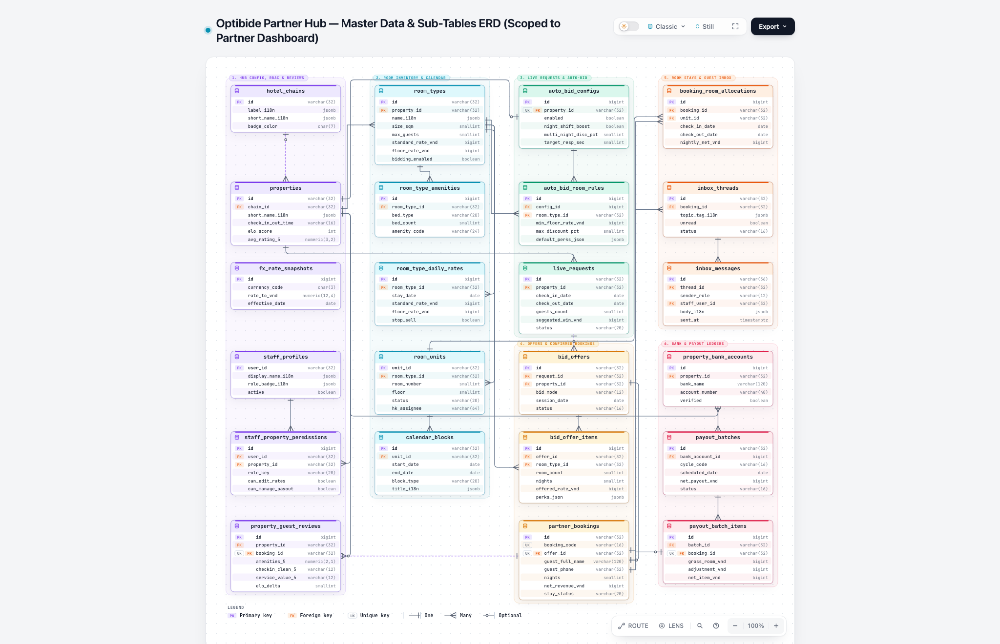
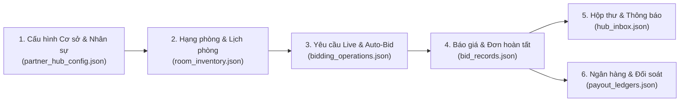
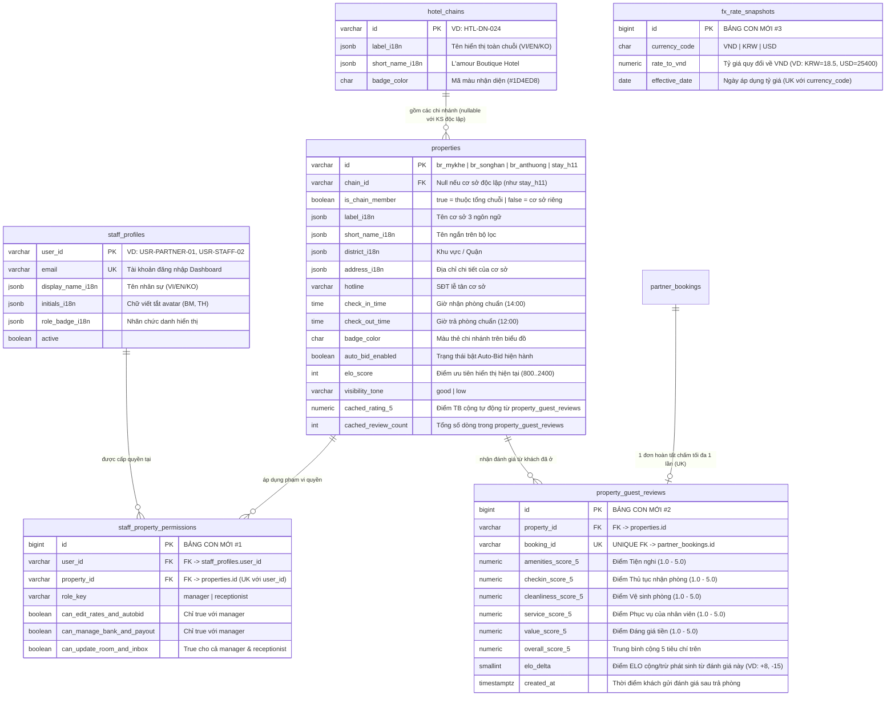
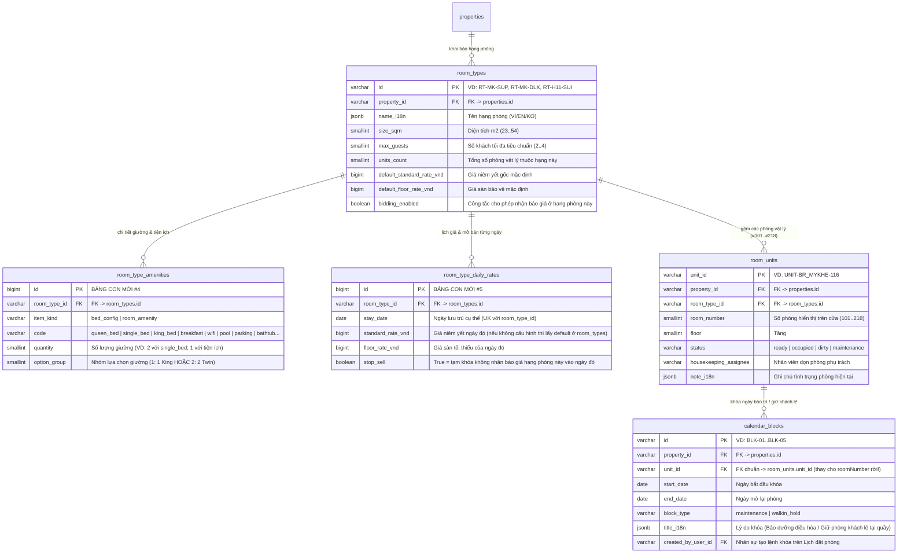
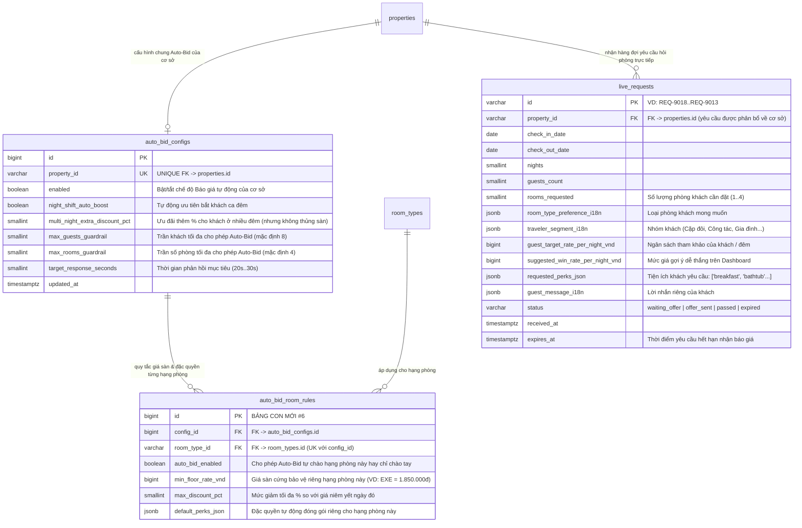
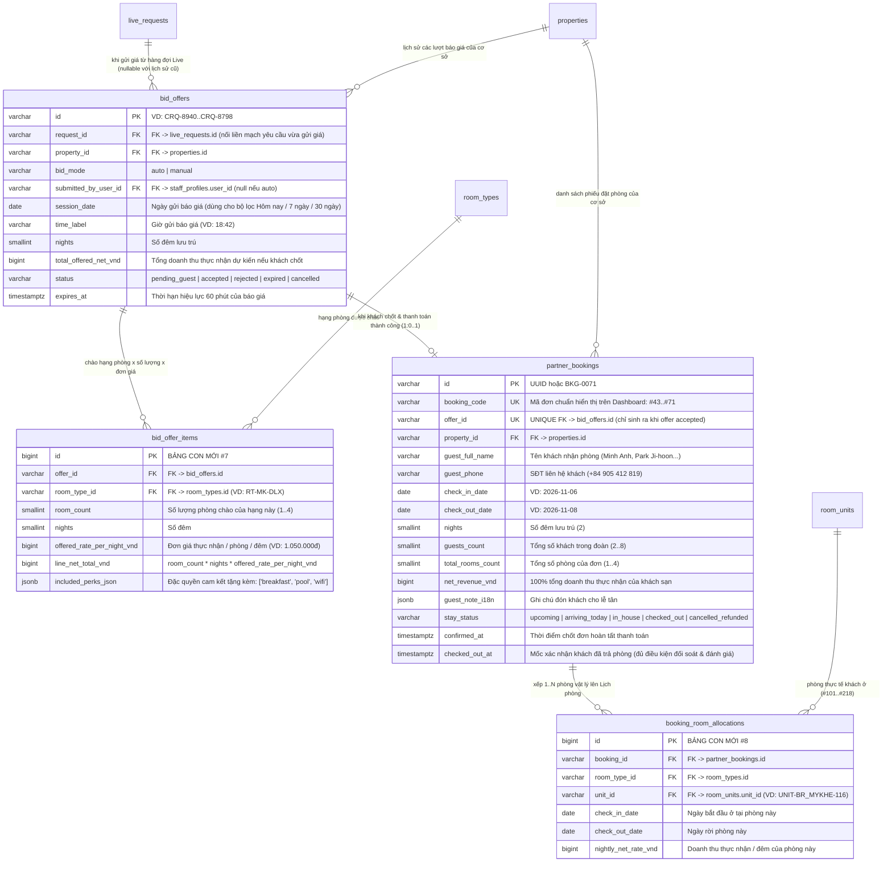
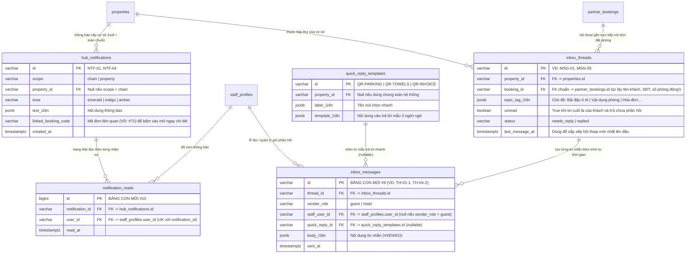
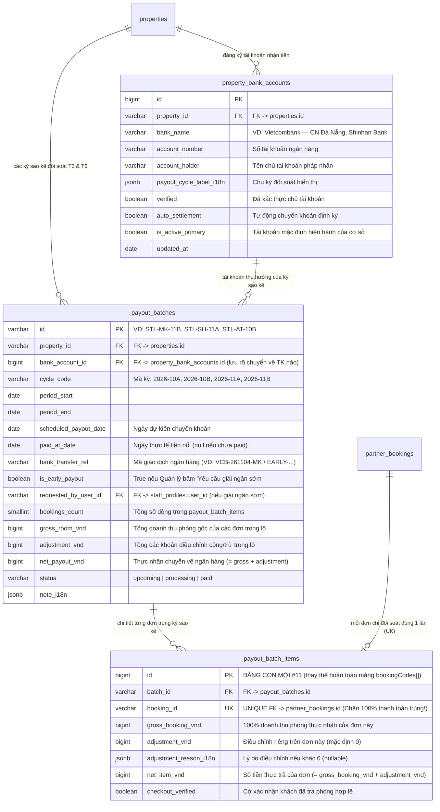
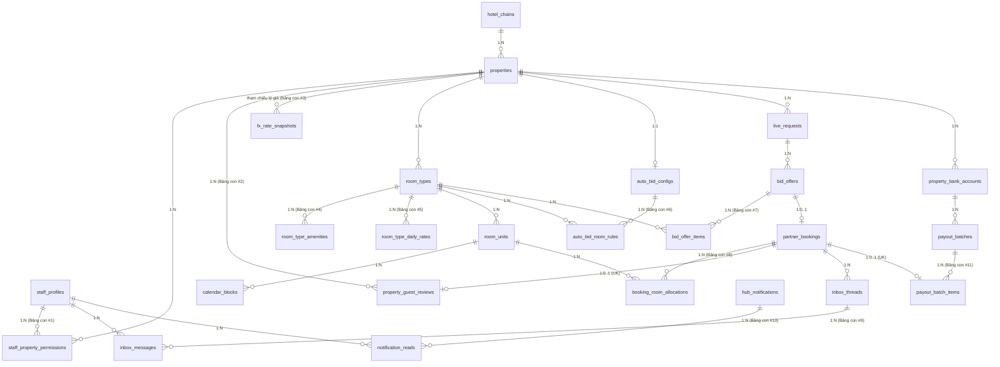

# Phân Tích Chi Tiết Các Bảng Con & Sơ Đồ Quan Hệ Thực Thể (ERD) Cho Optibide Partner Dashboard

> **Phạm vi & Ranh giới hệ thống (100% Đứng Ở Phía Dashboard Khách Sạn)**:  
> - Tài liệu này tập trung **trọn vẹn vào bộ Master Data của Cổng Đối Tác Khách Sạn** tại [`/Users/iannwendy/Desktop/goodNstay/dashboard/dashboard/master-data`](file:///Users/iannwendy/Desktop/goodNstay/dashboard/dashboard/master-data) và các màn hình vận hành của [`dashboard/dashboard`](file:///Users/iannwendy/Desktop/goodNstay/dashboard/dashboard).  
> - **Không lôi các bảng kỹ thuật nội bộ của Sàn Du khách** (như cổng thanh toán PayPal/KCP, khóa phiên checkout phía người mua hay phí sàn thu phía du khách) vào làm rối cơ sở dữ liệu của Khách sạn.  
> - Tuy nhiên, mọi bảng con của Dashboard đều được thiết kế **ăn khớp chặt chẽ với luồng thực tế hiện tại** mà khách sạn tương tác: *Cấu hình cơ sở & hạng phòng $\rightarrow$ Nhận yêu cầu hỏi phòng & Gửi báo giá (tay / Auto-Bid, hỗ trợ 1–4 phòng) $\rightarrow$ Nhận phiếu đặt phòng đã chốt & Xếp phòng lên Lịch $\rightarrow$ Nhắn tin với khách & Đón/Trả phòng (`checked_out`) $\rightarrow$ Nhận đánh giá 5 tiêu chí $\rightarrow$ Đối soát tiền thực nhận về ngân hàng*.  
> - Các tính năng mở rộng chưa nằm trong luồng vận hành cốt lõi hiện tại (như `marketing_campaigns.json` — Flash Deal / Upsell) được gác gọn sang phần ghi chú cuối tài liệu để giữ kiến trúc thật tinh gọn, rõ ràng.

---

## 0. Bộ Sơ Đồ ERD Trực Quan Của Riêng Partner Dashboard

- **Sơ đồ ERD Tương tác Trực tuyến (HTML độc lập — chia đúng 6 nhóm tương ứng 6 file JSON cốt lõi của Dashboard, hỗ trợ lọc từng nhóm & chế độ Sáng/Tối)**:  
  [`goodnstay_dashboard_subtables_erd.html`](../diagrams/goodnstay_dashboard_subtables_erd.html)
- **File `Draw.io` 2 Trang (Trang 1: Bản đồ bóc tách từ 6 file JSON hiện tại sang các Bảng Con · Trang 2: Sơ đồ ERD chi tiết PK/FK)**:  
  [`goodnstay_dashboard_subtables_erd.drawio`](../diagrams/goodnstay_dashboard_subtables_erd.drawio)
- **Ảnh Poster ERD Độ Phân Giải Cao (`2048×1320`)**:  
  - Nền sáng: [`goodnstay_dashboard_subtables_erd.png`](../diagrams/goodnstay_dashboard_subtables_erd.png) · Nền tối: [`goodnstay_dashboard_subtables_erd_dark.png`](../diagrams/goodnstay_dashboard_subtables_erd_dark.png)

---

## 1. Bức Tranh Tổng Quan: Từ 6 File JSON "Overview" Hiện Tại Chia Nhỏ Thành Các Bảng Con Nào?

Hiện tại, dữ liệu trong `dashboard/dashboard/master-data/` đang được gộp phẳng (nhúng mảng bên trong mảng, hoặc gán sẵn các con số tổng hợp tĩnh) để phục vụ hiển thị nhanh mức Overview. Khi đi dọc theo **luồng tác nghiệp thực tế của Quản lý khách sạn & Lễ tân trên Dashboard**, ta chỉ cần bổ sung **đúng 11 bảng con nhỏ gọn** nằm bên trong 6 nhóm bảng hiện có:

| STT | File JSON hiện tại trên Dashboard | Các Bảng Hiện Có (Giữ & Chuẩn hóa khóa) | Các Bảng Con Cần Tách Nhỏ Bên Trong | Vấn đề cốt lõi được giải quyết trên Dashboard |
| :---: | :--- | :--- | :--- | :--- |
| **1** | `partner_hub_config.json` | • `hotel_chains` • `properties` • `staff_profiles` | 1. **`staff_property_permissions`** 2. **`property_guest_reviews`** 3. **`fx_rate_snapshots`** | • Phân quyền Lễ tân chỉ thao tác đúng chi nhánh trực ca. • Tính động điểm đánh giá 5 tiêu chí & ELO từ từng đơn thật thay vì gõ cứng `4.9★`. • Giữ lịch sử tỷ giá `VND/KRW/USD` để xem báo cáo kỳ cũ không bị nhảy số. |
| **2** | `room_inventory.json` | • `room_types` • `room_units` • `calendar_blocks` | 4. **`room_type_amenities`** 5. **`room_type_daily_rates`** | • Tách loại giường (`King/Twin`) & tiện ích chuẩn để tự gợi ý hạng phòng khớp yêu cầu khách. • Cài giá chuẩn, giá sàn & đóng/mở bán theo từng ngày (cuối tuần khác ngày thường). |
| **3** | `bidding_operations.json` | • `live_requests` • `auto_bid_configs` | 6. **`auto_bid_room_rules`** | • Khóa giá sàn `min_floor_rate_vnd` riêng cho **từng Hạng phòng**, chặn lỗi lấy giá sàn 780k của phòng nhỏ đi tự động báo giá cho phòng Suite 1,85 triệu. |
| **4** | `bid_records.json` | *Tách 2 thực thể đang bị gộp:* • `bid_offers` (143 báo giá) • `partner_bookings` (29 đơn `#43..#71`) | 7. **`bid_offer_items`** 8. **`booking_room_allocations`** | • Cho phép 1 báo giá chào cụ thể hạng phòng × số lượng phòng (1–4 phòng) × đặc quyền. • Cho phép 1 đơn đặt phòng xếp **nhiều phòng vật lý** lên Lịch đặt phòng (thay vì 1 ô `roomNumber` duy nhất). |
| **5** | `hub_inbox.json` | • `inbox_threads` • `quick_reply_templates` • `hub_notifications` | 9. **`inbox_messages`** 10. **`notification_reads`** | • Tách mảng nhúng `thread[]` ra từng tin nhắn độc lập, lưu rõ lễ tân nào đã trả lời. • Đánh dấu đã đọc thông báo riêng cho từng cá nhân (Quản lý vs Lễ tân). |
| **6** | `payout_ledgers.json` | • `property_bank_accounts` • `payout_batches` | 11. **`payout_batch_items`** | • Thay mảng chữ `bookingCodes: ["#71", "#70"]` bằng bảng dòng sao kê có `UNIQUE(booking_id)` cho các đơn đã `checked_out`, chống sót/trùng đơn và ghi rõ khoản điều chỉnh từng đơn. |

---

## 2. Phân Tích Chi Tiết Từng Nhóm Bảng Hiện Có, Các Bảng Con Bên Trong & Mối Quan Hệ ERD

---

### NHÓM 1: Cấu Hình Cơ Sở, Phân Quyền Nhân Sự & Điểm Đánh Giá (`partner_hub_config.json`)

#### 2.1.1 Hiện trạng trong `partner_hub_config.json` đang thiếu gì?
Hiện file [`partner_hub_config.json`](file:///Users/iannwendy/Desktop/goodNstay/dashboard/dashboard/master-data/partner_hub_config.json) chứa `chainOverview` (chuỗi L'amour), mảng `properties[4]` (`br_mykhe`, `br_songhan`, `br_anthuong`, `stay_h11`), mảng `staffProfiles[2]` (Quản lý Bảo Minh & Lễ tân Thu Hà) và đối tượng `currencyRates`. Có **3 chỗ đang bị làm phẳng ở mức Overview**:
1. **Nhân sự chưa gắn với Cơ sở**: `staffProfiles` chỉ có `roleKey: "manager" | "receptionist"` toàn cục. Thực tế tại chuỗi L'amour có 3 chi nhánh khác nhau, Lễ tân ca trực ở CN Mỹ Khê chỉ được phép đổi trạng thái buồng và trả lời khách của CN Mỹ Khê, không được sửa nhầm sang CN Sông Hàn hay Stay Hotel H11.
2. **Điểm đánh giá `reviewRating5` & 5 tiêu chí `reviewCriteria5` đang là số gõ chết**: Trong mỗi `properties[]`, các số `reviewRating5: 4.9`, `reviewCount: 64`, `amenities: 4.8, checkin: 4.9, cleanliness: 5.0, service: 4.9, value: 4.9` và `eloScore: 1720` đang là hằng số tĩnh. Khi khách của đơn `#71` trả phòng xong và chấm sao (đúng 5 tiêu chí này trên luồng thực tế!), Dashboard không có bảng con nào lưu phiếu chấm điểm đó để tự động cập nhật lại điểm trung bình và cộng/trừ điểm hiển thị `eloScore`.
3. **Tỷ giá `currencyRates` chỉ lưu 1 thời điểm duy nhất**: `{ VND: 1, KRW: 18.5, USD: 25400 }`. Nếu tháng sau tỷ giá `KRW` đổi thành `19.2`, toàn bộ biểu đồ doanh thu quy đổi sang KRW/USD của tháng trước trên Dashboard bị nhảy lệch theo tỷ giá mới.

#### 2.1.2 Sơ đồ ERD Nhóm 1

#### 2.1.3 Giải thích tại sao Dashboard bắt buộc cần 3 bảng con này:
- **`staff_property_permissions`**: Hiện trên Dashboard đã phân quyền nút bấm giữa `Quản lý` và `Lễ tân` (ví dụ Lễ tân bấm sửa giá phòng hoặc bấm *Giải ngân sớm* sẽ bật cảnh báo yêu cầu quyền Quản lý). Bảng con này mở rộng cơ chế đó xuống đúng **từng chi nhánh**, để khi đăng nhập thật, tài khoản Lễ tân CN Mỹ Khê chỉ thấy đúng dữ liệu của `br_mykhe`, còn Quản lý Chuỗi thấy đủ cả 3 chi nhánh.
- **`property_guest_reviews`**: Biến thẻ **Điểm đánh giá & Uy tín hiển thị (`Trust & Visibility`)** trên trang Tổng quan từ số giả lập tĩnh thành số liệu sống 100%. Đặc biệt với cơ sở mới `stay_h11` đang có `0 đánh giá · ELO 800`, ngay khi hoàn tất đơn đầu tiên và có 1 bản ghi rơi vào `property_guest_reviews`, Dashboard lập tức tự tính điểm 5 thanh tiêu chí và nâng bậc hiển thị cho khách sạn mà không cần sửa tay file cấu hình.
- **`fx_rate_snapshots`**: Đảm bảo khi chủ khách sạn Hàn Quốc hoặc Việt Nam chuyển đổi bộ lọc tiền tệ `VND / KRW / USD` để xem biểu đồ doanh thu `30 ngày qua`, doanh thu của ngày nào được quy đổi đúng theo tỷ giá của ngày đó, giữ số liệu kế toán nhất quán tuyệt đối.

---

### NHÓM 2: Danh Mục Hạng Phòng, Giá Theo Ngày & Lịch Phòng (`room_inventory.json`)

#### 2.2.1 Hiện trạng trong `room_inventory.json` đang thiếu gì?
File [`room_inventory.json`](file:///Users/iannwendy/Desktop/goodNstay/dashboard/dashboard/master-data/room_inventory.json) đang cấp dữ liệu cho 2 màn hình **Quản lý phòng (`RoomsManagementView`)** và **Lịch đặt phòng (`BookingCalendarView`)** qua 3 mảng: `roomTypes[15]`, `units[48]`, `calendarBlocks[5]`. Tuy nhiên:
1. **Mô tả giường & tiện nghi đang lưu phẳng**: `bedSummary` là chuỗi chữ dịch thuật (`"1 giường King hoặc 2 giường đơn"`), còn `amenities` là mảng chuỗi nhúng trực tiếp vào `roomTypes`. Khi có một yêu cầu hỏi phòng đổ về màn hình Báo giá (ví dụ khách cần *"2 giường đơn"* kèm *"ăn sáng"* và *"bãi đậu xe"*), Dashboard không thể lọc tự động xem hạng phòng nào của khách sạn đáp ứng đúng cấu hình giường đó.
2. **Mỗi hạng phòng chỉ có đúng 1 mức giá cố định quanh năm**: `standardRateVnd: 1180000` và `floorRateVnd: 950000`. Trong vận hành khách sạn thực tế, tối Thứ Sáu – Thứ Bảy hoặc dịp lễ tại Đà Nẵng giá phòng và giá sàn luôn cao hơn ngày thường trong tuần, hoặc có những ngày cao điểm khách sạn muốn đóng bán đấu giá (`stop_sell`) riêng 1 hạng phòng.
3. **Khóa lịch `calendarBlocks` đang nối lỏng bằng số `roomNumber`**: Trong `calendarBlocks[]`, trường liên kết đang là `"roomNumber": 122` thay vì mã khóa chính `unitId` (`UNIT-BR_MYKHE-122`). Nếu hai chi nhánh cùng có phòng số `101`, nối bằng `roomNumber` rất dễ khóa nhầm phòng giữa các cơ sở.

#### 2.2.2 Sơ đồ ERD Nhóm 2

#### 2.2.3 Giải thích tại sao Dashboard bắt buộc cần 2 bảng con này:
- **`room_type_amenities`**: Giúp chuẩn hóa hoàn toàn dữ liệu cấu hình giường và tiện ích bên trong mỗi hạng phòng. Nhờ đó, khi khách hỏi *"Phòng 2 giường đơn khu Hải Châu"* (`REQ-9017`) hay *"Suite Gia Đình 4 khách có hồ bơi"* (`REQ-9016`), Dashboard đối chiếu thẳng vào bảng con này để đánh dấu ngay hạng phòng phù hợp nhất cho lễ tân chào giá.
- **`room_type_daily_rates`**: Phục vụ trực tiếp nhu cầu chỉnh giá linh hoạt theo ngày trên lịch của Quản lý khách sạn. Những ngày bình thường không chỉnh riêng thì hệ thống lấy giá mặc định trên `room_types`, còn Thứ Sáu – Thứ Bảy hoặc ngày lễ chỉ cần thêm dòng override vào `room_type_daily_rates` — vừa nhẹ dữ liệu, vừa sát thực tế kinh doanh lưu trú.

---

### NHÓM 3: Hàng Đợi Yêu Cầu Hỏi Phòng Live & Cấu Hình Auto-Bid (`bidding_operations.json`)

#### 2.3.1 Hiện trạng trong `bidding_operations.json` đang gặp rủi ro gì?
Hãy nhìn trực tiếp vào [`bidding_operations.json`](file:///Users/iannwendy/Desktop/goodNstay/dashboard/dashboard/master-data/bidding_operations.json) hiện tại:
- Trong `autoBidRules[4]`, mỗi cơ sở chỉ có **đúng 1 bản ghi phẳng duy nhất**, ví dụ tại `br_mykhe`: `"minFloorRateVnd": 780000`.
- **Mâu thuẫn nghiêm trọng ngay trong dữ liệu hiện tại**: Ở `room_inventory.json`, `br_mykhe` có 4 hạng phòng với mức giá sàn hoàn toàn khác nhau:
  - *Superior (`RT-MK-SUP`)*: giá sàn `760.000 ₫`
  - *Deluxe (`RT-MK-DLX`)*: giá sàn `950.000 ₫`
  - *Family Suite (`RT-MK-FAM`)*: giá sàn `1.600.000 ₫`
  - *Executive Ocean Suite (`RT-MK-EXE`)*: giá sàn `1.850.000 ₫`
  Nếu `autoBidRules` không có bảng con chi tiết cho từng hạng phòng mà chỉ giữ 1 con số `minFloorRateVnd: 780000` chung toàn khách sạn, hệ thống Auto-Bid sẽ có nguy cơ báo giá phòng *Ocean Suite* xuống dưới `1.850.000 ₫` gây lỗ nặng, hoặc tặng nhầm đặc quyền `pool / bathtub` cho hạng phòng *Superior* vốn không có bồn tắm!

#### 2.3.2 Sơ đồ ERD Nhóm 3

#### 2.3.3 Giải thích tại sao Dashboard bắt buộc cần bảng con `auto_bid_room_rules`:
- Khi Quản lý mở màn hình **Quản lý báo giá (`BiddingManagementView`)**, họ vẫn có công tắc tổng bật/tắt nhanh ở `auto_bid_configs`, nhưng bên dưới có thể mở bảng chi tiết từng hạng phòng (`auto_bid_room_rules`): cho phép Auto-Bid tự chạy thoải mái ở phòng *Superior* và *Deluxe* vào ban đêm, còn riêng 1–2 căn *Executive Ocean Suite* cao cấp nhất có thể đặt sàn cứng `1.850.000 ₫` hoặc tắt Auto-Bid để lễ tân tự chào giá tay giữ biên lợi nhuận cao nhất.
- Ngoài ra, trên `live_requests`, các cột kết quả tạm thời như `submittedRatePerNightVnd`, `submittedPerks` trước đây bị nhét chung vào yêu cầu nay được chuyển hẳn sang bảng **`bid_offers`** ở Nhóm 4 ngay bên dưới để nối liền mạch từ lúc gửi giá đến lúc chốt đơn!

---

### NHÓM 4: Lượt Báo Giá Đã Gửi & Phiếu Đặt Phòng Hoàn Tất (`bid_records.json` — Trọng Tâm Lớn Nhất)

#### 2.4.1 Hiện trạng trong `bid_records.json` đang vướng ở đâu?
Hiện tại [`bid_records.json`](file:///Users/iannwendy/Desktop/goodNstay/dashboard/dashboard/master-data/bid_records.json) là bảng gánh nặng nhất trên toàn bộ Dashboard vì đang **trộn 2 thực thể hoàn toàn khác nhau vào chung 1 mảng 143 phần tử**:
1. **114 bản ghi Báo giá không thành đơn (`expired`, `rejected`, `cancelled`)**: Chỉ có `id`, `propertyId`, `bidMode`, `sessionDate`, `nights`, `offeredRatePerNightVnd`, còn toàn bộ các trường `bookingCode`, `guestFullName`, `guestPhone`, `roomNumber`, `stayStatus`, `payoutBatchId` đều bị bỏ trống (`undefined`).
2. **29 bản ghi Đơn đặt phòng đã hoàn tất (`#43..#71` có `status = "accepted"`)**: Nhồi chung thông tin khách, phòng vật lý và đối soát vào dòng báo giá, nhưng lại vướng **2 giới hạn cứng khi chạy thực tế**:
   - **Giới hạn 1 phòng duy nhất**: Cột `roomNumber: 116` chỉ là 1 con số nguyên đơn lẻ. Trong thực tế luồng đặt phòng hiện tại cho phép khách đặt **từ 1 đến 4 phòng trong 1 yêu cầu** (ví dụ đoàn gia đình hoặc nhóm công tác đặt 2 phòng `#111` và `#112` trong cùng đơn `#72`) — cấu trúc 1 trường `roomNumber` không thể lưu và không thể vẽ cả 2 phòng lên **Lịch đặt phòng (`BookingCalendarView`)**!
   - **Đứt mạch từ `live_requests` sang `bid_records`**: Hiện tại trên UI, khi lễ tân bấm *"Gửi báo giá"* ở một `live_requests` (`REQ-9018`), dữ liệu chưa tự sinh thành một bản ghi `bid_offers` có chi tiết hạng phòng và số lượng phòng để theo dõi xuyên suốt tới khi thành `partner_bookings`.

#### 2.4.2 Sơ đồ ERD Nhóm 4 (Tách rõ Báo giá `bid_offers` & Đơn đặt phòng `partner_bookings` + 2 Bảng con)

#### 2.4.3 Giải thích tại sao Dashboard bắt buộc cần tách đôi & thêm 2 bảng con này:
- **Tách `bid_offers` và `partner_bookings`**:
  - Biểu đồ *"Tình trạng các lượt báo giá"* và thẻ KPI *"Tổng lượt báo giá / Tỷ lệ khách chốt / Báo giá tự động"* đọc từ bảng `bid_offers` (gọn nhẹ, sạch sẽ, không chứa cột rỗng).
  - Bảng *"Các đơn đặt phòng hoàn tất"*, *Modal Chi tiết đơn* và *Danh sách khách nhận phòng hôm nay* đọc thẳng từ `partner_bookings` — nơi 100% dòng đều là đơn thật có tiền thật.
- **Bảng con `bid_offer_items`**: Giúp khách sạn chào được đơn nhiều phòng (ví dụ khách hỏi 2 phòng, khách sạn đóng gói `2 × Phòng Deluxe` hoặc `1 × Deluxe + 1 × Superior`) và lưu rõ đặc quyền cam kết theo từng hạng phòng.
- **Bảng con `booking_room_allocations`**: Giải phóng hoàn toàn giới hạn `roomNumber: 116`! Một đơn `#69` của gia đình 4 người nếu lấy 2 phòng `#111` và `#112` sẽ có 2 dòng trong `booking_room_allocations` $\rightarrow$ màn hình **Lịch đặt phòng (`BookingCalendarView`)** tự động tô xanh trạng thái *"Đã đặt"* trên cả dòng `#111` lẫn dòng `#112`, đồng thời nếu khách cần đổi từ phòng `#116` sang `#119` giữa kỳ lưu trú, lễ tân chỉ cần cập nhật trên bảng con này mà không làm hỏng lịch sử đơn gốc!

---

### NHÓM 5: Hộp Thư Hội Thoại Khách Đặt Phòng & Chuông Thông Báo (`hub_inbox.json`)

#### 2.5.1 Hiện trạng trong `hub_inbox.json` đang thiếu gì?
Trong [`hub_inbox.json`](file:///Users/iannwendy/Desktop/goodNstay/dashboard/dashboard/master-data/hub_inbox.json):
1. Mỗi hội thoại trong `messages[5]` (`MSG-01..MSG-05`) đang **nhúng cứng mảng tin nhắn `thread[]` bên trong** và **lưu lặp lại bằng chữ tĩnh** các trường `guestName`, `guestPhone`, `staySummary: "Phòng #116 • 06/11 – 08/11 (2 đêm)"`. Nếu lễ tân đổi khách từ phòng `#116` sang `#119` bên Lịch phòng, dòng chữ `staySummary` bên Hộp thư không tự cập nhật theo; và khi hai bên nhắn tin qua lại dài ngày, việc ghi đè cả mảng `thread[]` dễ làm mất tin nhắn hoặc không biết **nhân viên lễ tân nào** trong ca trực đã trả lời khách.
2. Mảng `notifications[4]` trên chuông thông báo Topbar chưa có bảng ghi nhận **ai đã đọc**: Lễ tân bấm mở xem là mất cờ chưa đọc của Quản lý.

#### 2.5.2 Sơ đồ ERD Nhóm 5

#### 2.5.3 Giải thích tại sao Dashboard bắt buộc cần 2 bảng con này:
- **`inbox_messages` + nối chuẩn `booking_id` trên `inbox_threads`**: Khi lễ tân gửi câu trả lời trên màn hình **Tin nhắn khách hàng (`GuestMessagesView`)**, hệ thống chỉ cần `INSERT` thêm 1 dòng mới vào `inbox_messages` kèm `staff_user_id` của người trực ca (không bao giờ ghi đè làm mất tin nhắn cũ), còn thông tin *"Phòng #116 • 06/11 – 08/11"* được truy vấn động từ `partner_bookings` + `booking_room_allocations`, luôn khớp 100% với Lịch phòng.
- **`notification_reads`**: Giữ chuông thông báo độc lập cho từng tài khoản nhân sự đăng nhập trên Dashboard.

---

### NHÓM 6: Tài Khoản Ngân Hàng & Sao Kê Đối Soát Doanh Thu (`payout_ledgers.json`)

#### 2.6.1 Hiện trạng trong `payout_ledgers.json` đang gặp vấn đề gì?
Trong [`payout_ledgers.json`](file:///Users/iannwendy/Desktop/goodNstay/dashboard/dashboard/master-data/payout_ledgers.json):
1. **Lưu danh sách đơn bằng mảng chữ `bookingCodes: ["#71", "#70", "#67"]` (và lưu lặp `payoutBatchId` bên `bid_records.json`)**: Trong cơ sở dữ liệu kế toán – tài chính, việc dùng mảng chuỗi để gom đơn vào kỳ sao kê khiến hệ thống không thể đặt khóa `UNIQUE` chống thanh toán trùng (một mã `#71` có thể bị gõ nhầm vào 2 lô `STL-MK-11B` và `STL-MK-11C`), hoặc bên `payout_ledgers` có `#71` nhưng bên đơn đặt phòng lại trỏ sang lô khác.
2. **Không giải trình được cột `adjustmentVnd` xuống từng đơn**: Trên `batches[]` hiện có trường tổng `adjustmentVnd: 0`. Thực tế khi phát sinh 1 ca hoàn tiền ngoại lệ (ví dụ khách có giấy xác nhận cấp cứu y tế hợp lệ) hoặc điều chỉnh công nợ kỳ trước, kế toán khách sạn mở popup **Chi tiết sao kê (`PayoutReconciliationView`)** bắt buộc phải thấy khoản điều chỉnh đó nằm ở **đơn số mấy và vì lý do gì**.
3. **Ràng buộc điều kiện đối soát theo flow thực tế**: Chỉ những `partner_bookings` đã hoàn tất lưu trú (`stay_status = 'checked_out'`) mới được phép chốt thanh toán giải ngân về ngân hàng, còn các đơn mới đặt hôm nay nhưng chưa trả phòng (như `#71` trả phòng `08/11`) sẽ ở trạng thái *Tạm tính chờ khách trả phòng (`upcoming`)*.

#### 2.6.2 Sơ đồ ERD Nhóm 6

#### 2.6.3 Giải thích tại sao Dashboard bắt buộc cần bảng con `payout_batch_items`:
- Xóa bỏ hoàn toàn sự trùng lặp dữ liệu ở 2 đầu (`payout_ledgers.batches.bookingCodes[]` và `bid_records.payoutBatchId`). Giờ đây **chỉ có một nguồn sự thật duy nhất** nằm ở `payout_batch_items` với ràng buộc cứng `UNIQUE(booking_id)`: một đơn đặt phòng không bao giờ bị đưa nhầm vào 2 kỳ đối soát, tổng tiền của lô sao kê luôn bằng chính xác tổng các dòng thành phần (`SUM(net_item_vnd)`), và khi bấm mở popup sao kê của bất kỳ kỳ nào trên Dashboard, kế toán thấy rõ ràng tới từng đơn và từng khoản điều chỉnh.

---

## 3. Sơ Đồ ERD Tổng Hợp Toàn Bộ Partner Dashboard (Bảng Hiện Có + 11 Bảng Con)

---

## 4. Ghi Chú Các Phần Để Lại Giai Đoạn Sau (Không Đưa Vào Để Tránh Rối)

Đúng theo nguyên tắc làm chắc và gọn luồng vận hành thực tế trước:
1. **File `marketing_campaigns.json` (`flashDeals` & `upsellOffers`)**: Giữ nguyên mức danh mục đơn giản hiện tại, **chưa tách các bảng con theo dõi hạn ngạch Flash Deal từng ngày hay đơn đặt xe sân bay / nâng hạng phòng**, vì luồng giao dịch thực tế hiện tại mới tập trung vào *Báo giá phòng $\rightarrow$ Đặt phòng $\rightarrow$ Lưu trú $\rightarrow$ Đối soát*. Khi nào mở rộng tính năng bán gói phụ trợ thật mới bổ sung sau.
2. **Các nghiệp vụ nội bộ sâu của phần mềm PMS truyền thống** (như phân ca dọn phòng chi tiết từng chiếc khăn, phiếu bảo trì thiết bị tòa nhà, quản lý minibar/giặt ủi tại quầy, hồ sơ giấy phép KYB): Để lại ở các giai đoạn phát triển về sau, tránh làm nặng bộ dữ liệu cốt lõi của Partner Dashboard hiện tại.
