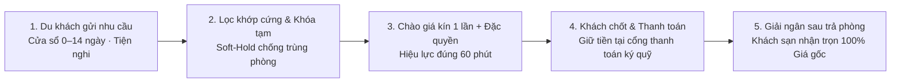

# Cẩm Nang Nghiệp Vụ & Tối Ưu Sản Phẩm — goodNstay Business Studio

> **Mục đích tài liệu**: Trình bày cô đọng bài toán kinh doanh, cấu trúc 9 màn hình vận hành, dòng tiền đối soát, phân tích AI của **goodNstay Business Studio**, kết hợp các nguyên tắc tối ưu UX/UI và các cơ chế thực chiến sắc bén trên sàn đấu thầu 1:1. *(Mọi cổng thanh toán, ngân hàng và kênh phân phối bên ngoài được chuẩn hóa chung, không phụ thuộc dịch vụ bên thứ ba).*

---

## 1. Gốc Rễ Kinh Doanh & Mô Hình Đấu Thầu Ngược 1:1

### 1.1 Ba nỗi đau cốt lõi của khách sạn truyền thống
1. **Phòng trống qua đêm là mất trắng 100%**: Trung bình ~30% quỹ phòng bị trống trong cửa sổ `0–14 ngày` sát giờ nhận phòng, doanh thu bốc hơi vĩnh viễn trong khi định phí vận hành vẫn phải trả đủ.
2. **Sợ phá vỡ cam kết ngang giá (`Rate Parity`)**: Giảm giá công khai trên các kênh đặt phòng trực tuyến truyền thống sẽ bị phạt giảm hiển thị và làm mất uy tín với khách đã đặt sớm.
3. **Bào mòn lợi nhuận vì hoa hồng cao**: Phí chiết khấu kênh ngoài `15% – 30%` cộng chi phí quảng cáo ăn mòn biên lãi ròng.

### 1.2 Cơ chế giải quyết của goodNstay & 4 quy tắc bất biến

- **0% hoa hồng trừ vào khách sạn**: Cơ sở đặt **Giá gốc (`Base Price`)** bao nhiêu thì nhận đủ `100%`. Phí nền tảng (`15%`) và thuế GTGT (`10%`) cộng vào phía du khách (**Khách trả = `126,5%` Giá gốc**).
- **Chào giá 1 lần & Đồng hồ sinh tử 60 phút**: Không sửa lại sau khi gửi; quá `60 phút` chưa thanh toán thì tự hủy vĩnh viễn và nhả khóa phòng ngay — bảo vệ mặt bằng giá niêm yết.
- **Không ép "ngân sách trần"**: Khách chỉ nêu nhu cầu thật; khách sạn thắng nhau nhờ **giá hợp lý**, **tốc độ phản hồi** và **Độ phù hợp (`Match/Fit Score`)** kèm đặc quyền mềm.
- **Khóa cam kết hai chiều**: Đã hoàn tất thanh toán qua **hệ thống thanh toán ký quỹ** là chốt cứng (chỉ hoàn tiền ngoại lệ sự cố y tế có chứng từ bệnh viện trong `≤ 3 ngày`); tiền chỉ giải ngân sau khi khách trả phòng.

---

## 2. Nguyên Tắc Thiết Kế UX/UI & Dữ Liệu Đắt Giá Trên Dashboard

| Trụ cột tối ưu | Quy tắc áp dụng cụ thể trên Dashboard |
| :--- | :--- |
| **1. Thứ tự đọc UX/UI & Thu gọn thông minh** | Phân tầng 3 nhịp quét mắt: **(Nhịp 1: 0–5s đầu trang)** Cảnh báo phiên chờ thanh toán, các thẻ KPI chạm được & điểm ELO $\rightarrow$ **(Nhịp 2: 5–20s giữa trang)** Sàn Live 60 phút, Biểu đồ xu hướng & Lịch 14 ngày vàng $\rightarrow$ **(Nhịp 3: 20s+ cuối trang & Ngăn kéo/Popup)** Bảng lịch sử thu gọn *(mặc định hiện 5 phiên gần nhất + nút "Xem thêm")* & hồ sơ mổ xẻ chi tiết. |
| **2. Con số "có linh hồn" & Bấm để bóc tách (`KPI Drill-down`)** | Mỗi chỉ số chính kèm **4 lớp ý nghĩa** *(So sánh kỳ trước · Nhãn sức khỏe · Nguyên nhân gốc · Nút hành động)* và **bấm trực tiếp vào thẻ KPI** để mở popup bóc tách sâu *(tỷ trọng doanh thu từng hạng phòng, khung giờ vàng khách gửi yêu cầu `11h30–13h30` & `19h30–22h00`, sơ đồ mã phòng thực tế & số phòng sắp trả trưa mai)*. |
| **3. Chọn đúng Biểu đồ (`Chart`) cho đúng số liệu** | • **Chuỗi thời gian** (Doanh thu gốc, Lượng thầu, Lịch sử ELO): `Area / Line Chart`. • **Cơ cấu quỹ phòng**: `Segmented Stacked Bar` kết hợp **Ma trận ô mã phòng trực quan** *(tránh lạm dụng `Pie Chart` nhiều lát cắt gây rối mắt)*. • **Chuyển đổi & Chất lượng**: `Funnel 4 bước` cho đấu thầu; `Grouped / Horizontal Bar` cho Độ khớp & 5 tiêu chí Rating. |
| **4. UI thích ứng động theo `Rules` (`Adaptive UI`)** | • *Có phiên chờ thanh toán `< 60p`*: Tự ghim thanh điểm tin vàng hổ phách lên đầu trang. • *Còn tồn phòng trống sau `20h00`*: Nổi bật nút gợi ý **Chế độ Xả phòng đêm 1-chạm**. • *Hạng phòng đã kín (`Sold-out`)*: Tự khóa nút gửi báo giá ở hạng phòng đó. • *Phòng tụt Rating lặp lại*: Gắn cờ nhắc kiểm tra kỹ thuật ngay trên sơ đồ phòng. |

> **Khung điều khiển chung**: Bộ chuyển đổi **Toàn chuỗi / Từng chi nhánh**, nút gạt kỳ **7 ngày / 30 ngày** (tính theo cùng nhóm ngày gửi chào giá - *Cohort*), tìm kiếm nhanh `⌘K`, xuất bảng tính `CSV` và chú giải công thức trong biểu tượng `(i)`.

---

## 3. Tóm Tắt Cô Đọng 9 Màn Hình & Các Điểm Nhấn Thực Chiến

### 3.1 Tổng quan (`Tổng quan vận hành`) + **Bóc tách KPI 1-chạm & Chỉ số ELO**
- **Thanh điểm tin nóng & Thẻ KPI chạm để bóc tách**: Theo dõi ngay phiên chờ thanh toán (`< 60p`), *Doanh thu gốc (0% hoa hồng) · Chào giá đã gửi · Tỷ lệ thắng · Phòng đêm & ADR gốc*; bấm vào từng thẻ mở ngay hộp phân tích chi tiết theo hạng phòng và khung giờ cao điểm.
- **Chỉ số phong độ vận hành (`ELO Score`)**: Thước đo động đánh giá uy tín cơ sở (*tốc độ phản hồi, giữ cam kết phòng không hủy/hạ hạng và điểm Rating hậu lưu trú*) kèm biến động `+/-` và lý do tăng/giảm.
- **Biểu đồ gạt kép (`Doanh thu gốc` / `Lượng thầu`) & Phễu 4 bước**: Chỉ rõ điểm rơi chuyển đổi từ *Yêu cầu khớp cứng $\rightarrow$ Gửi chào giá $\rightarrow$ Khách chọn $\rightarrow$ Hoàn tất thanh toán*.

### 3.2 Đấu thầu (`Sàn Live 60 phút`) + **Đóng gói đặc quyền & Popup Độ khớp**
- **Thẻ yêu cầu Live thông minh**: Hiển thị **tín hiệu mật độ cạnh tranh ẩn danh** (*số cơ sở đang chào giá / chưa ai chào*), huy hiệu **Khách đã gắn phương thức thanh toán** và nút **Gửi ngay Giá gốc AI đề xuất 1-chạm**.
- **Đóng gói đặc quyền mềm (`Perk Bundling`)**: Trước khi chốt gửi chào giá 1 lần duy nhất, hộp tùy chỉnh cho phép **tick tặng kèm đặc quyền chi phí vốn thấp** (*Miễn phí bữa sáng, Nhận phòng sớm / Trả phòng trễ*) để bứt phá xác suất thắng mà không cần hạ giá gốc.
- **Popup đối chiếu Độ phù hợp từng tiêu chí (`Interactive Match Breakdown`)**: Bấm vào huy hiệu `Khớp %` mở bảng so sánh trực diện **Khách cần vs. Cơ sở có** (*Đạt / Chênh lệch nhẹ / Thiếu* kèm đúng `%` bị trừ như *Thiếu bữa sáng `-5%`* và gợi ý cách bù đắp).

### 3.3 Giá & độ khớp (`Định giá & Độ khớp nhu cầu`)
- **Cặp giá song song**: Đặt `Giá gốc chào / đêm` (`100%`) cạnh `Giá trọn gói khách thấy / đêm` (`126,5%`) để quản lý luôn kiểm soát khoảng chênh `26,5%` thuế/phí.
- **Mô phỏng độ nhạy giá (`What-if`) & Dải giá `P25 – P75`**: Thanh trượt tính tức thì sản lượng hòa vốn khi giảm giá gốc; tham chiếu mặt bằng khu vực ẩn danh bảo vệ `Rate Parity`.

### 3.4 Doanh thu & đối soát (`Doanh thu & Đối soát thanh toán`)
- **Bảng cầu nối dòng tiền 7 bước minh bạch**: `Tổng khách trả vào cổng thanh toán ký quỹ (126,5%)` $\rightarrow$ trừ `Phí nền tảng (15%)` & `Thuế GTGT (10%)` $\rightarrow$ `100% Giá gốc cơ sở hưởng` $\rightarrow$ trừ `Hoàn tiền ngoại lệ y tế hợp lệ (≤ 3 ngày)` $\rightarrow$ **Thực nhận ròng** (tách rõ phần **Đã giải ngân về ngân hàng thụ hưởng** sau trả phòng và phần **Đang giữ ký quỹ**).
- **Sổ phụ 4 tab & Xuất CSV riêng**: Lọc nhanh *Tất cả · Chờ sau Check-out · Đã giải ngân · Ngoại lệ y tế*.

### 3.5 Phòng & công suất + **Lịch 14 Ngày Vàng, Khóa tạm `Soft-Hold` & Rating phòng**
- **Làm rõ 4 trạng thái & Khóa tạm chống trùng phòng (`Soft-Hold`)**:
  1. *Phòng trống sẵn sàng (`Available`)*: Sạch, trống lịch, đón khách ngay.
  2. *Phòng đang khóa tạm (`Soft-Hold ≤ 60p`)*: Đang nằm trong phiên chào giá / chờ thanh toán — **chống đặt trùng (`Overbooking`) tuyệt đối** khi tham gia nhiều phiên cùng lúc và tự nhả khóa ngay khi hết 60 phút hoặc khách từ chối.
  3. *Phòng đang được đặt / Có khách (`Booked / Occupied`)*: Đã chốt thanh toán hoặc đang lưu trú.
  4. *Phòng đang dọn / Bảo trì (`Cleaning / Maintenance`)*: Tạm khóa kỹ thuật.
- **Dải lịch "14 Ngày Vàng" phân màu khẩn cấp & Nút Xả phòng đêm**: Chia 3 vùng trực quan **Đỏ — Khẩn cấp (`D0–D1`)**, **Vàng — Cận ngày (`D2–D6`)**, **Xanh — An toàn (`D7–D14`)** *(các ngày `> 14 ngày` giữ nguyên cho kênh niêm yết truyền thống)*; tích hợp nút **Xả phòng đêm 1-chạm** sau `20h00`.
- **Rating chi tiết của phòng (5 tiêu chí hậu lưu trú)**: Chấm *Vệ sinh · Nhân viên · Nhận phòng · Đúng tiện nghi · Đáng giá tiền* xuống từng chi nhánh, hạng phòng và từng mã phòng cụ thể.

### 3.6 Auto-Bid (`Cấu hình Auto-Bid`)
- Phản hồi tự động trong `~1 phút`, tự chặn ở hạng phòng đã kín và khóa chặt **3 vòng an toàn**: **Giá gốc sàn/đêm** do chủ cơ sở đặt + trần cứng hệ thống **Tối đa 4 phòng** & **Tối đa 8 khách** (đoàn lớn tự chuyển duyệt thủ công).

### 3.7 Phân tích AI (`Mổ xẻ 4 nguồn dữ liệu & Cảnh báo bán hớ`)
- **AI Mổ xẻ phiên thất bại (`Loss Autopsy` từ 4 luồng dữ liệu)**: Hợp nhất *(1) Yêu cầu gốc của khách*, *(2) Hành vi tương tác ẩn danh (`Telemetry`: thời gian dừng mắt xem ảnh phòng/buffet, số cơ sở đem so sánh, thẻ từ chối)*, *(3) Báo giá & tốc độ phản hồi của cơ sở*, và *(4) Hồ sơ đối thủ thắng cuộc ẩn danh* (phân khúc sao, mức giá chốt, tốc độ gửi, đặc quyền tặng kèm) — kèm nút **Lưu thành quy tắc ưu tiên cho lần sau**.
- **Cảnh báo "Bán hớ" (`Underpricing Alert`) & Bảo vệ phiên chờ thanh toán**: Nhắc nâng nhẹ giá sàn khi thấy thắng quá nhanh (`< 2 phút`) ở mức giá rẻ sâu hơn thị trường; nhắc lễ tân không giục khách bấm thanh toán lại khi cổng thanh toán đang xử lý; tích hợp ngăn kéo hỏi đáp phân quyền theo chi nhánh.

### 3.8 Chất lượng dữ liệu & 3.9 Phạm vi sản phẩm
- **Kiểm toán dữ liệu & Từ điển 6 quy tắc cốt lõi**: Tách bạch phản hồi khách xác nhận thật, dữ kiện hệ thống và suy luận AI; chống lỗi chia mẫu số bằng `0`.
- **Lộ trình Hệ sinh thái 5 trụ cột & Bảng chốt 13 quyết định nghiệp vụ**: Từ *Lưu trú* mở rộng sang *Tour & Di chuyển (≤ 10 đối tác/SP/thành phố) · Đại lý lữ hành · Experiencer · Cộng đồng*, lưu nháp và xuất biên bản họp tức thì.

---

## 4. Bảng Số Liệu Đối Chiếu Nhanh Toàn Chuỗi (Mốc chuẩn `04/11/2026`)

| Hạng mục trên Dashboard | Kỳ 30 ngày (`06/10 – 04/11`) | Kỳ 7 ngày (`29/10 – 04/11`) | Ghi chú đọc số "có linh hồn" |
| :--- | ---: | ---: | :--- |
| **Yêu cầu tìm phòng khu vực** | **444** *(407 khớp cứng · 37 lệch)* | **122** *(108 khớp cứng · 14 lệch)* | Phản ánh sức cầu thật và lượng rơi ở vòng lọc hạng phòng. |
| **Chào giá 1 lần đã gửi** | **335** *(160 tự động · 175 thủ công)* | **85** *(42 tự động · 43 thủ công)* | Gần 50% cơ hội được Auto-Bid bắt kịp tức thì trong ~1 phút. |
| **Đơn thắng thầu & Tỷ lệ chốt** | **105** đơn (**31,3%**) | **24** đơn (**28,2%**) | Cứ ~3 chào giá gửi đi thì chốt thành công 1 đặt phòng thật. |
| **Phiên đang mở (< 60 phút)** | **8** chờ thanh toán · **6** đang mở | **8** chờ thanh toán · **6** đang mở | Các phòng này được khóa tạm `Soft-Hold` chống đặt trùng. |
| **Độ phù hợp trung bình (`Match`)** | **93,1%** | **92,4%** | Cơ cấu giường & tiện nghi đang khớp rất sát nhu cầu khách. |
| **Tổng tiền du khách thanh toán** | **661.721.500 ₫** | **152.837.300 ₫** | Tổng thu qua cổng thanh toán (đã gồm 15% phí + 10% VAT). |
| **Doanh thu gốc cơ sở hưởng (100%)** | **523.100.000 ₫** | **120.820.000 ₫** | 0% hoa hồng bị khấu trừ vào phần của khách sạn. |
| **Hoàn tiền ngoại lệ sự cố y tế** | **10.360.000 ₫** *(2 ca)* | **0 ₫** | Tỷ lệ hủy cực thấp nhờ cơ chế khóa cam kết hai chiều. |
| **Thực nhận ròng về chuỗi** | **512.740.000 ₫** | **120.820.000 ₫** | Kỳ 30 ngày: **341,4 tr ₫** đã giải ngân · **171,4 tr ₫** chờ trả phòng. |
| **Phòng đêm bán / Quỹ phòng cấp** | **343 / 540** (**63,5%**) | **84 / 126** (**66,7%**) | Giải phóng ~2/3 hạn mức phòng trống cửa sổ 0–14 ngày vàng. |
| **Giá bình quân / đêm (`ADR`)** | Gốc **1.494.869 ₫** *(Khách trả 1.891.009 ₫)* | Gốc **1.438.333 ₫** *(Khách trả 1.819.492 ₫)* | Giữ biên giá tốt dù xả phòng trống sát ngày. |
| **Rating phòng hậu lưu trú (5 tiêu chí)** | **★ 4,67 / 5.0** *(69 đánh giá)* | **★ 4,45 / 5.0** *(2 đánh giá)* | Bảo chứng chất lượng phục vụ đồng nhất và nuôi dưỡng điểm ELO. |
