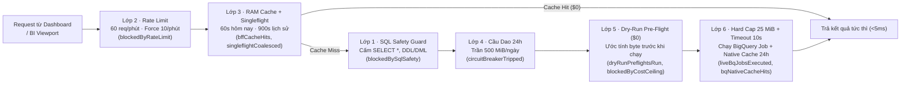

# Giải Thích Toàn Bộ JSON Trả Về Từ Endpoint `/api/v1/health` — BigQuery BFF (`:4000`)

> **goodNstay · Optibide Partner Hub** — Tài liệu tra cứu nhanh toàn bộ các trường giám sát sức khỏe dịch vụ và **6 lớp khóa chi phí Google Cloud BigQuery** trên endpoint `/api/v1/health`.

| Thông tin | Chi tiết |
| :--- | :--- |
| **Endpoint Local** | `GET http://127.0.0.1:4000/api/v1/health` |
| **Endpoint HTTPS Tunnel** | https://bao-minh-nguyens-macbook-pro-m4-pro.tail6930d7.ts.net/api/v1/health |
| **Xác thực** | Public *(chỉ trả trạng thái & chỉ số tổng hợp hệ thống, tuyệt đối `0% PII` và `0` dữ liệu khách sạn)* |
| **Mã nguồn Route (`server.ts`)** | https://github.com/iannwendy/goodnstayDashAI/blob/main/dashboard/bigquery-bff/src/server.ts#L101-L113 |
| **Mã nguồn Động cơ 6 lớp (`costGuard.ts`)** | https://github.com/iannwendy/goodnstayDashAI/blob/main/dashboard/bigquery-bff/src/costGuard.ts#L281-L308 |
| **Mã nguồn Cấu hình (`config.ts`)** | https://github.com/iannwendy/goodnstayDashAI/blob/main/dashboard/bigquery-bff/src/config.ts#L75-L130 |

> **Tóm tắt 1 câu để trình bày với CTO**:  
> *"`/api/v1/health` là bảng đồng hồ sống của tầng BFF nối với BigQuery `aevo-512307`, chứng minh hệ thống đang chạy thật và được bọc đủ 6 lớp bảo vệ (chặn SQL xấu, giới hạn 60 req/phút, RAM cache 60s–15p + gộp request trùng, kiểm tra nháp Dry-Run \$0, trần cứng 25 MiB/query và cầu dao 500 MiB/ngày) — thực tế chạy toàn bộ kiểm thử mà tổng tiền BigQuery vẫn là \$0."*

---

## 1. JSON Mẫu Thực Tế Trả Về Từ `/api/v1/health`

```json
{
  "ok": true,
  "service": "goodnstay-bigquery-bff",
  "gcpProjectId": "aevo-512307",
  "bqLocation": "US",
  "costGuard": {
    "pricingModel": "On-Demand (Protected by 6-Layer Cost Guardrail)",
    "onDemandRateUsdPerTiB": 6.25,
    "monthlyFreeTierTiB": 1,
    "maxBytesBilledPerQuery": 26214400,
    "maxWorstCaseCostPerQueryUsd": 0.00014901,
    "enableDryRunPreflight": true,
    "dailyBilledByteBudget": 524288000,
    "dailyBilledBytesUsed": 0,
    "dailyBudgetRemainingPct": 100,
    "circuitBreakerTripped": false,
    "jobTimeoutMs": 10000,
    "cacheTtlTodaySec": 60,
    "cacheTtlHistorySec": 900,
    "rateLimitPerMin": 60,
    "forceRefreshLimitPerMin": 10,
    "counters": {
      "totalRequests": 119,
      "bffCacheHits": 89,
      "singleflightCoalesced": 2,
      "liveBqJobsExecuted": 73,
      "bqNativeCacheHits": 73,
      "dryRunPreflightsRun": 73,
      "blockedByCostCeiling": 0,
      "blockedByDailyBudget": 0,
      "blockedByRateLimit": 0,
      "blockedBySqlSafety": 0
    },
    "cumulativeBytesProcessed": 0,
    "cumulativeBytesBilled": 0,
    "cumulativeEstimatedUsd": 0
  },
  "timestamp": "2026-11-26T08:04:46.355Z"
}
```

---

## 2. Sơ Đồ 6 Lớp Bảo Vệ Chi Phí Ánh Xạ Lên `/api/v1/health`



---

## 3. Giải Thích Chi Tiết Từng Trường (Đầy Đủ 4 Nhóm)

### Nhóm 1 — Trạng thái dịch vụ & Kết nối Google Cloud BigQuery

| Trường | Giá trị mẫu | Ý nghĩa |
| :--- | :--- | :--- |
| `ok` | `true` | Máy chủ BFF đang sống và phản hồi bình thường (`HTTP 200`). |
| `service` | `"goodnstay-bigquery-bff"` | Tên microservice trung gian đứng giữa Partner Hub và BigQuery. |
| `gcpProjectId` | `"aevo-512307"` | Mã dự án Google Cloud chứa kho dữ liệu BigQuery đang kết nối. |
| `bqLocation` | `"US"` | Vùng địa lý lưu trữ và thực thi truy vấn của BigQuery (`US` multi-region). |
| `timestamp` | `"2026-11-26T08:04:46.355Z"` | Thời điểm máy chủ xuất bản tin sức khỏe theo giờ chuẩn **UTC** (cộng thêm 7 giờ là giờ Việt Nam `ICT`, tức `15:04:46`). |

---

### Nhóm 2 — Cấu hình 6 lớp khóa chi phí BigQuery (`costGuard`)

| Trường | Giá trị mặc định | Biến môi trường cấu hình | Ý nghĩa dễ hiểu |
| :--- | :--- | :--- | :--- |
| `pricingModel` | `"On-Demand (Protected by 6-Layer Cost Guardrail)"` | *(cố định)* | Chế độ tính phí theo dung lượng quét thực tế của BigQuery, đã bọc đủ 6 lớp bảo vệ. |
| `onDemandRateUsdPerTiB` | `6.25` | *(hằng số Google Cloud)* | Biểu giá chuẩn của Google BigQuery: **\$6.25 cho mỗi 1 TiB** dữ liệu quét thực tế. |
| `monthlyFreeTierTiB` | `1` | *(hằng số Google Cloud)* | Hạn mức miễn phí hàng tháng của Google Cloud: **1 TiB đầu tiên mỗi tháng = \$0**. |
| `maxBytesBilledPerQuery` | `26214400` (**25 MiB**) | `BQ_MAX_BYTES_BILLED` *(kẹp cứng tối đa `100 MiB`)* | **Lớp 6 — Trần cứng mỗi truy vấn**: câu SQL nào quét vượt quá `25 MiB` sẽ bị Google Cloud từ chối hủy ngay lập tức. |
| `maxWorstCaseCostPerQueryUsd` | `0.00014901` | *(tự tính từ trần trên)* | Chi phí **xấu nhất có thể** cho 1 truy vấn nếu chạm đúng trần `25 MiB` chỉ khoảng **\$0.00015** (~3,8 VNĐ). |
| `enableDryRunPreflight` | `true` | `BQ_ENABLE_DRY_RUN_PREFLIGHT` | **Lớp 5 — Kiểm tra nháp miễn phí (Dry-Run)**: trước khi chạy thật, BFF luôn hỏi nháp BigQuery xem tốn bao nhiêu byte (**phí \$0**); nếu vượt trần thì chặn luôn. |
| `dailyBilledByteBudget` | `524288000` (**500 MiB**) | `BQ_DAILY_BYTE_BUDGET` | **Lớp 4 — Cầu dao ngân sách cuộn 24 giờ**: giới hạn tổng dung lượng bị tính tiền trong 24 giờ gần nhất là **500 MiB** (tối đa ~\$0.003/ngày ≈ 75 VNĐ/ngày). |
| `dailyBilledBytesUsed` | `0` | *(theo dõi động)* | Tổng dung lượng thực tế đã bị Google Cloud tính phí trong cửa sổ 24 giờ qua. |
| `dailyBudgetRemainingPct` | `100` | *(tự tính)* | Tỷ lệ `%` ngân sách an toàn trong ngày còn lại (`100%` = chưa tiêu đồng nào). |
| `circuitBreakerTripped` | `false` | *(theo dõi động)* | Trạng thái cầu dao ngắt khẩn cấp: `false` = an toàn; nếu thành `true`, mọi truy vấn mới sẽ bị chặn ngay bằng `HTTP 503 BQ_DAILY_BUDGET_EXCEEDED`. |
| `jobTimeoutMs` | `10000` (**10 giây**) | `BQ_JOB_TIMEOUT_MS` *(tối đa `30000`)* | Thời gian chờ tối đa cho mỗi job BigQuery; quá 10 giây tự ngắt tránh treo server. |
| `cacheTtlTodaySec` | `60` (**1 phút**) | `BFF_CACHE_TTL_TODAY_MS` | **Lớp 3 — Thời gian lưu RAM Cache cho kỳ Hôm nay (`today`)**: trong 60 giây chỉ hỏi BigQuery tối đa 1 lần. |
| `cacheTtlHistorySec` | `900` (**15 phút**) | `BFF_CACHE_TTL_HISTORY_MS` | **Lớp 3 — Thời gian lưu RAM Cache cho dữ liệu lịch sử (`7d`, `30d`, BI dataset)**: tái sử dụng trong 15 phút với chi phí `\$0`. |
| `rateLimitPerMin` | `60` | `BFF_RATE_LIMIT_PER_MIN` | **Lớp 2 — Giới hạn tần suất thông thường**: tối đa **60 request/phút/người dùng** để chống vòng lặp UI vô ý bắn liên tục. |
| `forceRefreshLimitPerMin` | `10` | `BFF_FORCE_REFRESH_LIMIT_PER_MIN` | **Lớp 2 — Giới hạn nút ép làm mới (bỏ cache)**: tối đa **10 lần/phút/người dùng**. |

---

### Nhóm 3 — Bộ đếm vận hành theo thời gian thực (`costGuard.counters`)

*(Các bộ đếm này bắt đầu từ `0` khi tiến trình BFF khởi động lại và tăng dần theo lưu lượng thực tế.)*

| Trường | Ý nghĩa chi tiết |
| :--- | :--- |
| `totalRequests` | Tổng số lượt yêu cầu dữ liệu đi qua lớp bảo vệ Cache/Singleflight của BFF. |
| `bffCacheHits` | Số lượt được trả lời tức thì từ **RAM Cache của BFF** (`< 5ms`, `\$0`, **không hề gọi lên Google Cloud**). |
| `singleflightCoalesced` | Số lượt request giống hệt nhau gửi tới **cùng 1 thời điểm** đã được gộp chung vào **1 truy vấn duy nhất** (chống nghẽn *cache stampede*). |
| `liveBqJobsExecuted` | Tổng số job truy vấn thực tế BFF đã gửi lên Google Cloud BigQuery. |
| `bqNativeCacheHits` | Số job trong số trên được **Cache gốc 24 giờ của BigQuery** trả kết quả ngay lập tức — **khi trúng BigQuery Native Cache, Google tính phí 0 byte và \$0!** |
| `dryRunPreflightsRun` | Số lần chạy kiểm tra nháp (`Dry-Run`, chi phí **\$0**) trước khi gửi job thật. |
| `blockedByCostCeiling` | Số câu SQL bị **Lớp 5** chặn trước khi chạy vì ước tính vượt trần `25 MiB/query` (`HTTP 400 BQ_COST_LIMIT_EXCEEDED`). |
| `blockedByDailyBudget` | Số câu SQL bị **Lớp 4** chặn vì chạm cầu dao `500 MiB/24 giờ` (`HTTP 503 BQ_DAILY_BUDGET_EXCEEDED`). |
| `blockedByRateLimit` | Số request bị **Lớp 2** chặn (`HTTP 429 RATE_LIMIT_EXCEEDED`) do gọi vượt quá 60 lần/phút hoặc ép làm mới quá 10 lần/phút. |
| `blockedBySqlSafety` | Số câu SQL bị **Lớp 1** chặn ngay bằng kiểm tra tĩnh vì chứa `SELECT *`, lệnh sửa/xóa (`INSERT`/`UPDATE`/`DELETE`/`DROP`/`TRUNCATE`/`ALTER`) hoặc nối nhiều câu lệnh (`;`). |

---

### Nhóm 4 — Tổng lũy kế chi phí thực tế từ lúc bật server

| Trường | Giá trị mẫu | Ý nghĩa |
| :--- | :--- | :--- |
| `cumulativeBytesProcessed` | `0` | Tổng số byte BigQuery phải đọc mới từ đĩa lưu trữ (không tính các lượt trúng cache). |
| `cumulativeBytesBilled` | `0` | Tổng số byte Google Cloud ghi nhận vào hóa đơn (trúng BigQuery Native Cache = `0`). |
| `cumulativeEstimatedUsd` | `0` | Tổng chi phí ước tính tích lũy bằng USD theo đơn giá `\$6.25/TiB` — hiện là **`\$0`** nhờ kết hợp 2 tầng cache (**BFF RAM Cache** + **BigQuery Native Cache**). |

---

## 4. Bảng Đọc Nhanh Tín Hiệu Vận Hành (Runbook Cho QA & DevOps)

| Tín hiệu quan sát trên `/api/v1/health` | Mức độ | Ý nghĩa & Hành động khuyến nghị |
| :--- | :---: | :--- |
| `ok: true`, `circuitBreakerTripped: false`, `dailyBudgetRemainingPct: 100`, `blockedBy* == 0` | **Bình thường (Xanh)** | Hệ thống khỏe mạnh, cache hoạt động tối ưu, chưa phát sinh chi phí bất thường. |
| `blockedByRateLimit > 0` | **Cảnh báo (Vàng)** | Có user hoặc lỗi vòng lặp `useEffect` phía Frontend gọi vượt `60 req/phút` (hoặc bấm Force Refresh liên tục). Kiểm tra tab Network (F12) tìm request bị `HTTP 429`. |
| `blockedByCostCeiling > 0` | **Cảnh báo (Vàng)** | Có câu SQL mới vượt trần `25 MiB/query` và đã được Dry-Run chặn kịp thời với phí `\$0`. Kiểm tra lại điều kiện `PARTITION BY` / `WHERE metric_date` trên câu SQL đó. |
| `blockedBySqlSafety > 0` | **Cảnh báo Bảo mật (Đỏ)** | Có câu truy vấn không hợp lệ (`SELECT *`, DML/DDL, multi-statement) cố đi qua BFF và đã bị chặn tại Lớp 1. Kiểm tra ngay log server. |
| `circuitBreakerTripped: true` hoặc `dailyBudgetRemainingPct < 20` | **Khẩn cấp (Đỏ)** | Lượng byte tính phí 24h sắp hoặc đã chạm trần `500 MiB/ngày`. Kiểm tra xem có truy vấn nào bỏ sót cache hoặc đang quét bảng thô thay vì bảng Gold Mart hay không. |

---

## 5. Lệnh Kiểm Tra Nhanh Qua Terminal

```bash
# Kiểm tra trực tiếp trên máy cục bộ
curl -sS http://127.0.0.1:4000/api/v1/health | python3 -m json.tool

# Kiểm tra từ xa qua HTTPS Tunnel
curl -sS https://bao-minh-nguyens-macbook-pro-m4-pro.tail6930d7.ts.net/api/v1/health | python3 -m json.tool
```
