# Nghiên Cứu Cách Dùng & Kiến Trúc Triển Khai Thực Tế Google Analytics 4 (GA4) + Google Cloud BigQuery Vào Optibide Partner Dashboard (`goodNstay`)

> **Phạm vi & Nguồn đối chiếu (Primary Sources)**: Toàn bộ thông số hạn mức (quotas), giới hạn payload, cấu trúc bảng, đơn giá và ràng buộc bảo mật trong tài liệu này được đối chiếu trực tiếp từ tài liệu gốc của Google (`developers.google.com/analytics`, `support.google.com/analytics`, `cloud.google.com/bigquery/docs`, `cloud.google.com/bigquery/pricing`, SDK chính thức `@google-analytics/data` và `@google-cloud/bigquery`), đồng thời ánh xạ 1-1 vào mã nguồn `dashboard/dashboard` cùng đặc tả 45 events (`goodNstay_Dashboard_Event_Metadata_Mapping.md`) và 15 bảng AI Analytics (`goodNstay_AI_Analytics_Tables_Va_ERD_Chi_Tiet.md`).

---

## 1. Tóm Tắt Quyết Định Kiến Trúc Cốt Lõi (Executive Summary)

Để đưa dữ liệu thực tế vào **Optibide Partner Hub (`dashboard/dashboard`)** phục vụ hàng trăm/nghìn cơ sở lưu trú mà **không bị nghẽn hạn mức API, không lệch số tiền đối soát và không lộ dữ liệu chéo giữa các khách sạn**, hai dịch vụ của Google phải được phân vai rõ ràng:

| Dịch vụ | Vai trò ĐÚNG trong hệ thống `goodNstay` | Sai lầm phổ biến cần TRÁNH |
| :--- | :--- | :--- |
| **Google Analytics 4 (`GA4`)**<br>*(developers.google.com/analytics)* | **Tầng Thu Thập Hành Vi (Behavioral Telemetry Collector)**: Dùng `gtag.js` / GTM trên Web/App để bắt toàn bộ hành vi trước thanh toán (lượt hiển thị thẻ giá, click nút *Xem / Chọn / Từ chối*, xem ảnh/video 5 danh mục, cuộn popup, thời gian đọc mô tả `dwell_ms`, nguồn UTM/chiến dịch, thiết bị `iOS/Android/Web`) và đẩy tự động sang BigQuery qua **GA4 BigQuery Export**. | **Không dùng `GA4 Data API (runReport)` làm nguồn truy vấn chính cho Dashboard đối tác**, và **không dùng GA4 làm sổ cái tính tiền doanh thu/sao kê** (do trình chặn quảng cáo AdBlocker, ước lượng `HLL++`, gộp dòng `(other)` và trần `14.000 tokens/giờ`). |
| **Google Cloud BigQuery**<br>*(cloud.google.com/bigquery)* | **Kho Dữ Liệu Phân Tích Trung Tâm (Analytical Data Warehouse & AI Mart)**: Hợp nhất **(1) luồng hành vi thô từ GA4 BigQuery Export** (`events_*`, `events_intraday_*`) với **(2) dữ liệu giao dịch chuẩn xác từ Database OLTP** (`bid_requests`, `bid_offers`, `orders_and_payments`, `payout_ledgers`) thành các bảng **Gold Mart** đã gom sẵn theo `event_date` + `partner_id` + `property_id` để cấp cho Backend API của Dashboard và mô-đun **AI Advisor**. | **Không gọi thẳng BigQuery từ trình duyệt React** (lộ toàn bộ doanh thu đối thủ) và **không truy vấn trực tiếp bảng thô `events_*` trên mỗi lần tải trang** (tốn chi phí quét toàn bộ dữ liệu của mọi khách sạn). |

### Sơ đồ Kiến trúc End-to-End cho `goodNstay` Partner Dashboard

```mermaid
flowchart LR
    subgraph Sources["1. Nguồn Sinh Dữ Liệu (goodNstay.com)"]
        WEB["Traveler Web / Mobile\n(gtag.js / GTM)\n45 UI & Media Events"]
        BE["Backend Services\n(Partner / Bidding / Payment)\nPostgreSQL OLTP"]
    end

    subgraph GA4["2. Google Analytics 4"]
        GA_PROP["GA4 Property\n(Web + App Streams)"]
        MP["Measurement Protocol\n(/mp/collect - Server Augment)"]
    end

    subgraph BQ["3. Google Cloud BigQuery (Warehouse)"]
        RAW_GA["Bronze: analytics_<id>\nevents_YYYYMMDD (Batch)\nevents_intraday_YYYYMMDD (Stream)"]
        RAW_DB["Bronze: oltp_replica\nbid_requests · bid_offers\norders_and_payments · payouts"]
        SILVER["Silver: stg_ga4_events\nFlattened UNNEST(event_params)\nPARTITION BY event_date"]
        GOLD["Gold Marts + BI Engine\nmart_partner_daily_kpis\nmart_offer_funnel_behavior\nmart_property_ai_snapshots\nCLUSTER BY partner_id, property_id"]
    end

    subgraph Serving["4. Tầng Phục Vụ & Bảo Mật"]
        CACHE["Redis / Memory Cache\nTTL 60s (today) · 15m (7d/30d)"]
        BFF["Partner BFF API (Node.js/TS)\nJWT RBAC (Quản lý / Lễ tân)\n@google-cloud/bigquery\nParameterized @partnerId"]
        DASH["Optibide Partner Hub\n(dashboard/dashboard)\nOverview · Funnel · Payout · AI Advisor"]
    end

    WEB -->|"Client Beacons"| GA_PROP
    BE -.->|"client_id + session_id\n(Webhook / Auto-bid)"| MP
    MP --> GA_PROP
    GA_PROP -->|"Native BigQuery Export\n(Miễn phí connector)"| RAW_GA
    BE -->|"Datastream CDC /\nBQ Storage Write API"| RAW_DB
    RAW_GA -->|"Scheduled Query /\nDataform"| SILVER
    SILVER --> GOLD
    RAW_DB --> GOLD
    GOLD <-->|"Sub-second\nmaxBytesBilled=50MB"| BFF
    BFF <--> CACHE
    BFF -->|"GET /api/partner-analytics/*\nhoặc /api/master-data"| DASH
```



---

## 2. Nghiên Cứu Chuyên Sâu Dịch Vụ 1: Google Analytics 4 (`GA4`)

### 2.1 Hai Cơ Chế Thu Thập Dữ Liệu: `gtag.js` / GTM (Client) vs. `Measurement Protocol` (Server)

Theo tài liệu chính thức của Google ([Tagging options](https://developers.google.com/analytics/devguides/collection/ga4/tag-options), [Measurement Protocol Overview](https://developers.google.com/analytics/devguides/collection/protocol/ga4)):

1. **Client-side (`gtag.js` hoặc Google Tag Manager)**:
   - Tự động khởi tạo phiên (`session_start`), quản lý định danh trình duyệt `client_id` (cookie `_ga`), tự động phân giải nguồn chiến dịch (`utm_*`, `gclid`), thông tin thiết bị (`device.operating_system`, màn hình) và vị trí địa lý (`geo.country`, `geo.city`).
   - Cú pháp chuẩn gửi sự kiện tùy chỉnh ([Events Guide](https://developers.google.com/analytics/devguides/collection/ga4/events)):
     ```ts
     gtag("event", "offer_browse_click", {
       offer_id: "OFR-9012",
       property_id: "br_mykhe",
       room_id: "rm_deluxe_01",
       match_rate_pct: 92.5,
       saving_pct: 14.0,
       card_position: 1,
     });
     ```

2. **Server-side (`Measurement Protocol` — `POST https://www.google-analytics.com/mp/collect`)**:
   - Tài liệu Google khẳng định rõ: **Measurement Protocol được thiết kế để bổ sung (augment), KHÔNG thay thế hoàn toàn `gtag.js`/Firebase** ([MP Overview](https://developers.google.com/analytics/devguides/collection/protocol/ga4)). Nếu chỉ bắn từ server mà không có `gtag.js` ở client, GA4 sẽ mất nguồn truy cập (UTM), bối cảnh thiết bị/địa lý gắn với phiên và các sự kiện tự động.
   - **Quy tắc bắt buộc để nối sự kiện Server vào đúng phiên Client** ([MP Use Cases](https://developers.google.com/analytics/devguides/collection/protocol/ga4/use-cases), [Sending Events](https://developers.google.com/analytics/devguides/collection/protocol/ga4/sending-events)):
     - Frontend phải đọc `client_id` và `session_id` từ `gtag.js` rồi đính kèm vào request gửi lên Backend `goodNstay`:
       ```ts
       gtag("get", "G-XXXXXXXXXX", "client_id", (clientId) => { /* gửi lên API đặt phòng */ });
       gtag("get", "G-XXXXXXXXXX", "session_id", (sessionId) => { /* gửi lên API đặt phòng */ });
       ```
     - Backend gọi `POST https://www.google-analytics.com/mp/collect?measurement_id=G-XXXX&api_secret=<SECRET>` (tuyệt đối giấu `api_secret` ở biến môi trường server) kèm:
       - `client_id` ở cấp root JSON và `user_id` (nếu đã đăng nhập, tối đa `256` ký tự).
       - `session_id` và `engagement_time_msec` (ví dụ `100`) bên trong `events[].params` để sự kiện hiển thị trên báo cáo Realtime và kế thừa đúng địa lý/thiết bị của phiên.
       - Gửi trong vòng **<= 24 giờ kể từ lúc bắt đầu phiên** (tối đa lùi `timestamp_micros` không quá **72 giờ**; khuyến nghị trong **48 giờ** để khớp chuẩn với sự kiện client).
     - **Lưu ý kiểm thử quan trọng**: Endpoint `/mp/collect` trên Production **luôn trả về HTTP `2xx` (204)** kể cả khi sai tên tham số! Khi phát triển hoặc chạy CI QA, bắt buộc gọi vào `POST https://www.google-analytics.com/debug/mp/collect` với `"validation_behavior": "ENFORCE_RECOMMENDATIONS"` để đọc mảng lỗi `validationMessages[]` ([Validating Events](https://developers.google.com/analytics/devguides/collection/protocol/ga4/validating-events)).

### 2.2 Các Giới Hạn Kỹ Thuật Của GA4 Khi Áp Dụng Bộ 45 Events Của `goodNstay`

Đối chiếu từ tài liệu hạn mức chính thức ([Event collection limits](https://support.google.com/analytics/answer/9267744), [Custom dimensions & metrics limits](https://support.google.com/analytics/answer/14240153)):

| Thông số giới hạn | Bản GA4 Standard (Miễn phí) | Bản GA4 360 | Hệ quả thiết kế trực tiếp cho `goodNstay` |
| :--- | :--- | :--- | :--- |
| **Độ dài tên Event / Parameter** | Tối đa **40 ký tự** (`[A-Za-z0-9_]`, bắt đầu bằng chữ cái) | 40 ký tự | Toàn bộ 45 tên sự kiện trong `booking_form`, `offer_listing`, `explore_stays`, `payment_form` đều `<= 36` ký tự -> **Đạt chuẩn 100%**. Không dùng tiền tố cấm (`ga_`, `google_`, `firebase_`, `_`). |
| **Số lượng Parameters / 1 Event** | Tối đa **25 params / event** | 100 params / event | Không nhồi toàn bộ `BookingFormTelemetry` (33 trường) vào 1 event duy nhất trên `gtag.js`; tách theo đúng từng bước (`booking_destination_select`, `booking_stay_details_complete`, `booking_form_complete`) mỗi event `8–18` params. |
| **Độ dài giá trị Parameter (`string_value`)** | Tối đa **100 ký tự** *(trừ `page_location` 1.000, `page_referrer` 420, `page_title` 300)* | 500 ký tự | **Cực kỳ lưu ý với `combo_signature`**: Chuỗi như `hotel\|bed:doubleQueenKing\|room:standard\|svc:breakfast,elevator,lateCheckout,parkingLot,petAllow,swimmingPool` có thể vượt **100 ký tự** và bị GA4 cắt cụt! Giải pháp: gửi mã rút gọn / hash `combo_hash` vào GA4 và lưu chuỗi đầy đủ `combo_signature` (`varchar(255)`) trong bảng OLTP `bid_requests` đồng bộ sang BigQuery. |
| **Đăng ký Custom Dimensions trong GA4 UI** | **50** event-scoped, **25** user-scoped, **10** item-scoped | 125 / 100 / 25 | **Lợi thế lớn khi dùng BigQuery Export**: Bạn **KHÔNG cần đăng ký** hết hàng chục tham số (`offer_id`, `request_id`, `property_id`, `dwell_ms`...) vào 50 ô Custom Dimensions của GA4 UI. **BigQuery Export tự động xuất toàn bộ 25 `event_params` thô của mọi sự kiện** ([BigQuery Export Schema](https://support.google.com/analytics/answer/7029846)). Chỉ đăng ký ~10–15 chiều tổng quan (như `staying_country`, `accommodation_type`, `device_os`) trên GA4 UI cho đội Marketing xem nhanh. |
| **Thời gian lưu trữ dữ liệu thô trong GA4** | **2 hoặc 14 tháng** | Tối đa 50 tháng | Bắt buộc bật **BigQuery Export** ngay từ đầu để lưu lịch sử vĩnh viễn theo năm (so sánh mùa vụ YoY) mà không bị GA4 xóa sau 14 tháng. |

### 2.3 Tại Sao KHÔNG Gọi Thẳng `GA4 Data API v1 (runReport)` Cho Partner Dashboard?

Google cung cấp SDK `@google-analytics/data` (`BetaAnalyticsDataClient.runReport` & `runRealtimeReport` — [Data API Overview](https://developers.google.com/analytics/devguides/reporting/data/v1)). Tuy nhiên, tài liệu hạn mức & bề mặt báo cáo của Google chỉ ra **4 rào cản chí mạng** nếu dùng nó làm nguồn chính cho Dashboard đối tác B2B ([Data API Quotas](https://developers.google.com/analytics/devguides/reporting/data/v1/quotas), [High-cardinality `(other)` row](https://support.google.com/analytics/answer/12226705), [Data Freshness](https://support.google.com/analytics/answer/12233314)):

1. **Trần Quota Token Theo Giờ Rất Thấp**:
   - Một GA4 Standard Property chỉ có **200.000 tokens/ngày**, **40.000 tokens/giờ**, tối đa **14.000 tokens / GCP Project / Property / giờ**, và tối đa **10 request đồng thời (`concurrentRequests = 10`)**.
   - Nếu 1 trang Dashboard gọi 6 biểu đồ (`~48 tokens/lần mở`), chỉ cần **~292 lượt F5/giờ trên toàn sàn** (hoặc **11 khách sạn bấm xem cùng 1 giây**) là toàn bộ hệ thống dính lỗi `429 RESOURCE_EXHAUSTED`.
2. **Hiện Tượng Gộp Dòng `(other)` Với Trường Nhiều Giá Trị (High Cardinality)**:
   - Bất kỳ chiều dữ liệu nào có **> 500 giá trị duy nhất/ngày** (như `offer_id`, `request_id`, hoặc `property_id` khi sàn mở rộng quy mô) đều bị coi là *high-cardinality*. Khi bảng tổng hợp nội bộ của GA4 chạm ngưỡng **50.000 dòng**, GA4 tự động gộp phần dư vào dòng **`(other)`** -> khách sạn tra cứu chi nhánh của mình sẽ thấy mất số liệu!
3. **Độ Trễ Xử Lý Nội Ngày (`2–6 giờ`) & Phép Đếm Xấp Xỉ `HLL++`**:
   - Dữ liệu chuẩn của `runReport` trên GA4 Standard mất **2–6 giờ** để xử lý trong ngày (xử lý hoàn tất ngày mất 12–24+ giờ), và các chỉ số `activeUsers` / `sessions` dùng thuật toán xác suất **HyperLogLog++ (`HLL++`)** ([HLL++ in GA4](https://developers.google.com/analytics/blog/2022/hll)) kèm ẩn dòng dữ liệu nhỏ (*Data Thresholding*).
4. **Khi Nào NÊN Dùng `@google-analytics/data`?**:
   - Dùng có chọn lọc endpoint **`runRealtimeReport`** (cửa sổ 30 phút gần nhất, cache 30–60 giây ở Backend BFF) nếu muốn hiển thị một huy hiệu nhỏ *"Đang có X du khách trực tuyến tìm phòng tại Đà Nẵng / Seoul trong 30 phút qua"*. Mọi KPI cốt lõi của Dashboard đều lấy từ **BigQuery**.

---

## 3. Nghiên Cứu Chuyên Sâu Dịch Vụ 2: Google Cloud BigQuery

### 3.1 Cầu Nối Miễn Phí `GA4 BigQuery Export` (`analytics_<property_id>`)

Khi liên kết GA4 với BigQuery trong `GA4 Admin > Product Links > BigQuery Links` ([BigQuery Export Guide](https://support.google.com/analytics/answer/9358801), [Export Limits](https://support.google.com/analytics/answer/9823238)):

- **Các bảng tự động sinh ra trong dataset `analytics_<property_id>`**:
  1. **`events_YYYYMMDD` (Daily Batch Export)**: Miễn phí 100% phí xuất; giới hạn **1.000.000 (1M) events/ngày** cho GA4 Standard (nếu vượt liên tục sẽ bị tạm dừng xuất và **không backfill** ngày bị lỡ -> cần bật bộ lọc loại trừ các event nhiễu không cần thiết hoặc bật Streaming Export). Bảng này tiếp tục được Google cập nhật bù các sự kiện đến trễ trong tối đa **3 ngày** sau ngày `YYYYMMDD`.
  2. **`events_intraday_YYYYMMDD` (Streaming Export)**: **Không giới hạn số lượng sự kiện/ngày** (Unlimited!), dữ liệu đổ về BigQuery chỉ sau **vài phút**, tự động xóa khi bảng `events_YYYYMMDD` cuối ngày hoàn tất. Chi phí GCP Streaming cực rẻ: **`$0.05 / GB`** (tương đương ~`600.000` sự kiện GA4 / GB, tức chỉ khoảng **`~$0.08` cho 1 triệu sự kiện realtime!**). *Lưu ý: Bắt buộc gắn Billing Account cho GCP Project (BigQuery Sandbox miễn phí không cho bật Streaming và tự xóa bảng sau 60 ngày).*
  3. **`users_YYYYMMDD` & `pseudonymous_users_YYYYMMDD`**: Bảng snapshot hồ sơ người dùng phục vụ phân tích vòng đời / khách quay lại ([User-data schema](https://support.google.com/analytics/answer/12769371)).

- **Cách bóc tách `event_params` (`ARRAY<STRUCT>`) chuẩn Google (Không dùng `CROSS JOIN`)**:
  Mỗi dòng trong `events_*` là 1 sự kiện, còn toàn bộ tham số tùy chỉnh nằm trong mảng lặp `event_params`. Theo [Google BigQuery Cookbook cho GA4](https://developers.google.com/analytics/bigquery/basic-queries), tuyệt đối dùng **Correlated Scalar Subquery** để giữ nguyên tỷ lệ `1 dòng = 1 sự kiện` (không làm phình bội số dòng khi tính tổng):
  ```sql
  SELECT
    PARSE_DATE('%Y%m%d', event_date) AS event_dt,
    TIMESTAMP_MICROS(event_timestamp) AS occurred_at,
    event_name,
    user_id AS traveler_id,
    user_pseudo_id,
    device.operating_system AS device_os,
    geo.country AS booker_geo_country,
    (SELECT value.string_value FROM UNNEST(event_params) WHERE key = 'property_id') AS property_id,
    (SELECT value.string_value FROM UNNEST(event_params) WHERE key = 'offer_id') AS offer_id,
    (SELECT value.string_value FROM UNNEST(event_params) WHERE key = 'request_id') AS request_id,
    (SELECT value.string_value FROM UNNEST(event_params) WHERE key = 'content_category') AS content_category,
    (SELECT value.int_value    FROM UNNEST(event_params) WHERE key = 'dwell_ms') AS dwell_ms,
    (SELECT COALESCE(value.double_value, value.float_value, CAST(value.int_value AS FLOAT64))
     FROM UNNEST(event_params) WHERE key = 'match_rate_pct') AS match_rate_pct
  FROM `gns-analytics-prod.analytics_123456789.events_*`
  WHERE _TABLE_SUFFIX BETWEEN '20261101' AND '20261123';
  ```
  > **Quy tắc sống còn với `_TABLE_SUFFIX`**: Điều kiện lọc `_TABLE_SUFFIX` bắt buộc là **biểu thức hằng số (constant expression)** truyền từ tham số hoặc literal ngày cụ thể; nếu viết subquery động trong `WHERE _TABLE_SUFFIX IN (SELECT ...)`, BigQuery sẽ quét sạch **toàn bộ lịch sử mọi ngày** trong dataset ([Querying wildcard tables](https://cloud.google.com/bigquery/docs/querying-wildcard-tables)).

### 3.2 Tối Ưu Tốc Độ `< 300ms` & Giảm 99% Chi Phí Quét Cho Dashboard (Medallion + BI Engine)

Bảng giá chính thức của BigQuery ([BigQuery Pricing](https://cloud.google.com/bigquery/pricing)):
- **Truy vấn On-Demand**: **`$6.25 / TiB`** dữ liệu quét — **Miễn phí 1 TiB đầu tiên mỗi tháng**. Kết quả trúng Query Cache (24h) hoặc tăng tốc qua BI Engine tốn **`0 byte`** phí quét.
- **Lưu trữ Logical**: **`~$0.02 / GiB / tháng`** (dữ liệu > 90 ngày không sửa giảm còn **`~$0.01 / GiB / tháng`**) — **Miễn phí 10 GiB đầu tiên mỗi tháng**.
- **Đồng bộ dữ liệu OLTP qua BigQuery Storage Write API (gRPC)**: **Miễn phí 2 TiB đầu tiên mỗi tháng** (`$0.025 / GiB` sau đó).

Để mỗi lượt mở Dashboard của đối tác chỉ quét **vài KB đến vài MB** thay vì hàng GB:

1. **Tầng Silver (`stg_ga4_events`) — Làm phẳng & Phân vùng**:
   - Dùng **Scheduled Queries** ([Scheduling queries](https://cloud.google.com/bigquery/docs/scheduling-queries)) hoặc **Dataform** chạy định kỳ (mỗi 5–15 phút cho bảng intraday + 1 lần/ngày quét bù 3 ngày gần nhất của `events_YYYYMMDD`) để ghi ra bảng chuẩn có:
     - `PARTITION BY event_date` kèm `OPTIONS (require_partition_filter = true)` ([Partitioned tables](https://cloud.google.com/bigquery/docs/querying-partitioned-tables)).
     - `CLUSTER BY property_id, event_name, offer_id` (BigQuery hỗ trợ tối đa **4 cột clustering** và tự động sắp xếp lại khối lưu trữ nền hoàn toàn miễn phí — [Clustered tables](https://cloud.google.com/bigquery/docs/clustered-tables)).
2. **Tầng Gold (`gns_analytics_mart.*`) — Kết hợp GA4 Hành Vi + OLTP Đơn Hàng/Tài Chính**:
   - Gom sẵn số liệu theo ngày, cơ sở lưu trú (`property_id`) và đối tác (`partner_id`).
   - Áp dụng **Materialized Views** ([Materialized views](https://cloud.google.com/bigquery/docs/materialized-views-create)) và ghim các bảng Gold Mart vào **BigQuery BI Engine** (`$0.0416 / GiB-giờ`, ví dụ ghim 1–2 GiB RAM cho toàn bộ bảng tổng hợp Dashboard) để đạt phản hồi **dưới 200–500 mili-giây** ([BI Engine intro](https://cloud.google.com/bigquery/docs/bi-engine-intro)).

---

## 4. Triển Khai Thực Tế Vào `dashboard/dashboard` Của `goodNstay`

### 4.1 Nguyên Tắc Phân Định Nguồn Dữ Liệu (Data Ownership Matrix)

Đối chiếu với bất biến tài chính `×1.265` trong `goodNstay_Dashboard_Event_Metadata_Mapping.md` và 8 phân hệ của `dashboard/dashboard` (`overview`, `calendar`, `payout`, `rooms`, `bidding`, `messages`, `marketing_deals`, `marketing_upsell`):

| Phân hệ trên `dashboard/dashboard` | Nguồn Dữ Liệu Chuẩn (Source of Truth) | Vai trò của GA4 + BigQuery |
| :--- | :--- | :--- |
| **Doanh thu thuần (`base_price`), Phí sàn 15%, VAT 10%, Sao kê ngân hàng (`payout`), Lịch phòng (`calendar`), Hạng phòng (`rooms`), Hộp thư (`messages`)** | **100% từ PostgreSQL OLTP** (đồng bộ sang BigQuery qua CDC / Storage Write API để lên báo cáo lịch sử) | Tuyệt đối không cộng tiền thanh toán từ sự kiện trình duyệt `gtag.js` (vì khách có thể chặn script hoặc rớt mạng sau khi cổng KCP/PayPal trừ tiền). |
| **Phễu chuyển đổi 7–8 bước, Tỷ lệ Xem $\rightarrow$ Chọn (`is_viewed_unique`), Đếm lượt click ảnh/video 5 mục, Cuộn trang, Thời gian quyết định (`decision_duration_sec`), Thiết bị `iOS/Android/Web`, Quốc gia người đặt** | **GA4 (`gtag.js` + MP) $\rightarrow$ BigQuery Silver/Gold** | Đây là sức mạnh độc quyền của GA4 + BigQuery mà DB giao dịch truyền thống không có: giải thích vì sao khách mở xem đề nghị nhưng không bấm Chọn! |
| **Mô-đun `AiAdvisorSection.tsx` (*"Tại sao Trúng thầu vs. Tại sao Không trúng thầu"*) & Điểm chất lượng / Benchmark thị trường** | **BigQuery Gold Mart (`mart_property_ai_snapshots`)** (JOIN giữa OLTP `bid_offers` + `offer_criteria_matches` và GA4 `explore_stays` / `offer_listing`) | Kết hợp độ khớp tiêu chí (`match_rate_pct`, thiếu tiêu chí `petAllow` / `breakfast`), chênh lệch giá so với sàn khác (`saving_pct`) và hành vi xem ảnh/mô tả để sinh 3 thẻ khuyến nghị thông minh trên `AiAdvisorSection`. |

### 4.2 Thiết Kế DDL Thực Tế Trên BigQuery Cho `goodNstay`

```sql
-- 1. Bảng Silver: Sự kiện hành vi GA4 đã làm phẳng (Hợp nhất Daily + Intraday hôm nay)
CREATE TABLE IF NOT EXISTS `gns_analytics_mart.stg_ga4_behavior_events` (
  event_date DATE NOT NULL,
  occurred_at TIMESTAMP NOT NULL,
  event_name STRING NOT NULL,
  session_id INT64,
  user_pseudo_id STRING,
  traveler_id STRING,
  partner_id STRING,
  property_id STRING,
  request_id STRING,
  offer_id STRING,
  room_id STRING,
  view_session_id STRING,
  device_os STRING,
  device_category STRING,
  booker_country STRING,
  content_category STRING,
  media_type STRING,
  scroll_down_count INT64,
  scroll_up_count INT64,
  dwell_ms INT64,
  saving_pct FLOAT64,
  match_rate_pct FLOAT64
)
PARTITION BY event_date
CLUSTER BY partner_id, property_id, event_name, offer_id
OPTIONS (
  require_partition_filter = true,
  description = 'Bảng sự kiện GA4 đã bóc tách UNNEST(event_params) cho goodNstay Partner Hub'
);

-- 2. Bảng Gold Mart: Tổng hợp KPI Ngày + Hành vi Phễu + Tài chính OLTP theo Cơ sở lưu trú
CREATE TABLE IF NOT EXISTS `gns_analytics_mart.mart_partner_property_daily` (
  metric_date DATE NOT NULL,
  partner_id STRING NOT NULL,
  property_id STRING NOT NULL,
  -- Chỉ số Đấu giá & Tài chính (từ OLTP replica)
  total_bids INT64 NOT NULL,
  auto_bids_count INT64 NOT NULL,
  accepted_paid_bids INT64 NOT NULL,
  selected_unpaid_bids INT64 NOT NULL,
  rejected_bids INT64 NOT NULL,
  expired_bids INT64 NOT NULL,
  cancelled_bids INT64 NOT NULL,
  hotel_net_revenue_vnd NUMERIC NOT NULL,
  platform_fee_vnd NUMERIC NOT NULL,
  vat_amount_vnd NUMERIC NOT NULL,
  gross_gmv_vnd NUMERIC NOT NULL,
  avg_match_rate_pct NUMERIC,
  -- Chỉ số Hành vi Du khách (từ GA4 stg_ga4_behavior_events)
  unique_impressed_offers INT64 NOT NULL,
  total_browse_clicks INT64 NOT NULL,
  unique_viewed_offers INT64 NOT NULL,
  unique_selected_offers INT64 NOT NULL,
  avg_decision_duration_sec FLOAT64,
  avg_description_dwell_ms FLOAT64,
  media_clicks_grounds INT64 NOT NULL,
  media_clicks_facility INT64 NOT NULL,
  media_clicks_dining INT64 NOT NULL,
  media_clicks_room INT64 NOT NULL,
  media_clicks_nearby INT64 NOT NULL
)
PARTITION BY metric_date
CLUSTER BY partner_id, property_id
OPTIONS (
  require_partition_filter = true,
  description = 'Gold Mart cấp dữ liệu trực tiếp cho OverviewViewModel và AiAdvisorSection'
);
```

### 4.3 Kiến Trúc Bảo Mật Đa Chi Nhánh (Multi-Tenant Security) & Lưu Ý Quan Trọng Về RLS

1. **Tuyệt đối không lộ Credentials ra Frontend**:
   - Mọi truy vấn đi qua **Partner Backend-for-Frontend (BFF)** sử dụng **GCP Service Account** tối thiểu quyền (`roles/bigquery.jobUser` trên project chạy job + `roles/bigquery.dataViewer` **chỉ trên dataset `gns_analytics_mart`**, không cấp quyền đọc dataset thô `analytics_<property_id>` — [BigQuery Auth](https://cloud.google.com/bigquery/docs/authentication)).
2. **Tại sao dùng `BFF Parameterized Filter + Authorized Views` thay vì `BigQuery Row-Level Security (RLS)`?**:
   - Tài liệu chính thức của Google về **Row-Level Security (`CREATE ROW ACCESS POLICY`)** cảnh báo rõ ([RLS Limitations](https://cloud.google.com/bigquery/docs/row-level-security-intro#limitations)):
     - Bảng gắn chính sách RLS **KHÔNG được tăng tốc bởi BigQuery BI Engine**, **KHÔNG dùng được Materialized Views**, **KHÔNG tham gia vào Partition Pruning** và chặn truy vấn wildcard!
     - Hơn nữa, RLS lọc theo tài khoản Google IAM (`SESSION_USER()`), trong khi các chủ khách sạn của `goodNstay` đăng nhập bằng tài khoản ứng dụng JWT của `goodNstay`.
   - Do đó, chuẩn kiến trúc tốt nhất cho SaaS Dashboard bên ngoài là: **Xác thực JWT tại BFF $\rightarrow$ Trích xuất `partnerId`, `allowedPropertyIds` và `roleKey` (`Quản lý` vs `Lễ tân`) từ token trên Server $\rightarrow$ Truyền vào BigQuery qua Parameterized Queries (`@partnerId`, `@propertyIds`) trên bảng Partitioned + Clustered (hoặc Authorized View)**. Cách này vừa chống tuyệt đối SQL Injection / BOLA (`OWASP API1:2023`), vừa giữ nguyên 100% tốc độ của Partition Pruning, Clustering, Materialized Views và BI Engine!

### 4.4 Mẫu Code Backend BFF (`TypeScript` + `@google-cloud/bigquery`) Nối Vào `dashboard/dashboard`

Cài đặt ở tầng Backend BFF:
```bash
npm install @google-cloud/bigquery @google-analytics/data ioredis
```

Triển khai service truy vấn an toàn có **trần chi phí `maximumBytesBilled`**, **Query Parameters** và **Cache TTL**:

```ts
// backend/src/services/partnerBigQueryService.ts
import { BigQuery } from "@google-cloud/bigquery";

const bigquery = new BigQuery({
  projectId: process.env.GCP_PROJECT_ID,
  location: process.env.BQ_LOCATION || "asia-southeast1", // Đặt cùng region với GNS (Singapore/Tokyo/Seoul)
});

export interface PartnerAnalyticsQueryInput {
  verifiedPartnerId: string;        // Lấy từ JWT session trên Server, KHÔNG lấy từ query string!
  scopedPropertyIds: string[];      // Đã kiểm tra thuộc sở hữu của verifiedPartnerId (VD: ['br_mykhe', 'br_songhan'])
  roleKey: "manager" | "receptionist";
  startDate: string;                // YYYY-MM-DD (từ today / 7d / 30d)
  endDate: string;                  // YYYY-MM-DD
}

export async function queryPartnerOverviewDaily(input: PartnerAnalyticsQueryInput) {
  const sql = `
    SELECT
      FORMAT_DATE('%Y-%m-%d', metric_date) AS iso_date,
      SUM(total_bids) AS total_bids,
      SUM(auto_bids_count) AS auto_bids_count,
      SUM(accepted_paid_bids) AS accepted,
      SUM(expired_bids) AS expired,
      SUM(rejected_bids) AS rejected,
      SUM(cancelled_bids) AS cancelled,
      -- Phân quyền RBAC ngay từ tầng dữ liệu nếu cần ẩn doanh thu nhạy cảm
      CASE WHEN @isManager THEN SUM(hotel_net_revenue_vnd) ELSE 0 END AS revenue_vnd,
      SUM(unique_viewed_offers) AS unique_viewed_offers,
      SUM(unique_selected_offers) AS unique_selected_offers,
      AVG(avg_decision_duration_sec) AS avg_decision_sec
    FROM \`gns_analytics_mart.mart_partner_property_daily\`
    WHERE metric_date BETWEEN @startDate AND @endDate
      AND partner_id = @partnerId
      AND property_id IN UNNEST(@propertyIds)
    GROUP BY metric_date
    ORDER BY metric_date ASC
  `;

  const [rows] = await bigquery.query({
    query: sql,
    params: {
      startDate: input.startDate,
      endDate: input.endDate,
      partnerId: input.verifiedPartnerId,
      propertyIds: input.scopedPropertyIds,
      isManager: input.roleKey === "manager",
    },
    types: {
      startDate: "DATE",
      endDate: "DATE",
      partnerId: "STRING",
      propertyIds: ["STRING"],
      isManager: "BOOL",
    },
    useQueryCache: true, // Tận dụng cache 24h miễn phí của BigQuery
    maximumBytesBilled: String(50 * 1024 * 1024), // Trần cứng 50 MiB/query -> vượt ngưỡng tự hủy với phí $0
  });

  return rows;
}
```

### 4.5 Cách Nối Êm Ái Vào Frontend `dashboard/dashboard` (Không Phá Vỡ UI & Bộ Test Hiện Tại)

Quan sát file [`dashboard/dashboard/src/services/masterDataService.ts`](../../dashboard/dashboard/src/services/masterDataService.ts):
- Hiện tại hàm `loadMasterDataBundle()` đã được thiết kế sẵn theo kiến trúc **2 tầng (Live API first $\rightarrow$ Static Seed JSON fallback)**:
  1. Gọi `GET /api/master-data` trước; nếu nhận `{ ok: true, bundle }` thì nạp dữ liệu live (`source: "live-master-api"`).
  2. Nếu offline hoặc chạy môi trường tĩnh/test seed thì tự động fallback về `/master-data/*.json`.

Nhờ kiến trúc sạch này, lộ trình tích hợp thực tế gồm **3 Pha không gián đoạn (Zero-Regression Strangler Pattern)**:

- **Pha 1 — Gắn Tracking GA4 & Mở BigQuery Export trên Môi trường Staging (`web.stag.goodnstay.com`)**:
  1. Cài đặt GTM / `gtag.js` trên `web.stag.goodnstay.com` bắn đúng tên sự kiện & tham số chuẩn hóa trong `goodNstay_Dashboard_Event_Metadata_Mapping.md` (kiểm soát mọi giá trị chuỗi `<= 100` ký tự; kiểm thử bằng **GA4 DebugView**).
  2. Bổ sung chuyển tiếp `client_id` + `session_id` lên Backend Staging để bắn **Measurement Protocol** (kiểm thử qua `/debug/mp/collect`) cho các sự kiện hậu đài (`auto_bid`, `offer_ttl_expired`, webhook `payment_complete`).
  3. Vào `GA4 Admin > BigQuery Links`, liên kết vào GCP Project tại region gần nhất (ví dụ `asia-southeast1` Singapore hoặc `asia-northeast3` Seoul — lưu ý **chọn đúng Region ngay từ đầu** vì BigQuery dataset không thể đổi region sau khi tạo!). Bật cả **Daily** và **Streaming (`events_intraday_*`)**.

- **Pha 2 — Dựng Tầng BigQuery `gns_analytics_mart` & Adapter API**:
  1. Đồng bộ các bảng OLTP Staging (`bid_requests`, `bid_offers`, `orders_and_payments`, `payout_ledgers`) sang BigQuery.
  2. Tạo Scheduled Queries chạy 15 phút/lần làm phẳng `events_*` sang `stg_ga4_behavior_events` và tính toán 3 bảng Gold Mart (`mart_partner_property_daily`, `mart_offer_funnel_behavior`, `mart_property_ai_snapshots`).
  3. Triển khai endpoint BFF `/api/partner-analytics/overview` (và adapter tương thích trên `/api/master-data`) có Redis TTL Cache (`60s` cho kỳ `today`, `15 phút` cho `7d`/`30d`). Toàn bộ các hàm `buildOverviewViewModel()`, `buildBiddingModuleViewModel()` và `AiAdvisorSection.tsx` nhận dữ liệu thực mà giữ nguyên 100% giao diện & responsive tests.

- **Pha 3 — Kích Hoạt BI Engine & AI Chẩn Đoán Đấu Giá Thời Gian Thực**:
  1. Bật **BigQuery BI Engine** (`1–2 GiB` reservation cho dataset `gns_analytics_mart`) khi lượng khách sạn đối tác tăng cao để giữ độ trễ mọi thao tác lọc kỳ (`Hôm nay / 7 ngày / 30 ngày`) và đổi chi nhánh dưới `200ms`.
  2. Nối bảng `mart_property_ai_snapshots` vào dịch vụ sinh nội dung cho `AiAdvisorSection.tsx` và Partner AI Chatbot để trả lời tức thì bằng số liệu thật câu hỏi cốt lõi: **Tại sao cơ sở lưu trú Trúng thầu vs. Không trúng thầu** (do giá cao hơn sàn khác, thiếu tiêu chí khách tích chọn hay hình ảnh hạng phòng ít được xem).

---

## 5. Ước Tính Chi Phí Vận Hành Thực Tế (Cost Modeling Cho `goodNstay`)

Giả định quy mô thực tế giai đoạn vận hành của `goodNstay`: **~10 triệu sự kiện hành vi GA4 / tháng** (~330.000 events/ngày — nằm gọn trong hạn mức 1M events/ngày của GA4 Standard) và **200 cơ sở lưu trú** thường xuyên mở Dashboard:

| Hạng mục | Khối lượng ước tính / tháng | Mức miễn phí (Free Tier) | Chi phí thực trả ước tính / tháng |
| :--- | :--- | :--- | :--- |
| **GA4 Collection & Daily BigQuery Export** | ~10M events/tháng (~330k/ngày) | Miễn phí hoàn toàn (Standard `< 1M` events/ngày) | **`$0.00`** |
| **GA4 Streaming Intraday Export** *(tùy chọn realtime trong ngày)* | ~10M events $\approx$ `16.7 GB` streamed (`$0.05/GB`) | Không áp dụng free tier cho GA4 streaming | **`~$0.85 / tháng`** |
| **BigQuery Storage (Bronze + Silver + Gold)** | ~15–25 GiB tích lũy trong những tháng đầu | Miễn phí **10 GiB đầu tiên / tháng** | **`~$0.20 – $0.50 / tháng`** |
| **BigQuery Queries (Scheduled ELT + BFF có Redis Cache)** | Scheduled ELT + cache misses $\approx$ `80–250 GiB` quét/tháng | Miễn phí **1 TiB (1.024 GiB) đầu tiên / tháng** | **`$0.00`** *(nằm gọn trong 1 TiB miễn phí!)* |
| **BigQuery BI Engine** *(chỉ bật ở Pha 3 khi quy mô lớn)* | Tùy chọn `0 GiB` (Pha 1–2) hoặc `1 GiB` (Pha 3) | Không bắt buộc ở Pha 1–2 | **`$0.00`** *(hoặc `~$30.37/tháng` nếu ghim 1 GiB RAM 24/7)* |
| **TỔNG CỘNG (Pha 1 & Pha 2 Production)** | Đầy đủ Near-Real-Time Dashboard cho ~200 khách sạn | — | **`~$1 – $5 / tháng`** |

---

## 6. Danh Mục Nguồn Tài Liệu Chính Thức (Primary Documentation Links)

1. **Google Analytics 4 — Thu thập & Measurement Protocol**:
   - Tagging options (`gtag.js` vs. GTM): https://developers.google.com/analytics/devguides/collection/ga4/tag-options
   - Send events with `gtag.js`: https://developers.google.com/analytics/devguides/collection/ga4/events
   - Measurement Protocol (GA4) Overview: https://developers.google.com/analytics/devguides/collection/protocol/ga4
   - Sending & Validating Measurement Protocol Events: https://developers.google.com/analytics/devguides/collection/protocol/ga4/sending-events · https://developers.google.com/analytics/devguides/collection/protocol/ga4/validating-events
   - Session attribution & use cases for MP: https://developers.google.com/analytics/devguides/collection/protocol/ga4/use-cases
   - GA4 Event collection & Custom definition limits: https://support.google.com/analytics/answer/9267744 · https://support.google.com/analytics/answer/14240153
2. **Google Analytics Data API v1 & Giới hạn**:
   - Data API Quotas & `PropertyQuota`: https://developers.google.com/analytics/devguides/reporting/data/v1/quotas
   - Realtime Reporting Guide (`runRealtimeReport`): https://developers.google.com/analytics/devguides/reporting/data/v1/realtime-basics
   - High-cardinality dimensions & `(other)` row: https://support.google.com/analytics/answer/12226705
   - Data freshness & Reporting surfaces comparison: https://support.google.com/analytics/answer/12233314 · https://support.google.com/analytics/answer/13644080
3. **GA4 BigQuery Export & Google Cloud BigQuery**:
   - BigQuery Export setup, Daily vs. Streaming & Limits: https://support.google.com/analytics/answer/9358801 · https://support.google.com/analytics/answer/9823238
   - GA4 BigQuery Export Event & User Schema: https://support.google.com/analytics/answer/7029846 · https://support.google.com/analytics/answer/12769371
   - Basic SQL queries for GA4 `UNNEST(event_params)`: https://developers.google.com/analytics/bigquery/basic-queries
   - BigQuery Pricing & Cost Control (`maximumBytesBilled`): https://cloud.google.com/bigquery/pricing · https://cloud.google.com/bigquery/docs/best-practices-costs
   - Wildcard `_TABLE_SUFFIX`, Partitioning, Clustering, Materialized Views & BI Engine: https://cloud.google.com/bigquery/docs/querying-wildcard-tables · https://cloud.google.com/bigquery/docs/querying-partitioned-tables · https://cloud.google.com/bigquery/docs/clustered-tables · https://cloud.google.com/bigquery/docs/materialized-views-create · https://cloud.google.com/bigquery/docs/bi-engine-intro
   - Multi-tenant Security (Parameterized Queries, Authorized Views & Row-Level Security limitations): https://cloud.google.com/bigquery/docs/parameterized-queries · https://cloud.google.com/bigquery/docs/authorized-views · https://cloud.google.com/bigquery/docs/row-level-security-intro#limitations
   - Official Node.js/TypeScript SDK `@google-cloud/bigquery`: https://github.com/googleapis/nodejs-bigquery
