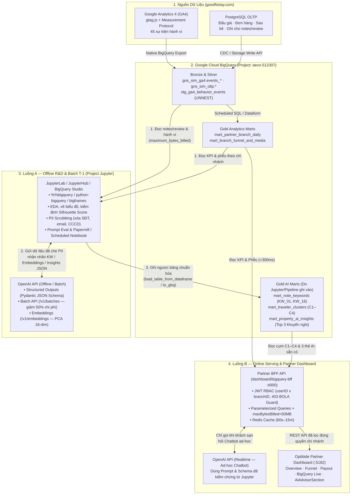

# Nghiên Cứu Kiến Trúc & Luồng Làm Việc Khi Tích Hợp Jupyter (`jupyter.org`) Vào Stack `GA4 + BigQuery + Partner Dashboard + OpenAI API` (`goodNstay`)

> **Phạm vi & Nguồn đối chiếu (Primary Sources)**: Tài liệu này tổng hợp và đối chiếu trực tiếp từ tài liệu chính thức của Project Jupyter (`jupyter.org`, `docs.jupyter.org`, `jupyterlab/jupyter-ai`), Google Cloud BigQuery (`docs.cloud.google.com/bigquery`, `googleapis/python-bigquery`, BigQuery DataFrames `bigframes`, BigQuery Studio / Colab Enterprise), OpenAI (`developers.openai.com`, `openai/openai-python`) và Papermill (`papermill.readthedocs.io`), ánh xạ 1-1 vào kiến trúc hiện hữu của `goodNstay` (`docs/ga4-bigquery/goodNstay_GA4_BigQuery_Research_Va_Trien_Khai_Dashboard.md`, `docs/ga4-bigquery/2026-11-23-bigquery-ga4-simulation-bff-and-rbac-viewport-design.md` và `docs/analytics-and-schema/2026-11-20-traveler-keyword-clustering-design.md`).

---

## 1. Tóm Tắt Nhanh: Tại Sao Thêm Jupyter Vào Stack Này?

Trong stack 4 mảnh ghép hiện hữu của `goodNstay` (**GA4 $\rightarrow$ BigQuery $\rightarrow$ Partner Dashboard $\leftarrow$ OpenAI API**), vẫn tồn tại một "khoảng trống kỹ thuật" lớn giữa **dữ liệu thô trong BigQuery** và **trí tuệ AI hiển thị trên Partner Dashboard**:

- **SQL trên BigQuery** rất mạnh để gom nhóm/lọc dữ liệu lớn, nhưng **không phù hợp** để làm sạch văn bản đa ngôn ngữ (`VI · EN · KO`), che lọc `PII`, thử nghiệm prompt OpenAI, trực quan hóa cây phân cụm `Ward Hierarchical Clustering`, hay đánh giá định lượng chất lượng khuyến nghị AI (*Prompt Evaluation*).
- **Backend BFF (`dashboard/bigquery-bff`)** phục vụ **Partner Dashboard (`dashboard/dashboard`)** phải trả kết quả dưới `300ms`, bảo mật đa chi nhánh (`userID × branchID`) và ổn định — **không phải nơi để Data/Dev thử nghiệm thuật toán hay gọi OpenAI API lặp đi lặp lại mỗi lần khách sạn F5 trang**.

**Jupyter (`https://jupyter.org/`) lấp đúng khoảng trống đó**: đóng vai trò **Phòng thí nghiệm Dữ liệu & AI tương tác (Interactive Data & AI Workbench)** kiêm **Xưởng chế biến theo lô (Offline / Nightly Batch Enrichment)** nằm giữa **BigQuery** và **OpenAI API**.

### Bảng Phân Vai Chuẩn Của 5 Mảnh Ghép Trong Stack

| Thành phần | Vai trò ĐÚNG trong hệ thống `goodNstay` | Sai lầm phổ biến cần TRÁNH |
| :--- | :--- | :--- |
| **1. Google Analytics 4 (`GA4`)** | Thu thập 45 sự kiện hành vi người dùng (`gtag.js` + Measurement Protocol) và đẩy tự động về BigQuery (`events_*`, `events_intraday_*`). | Không gọi `GA4 Data API (runReport)` trực tiếp cho Dashboard (dính trần 14k tokens/giờ & gộp dòng `(other)`); không dùng GA4 tính sổ cái tiền. |
| **2. Google BigQuery** | Kho dữ liệu trung tâm 3 tầng (**Bronze $\rightarrow$ Silver $\rightarrow$ Gold Mart**) hợp nhất hành vi GA4 + giao dịch OLTP + **kết quả AI đã tính sẵn (`mart_property_ai_insights`)**. | Không truy vấn trực tiếp bảng thô `events_*` trên mỗi lượt mở trang; không bật BigQuery RLS làm vô hiệu hóa BI Engine & Partition Pruning. |
| **3. Jupyter (`jupyter.org`)** | **(a) R&D & EDA:** Khám phá dữ liệu BigQuery, tìm "vùng giá ngọt", vẽ phễu 5 tầng rớt đơn.<br>**(b) ML & Prompt Lab:** Chạy phân cụm `C1–C4`, che lọc `PII`, thử nghiệm & đánh giá (Eval) prompt OpenAI Structured Outputs.<br>**(c) Batch Enrichment (`T-1`):** Chạy job đêm/tuần qua Papermill hoặc BigQuery Studio Scheduled Notebooks để ghi ngược kết quả AI vào BigQuery Gold Mart. | **KHÔNG đặt Jupyter trên đường đi request realtime của khách sạn** (Partner Dashboard tuyệt đối không gọi trực tiếp vào Jupyter Kernel); không dùng Jupyter thay thế React Dashboard cho đối tác bên ngoài; không commit `.ipynb` chứa PII/API key lên Git. |
| **4. OpenAI API** | **(a) Batch `T-1` (qua Jupyter/Python):** Bóc nhãn `free-text` Tầng 2 (`KW_01..KW_16`, Structured Outputs + Batch API giảm 50% chi phí), sinh `Embeddings` cho phân cụm GĐ2, sinh 3 thẻ chẩn đoán *"Tại sao Trúng vs. Không trúng thầu"*.<br>**(b) Realtime (qua BFF):** Trả lời câu hỏi ad-hoc trên Partner AI Chatbot bằng đúng Prompt/Schema đã kiểm chứng trong Jupyter. | Không gửi `notes` / `review` thô chưa che `PII` lên OpenAI; không gọi OpenAI đồng bộ cho hàng trăm chi nhánh khi tải trang Overview; không để AI tự bịa số liệu hoặc đề xuất ngoài đòn bẩy khách sạn. |
| **5. Partner Dashboard (`dashboard/dashboard` + `bigquery-bff`)** | Giao diện SaaS cho chủ khách sạn / quản lý / lễ tân. Đọc siêu tốc (`< 300ms`) từ **BigQuery Gold Mart** thông qua **BFF (`:4000`)** đã khóa cứng JWT RBAC (`userID × branchID`) + Redis Cache. | Không gọi thẳng BigQuery, Jupyter hay OpenAI API từ trình duyệt React (lộ credentials & lỗ hổng BOLA xem trộm doanh thu đối thủ). |

---

## 2. Sơ Đồ Kiến Trúc & 2 Luồng Vận Hành (End-to-End Flow)

Điểm cốt lõi để nắm trọn flow làm việc của stack 5 thành phần là **tách bạch 2 vòng lặp vận hành**:
1. **Luồng A (Offline / R&D & Batch `T-1`) — CÓ JUPYTER**: Đọc từ BigQuery $\rightarrow$ phân tích, che `PII`, phân cụm `C1–C4` & gọi OpenAI API trong Jupyter $\rightarrow$ ghi ngược kết quả chuẩn hóa vào bảng **BigQuery Gold AI Mart**.
2. **Luồng B (Online / Real-time Serving) — KHÔNG ĐI QUA JUPYTER**: Partner Dashboard gọi qua BFF (`:4000`) đọc siêu tốc các bảng Gold Mart đã tính sẵn; chỉ gọi OpenAI API trực tiếp từ BFF khi chủ khách sạn gõ câu hỏi chat mới (dùng đúng Prompt & JSON Schema đã chốt từ Jupyter).



---

## 3. Giải Phẫu Hệ Sinh Thái Project Jupyter (`https://jupyter.org/`)

### 3.1 Kiến Trúc 3 Tầng Tách Rời (Client – Server – Kernel)
Theo tài liệu chính thức của Project Jupyter ([What is Jupyter?](https://docs.jupyter.org/en/latest/what_is_jupyter.html), [Jupyter Architecture](https://docs.jupyter.org/en/latest/projects/architecture/content-architecture.html)), khi bạn mở Jupyter trên trình duyệt, thực chất có **3 tiến trình độc lập** phối hợp với nhau:

1. **Frontend (Web UI — JupyterLab / Notebook 7):** Giao diện trên trình duyệt hiển thị ô mã nguồn (*code cell*), văn bản giải thích (*Markdown / LaTeX*) và kết quả trực quan (bảng, biểu đồ, HTML). Giao diện **không tự chạy code**.
2. **Jupyter Server (`jupyter_server`):** Dịch vụ nền quản lý hệ thống tệp `.ipynb` (bản chất là văn bản **JSON** theo chuẩn `nbformat`), xác thực phiên, cung cấp REST API và làm cầu nối giữa trình duyệt và Kernel.
3. **Kernel (`ipykernel` cho Python):** Tiến trình hệ điều hành độc lập thực thi mã (REPL) và giữ trạng thái biến/DataFrame trong RAM, giao tiếp với Jupyter Server thông qua **Jupyter Messaging Protocol** trên socket **ZeroMQ (ZMQ)**. Nhờ tách biệt này, nếu trình duyệt lỡ đóng tab hoặc rớt mạng tạm thời, tiến trình tính toán nặng trong Kernel vẫn không bị sập ngay lập tức.

### 3.2 Các Công Cụ Chính Trong Hệ Sinh Thái `jupyter.org` Cần Biết

| Công cụ | Chức năng chính | Ứng dụng cụ thể cho đội `goodNstay` |
| :--- | :--- | :--- |
| **JupyterLab** | IDE web thế hệ mới (đa tab, chia đôi màn hình, terminal, xem CSV/JSON/Markdown, hỗ trợ hàng trăm extension). | Môi trường làm việc hàng ngày của Data / AI / Intern để viết notebook phân tích GA4, BigQuery và thử nghiệm OpenAI API. |
| **Jupyter Notebook (v7)** | Giao diện tối giản tập trung vào 1 tài liệu `.ipynb`, dùng chung kiến trúc nền với JupyterLab. | Phù hợp khi chỉ cần mở đọc/chạy nhanh 1 notebook báo cáo đơn lẻ. |
| **JupyterHub** | Phiên bản đa người dùng (multi-user), tự cấp phát và cô lập các server Jupyter riêng cho từng thành viên (chạy trên VM hoặc Kubernetes). | Dùng khi team `goodNstay` có nhiều người (Data, PM, QA, Intern) cần môi trường dùng chung chuẩn hóa mà không phải tự cài đặt từng máy. |
| **Jupyter AI (`jupyter-ai`)** | Extension chính thức của Project Jupyter nhúng trực tiếp LLM (bao gồm **OpenAI API**) vào JupyterLab qua khung chat *Jupyternaut* và cell magic `%%ai` (`jupyter-ai-magic-commands`). | Hỗ trợ viết nhanh truy vấn SQL BigQuery `UNNEST(event_params)`, giải thích lỗi Python, tóm tắt bảng kết quả và thử nhanh prompt OpenAI ngay trong cell. |
| **Papermill** | Thư viện chuẩn hóa việc truyền tham số (`parameters` cell tag) và chạy tự động file `.ipynb` từ CLI/Python/Airflow (`pm.execute_notebook`). | Biến notebook EDA/AI thành job chạy định kỳ ban đêm `T-1` (truyền tham số `run_date`, `partner_id`) và lưu bản `.ipynb` đã chạy làm nhật ký kiểm toán. |
| **Voilà** | Biến một notebook `.ipynb` thành web app tương tác **ẩn toàn bộ code cell**, chặn người xem chạy mã tùy ý. | Chỉ dùng dựng **bản mẫu nội bộ (internal prototype)** demo nhanh biểu đồ cho CTO/PM trước khi code chính thức lên React `dashboard/dashboard`. |
| **BigQuery Studio (Colab Enterprise)** | Môi trường notebook chuẩn `.ipynb` được Google nhúng trực tiếp ngay trong bảng điều khiển GCP BigQuery, hỗ trợ **Scheduled Notebooks** (powered by Dataform) và kết nối Git. | Lựa chọn "nhẹ vận hành nhất" trên chính GCP Project `aevo-512307` vì không phải tự dựng server JupyterHub và dùng chung luôn IAM / BigQuery DataFrames (`bigframes`). |

### 3.3 Nên Chạy Jupyter Ở Đâu Cho `goodNstay`? (So Sánh 3 Mô Hình Triển Khai)

| Tiêu chí | A. JupyterLab Local (trên máy dev/intern) | B. BigQuery Studio / Colab Enterprise (trên GCP `aevo-512307`) | C. Self-hosted JupyterHub (Docker / GKE) |
| :--- | :--- | :--- | :--- |
| **Độ dễ khởi động** | **Rất nhanh (5 phút)** qua `venv`/`uv`, miễn phí compute. | **Nhanh**, có sẵn trong GCP Console, kết nối BigQuery không cần tải JSON key về máy. | Trung bình–Cao (cần cấu hình TLS, OAuth, container isolation, per-user subdomain). |
| **Chi phí hạ tầng** | `$0` (chỉ tốn tiền quét BigQuery & token OpenAI). | Trả theo thời gian bật runtime máy ảo E2 chuẩn (tự tắt khi nhàn rỗi). | Trả phí VM/GKE cố định hàng tháng. |
| **Lên lịch chạy tự động (`T-1`)** | Không nên chạy cron trên laptop cá nhân. | **Có sẵn Scheduled Notebooks** (deploy version $\rightarrow$ Dataform chạy tự động, lưu log ra GCS). | Phải kết hợp thêm Airflow / Prefect / Cron + Papermill. |
| **Khuyến nghị theo giai đoạn** | **Giai đoạn 1 (Ngay lập tức):** Học flow, phát triển & Git review notebook `.ipynb` cục bộ. | **Giai đoạn 2 (Staging/Team):** Chạy chung trên GCP `aevo-512307` và lên lịch job đêm `T-1`. | Chỉ cân nhắc ở **Giai đoạn 3** nếu team Data lớn (>10 người) cần tùy biến hạ tầng riêng ngoài GCP. |

---

## 4. Chi Tiết 6 Bước Của Flow Làm Việc Thực Tế Trong `goodNstay`

Dưới đây là trình tự làm việc chi tiết từ đầu đến cuối để bạn nắm rõ từng điểm nối giữa 5 công cụ:

### Bước 1 — Dữ Liệu Đầu Vào Tại BigQuery (`GA4 + OLTP → Silver/Gold`)
- Hành vi người dùng (`booking_form`, `offer_listing`, `explore_stays`, `payment_form`) đổ từ GA4 vào `events_YYYYMMDD` / `events_intraday_YYYYMMDD` (trên môi trường giả lập hiện tại là `aevo-512307.gns_sim_ga4`).
- Dữ liệu giao dịch, báo giá, tài chính (`×1.265`) và văn bản `notes` / `review` đồng bộ từ OLTP vào `gns_sim_oltp`.
- Scheduled SQL trong BigQuery làm phẳng `UNNEST(event_params)` sang `gns_analytics_mart.stg_ga4_behavior_events` và các bảng Gold Mart ngày (`mart_partner_branch_daily`, `mart_branch_funnel_and_media`).

### Bước 2 — Nạp Dữ Liệu Từ BigQuery Vào Jupyter (3 Cách Chính Thức)
Trong JupyterLab (hoặc BigQuery Studio), tùy kích thước dữ liệu mà chọn 1 trong 3 cách chuẩn từ tài liệu Google:

1. **Cách 1 — `%%bigquery` Cell Magic (`bigquery-magics`)**: Tiện nhất cho bước khám phá nhanh SQL và kiểm thử truy vấn có tham số (`--params`), kết quả tự đổ thành pandas DataFrame.
2. **Cách 2 — `google-cloud-bigquery` Python Client**: Chuẩn nhất cho pipeline có kiểm soát chi phí vì thiết lập được **`QueryJobConfig(maximum_bytes_billed=..., query_parameters=...)`** (vượt ngưỡng byte tự hủy với phí `$0`) và dùng `to_dataframe()` (tự tối ưu tốc độ tải bằng BigQuery Storage Read API khi cài `google-cloud-bigquery-storage` + `pyarrow`).
3. **Cách 3 — BigQuery DataFrames (`bigframes.pandas as bpd`)**: Dùng cú pháp quen thuộc như pandas nhưng **đẩy toàn bộ tính toán và ML (`bigframes.ml`) chạy trực tiếp trên cụm BigQuery Cloud** — nguyên tắc quan trọng là **không gọi `.to_pandas()` trên toàn bộ bảng lớn** (chỉ `.peek()` hoặc tổng hợp nhỏ rồi mới vẽ biểu đồ) để tránh tràn RAM máy cá nhân.

### Bước 3 — Khám Phá (EDA), Kiểm Định Nghiệp Vụ & Bắt Buộc Che Lọc `PII`
Ngay trên notebook Jupyter, người làm dữ liệu thực hiện 3 việc mà SQL thuần khó làm tốt:
- **Kiểm định trực quan 3 câu hỏi của CTO:** Vẽ phân bố `saving_pct` theo tỷ lệ trúng thầu (kiểm chứng "vùng giá ngọt" `10–15%`), phân rã phễu rớt đơn 5 tầng theo từng nhóm cơ sở lưu trú, kiểm tra mối tương quan giữa việc có/thiếu Video (`content_category = 'videos'`) với tỷ lệ thoát trang chi tiết.
- **Lọc dữ liệu ngoài biên (Anti-Goals trong `2026-11-20-traveler-keyword-clustering-design.md`):** Loại bỏ thao tác nháp trước mốc `booking_form_complete` và loại lỗi thẻ/cổng thanh toán (`payment_fail`) khỏi vector đánh giá giá phòng của khách sạn.
- **Che lọc `PII` (`PII Scrubbing` — Bước 0 bắt buộc):** Dùng regex/NLP trong Python xóa sạch số điện thoại, email, số CCCD/hộ chiếu, URL và tên riêng trong `request.notes` / `review` **TRƯỚC khi bất kỳ dòng chữ nào rời khỏi môi trường nội bộ để gọi OpenAI API**.

### Bước 4 — Kết Nối Jupyter Với OpenAI API Cho 3 Bài Toán Cốt Lõi Của `goodNstay`
Trong Jupyter, OpenAI API được dùng theo **2 cách bổ trợ**:
- *(Hỗ trợ người làm notebook)*: Bật extension **`jupyter-ai`** (`%load_ext jupyter_ai_magic_commands`, truyền `OPENAI_API_KEY` qua `.env`) để dùng `%%ai` sinh code phân tích nhanh hoặc giải thích số liệu bất thường.
- *(Xử lý dữ liệu cốt lõi bằng Python SDK `openai`)*:
  1. **Tác vụ 4A — Bóc tách từ khóa `Free-Text` Tầng 2 (`Closed-Taxonomy Tagging`):**
     - Tầng 1 trong Python chạy bộ khớp từ điển 3 ngôn ngữ (`VI · EN · KO`) + luật phủ định 4 từ đứng trước (`0đ` chi phí, xử lý ~80% câu).
     - Chỉ ~5%–20% câu dài/phức tạp còn lại mới gửi sang **OpenAI Structured Outputs (`client.responses.parse(..., text_format=KeywordTagResult)`)** với `Literal["KW_01", ..., "KW_16"]` bằng Pydantic để ép mô hình **100% trả về JSON đúng mã chuẩn, không sinh chữ lan man**.
     - Khi chạy định kỳ hàng đêm (`T-1`) với hàng nghìn ghi chú, gom thành file `.jsonl` gửi qua **OpenAI Batch API (`/v1/batches`)** để **giảm 50% chi phí API** (cam kết trả kết quả trong 24h), khớp dòng bằng `custom_id`, và **chủ động xóa file `.jsonl` trên Files API sau khi tải kết quả về**.
  2. **Tác vụ 4B — Embeddings & Phân Cụm Máy Học Giai Đoạn 2 (`C1–C4`):**
     - Khi đạt ngưỡng `>= 5.000` yêu cầu sạch (chu kỳ `7 ngày`) trên `>= 30` cơ sở lưu trú: gọi `/v1/embeddings` trên văn bản `notes` đã che `PII` $\rightarrow$ nén `PCA 16-dim` $\rightarrow$ ghép với 6 biến liên tục chuẩn hóa + 16 cờ `KW_01..KW_16` thành vector $\mathbf{x}_r \in \mathbb{R}^{38}$.
     - Chạy `Ward Hierarchical Clustering` + `K-Means` trong Jupyter, vẽ biểu đồ kiểm định và chỉ duyệt xuất bản bộ tâm cụm mới nếu **`Silhouette Score >= 0.25`** và không có cụm nào `< 5%` lượng yêu cầu.
  3. **Tác vụ 4C — Thiết Kế, Đánh Giá Prompt & Sinh Thẻ Chẩn Đoán `AiAdvisorSection`:**
     - Chạy thử nghiệm prompt biến số liệu tổng hợp của từng `branch_id` thành **Top 3 thẻ khuyến nghị *"Tại sao Trúng thầu vs. Tại sao Không trúng thầu"*** (ràng buộc Schema JSON chặt, dùng 100% ngôn ngữ kinh doanh khách sạn theo `AGENTS.md` §8, không rò rỉ `snake_case`, chỉ khuyên trong tập đòn bẩy khách sạn kiểm soát được).
     - Xây bảng kiểm định (*Prompt Eval Set* ~20–50 kịch bản khách sạn: khách sạn đang vận hành vs. khách sạn mới 0 đánh giá vs. khách sạn bị rớt thanh toán) ngay trong Jupyter để chấm điểm độ chính xác trước khi cập nhật prompt cho hệ thống!

### Bước 5 — Ghi Ngược Kết Quả AI Từ Jupyter Về BigQuery Gold AI Mart
Jupyter **không đẩy thẳng JSON lên Frontend React**, mà ghi toàn bộ kết quả đã kiểm định vào các bảng chuẩn hóa trên **BigQuery (`gns_analytics_mart`)**:
- `gns_analytics_mart.mart_note_keywords` (nhãn `KW_01..KW_16` theo `request_id`, không lưu raw PII).
- `gns_analytics_mart.mart_traveler_clusters` (nhãn cụm chính `C1–C4`, điểm thành phần, phiên bản mô hình `model_version`).
- `gns_analytics_mart.mart_property_ai_insights` (partition theo `metric_date`, cluster theo `partner_id, branch_id`, chứa JSON các thẻ chẩn đoán & khuyến nghị đã qua kiểm duyệt schema cho từng chi nhánh).

Ghi từ Python bằng `client.load_table_from_dataframe(df, destination, job_config=LoadJobConfig(write_disposition="WRITE_TRUNCATE"))` (hoặc ghi theo từng phân vùng ngày `table_id$YYYYMMDD` để không bao giờ ghi đè mất lịch sử các ngày trước).

### Bước 6 — Phục Vụ Partner Dashboard (`dashboard/dashboard` :5182) Qua `bigquery-bff` (:4000)
- Khi chủ khách sạn / Quản lý chi nhánh mở **Optibide Partner Hub (`:5182`)**:
  - Frontend gọi `GET /api/v1/analytics/viewport` hoặc `/api/v1/analytics/bundle` tới `dashboard/bigquery-bff` (`:4000`) kèm JWT.
  - BFF xác thực `userID × branchID` (chặn `403 FORBIDDEN_BRANCH_SCOPE` nếu truy cập chéo chi nhánh, ẩn tài chính nếu `receptionist`), rồi chạy truy vấn có tham số (`@partnerId`, `UNNEST(@allowedBranchIds)`) đọc bảng **`mart_property_ai_insights`** cùng **`mart_partner_branch_daily`** trên BigQuery (kèm Redis/Memory Cache `60s–15m`).
  - **Kết quả:** Chủ khách sạn thấy ngay khuyến nghị AI chất lượng cao từ OpenAI với **độ trễ `< 300ms`**, **chi phí gọi OpenAI = `$0` trên mỗi lượt F5**, và **an toàn cô lập dữ liệu đa chi nhánh 100%**.
- Khi chủ khách sạn gõ câu hỏi tự do trong **Partner AI Chatbot** (luồng online):
  - BFF lấy đúng lát cắt số liệu của `branch_id` được phép từ BigQuery Gold Mart, nạp vào **đúng Prompt Template + Pydantic/JSON Schema đã được tối ưu trong Jupyter**, gọi OpenAI API và trả lời tức thì.

---

## 5. Mã Mẫu End-to-End Thực Chiến Trong Một Jupyter Notebook Cho `goodNstay`

### 5.1 Khởi Tạo Môi Trường Python Cô Lập (Không Cài Global)

```bash
# Tạo thư mục notebooks và môi trường ảo riêng
mkdir -p analytics-notebooks && cd analytics-notebooks
python3 -m venv .venv
source .venv/bin/activate

# Cài các thư viện chính thức của stack
pip install jupyterlab google-cloud-bigquery google-cloud-bigquery-storage \
            bigquery-magics bigframes pyarrow pandas scikit-learn plotly \
            openai pydantic python-dotenv papermill nbstripout

# Xác thực GCP ADC cho project aevo-512307 (không tải file JSON key về repo)
gcloud auth application-default login
gcloud config set project aevo-512307

# Bật tự động xóa cell output khi commit Git (chống lộ dữ liệu/PII)
nbstripout --install

# Khởi chạy JupyterLab
jupyter lab
```

> **Cấu hình bí mật cục bộ (`.env`, bắt buộc thêm vào `.gitignore`):**
> ```dotenv
> GCP_PROJECT_ID=aevo-512307
> BQ_LOCATION=US
> OPENAI_API_KEY=sk-temp-placeholder-replace-me
> ```

### 5.2 Khung Mã Python Trong Notebook (BigQuery $\rightarrow$ Che PII $\rightarrow$ OpenAI Structured Outputs $\rightarrow$ Ghi Ngược BigQuery)

```python
# === CELL 1 [Tag: parameters] (Hỗ trợ Papermill chạy tự động T-1) ===
PROJECT_ID = "aevo-512307"
BQ_LOCATION = "US"
RUN_DATE = "2026-11-06"          # Ghi đè tự động khi chạy Papermill
OPENAI_MODEL = "gpt-4o-mini"     # Hoặc model nhẹ phù hợp ngân sách
MAX_BYTES_BILLED = 50 * 1024 * 1024  # Trần cứng 50 MiB/query

# === CELL 2: Đọc snapshot chi nhánh từ BigQuery Gold Mart (Có khóa chi phí) ===
import os, re, json
import pandas as pd
from dotenv import load_dotenv
from google.cloud import bigquery
from openai import OpenAI
from pydantic import BaseModel, Field
from typing import List, Literal

load_dotenv()
bq = bigquery.Client(project=PROJECT_ID, location=BQ_LOCATION)
oai = OpenAI(api_key=os.environ["OPENAI_API_KEY"])

sql = """
SELECT
  partner_id,
  branch_id,
  SUM(total_bids) AS total_bids,
  SUM(accepted_paid_bids) AS won_bids,
  SUM(rejected_bids) AS rejected_bids,
  SUM(expired_bids) AS expired_bids,
  AVG(avg_saving_pct) AS avg_saving_pct,
  AVG(avg_match_rate_pct) AS avg_match_rate_pct,
  AVG(avg_decision_duration_sec) AS avg_decision_sec
FROM `gns_analytics_mart.mart_partner_branch_daily`
WHERE metric_date BETWEEN DATE_SUB(@run_date, INTERVAL 30 DAY) AND @run_date
GROUP BY partner_id, branch_id
"""
job_cfg = bigquery.QueryJobConfig(
    query_parameters=[bigquery.ScalarQueryParameter("run_date", "DATE", RUN_DATE)],
    maximum_bytes_billed=MAX_BYTES_BILLED,
    use_query_cache=True,
)
df_branches = bq.query(sql, job_config=job_cfg).to_dataframe()
df_branches.head()

# === CELL 3: Hàm che lọc PII bắt buộc (dùng cho notes/review trước khi gọi OpenAI) ===
PII_PATTERNS = [
    (re.compile(r"[\w.+-]+@[\w-]+\.[\w.-]+"), "[EMAIL]"),
    (re.compile(r"\+?\d[\d\s\-().]{7,15}\d"), "[PHONE]"),
    (re.compile(r"https?://\S+"), "[URL]"),
]
def scrub_pii(text: str) -> str:
    clean = text or ""
    for pattern, token in PII_PATTERNS:
        clean = pattern.sub(token, clean)
    return clean.strip()

# === CELL 4: Khóa cứng JSON Schema bằng Pydantic + OpenAI Structured Outputs ===
class ActionCard(BaseModel):
    lever: Literal[
        "pricing_discount_band",
        "auto_bid_speed",
        "multi_room_bundle",
        "amenity_package",
        "media_and_video",
        "first_review_boost",
    ]
    headline_vi: str = Field(description="Tiêu đề kinh doanh ngắn gọn, không chứa biến snake_case")
    why_won_or_lost_vi: str = Field(description="Giải thích ngắn dựa đúng số liệu đầu vào")
    recommended_action_vi: str = Field(description="1 hành động cụ thể khách sạn tự làm được ngay")

class BranchAiDiagnosis(BaseModel):
    primary_bottleneck: Literal["visibility_speed", "price_saving", "amenity_gap", "media_trust", "balanced"]
    cards: List[ActionCard] = Field(min_length=3, max_length=3)

records = []
for row in df_branches.to_dict(orient="records"):
    prompt_payload = {
        "total_bids": int(row["total_bids"]),
        "won_bids": int(row["won_bids"]),
        "rejected_bids": int(row["rejected_bids"]),
        "expired_bids": int(row["expired_bids"]),
        "avg_saving_pct": round(float(row["avg_saving_pct"] or 0), 2),
        "avg_match_rate_pct": round(float(row["avg_match_rate_pct"] or 0), 2),
        "avg_decision_sec": round(float(row["avg_decision_sec"] or 0), 1),
    }
    resp = oai.responses.parse(
        model=OPENAI_MODEL,
        input=[
            {
                "role": "system",
                "content": (
                    "Bạn là cố vấn vận hành khách sạn của goodNstay. "
                    "Chỉ dùng đúng số liệu được cung cấp, viết tiếng Việt kinh doanh tự nhiên, "
                    "tuyệt đối không dùng tên biến kỹ thuật snake_case, không bịa số liệu."
                ),
            },
            {"role": "user", "content": json.dumps(prompt_payload, ensure_ascii=False)},
        ],
        text_format=BranchAiDiagnosis,
    )
    parsed = resp.output_parsed
    records.append({
        "metric_date": pd.to_datetime(RUN_DATE).date(),
        "partner_id": row["partner_id"],
        "branch_id": row["branch_id"],
        "primary_bottleneck": parsed.primary_bottleneck,
        "cards_json": parsed.model_dump_json(),
        "model_used": OPENAI_MODEL,
    })

# === CELL 5: Ghi ngược kết quả về BigQuery Gold AI Mart cho BFF đọc (<300ms) ===
df_out = pd.DataFrame(records)
partition_suffix = RUN_DATE.replace("-", "")
dest_table = f"{PROJECT_ID}.gns_analytics_mart.mart_property_ai_insights${partition_suffix}"

load_cfg = bigquery.LoadJobConfig(
    write_disposition=bigquery.WriteDisposition.WRITE_TRUNCATE,
    time_partitioning=bigquery.TimePartitioning(field="metric_date"),
    clustering_fields=["partner_id", "branch_id"],
)
load_job = bq.load_table_from_dataframe(df_out, dest_table, job_config=load_cfg)
load_job.result()
print(f"Đã ghi {len(df_out)} bản ghi AI Insights vào {dest_table}")
```

*(Lưu ý: Khi xử lý từ vài trăm đến hàng chục nghìn ghi chú `notes` hoặc chi nhánh mỗi đêm, thay vòng `for` gọi đồng bộ ở Cell 4 bằng **OpenAI Batch API (`/v1/batches`)** để giảm 50% chi phí và không dính rate limit).*

---

## 6. Quy Chuẩn Tổ Chức Thư Mục & Lộ Trình Từ Notebook Lên Production

### 6.1 Cấu Trúc Thư Mục `analytics-notebooks/` Gợi Ý Cho Team `goodNstay`
Để tránh tình trạng "rác notebook" (`Untitled1.ipynb`, `test_final_v2.ipynb`), nên chia theo **5 chặng đúng với vòng đời dữ liệu**:

```text
analytics-notebooks/
├── README.md                              # Hướng dẫn chạy venv, ADC, .env & quy ước đặt tên
├── requirements.txt                       # Khóa phiên bản thư viện Python
├── src/                                   # Mã Python tái sử dụng (import vào notebook & có unit test)
│   ├── pii_scrubber.py                    # Che SĐT, email, CCCD, URL trước khi gửi OpenAI
│   ├── keyword_rules_t1.py                # Bộ từ điển KW_01..KW_16 đa ngôn ngữ VI/EN/KO + luật phủ định
│   └── openai_schemas.py                  # Pydantic schemas cho KeywordTagging & BranchAiDiagnosis
├── notebooks/
│   ├── 01_eda_ga4_funnel_and_pricing.ipynb    # Khám phá GA4 UNNEST, phễu 5 tầng & vùng giá ngọt 10–15%
│   ├── 02_freetext_keyword_tagging_t1_t2.ipynb# Chạy Tầng 1 từ điển + Tầng 2 OpenAI Structured/Batch API
│   ├── 03_traveler_clustering_c1_c4.ipynb     # GĐ1 chấm điểm trọng số & GĐ2 Embeddings + Ward/K-Means
│   ├── 04_ai_advisor_prompt_eval.ipynb        # Chấm điểm Prompt trên 20–50 case khách sạn (Eval Matrix)
│   └── 05_publish_gold_ai_mart.ipynb          # Notebook gắn tag `parameters` chạy Papermill/Scheduled Job
└── tests/                                 # Unit tests cho src/ (pii_scrubber, keyword_rules_t1, schemas)
```

### 6.2 Thang Chuyển Dịch 3 Cấp Từ Thử Nghiệm Lên Production (Notebook $\rightarrow$ Production Ladder)

1. **Cấp 1 — Khám phá & Kiểm chứng (Interactive R&D trên JupyterLab / BigQuery Studio):**
   - Dùng cho việc thăm dò dữ liệu GA4 mới, thử thuật toán phân cụm, so sánh chất lượng giữa các model OpenAI và xuất biểu đồ họp với CTO/PM.
2. **Cấp 2 — Tự động hóa nhẹ cho Staging / Pilot (`Papermill` hoặc `BigQuery Studio Scheduled Notebooks`):**
   - Gắn tag `parameters` cho notebook `05_publish_gold_ai_mart.ipynb`.
   - Chạy tự động mỗi đêm (`T-1`, ví dụ `02:00 ICT`) qua **BigQuery Studio Scheduled Notebooks** (Dataform tự chạy trên runtime E2 và xuất bản `.ipynb` đã chạy kèm biểu đồ/log lên Cloud Storage Bucket `GCS` để audit) hoặc qua CLI `papermill 05_publish_gold_ai_mart.ipynb gs://.../run_2026-11-06.ipynb -p RUN_DATE 2026-11-06`.
3. **Cấp 3 — Vận hành Production Quy Mô Lớn (Tách `.py` + CI/CD):**
   - Khi logic bóc keyword, phân cụm và sinh insight đã ổn định, chuyển phần lõi sang gói Python thuần (`src/` có unit test chạy CI/CD) và đóng gói chạy trên **Cloud Run Jobs** hoặc **Cloud Composer (Airflow)**; có thể dùng `jupytext` để đồng bộ 2 chiều `.ipynb ↔ .py` giúp Git diff sạch sẽ. Lúc này Jupyter quay về đúng vai trò mạnh nhất: nghiên cứu mô hình mới, điều tra sự cố dữ liệu bất thường và tái đánh giá Prompt.

---

## 7. Rào Chắn Bảo Mật, Quyền Riêng Tư & Kiểm Soát Chi Phí

1. **Quyền Riêng Tư Dữ Liệu Với OpenAI API (`PII` & Data Retention):**
   - Theo chính sách dữ liệu doanh nghiệp chính thức của OpenAI ([API Data Privacy](https://openai.com/enterprise-privacy/)), dữ liệu gửi qua **OpenAI API mặc định KHÔNG được dùng để huấn luyện mô hình**.
   - Tuy nhiên, theo mặc định OpenAI vẫn lưu nhật ký giám sát lạm dụng (*Abuse Monitoring Logs*) tối đa **30 ngày** (muốn **Zero Data Retention — ZDR** cần ký thỏa thuận riêng với OpenAI Sales, không phải nút tự bật). Với **Batch API**, file `.jsonl` được lưu qua **Files API** nên pipeline **bắt buộc gọi `client.files.delete(...)`** sau khi tải xong kết quả.
   - Do đó, nguyên tắc sống còn của `goodNstay`: **100% che lọc `PII` (`scrub_pii`) và chỉ gửi số liệu tổng hợp hoặc câu ghi chú đã ẩn danh**, tuyệt đối không gửi `user_id` thật, email, SĐT, thông tin thanh toán hay tên riêng khách lên OpenAI.
2. **Bảo Mật Multi-Tenant & Truy Cập BigQuery Từ Jupyter:**
   - **Tách quyền rõ ràng:** Tài khoản chạy Jupyter của Data Engineer chỉ được cấp quyền đọc dataset phân tích (`roles/bigquery.dataViewer`) và chỉ được ghi vào dataset đích `gns_analytics_mart` (`roles/bigquery.dataEditor` giới hạn ở mức dataset, **không cấp quyền ghi vào `gns_sim_oltp` hay bảng nguồn**).
   - **Không mở Jupyter ra Internet công cộng:** Theo tài liệu bảo mật chính thức của Jupyter (`docs.jupyter.org`), luôn chạy JupyterLab trên `localhost` khi dev cục bộ; nếu triển khai JupyterHub cho team thì bắt buộc bật **HTTPS/TLS**, xác thực **OAuth/SSO**, cô lập container theo người dùng và cân nhắc **per-user subdomain** để chống XSS/XSRF giữa các thành viên.
   - **Vệ sinh Git (`.ipynb` Hygiene):** Luôn dùng `nbstripout` trước khi commit để xóa cell output (tránh vô tình đẩy bảng dữ liệu khách sạn hay token vào lịch sử Git) và giữ `.env` trong `.gitignore`.
3. **Khóa Chi Phí 3 Tầng (BigQuery + OpenAI + Compute):**
   - **BigQuery:** Luôn đặt `maximum_bytes_billed` trong mọi `QueryJobConfig` ở Python (giống chuẩn `50 MiB` ở `bigquery-bff`), luôn lọc cột `PARTITION BY` (`metric_date` / `event_date`), và dùng `bigframes` khi cần xử lý bảng lớn thay vì kéo `.to_pandas()`.
   - **OpenAI API:** Dùng mô hình gọn nhẹ cho Tầng 2 Keyword Tagging & tổng hợp thẻ, kết hợp **Batch API (giảm 50% chi phí)** cho job đêm `T-1` và **tái sử dụng kết quả từ BigQuery Gold AI Mart** thay vì gọi lại OpenAI mỗi lần mở Dashboard.
   - **Jupyter Runtime:** Nếu dùng BigQuery Studio / Colab Enterprise Scheduled Notebooks, thiết lập auto-shutdown runtime E2 khi nhàn rỗi và chỉ chạy đúng khung lịch `T-1` / hàng tuần.

---

## 8. Danh Mục Nguồn Tài Liệu Chính Thức (Primary Sources)

1. **Project Jupyter (`jupyter.org` & `docs.jupyter.org`)**:
   - Trang chủ & Hệ sinh thái Project Jupyter: https://jupyter.org/
   - Kiến trúc Client–Server–Kernel (*What is Jupyter?*): https://docs.jupyter.org/en/latest/what_is_jupyter.html
   - Tổng quan kiến trúc dự án (IPython Kernel, `.ipynb` / `nbformat`, JupyterLab, JupyterHub): https://docs.jupyter.org/en/latest/projects/architecture/content-architecture.html
   - Jupyter AI (Tích hợp OpenAI API, `OPENAI_API_KEY`, Jupyternaut & Magic commands `%%ai`): https://github.com/jupyterlab/jupyter-ai/blob/main/docs/source/users/jupyternaut/index.md · https://github.com/jupyterlab/jupyter-ai/blob/main/docs/source/users/magic_commands/index.md
   - Voilà (Chuyển notebook thành web app nội bộ ẩn code): https://voila.readthedocs.io/
   - Papermill (Tham số hóa & chạy tự động notebook trong pipeline): https://papermill.readthedocs.io/
2. **Google Cloud BigQuery + Notebooks & Python**:
   - BigQuery Python Client (`QueryJobConfig.maximum_bytes_billed`, `to_dataframe`, `load_table_from_dataframe`): https://github.com/googleapis/python-bigquery/blob/main/docs/reference.rst
   - IPython Magics cho BigQuery (`bigquery-magics` / `%%bigquery --params`): https://cloud.google.com/bigquery/docs/visualize-jupyter
   - BigQuery DataFrames (`bigframes` Quickstart & Session I/O): https://docs.cloud.google.com/bigquery/docs/dataframes-quickstart · https://docs.cloud.google.com/bigquery/docs/dataframes-sessions-io
   - Lên lịch chạy Notebooks trong BigQuery Studio / Colab Enterprise: https://docs.cloud.google.com/bigquery/docs/orchestrate-notebooks
   - BigQuery Scheduled Queries: https://docs.cloud.google.com/bigquery/docs/scheduling-queries
3. **OpenAI API & Python SDK**:
   - OpenAI Python SDK — Structured Outputs (`client.responses.parse` & `client.chat.completions.parse` với Pydantic): https://github.com/openai/openai-python/blob/main/helpers.md
   - OpenAI Batch API (Giảm 50% chi phí, định dạng `.jsonl` & khớp `custom_id`): https://developers.openai.com/api/docs/guides/batch · https://developers.openai.com/cookbook/examples/batch_processing
   - Chính sách quyền riêng tư dữ liệu API (Không train trên dữ liệu API, 30-day abuse logs & Zero Data Retention): https://openai.com/enterprise-privacy/
4. **Tài Liệu Nội Bộ `goodNstay` Liên Quan Trực Tiếp**:
   - Kiến trúc GA4 + BigQuery + Partner Dashboard: `docs/ga4-bigquery/goodNstay_GA4_BigQuery_Research_Va_Trien_Khai_Dashboard.md`
   - Thiết kế giả lập BigQuery (`aevo-512307`), `bigquery-bff` (`:4000`) & RBAC `userID × branchID`: `docs/ga4-bigquery/2026-11-23-bigquery-ga4-simulation-bff-and-rbac-viewport-design.md`
   - Từ điển 16 Keywords đa ngôn ngữ & Phân cụm 2 giai đoạn `C1–C4`: `docs/analytics-and-schema/2026-11-20-traveler-keyword-clustering-design.md`
