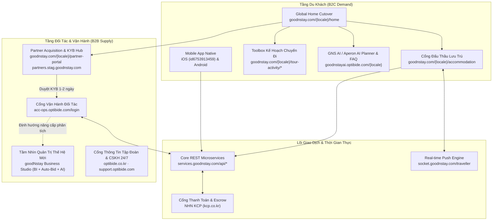
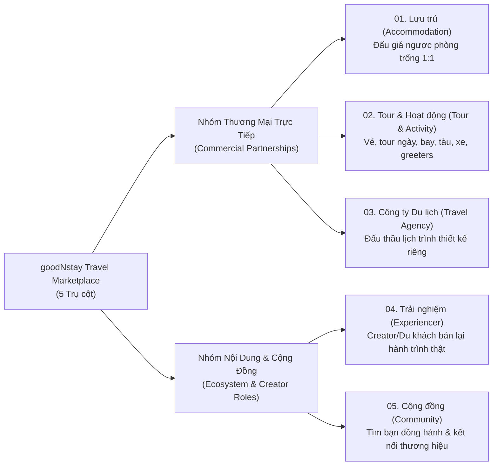
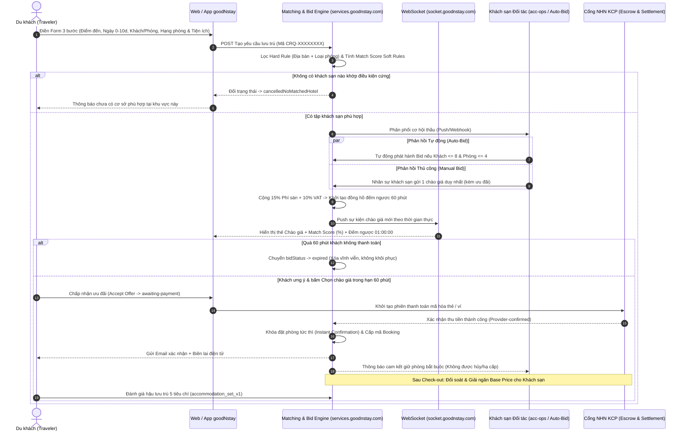
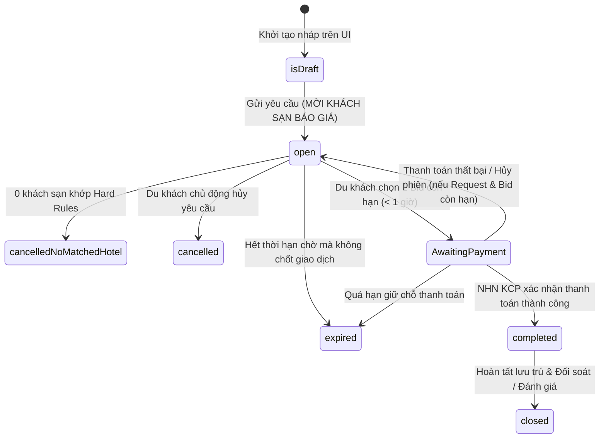

# Báo Cáo Giải Phẫu Toàn Diện Nghiệp Vụ, Hệ Sinh Thái & Định Hướng Chiến Lược — goodNstay (`goodnstay.com`)

> **Ngày khảo sát & trích xuất dữ liệu thực tế**: `04/11/2026`  
> **Điểm khởi phát khảo sát**: `https://goodnstay.com/vi-VN/home` (kiểm chứng trên cả phiên **Guest** chưa đăng nhập và phiên **Signed-In** tài khoản thực nghiệm, kết hợp bóc tách API `services.goodnstay.com`, WebSocket, gói JS Next.js, `sitemap.xml`, `robots.txt`, `llms.txt` và hệ thống các cổng vệ tinh của Optibide).  
> **Mục tiêu tài liệu**: Cung cấp bức tranh toàn diện từ gốc rễ bài toán kinh doanh, mô hình doanh thu, quy tắc vận hành chi tiết từng phân hệ, luồng trạng thái dữ liệu, chính sách pháp lý – thanh toán – đối soát, cho tới kiến trúc kỹ thuật và lộ trình phát triển dài hạn mà hệ thống **goodNstay** đang hướng tới.

---

## 1. Pháp Nhân Vận Hành, Định Vị Thương Hiệu & Bài Toán Gốc Rễ

### 1.1 Hồ sơ Pháp nhân & Cấu trúc Vận hành Xuyên biên giới
Toàn bộ nền tảng **goodNstay** được sở hữu và vận hành chính thức bởi một startup công nghệ du lịch (TravelTech) Hàn Quốc đang mở rộng mạnh sang Đông Nam Á:

| Hạng mục | Thông tin xác thực trên hệ thống |
| :--- | :--- |
| **Pháp nhân chủ quản** | **Optibide Co., Ltd.** (*Công ty Cổ phần Optibide*) |
| **Đại diện pháp luật (CEO)** | **Lee Hyun Seung** |
| **Mã số doanh nghiệp (KR)** | `241-86-03602` |
| **Giấy phép TMĐT / Bán hàng từ xa** | `Số 2025-Gangwon-Gangneung-0528` |
| **Hotline CSKH quốc tế** | `+82-70-7954-8211` · Email quản trị: `supports@optibide.com` |
| **Trụ sở chính (HQ)** | Phòng 215, Trung tâm phần mềm Số 4, đường Gyeonggang-ro 2326beon-gil, TP. Gangneung, tỉnh Gangwon, Hàn Quốc |
| **Trung tâm R&D** | 25-23 Dasanjungang-ro 19beon-gil, F336–F337, Dasan-dong, Namyangju, tỉnh Gyeonggi, Hàn Quốc |
| **Trung tâm Chuyển đổi số (DT)** | Tầng trệt, 2A1–2A2 Nguyễn Thị Minh Khai, phường Sài Gòn, TP. Hồ Chí Minh, Việt Nam |
| **Quy ước tên thương hiệu** | Hiển thị **`goodNstay`** trên mọi ngôn ngữ quốc tế, riêng bản tiếng Hàn (`ko-KR`) sử dụng **`굿앤스테이`**; Slogan: *"goodNstay · Life is Journey"* |
| **Ứng dụng di động chính thức** | **iOS App Store**: `id6753913459` · **Google Play Store**: `com.optibide.otacustomer` |

### 1.2 Bài toán Kinh tế Gốc rễ ("Tại sao goodNstay ra đời?")
Ngành khách sạn và dịch vụ du lịch tồn tại một nghịch lý cấu trúc kéo dài hàng thập kỷ mà các kênh OTA truyền thống (Booking.com, Agoda, Expedia, Traveloka...) không giải quyết triệt để được:

1. **Nỗi đau phía Cung (Khách sạn & Nhà điều hành dịch vụ)**:
   - **Tài sản dễ hỏng 100% (*Perishable Inventory*)**: Trung bình khoảng **30% công suất phòng khách sạn** (hoặc suất tour, lớp workshop) bị bỏ trống vào sát giờ nhận phòng. Một đêm phòng trôi qua không có khách đồng nghĩa doanh thu đêm đó mất trắng vĩnh viễn, trong khi chi phí cố định (nhân sự, khấu hao, vận hành tòa nhà) vẫn phải chi trả.
   - **Bẫy Ngang giá (*OTA Rate Parity*) & Xói mòn thương hiệu**: Khách sạn rất muốn xả phòng trống sát ngày với giá ưu đãi sâu để thu hồi dòng tiền. Tuy nhiên, nếu hạ giá công khai trên mặt tiền OTA, họ vừa vi phạm cam kết *Rate Parity* với các kênh phân phối khác, vừa làm sụt giảm định vị giá trị thương hiệu trong mắt khách đã đặt sớm với giá cao.
   - **Bào mòn biên lợi nhuận bởi Hoa hồng & Đấu thầu quảng cáo**: Các OTA truyền thống thu hoa hồng từ **15% – 30%** trên mỗi đặt phòng, cộng thêm chi phí đấu giá từ khóa/vị trí xếp hạng hiển thị (*Pay-to-play Sponsored Ranking*), khiến khách sạn vừa mất biên lợi nhuận vừa phụ thuộc hoàn toàn vào thuật toán hiển thị của sàn.

2. **Nỗi đau phía Cầu (Du khách)**:
   - **Quá tải tìm kiếm (*Search Fatigue*)**: Du khách phải mở hàng chục tab, tự lọc hàng trăm khách sạn có mức giá niêm yết na ná nhau mà không biết đâu mới là nơi đang sẵn sàng tặng thêm quyền lợi tốt nhất cho lịch trình cụ thể của mình.
   - **Không tiếp cận được "kho giá ẩn"**: Du khách đi sát ngày hoặc linh hoạt loại phòng không có kênh chính thống để thương lượng trực tiếp 1:1 với khách sạn.

3. **Lời giải cốt lõi của goodNstay — Sàn Đấu Thầu Ngược Dựa Trên Ý Định (*Intent-Driven 1:1 Private Reverse Auction*)**:
   - Đảo ngược hoàn toàn chiều tương tác: Thay vì **Khách đi tìm phòng niêm yết giá tĩnh**, **Khách công bố nhu cầu chuyến đi -> Khách sạn chủ động đấu thầu gửi chào giá riêng tư 1:1**.
   - Vì mỗi chào giá chỉ hiển thị riêng tư cho đúng tài khoản du khách gửi yêu cầu và tự hủy sau **1 giờ**, khách sạn thoải mái tung mức giá xả phòng trống cạnh tranh kèm đặc quyền (bữa sáng, nâng hạng phòng, trả phòng trễ...) mà **không phá vỡ mặt bằng giá niêm yết công khai trên các OTA khác**.

---

## 2. Bản Đồ Toàn Cảnh Hệ Sinh Thái Đa Cổng (Multi-Portal Ecosystem)

Khi truy cập `https://goodnstay.com/vi-VN/home`, người dùng thực chất đang đứng tại "cửa ngõ tổng hợp" của một hệ sinh thái gồm **8 cổng web/dịch vụ chuyên biệt** liên kết chặt chẽ dưới hạ tầng của Optibide:

### Bảng Phân vai Chi tiết Từng Miền (Domain/Subdomain)
| Miền / Đường dẫn | Tên phân hệ | Vai trò nghiệp vụ trong hệ sinh thái |
| :--- | :--- | :--- |
| `goodnstay.com/{locale}/home` | **Global Marketplace Home** | Mặt tiền tổng hợp mới (`data-gns-home-root="cutover"`), định vị goodNstay là siêu chợ du lịch 5 trụ cột, thu thập nhu cầu ngay tại Hero Form. |
| `goodnstay.com/{locale}/accommodation` | **Accommodation Reverse-Auction App** | Phân hệ giao dịch chủ lực: Đăng nhập/Đăng ký, trình tạo yêu cầu lưu trú 3 bước, quản lý đa tab yêu cầu, nhận thầu thời gian thực, lịch sử đặt chỗ (`/history/*`), tin nhắn (`/messages`), thông báo (`/notifications`) và hồ sơ (`/user-profile`). |
| `goodnstay.com/{locale}/tour-activity/*` | **Travel Planning Toolbox** | Bộ công cụ lập kế hoạch chuyến đi một điểm chạm gồm 5 nhánh: Chuyến bay (`/flights`), Tàu hỏa (`/trains`), Xe ô tô (`/cars`), Điểm tham quan & Hoạt động (`/attractions-activities`), và Dịch vụ đón hỗ trợ sân bay (`/greeters`). |
| `goodnstayai.optibide.com/{locale}` | **GNS AI (Aperon AI) & Help Hub** | Trợ lý tư vấn hành trình cao cấp chạy trên OpenAI/ChatGPT (xuất bản *Travel Brief Deck* theo ngày, khu vực ở, ngân sách, ẩm thực) kiêm cổng lưu trữ bộ **35 FAQ nghiệp vụ chính thức** (`/support/faqs`). |
| `goodnstay.com/{locale}/partner-portal` | **Partner Hub & KYB Onboarding** | Cổng tuyển mộ và nộp hồ sơ thẩm định pháp lý (KYB) cho các nhóm đối tác: Khách sạn (`/join-partner`), Tour & Hoạt động (`/tour-and-activity-partner`), Đại lý du lịch (`/travel-partner`), Người trải nghiệm (`/experiencer-partner`). |
| `acc-ops.optibide.com/login` | **Optibide Partner Portal (`acc-ops`)** | Hệ thống tác nghiệp hàng ngày của cơ sở lưu trú: Nhận thông báo yêu cầu mới, gửi chào giá thủ công, thiết lập quy tắc Auto-Bid, quản lý lịch phòng, chat với khách và tải chứng từ đối soát. |
| `services.goodnstay.com` & `socket.goodnstay.com` | **Backend API & Socket Gateway** | Nền tảng xử lý nghiệp vụ trung tâm, thuật toán khớp lệnh cứng/mềm, tính phí/thuế, đẩy sự kiện giá thầu và đếm ngược trực tiếp xuống trình duyệt/ứng dụng. |
| `optibide.co.kr` & `support.optibide.com` | **Corporate Site & 24/7 Support** | Trang giới thiệu sản phẩm cấp tập đoàn, nơi tải cẩm nang hướng dẫn (*Traveller Guide* / *Partner Guide* cho 7 thị trường ngôn ngữ) và cổng Chatbot hỗ trợ sự cố khẩn cấp 24/7. |

---

## 3. Chiến Lược 5 Trụ Cột Sản Phẩm (5 Marketplace Verticals)

Trên trang chủ `/vi-VN/home`, hệ thống công bố rõ tầm nhìn mở rộng từ một ứng dụng đặt phòng khách sạn thành **Marketplace Du lịch 5 Trụ cột (`01 / 05`)**, chia thành **2 nhóm vai trò kinh tế** (như được định nghĩa rõ trên Partner Hub: *Commercial Business Partnerships* và *Ecosystem Content/Community Roles*):

### 3.1 Trụ cột 1: Lưu trú (`Accommodation`) — Mũi nhọn cốt lõi đã vận hành thực tế
- **Đối tượng cung cấp**: Khách sạn, resort, boutique hotel, villa, căn hộ dịch vụ, ryokan.
- **Cơ chế nghiệp vụ**: Đấu thầu ngược 1:1 cho nhu cầu lưu trú ngắn hạn (cửa sổ đặt phòng sát ngày **0 – 10/14 ngày** trước check-in).
- **Lợi thế cạnh tranh**: Hoa hồng 0% trừ vào giá gốc đối tác, không bán quảng cáo xếp hạng, bảo vệ tuyệt đối cấu trúc giá công khai của khách sạn.

### 3.2 Trụ cột 2: Tour & Hoạt động (`Tour & Activity`) — Tổ hợp Di chuyển & Trải nghiệm điểm đến
Không chỉ dừng ở vé tham quan, đường dẫn `/vi-VN/tour-activity` tiết lộ tham vọng gom **5 mảnh ghép hậu cần chuyến đi** về chung một tài khoản du khách để khách không phải chuyển đổi qua lại giữa 5 ứng dụng rời rạc:
1. **Điểm tham quan & Hoạt động (`/attractions-activities`)**: Đặt tour trong ngày, vé tham quan, lớp học bản địa, du thuyền theo cấu trúc gói phân tầng (**`Basic` / `Premium` / `Elite`**), tính vé theo **Người lớn (`Adult`) / Trẻ em (`Children`)**, hỗ trợ cả thêm vào giỏ hàng (`Add To Cart`) và đặt ngay (`Book`).
2. **Chuyến bay (`/flights`)**: Tìm vé một chiều/khứ hồi, đối chiếu hạng khoang & hành lý, chuyển tiếp hoàn tất thanh toán với đối tác hàng không liên kết (tập trung các trục bay Đông Bắc Á – Đông Nam Á như *Seoul → Đà Nẵng*, *Seoul → Tokyo*, *Busan → Osaka*).
3. **Tàu hỏa (`/trains`)**: Tra cứu tàu cao tốc và liên tỉnh (*KTX Seoul → Busan*, *Seoul → Gangneung*, *tàu đêm Hà Nội → Đà Nẵng*).
4. **Xe ô tô (`/cars`)**: Đặt xe đưa đón sân bay giá cố định khớp giờ hạ cánh, thuê xe riêng có tài xế theo ngày hoặc xe tự lái.
5. **Dịch vụ đón hỗ trợ (`/greeters`)**: Dịch vụ trợ lý bản địa đón tận cửa máy bay/nhà ga để hỗ trợ ngôn ngữ, nối chuyến gấp hoặc đi cùng gia đình có người cao tuổi/trẻ nhỏ (* xác nhận theo yêu cầu*).

> [!IMPORTANT]
> **Quy tắc bảo hộ cạnh tranh độc đáo của mảng Tour & Hoạt động** (trích từ `/vi-VN/tour-and-activity-partner`):  
> - **Giới hạn mật độ cung**: Trong cùng một thành phố, goodNstay **chỉ tiếp nhận tối đa 10 đối tác cho mỗi dòng sản phẩm giống nhau** nhằm chống phá giá và bảo đảm doanh thu bền vững cho từng nhà điều hành.  
> - **Mô hình phí & dòng tiền**: Thu mức phí vận hành cố định tối thiểu hàng tháng (thay vì cắt % hoa hồng cao), giới hạn cửa sổ sử dụng trong vòng **10 ngày** sau khi đặt để giảm tỷ lệ hủy, và **thanh toán đối soát nhanh trong vòng 7 ngày** sau khi khách sử dụng dịch vụ.

### 3.3 Trụ cột 3: Công ty Du lịch (`Travel Agency`) — Đấu thầu Lịch trình Thiết kế Riêng
- **Ý tưởng cốt lõi**: Mang mô hình đấu giá ngược từ "đặt phòng lẻ" sang **"đặt tour trọn gói may đo" (*Custom Trip Proposal Bidding*)**.
- **Luồng vận hành**: Du khách chia sẻ kế hoạch chuyến đi (điểm đến, số ngày, quy mô đoàn, phong cách mong muốn) -> Các công ty lữ hành đã xác minh gửi **đề xuất lịch trình riêng kèm báo giá trọn gói** -> Khi trúng thầu, đại lý trực tiếp điều hành và chăm sóc đoàn.
- **Kỷ luật đối tác lữ hành** (theo `/legal/partner-rules`): Lịch trình thực tế phải khớp 100% mô tả, hiển thị tổng chi phí trọn gói ngay từ đầu, **nghiêm cấm ép khách mua sắm/dịch vụ phát sinh tại chỗ** (*forced shopping/upselling*) và cấm tự ý đổi tour nếu không do thiên tai có sự đồng ý của khách.

### 3.4 Trụ cột 4: Trải nghiệm (`Experiencer`) — Kinh tế Sáng tạo Du lịch (*Creator-to-Commerce*)
- **Định vị rất khác biệt**: Biến những người có sức ảnh hưởng (Creator/KOL), chủ workshop thủ công, sự kiện pop-up giới hạn thời gian, hoặc chính **du khách đã trải nghiệm dịch vụ trên goodNstay** thành đối tác kinh doanh.
- **Hai hướng khai thác**:
  1. Du khách/Creator đăng tải câu chuyện hành trình thật (video, ảnh thực tế) để truyền cảm hứng và "bán" lại lộ trình/ưu đãi độc quyền cho cộng đồng người theo dõi của mình.
  2. Chủ lớp học/workshop địa phương chuyển đổi các khung giờ vắng hoặc lớp chưa đủ học viên thành doanh thu thực tế mà không tốn phí quảng cáo trên sàn.
- **Tiêu chuẩn thẩm định KYB riêng** (`/vi-VN/experiencer-partner`): Ngoài giấy phép (nếu có) và ảnh hoạt động, biểu mẫu thu thập **Danh mục nội dung, Nền tảng MXH chính, Số lượng người theo dõi, Lượt xem trung bình mỗi video và Tần suất đăng bài**, xét duyệt thủ công trong 1–2 ngày làm việc.

### 3.5 Trụ cột 5: Cộng đồng (`Community`) — Mạng xã hội Đồng hành & Tương tác Thương hiệu Tự nhiên
- **Đối với du khách**: Không gian tìm bạn đồng hành (*Travel Companion Matching*) có chung lịch trình/sở thích, trao đổi mẹo bản địa và hỏi đáp trực tiếp.
- **Đối với thương hiệu (*Brand & Community*)**: Thay vì treo banner quảng cáo truyền thống gây phản cảm, các thương hiệu du lịch tham gia đối thoại tự nhiên xoay quanh chủ đề/nhóm sở thích của cộng đồng thành viên.

---

## 4. Nghiệp Vụ Cốt Lõi Chuyên Sâu: Động Cơ Đấu Giá Ngược Lưu Trú

Đây là "trái tim" đang chạy thực tế trên Production (`goodnstay.com` + `services.goodnstay.com`). Toàn bộ quy tắc dưới đây được đối chiếu chéo từ giao diện thực tế, bộ cấu hình động `/api/system-configs`, dữ liệu thầu thật trong `/api/traveler/request-bids` và 35 câu hỏi FAQ chính thức.

### 4.1 Giải thích chính xác cơ chế "Đấu giá ngược" (Tránh nhầm lẫn nghiệp vụ)
> [!NOTE]
> **Du khách có tự nhập mức giá trần mong muốn không?**  
> Theo thiết kế đang vận hành trên Production hiện tại (xác nhận tại Form 3 bước `/vi-VN/accommodation` và Câu số 3 & 4 trong FAQ chính thức): **KHÔNG — Du khách không tự đặt giá phòng.**  
> Thay vì mô hình *"Name Your Own Price"* (người mua chốt giá mù như Priceline đời đầu), goodNstay áp dụng mô hình **Đấu thầu Ngược theo Nhu cầu (*Request-for-Proposal / Blind Reverse Auction*)**: Du khách chỉ mô tả điều kiện chuyến đi; các khách sạn phù hợp sẽ **cạnh tranh kín với nhau** bằng cách tự định giá ưu đãi + gói đặc quyền tốt nhất để giành khách.  
> *(Lưu ý mở rộng: Trong nguyên mẫu quản trị tương lai `goodNstay Business Studio`, đội sản phẩm đang nghiên cứu bổ sung thêm trường `budget` — ngân sách tham khảo của khách — để đo chỉ số `% Đề nghị vượt ngân sách`, nhưng trên cổng du khách Production hiện hành trường này chưa áp dụng).*

### 4.2 Sơ đồ Tuần tự Luồng Giao dịch Đầu-Cuối (End-to-End Sequence)

### 4.3 Giải phẫu Form Tạo Yêu cầu Đấu thầu 3 Bước (`CRQ-XXXXXXXX`)
Sau khi đăng nhập tại `/vi-VN/accommodation`, du khách có thể mở **nhiều tab yêu cầu song song** (`Yêu cầu 1`, nút `+ Yêu cầu`; tham số hệ thống `MAX_ACTIVE_REQUESTS_PER_USER = 999`). Mỗi yêu cầu gồm 3 khối dữ liệu:

1. **Bước `1/3` — Khu vực Địa lý Lưu trú** *(trên UI tiếng Việt hiện gắn nhãn là "Thời gian lưu trú", dù bên trong là bộ chọn địa điểm)*:
   - Hỗ trợ tìm kiếm nhanh hoặc chọn phân cấp hành chính động theo chuẩn riêng của **198 quốc gia** (`/api/locations/countries`).
   - Hệ thống tự động thích ứng số cấp hành chính theo từng nước:
     - **Hàn Quốc (`KR`)**: 4 cấp (`시·도` Tỉnh/TP trực thuộc TW $\rightarrow$ `시·군` Thành phố/Quận $\rightarrow$ `구` Quận $\rightarrow$ `읍·면·동` Phường/Xã/Thị trấn).
     - **Nhật Bản (`JP`)**: 4 cấp (`都道府県` $\rightarrow$ `市区町村` $\rightarrow$ `区`).
     - **Việt Nam (`VN`)**: Cập nhật mô hình hành chính **2 cấp mới** (`Tỉnh / thành phố trực thuộc trung ương` $\rightarrow$ `Xã / phường / đặc khu`).
2. **Bước `2/3` — Chi tiết Lưu trú & Hồ sơ Người đặt (`Tổng quan yêu cầu`)**:
   - **Cửa sổ ngày lưu trú ngắn hạn**: Chỉ mở chọn ngày gần (tối ưu cho bài toán xả phòng trống trong vòng **10 – 14 ngày tới**).
   - **Cơ cấu đoàn khách (`guestComposition`)**: Phân tách chi tiết 4 nhóm để khách sạn tính sức chứa và chính sách phụ thu chính xác:
     - `Người lớn` (từ 13 tuổi trở lên)
     - `Trẻ em` (2 – 12 tuổi)
     - `Em bé` (dưới 2 tuổi)
     - `Thú cưng / Động vật hỗ trợ` (*Service animals*)
   - **Số lượng phòng (`roomCount`)**.
   - **Thông tin người đặt & Liên hệ khẩn cấp**: Tự động điền từ Hồ sơ thành viên (Họ tên pháp lý, Email, SĐT, Ngày sinh, Giới tính, Quốc gia cư trú) kèm tùy chọn người lưu trú thực tế (`stayingGuests`) và người liên hệ khẩn cấp (`emergencyContact`).
3. **Bước `3/3` — Tiêu chí Chỗ ở, Phòng, Giường & Dịch vụ đi kèm**:
   - **Loại hình lưu trú (`accommodationType`)**: Hiện kích hoạt cấu hình `hotel` (*Khách sạn*).
   - **Loại phòng (`accommodation.room` — Bắt buộc)**: `Tiêu chuẩn (Standard)`, `Superior`, `Cao cấp (Deluxe)`, `Executive`, `Suite`, hoặc `Phòng bất kỳ (anyRoom)`.
   - **Loại giường (`accommodation.bed`)**: `Giường đơn (Single)`, `Hai giường đơn (Twin)`, `Giường đôi (Queen, King)`, hoặc `Giường bất kỳ (anyBed)`.
   - **11 Dịch vụ & Tiện nghi đi kèm (`accommodation.service`)**: `Bữa sáng`, `Hồ bơi`, `Wifi`, `Bãi đậu xe`, `Cho phép thú cưng`, `Trả phòng trễ (Late checkout)`, `Tiện ích phòng` (*Tủ lạnh mini, TV, Wi-Fi miễn phí, Máy lạnh*), `Truyền hình (OTT)`, `Giặt ủi`, `Thang máy`, và `Hỗ trợ xe lăn (Wheelchair accessibility)`.

### 4.4 Thuật toán Khớp lệnh 2 Tầng: `Hard Rules` vs. `Soft Rules` & `matchScore`
Trích xuất từ `/api/system-configs` và cấu trúc `hotelBids` cho thấy hệ thống phân loại tiêu chí của khách thành 2 tầng rõ rệt:

| Phân loại | Trường áp dụng | Cách hệ thống xử lý |
| :--- | :--- | :--- |
| **Điều kiện Cứng (`hardRulesFilter`)** | Địa bàn hành chính + `accommodation.room` (Hạng phòng) | **Bộ lọc loại trừ bắt buộc**. Cơ sở lưu trú phải nằm đúng khu vực và có đúng hạng phòng khách yêu cầu (trừ khi khách chọn `anyRoom`). Nếu **0** khách sạn thỏa mãn, hệ thống lập tức chuyển yêu cầu sang `cancelledNoMatchedHotel` (`isNoMatchedHotel = true`) để khách không phải chờ vô ích. |
| **Điều kiện Mềm (`Soft Preferences`)** | `accommodation.bed` (Loại giường) + 11 tùy chọn `accommodation.service` | **Bộ chấm điểm độ khớp (`matchScore`)**. Khách sạn thiếu 1–2 tiện ích phụ vẫn được quyền gửi chào giá, nhưng hệ thống sẽ tính phần trăm độ khớp (ví dụ `matchScore: 90` ứng với `90%`) và ghi nhận các mục chưa đáp ứng vào `unmatchedItems`, đồng thời tổng hợp chỉ số **"Tỷ lệ khớp trung bình"** trên bảng tóm tắt của du khách. |

### 4.5 Ba Quy tắc Vận hành "Sắt đá" của Phiên Đấu Thầu
1. **Quy tắc "Đề xuất Một Lần" (*One-Shot Immutable Bid*)**:
   - Đối với mỗi mã yêu cầu `CRQ`, một chi nhánh khách sạn (`hotelBranchId`) **chỉ được phép gửi giá đúng 1 lần duy nhất**. Sau khi bấm gửi, khách sạn **không thể sửa giá hay thay đổi điều kiện**. Quy tắc này buộc khách sạn phải đưa ra mức giá thực sự cạnh tranh ngay từ đầu thay vì thăm dò nhỏ giọt.
2. **Quy tắc "Hiệu lực Sinh tử 1 Giờ" (`BID_TTL_HOURS = 1`)**:
   - Mọi chào giá vừa phát hành đều đếm ngược đúng **60 phút**.
   - Khi đồng hồ về `00:00`, chào giá tự động chuyển sang `expired`, biến mất khỏi danh sách khả dụng, **không thể gia hạn, không thể khôi phục bởi CSKH và không thể phát hành lại cùng ưu đãi đó**. Điều này giải phóng ngay quỹ phòng cho khách sạn để bán trên kênh khác nếu du khách chần chừ.
3. **Ngưỡng An toàn cho Đấu thầu Tự động (`Auto-Bid Guardrails`)**:
   - Khách sạn có thể bật chế độ `Auto-Bid` (`isAutoBid: true`) để hệ thống tự động báo giá tức thì trong vài giây khi có yêu cầu khớp cấu hình.
   - Tuy nhiên, tham số hệ thống khóa trần tự động ở mức **`MAX_GUESTS_FOR_AUTOBID = 8` khách** và **`MAX_ROOMS_FOR_AUTOBID = 4` phòng**. Mọi yêu cầu đoàn lớn (> 8 khách hoặc > 4 phòng) đều bắt buộc chuyển sang duyệt thủ công để tránh rủi ro lố công suất (overbooking) cho khách sạn.

### 4.6 Máy Trạng thái (State Machine) của Yêu cầu & Chào giá

---

## 5. Mô Hình Doanh Thu, Công Thức Tính Giá, Cổng NHN KCP & Chính Sách Hoàn Hủy

### 5.1 Giải mã Bài toán "0% Hoa hồng Đối tác" — Công thức Định giá Thực tế trên Production
Một câu hỏi lớn khi đọc tài liệu quảng bá của goodNstay là: *"Nếu nền tảng cam kết thu 0% hoa hồng từ khách sạn, vậy Optibide kiếm tiền bằng cách nào?"*

Bóc tách trực tiếp tham số hệ thống (`FEE_PERCENT: 15`, `VAT_PERCENT: 10` trong `/api/system-configs`) và đối tượng `pricingDetails` trong các chào giá thực tế từ API `/api/traveler/request-bids` cho phép chứng minh chính xác 100% công thức tài chính của sàn:

- **Phía Khách sạn**: Khách sạn nhập mức giá thu về mong muốn gọi là **`basePrice`**. Khách sạn nhận trọn vẹn `100% basePrice` khi đối soát (không bị khấu trừ hoa hồng lùi như OTA truyền thống).
- **Phía Nền tảng & Du khách**: Hệ thống tự động cộng biên phí dịch vụ nền tảng (**15%**) trên `basePrice`, sau đó tính thuế GTGT (**10%**) trên tổng gộp (giá gốc + phí sàn) để tạo thành **Tổng giá trọn gói hiển thị cho khách (`totalPrice`)**:

$$\text{feePrice} = \text{basePrice} \times 15\%$$

$$\text{subTotalPrice} = \text{basePrice} + \text{feePrice} = \text{basePrice} \times 1.15$$

$$\text{vatPrice} = \text{subTotalPrice} \times 10\% = \text{basePrice} \times 0.115$$

$$\text{totalPrice} = \text{subTotalPrice} + \text{vatPrice} = \text{basePrice} \times 1.15 \times 1.10 = \mathbf{1.265 \times \text{basePrice}}$$

#### Bảng Kiểm chứng Số liệu Thật từ Production (`CRQ-QM2HO1BE`)
| Mã Bid (`id`) | Cơ sở lưu trú | Tiền tệ | Giá gốc Khách sạn (`basePrice`) | Phí sàn 15% (`feePrice`) | Tạm tính (`subTotalPrice`) | VAT 10% (`vatPrice`) | Tổng giá Khách trả (`totalPrice`) |
| :--- | :--- | :---: | ---: | ---: | ---: | ---: | ---: |
| `6393` | Unit Hotel H23 (Seoul, 3★) | `USD` | `$168.00` | `$25.20` | `$193.20` | `$19.32` | **`$212.52`** |
| `6392` | Central Hotel H14 (Seoul, 3★) | `KRW` | `₩15,360` | `₩2,304` | `₩17,664` | `₩1,766.4` | **`₩19,430.4`** |
| `6391` | Urban Hotel H13 (Seoul, 5★) | `KRW` | `₩6,600` | `₩990` | `₩7,590` | `₩759` | **`₩8,349`** |
| `6390` | Prime Hotel H12 (Seoul, 5★) | `KRW` | `₩10,200` | `₩1,530` | `₩11,730` | `₩1,173` | **`₩12,903`** |

> [!WARNING]
> **Điểm lệch thông điệp cần lưu ý**: Trên trang giới thiệu tập đoàn `optibide.co.kr/vi-VN/our-product`, câu chữ marketing viết *"Xác nhận đặt phòng với phí 0% và minh bạch hoàn toàn"*. Trong thực tế vận hành, **"0% hoa hồng"** áp dụng cho phía **Đối tác khách sạn** (không trừ vào `basePrice`), còn tổng giá phía **Du khách** đã gộp sẵn **15% phí nền tảng + 10% VAT** (`+26,5%` so với `basePrice`) dưới nhãn *"Tổng giá (đã bao gồm VAT)"*.

### 5.2 Kiến trúc Thanh toán An toàn, Chống Trùng Giao dịch & Đối soát (NHN KCP)
Optibide tích hợp cổng thanh toán và ký quỹ của tập đoàn **NHN KCP** (`kcp.co.kr`):
1. **Bảo mật kép & Token hóa**: Không lưu trữ thông tin thẻ thô trên máy chủ goodNstay; hỗ trợ thẻ tín dụng/ghi nợ nội địa Hàn Quốc, thẻ quốc tế và ví điện tử.
2. **Quy tắc Phục hồi Lỗi Thanh toán (*Payment Recovery Contract*)**:
   - Phân tách nghiêm ngặt giữa: **(a) Lỗi API / Người dùng tự hủy**, **(b) Trạng thái Đang xử lý / Không xác định (`Pending` / `Unknown` do đứt mạng, timeout)**, và **(c) Kết quả tài chính cuối cùng do cổng thanh toán xác nhận (`Confirmed` / `Failed`)**.
   - **Nguyên tắc chống thu tiền đúp**: Điều khoản mục 15 quy định rõ nếu xảy ra sự cố gián đoạn trong lúc thanh toán (trạng thái `Unknown`), hệ thống **không được xúi giục du khách bấm tạo lại giao dịch trả tiền ngay**, mà hướng dẫn kiểm tra trạng thái xác nhận trước để triệt tiêu rủi ro trừ tiền 2 lần.
3. **Chu trình Đối soát Đối tác**:
   - Dòng tiền chỉ được giải ngân sau khi xác nhận dữ liệu check-in/check-out thực tế theo chu kỳ đối soát đã đăng ký với NHN KCP (riêng mảng Tour & Hoạt động cam kết thanh toán trong **7 ngày** sau ngày sử dụng).
   - Mọi báo cáo tài chính tuân thủ đẳng thức kiểm toán bất biến:
     $$\text{Gross (Tổng thu)} - \text{Refund (Hoàn tiền)} = \text{Net (Doanh thu ròng)} = \text{Settled (Đã đối soát)} + \text{Unsettled (Chờ đối soát)}$$

### 5.3 Cơ chế "Khóa Cam Kết Hai Chiều" — Chính sách Hoàn Hủy & Bảo hộ Khẩn cấp
Để mô hình đấu giá phòng trống phút chót không bị phá sản bởi tình trạng "đặt ảo hủy sát giờ" hoặc "khách sạn bùng phòng khi thấy khách lẻ trả giá cao hơn", Optibide thiết kế bộ chế tài đối xứng cực kỳ nghiêm ngặt:

- **Phía Du khách (`/legal/cancellations-and-refund-policy`)**:
  - **Quy định**: Đặt chỗ được chốt cứng ngay khi thanh toán hoàn tất; **nghiêm cấm tự ý hủy đổi**.
  - **Ngoại lệ duy nhất**: Sự cố y tế nghiêm trọng không thể di chuyển (*tử vong, mang thai, gãy xương, nhập viện...*) nộp giấy tờ chứng minh hợp lệ cho Optibide trong vòng **3 ngày** kể từ lúc gửi yêu cầu (hoàn tiền về phương thức thanh toán gốc trong 5–10 ngày làm việc).
- **Phía Khách sạn (`10 Quy tắc Vàng` tại `/legal/partner-rules` & `/help-center/emergency-support-center`)**:
  - **Nghĩa vụ bắt buộc**: Báo giá 1 lần không sửa đổi; **cấm thu thêm bất kỳ phụ phí ẩn nào** tại quầy lễ tân ngoài tổng tiền đã báo; công khai rõ tiền cọc (nếu có) và dịch vụ không bao gồm; **đảm bảo đúng hạng phòng** (chỉ được nâng hạng miễn phí, cấm hạ hạng); **cấm đơn phương hủy phòng** sau khi khách đã trả tiền và cấm phân biệt đối xử với khách từ kênh goodNstay.
  - **Bảo vệ khẩn cấp cho khách & Chế tài đối tác**: Nếu khách đến nơi bị từ chối check-in, overbooking, giao sai phòng, đòi thu thêm phí hoặc nhân viên thô lỗ, Optibide đứng ra **bố trí khách sạn tương đương/cao cấp hơn, tài trợ chi phí di chuyển, hoàn tiền trực tiếp hoặc tặng điểm thưởng / `Optiguard Coin`**, đồng thời phạt tài chính và **đình chỉ quyền tham gia đấu thầu** của cơ sở vi phạm.

---

## 6. Hệ Thống Tài Khoản, Nhắn Tin Dịch AI, Đánh Giá Hậu Lưu Trú & Quyền Lợi Thành Viên

### 6.1 Quản trị Định danh, Thiết bị & Bảo mật Cấp cao (`/user-profile/profile-details`)
Khác với nhiều trang du lịch chỉ có trang đổi tên đơn giản, phân hệ Hồ sơ của goodNstay được xây dựng theo chuẩn bảo mật tài chính chặt chẽ:
- **5 cổng Đăng nhập Xã hội (OAuth Account Linking)**: Liên kết/hủy liên kết linh hoạt với **`Google`**, **`Apple`**, **`Facebook`**, **`KakaoTalk`** và **`Naver`** (phục vụ tối ưu luồng khách Hàn Quốc và Đông Nam Á).
- **Tách bạch Email đăng nhập & Email nhận thông báo**, che mặt nạ dữ liệu nhạy cảm (`baom*****@gmail.com`, `+** *** **8 825`).
- **Khóa Cooldown đổi mật khẩu**: Sau khi đổi mật khẩu, hệ thống áp thời gian chờ an toàn trước khi cho phép đổi lại (ví dụ thông báo thực tế: *"Bạn có thể đổi mật khẩu lại vào ngày 12/11/2026"*).
- **Quản trị Phiên thiết bị từ xa (`login-devices`) & Nhật ký Audit (`login-records`)**: Liệt kê mọi trình duyệt/thiết bị đang giữ phiên đăng nhập kèm dấu thời gian hoạt động gần nhất, cho phép bấm **`Đăng xuất` cưỡng bức từng thiết bị từ xa** và tra cứu lịch sử đăng nhập thành công/thất bại.
- **Dữ liệu Cá nhân hóa & Pháp lý**: Lưu trữ *Tên đầy đủ hợp pháp* (khớp hộ chiếu/CCCD để xuất voucher nhận phòng), *Quốc gia/Thành phố cư trú* và *Thành phố thường xuyên ghé thăm* để gợi ý ưu đãi sát nhu cầu.
- **Quyền Xóa tài khoản vĩnh viễn (`/help-center/delete-account`)**: Tuân thủ quy định bảo vệ dữ liệu cá nhân (PIPA Hàn Quốc / GDPR) — xóa toàn bộ tin nhắn, hủy các lượt đấu giá đang mở và ngừng mọi email tiếp thị.

### 6.2 Trung tâm Tin nhắn 1:1 & Dịch Tự động Đa Ngôn Ngữ AI (`/messages`)
- Du khách và khách sạn có kênh trò chuyện trực tiếp (`/api/traveler/messaging/conversations` + đếm tin chưa đọc `/unread-count` + đẩy thời gian thực qua WebSocket).
- **Phá bỏ rào cản ngôn ngữ xuyên biên giới**: Trong `/api/system-configs`, cờ `isEnabledAITranslateTargets: true` kích hoạt dịch tự động nội dung trao đổi giữa **7 mã ngôn ngữ mục tiêu**: `ko-KR` (Hàn), `vi-VN` (Việt), `ja-JP` (Nhật), `zh-CN` (Trung giản thể), `zh-TW` (Đài Loan), `zh-HK` (Hồng Kông) và `en-US` (Anh). Nhờ đó du khách Hàn Quốc/Quốc tế có thể nhắn tin bằng tiếng mẹ đẻ với lễ tân khách sạn tại Việt Nam hoặc Nhật Bản.

### 6.3 Bộ Đánh giá Chất lượng Hậu Lưu trú 5 Trụ cột (`accommodation_set_v1`)
Hệ thống đánh giá sao trên goodNstay không cho chấm điểm cảm tính từ người chưa ở, mà chỉ kích hoạt cho đặt chỗ hợp lệ dựa trên bộ câu hỏi chuẩn hóa `/api/ratings/questions?productType=accommodation` gồm **5 tiêu chí cốt lõi**:
1. **Độ thoải mái & Sạch sẽ của phòng** (`roomComfortCleanliness`)
2. **Sự hiếu khách & Hỗ trợ của nhân viên** (`staffHospitality`)
3. **Trải nghiệm thủ tục nhận phòng suôn sẻ** (`checkinExperience`)
4. **Mức độ đáp ứng tiện nghi so với kỳ vọng** (`amenitiesExpectation`)
5. **Giá trị nhận được so với số tiền bỏ ra** (`valueForMoney`)

Ngoài ra, theo Mục 22 Điều khoản sử dụng, **xếp hạng Sao khách sạn** trên sàn được thẩm định tổng hợp từ hồ sơ pháp lý địa phương do khách sạn nộp, tiện nghi thực tế, hình ảnh, mức giá và điểm đánh giá đã xác thực của du khách.

### 6.4 Chương trình Thành viên & Xu Bảo chứng `Optiguard Coin`
- Được quy định chính thức tại **Mục 18 Điều khoản sử dụng** và **Trung tâm Hỗ trợ Khẩn cấp**: Thành viên đăng ký trên goodNstay được phân hạng cấp độ thành viên (*Membership Tiers*) và tích lũy **`Optiguard Coin`** (điểm thưởng/xu hệ sinh thái dùng cho ưu đãi thành viên và dùng làm công cụ bồi thường thiện chí tức thời khi du khách gặp sự cố dịch vụ tại cơ sở lưu trú).

---

## 7. Bản Địa Hóa Đa Quốc Gia (i18n) & Đa Tiền Tệ (Multi-Currency FX)

1. **Độ phủ Ngôn ngữ (12+ Locales)**:
   - Hạ tầng định tuyến Next.js hỗ trợ tối thiểu **12 mã ngôn ngữ - vùng lãnh thổ** (công bố trong `llms.txt`): `en-US`, `vi-VN`, `ko-KR`, `ja-JP`, `zh-HK`, `zh-TW`, `zh-CN`, `ar-AE` (Ả Rập), `nl-NL` (Hà Lan), `es-ES` (Tây Ban Nha), `fr-FR` (Pháp), `it-IT` (Ý).
   - Trên thanh Header của Global Home hiện mở chọn trực tiếp **7 ngôn ngữ chiến lược châu Á – Thái Bình Dương**: `English`, `한국어`, `Tiếng Việt`, `日本語`, `繁體中文`, `ไทย` (Thái Lan) và `English (SG)` (Singapore).
2. **Độ phủ Tiền tệ & Cơ chế Quy đổi Tỷ giá (`fx-rates`)**:
   - Giao diện cung cấp **13 đơn vị tiền tệ**: `USD ($)`, `VND (₫)`, `KRW (₩)`, `TWD (NT$)`, `JPY (¥)`, `CNY (¥)`, `EUR (€)`, `RUB (₽)`, `IDR (Rp)`, `INR (₹)`, `TRY (₺)`, `THB (฿)`, `SGD (S$)`.
   - API `/api/payment/fx-rates?base=USD` lấy nguồn từ `OPEN_ER_API` với đồng tiền cơ sở là **`USD`**. Khi khách sạn chào giá bằng đồng nội tệ của họ (ví dụ `KRW` hoặc `USD`), giao diện dùng bảng tỷ giá này để quy đổi hiển thị sang đồng tiền du khách đang chọn, kèm lưu ý pháp lý rõ ràng về chênh lệch tỷ giá của ngân hàng phát hành thẻ khi thanh toán xuyên biên giới.

---

## 8. Giải Phẫu Chi Tiết Trang Chủ Mới (`/vi-VN/home` — Global Home Cutover)

Đường dẫn `https://goodnstay.com/vi-VN/home` mang thuộc tính DOM `data-gns-home-root="cutover"`. Trong lộ trình kiến trúc của Optibide, trước đây trang gốc chỉ phục vụ riêng mảng Lưu trú; `/vi-VN/home` chính là **mặt tiền chuyển giao thế hệ mới** đưa người dùng vào toàn bộ 5 trụ cột của Marketplace.

Trang được thiết kế thành **11 phân vùng (Sections) nối tiếp nhau theo phễu tâm lý người dùng**:

| Thứ tự | Phân vùng (DOM Class) | Nội dung & Chức năng nghiệp vụ trên `/vi-VN/home` |
| :---: | :--- | :--- |
| **1** | **Header & Hamburger Drawer** (`.gns-home-header`, `.gns-home-drawer`) | Chuyển đổi nhanh 5 trụ cột, Ngôn ngữ, Tiền tệ, CTA *"Đăng ký làm Đối Tác"* và Ngăn kéo điều hướng thích ứng theo phiên: **Guest** (*Tạo tài khoản miễn phí, Đăng nhập, Lịch sử, Hỗ trợ*) vs. **Signed-In** (*Hồ sơ người dùng, Lịch sử, Thông báo kèm badge, Đăng xuất*). |
| **2** | **Hero Multi-Journey Request Panel** (`.gns-home-hero`) | Tuyên ngôn *"Một yêu cầu. Cả một thế giới đề xuất riêng cho bạn."* tích hợp bộ chuyển 5 hành trình (`01 / 05`) và **Form khởi tạo yêu cầu trực tiếp** (Điểm đến, Nhận/Trả phòng, Cơ cấu khách + thú cưng, Loại hình lưu trú) dẫn thẳng vào luồng đấu thầu. |
| **3** | **How It Works** (`.gns-home-how`) | Chuẩn hóa nhận thức người mới về 4 bước đấu giá ngược: *(1) Tạo yêu cầu $\rightarrow$ (2) Khách sạn đấu thầu $\rightarrow$ (3) So sánh chào giá $\rightarrow$ (4) Chọn & thanh toán*. |
| **4** | **Marketplace Explorer** (`.gns-home-market`) | 5 thẻ giới thiệu trực quan 5 phân hệ: *Lưu trú*, *Tour & Hoạt động*, *Công ty Du lịch*, *Trải nghiệm*, *Cộng đồng*. |
| **5** | **Destination Flip Carousel** (`.gns-home-dest`) | Băng chuyền lật thẻ 2 mặt gợi cảm hứng qua **9 điểm đến biểu tượng toàn cầu**: *Rome, Paris, Barcelona, Athens, Tokyo, New York, Seoul, Sydney, Dubai*. |
| **6** | **Inspiration & Community** (`.gns-home-inspire`) | Kêu gọi chia sẻ câu chuyện hành trình thật (*Experiencer*) và tìm bạn đồng hành (*Community*). |
| **7** | **Signature Ecosystem Bridge** (`.gns-home-bridge`) | Khối chuyển tiếp thị giác kết nối các thực thể: *Du khách · Đối tác · Hành trình · Cộng đồng · Lưu trú · Trải nghiệm · Lịch trình · Điểm đến*. |
| **8** | **Partner Network Acquisition** (`.gns-home-partners`) | Phễu thu hút nguồn cung B2B cho 4 nhóm kinh doanh (*Lưu trú, Tour & Hoạt động, Công ty Du lịch, Trải nghiệm*). |
| **9** | **Travel Clarity** (`.gns-home-clarity`) | 4 cam kết minh bạch vận hành: *So sánh đề xuất cạnh nhau · Theo dõi trạng thái yêu cầu · Chọn đối tác chủ động · Trung tâm hướng dẫn sẵn có*. |
| **10** | **Meet GNS AI** (`.gns-home-ai`) | Điểm chạm điều hướng sang trợ lý lập kế hoạch `goodnstayai.optibide.com` (*Gợi ý điểm đến, Dựng lịch trình, Tìm điểm tham quan, Mẹo bản địa*) kèm nút nổi cố định **`GNS AI`** ở góc dưới bên phải màn hình. |
| **11** | **Global Footer** (`.gns-home-footer`) | Sơ đồ điều hướng toàn trang, cổng Đối tác, bộ 4 văn bản Pháp lý, Hỗ trợ khẩn cấp, Thông cáo báo chí (`/newsroom`) và thông tin pháp nhân 3 văn phòng Hàn – Việt. |

---

## 9. Tầm Nhìn Quản Trị Phía Đối Tác: Từ `acc-ops` Đến `goodNstay Business Studio` & `API v2`

Không chỉ chăm chút đầu cầu Du khách, hệ thống đang đầu tư mạnh vào năng lực quản trị doanh thu (*Revenue Management*) cho phía Khách sạn và Nhà điều hành:

1. **Cổng Vận hành Hiện hữu (`acc-ops.optibide.com`) & Kết nối Kỹ thuật (`API v2`)**:
   - Cung cấp lịch hợp nhất (*Unified Calendar*), quản lý đặt chỗ, nhắn tin với du khách và báo cáo tự động.
   - Theo bản tin kỹ thuật tại `/newsroom/api-v2-release-notes-and-migration-guide`, Optibide đang triển khai **API v2 kèm hệ thống Webhook thời gian thực**, hướng tới tích hợp trực tiếp với các phần mềm quản lý khách sạn (**PMS / Channel Manager**) để đồng bộ quỹ phòng trống tự động.
2. **Hệ thống Quản trị Thông minh Thế hệ Mới (`goodNstay Business Studio` — Đặc tả trong Workspace)**:
   - Giải quyết trọn vẹn **5 bài toán điều hành cốt lõi của chủ khách sạn và chuỗi lưu trú**:
     1. *Phễu chuyển đổi Cohort 4 bước*: Đo chính xác từ `Yêu cầu nhận được` $\rightarrow$ `Giá thầu đã gửi` $\rightarrow$ `Được khách chọn` $\rightarrow$ `Đã thanh toán` (ADR, Sold Room Nights, Win Rate).
     2. *Kiểm soát Hạn mức kênh (`Channel Quota Utilization`)*: Đo tốc độ lấp đầy số phòng đêm phân bổ riêng cho kênh goodNstay tại từng cơ sở trong chuỗi và theo khoảng cách ngày đặt (*Lead time 0–9 ngày*).
     3. *Phân tích Lý do mất thầu có kỷ luật dữ liệu*: Tách bạch tuyệt đối 3 tầng thông tin (**Dữ kiện hệ thống `System Fact`**, **Phản hồi khách xác nhận `Guest Feedback`**, và **Giả thuyết gợi ý `AI Hypothesis`**) để tránh sai lầm hạ giá hàng loạt khi chưa đủ bằng chứng.
     4. *Bộ Giả lập Độ nhạy Giá (`What-if Price Simulator`) & Benchmark phân vị thị trường (`25% – 75%`)*: Bảo mật giá từng đối thủ riêng lẻ nhưng giúp khách sạn biết vị thế giá chào của mình và tính ngay điểm hòa vốn doanh thu khi giảm giá.
     5. *Tối ưu hóa Sàn giá `Auto-Bid` & Trợ lý phân tích `GNS Intelligence`* theo nguyên tắc **Con người giữ quyền phê duyệt cuối cùng (`Human-in-the-loop`)**.

---

## 10. Kiến Trúc Kỹ Thuật & Danh Mục API Thực Tế Đã Bóc Tách

### 10.1 Công nghệ Nền tảng (Tech Stack)
- **Frontend**: **Next.js App Router** (sử dụng **Turbopack** + **React Server Components `_rsc`**), bộ component **Radix UI**, **Tailwind CSS**, phông chữ đa hệ ký tự **Noto Sans**.
- **Backend & Giao tiếp Thời gian thực**: Kiến trúc dịch vụ RESTful tại `https://services.goodnstay.com/api/*` kết hợp kênh **WebSocket** tại `https://socket.goodnstay.com/traveller`.
- **Hạ tầng Đám mây, Media & Giám sát**:
  - **CDN & Bảo mật biên**: **Cloudflare** (kèm Cloudflare Browser Insights RUM).
  - **Lưu trữ & Tối ưu Ảnh**: **Cloudinary** (`res.cloudinary.com/optibide-dev`, tự động nén định dạng hiện đại `.avif` và `.webp`).
  - **Giám sát lỗi & Phân tích hành vi**: **Sentry** (`sentry-environment=prod`) + **Google Tag Manager (`GTM-PNFKF7R8`)** / **GA4 (`G-9Z8ZKLLBVR`)**.
- **Chiến lược SEO & Quản trị Dữ liệu AI Hiện đại (`robots.txt` + `llms.txt`)**:
  - Triển khai chuẩn **`/llms.txt`** tóm tắt cấu trúc máy đọc được cho các trợ lý AI.
  - Khai báo `Content-Signal: search=yes, ai-train=no`: Cho phép Googlebot, Bingbot, **Naver (`Yeti`)**, **Kakao (`Daumoa`)**, **OpenAI Search (`OAI-SearchBot`)** và **Perplexity (`PerplexityBot`)** lập chỉ mục tìm kiếm/trích dẫn nguồn, nhưng **chặn toàn bộ bot thu thập dữ liệu huấn luyện mô hình AI** (`GPTBot`, `ClaudeBot`, `Google-Extended`, `Bytespider`, `CCBot`...).

### 10.2 Bảng Tổng hợp Các API Endpoint Thực tế Đã Phát hiện
| Nhóm Nghiệp vụ | Phương thức & Đường dẫn Endpoint (`services.goodnstay.com`) | Chức năng chính |
| :--- | :--- | :--- |
| **Cấu hình & Danh mục** | `GET /api/system-configs?locale={locale}` | Tải cấu hình loại chỗ ở, Hard/Soft filters, tiện nghi, thuế/phí (`10%`/`15%`), `BID_TTL_HOURS`, trần Auto-Bid và ngôn ngữ dịch AI. |
| **Địa giới Hành chính** | `GET /api/locations/{countries,states,children}` · `/api/location-search` | Cung cấp 198 quốc gia kèm phân cấp hành chính động (2–4 cấp) và gợi ý điểm đến. |
| **Tỷ giá & Tiền tệ** | `GET /api/payment/fx-rates?base=USD` | Trả bảng tỷ giá quy đổi từ đồng `USD` sang các ngoại tệ hỗ trợ. |
| **Xác thực & Hồ sơ** | `POST /api/traveler/{register,login,logout,forgot-password,reset-password}` · `GET /api/traveler/me` | Đăng ký, đăng nhập, quản lý phiên và khôi phục mật khẩu du khách. |
| **Bảo mật & Liên kết OAuth** | `GET /api/traveler/{login-devices,login-records}` · `POST /api/traveler/account-link/{request,confirm,unlink}` | Kiểm soát thiết bị đăng nhập từ xa, nhật ký audit và liên kết 5 mạng xã hội OAuth. |
| **Yêu cầu & Đấu thầu** | `GET /api/traveler/request-bids?requestStatus={status}` · `/api/customer-requests/{id}` · `/api/hotel-bids/{id}` | Tạo/hủy yêu cầu lưu trú, lọc theo 5 trạng thái và xử lý chấp nhận/từ chối giá thầu. |
| **Chờ Thanh toán** | `GET /api/traveler/bookings/awaiting-payment` | Theo dõi các chào giá khách đã chọn và đang trong phiên thanh toán. |
| **Nhắn tin & Thông báo** | `GET /api/traveler/messaging/{conversations,unread-count}` · `/api/v1/notifications/*` | Nhắn tin 1:1 với khách sạn và đồng bộ trung tâm thông báo thời gian thực. |
| **Đánh giá & Xếp hạng** | `GET /api/ratings/questions?productType=accommodation` · `GET /api/hall-of-fame` | Tải bộ 5 câu hỏi đánh giá hậu lưu trú và danh sách khách sạn Sảnh Tinh Hoa. |

---

## 11. Đánh Giá Mức Độ Hoàn Thiện Thực Tế (Maturity Matrix) & Các Khoảng Trống Hiện Hữu

Để sử dụng báo cáo này làm cơ sở làm việc thực tế (Product, QA, BA hoặc Engineering), cần phân biệt thật rạch ròi giữa **những gì đã chạy hoàn chỉnh trên Production** và **những phần đang trong giai đoạn chuyển giao (Cutover / Placeholder / Lỗi tồn đọng)**:

### 11.1 Ma trận Mức độ Trưởng thành theo Phân hệ
| Phân hệ / Tính năng | Trạng thái Thực tế (`11/2026`) | Chi tiết Kiểm chứng trên Production |
| :--- | :---: | :--- |
| **Đấu thầu Ngược Lưu trú (`/accommodation`)** | **Live End-to-End** | Đăng nhập, tạo yêu cầu 3 bước, khớp lệnh, nhận Auto-Bid, tính phí/VAT, hủy yêu cầu, lịch sử đặt chỗ đều hoạt động thật với cơ sở dữ liệu thật. |
| **Tài khoản, Bảo mật, Thông báo & Chat** | **Live End-to-End** | Quản lý thiết bị, nhật ký đăng nhập, liên kết OAuth, thông báo và khung tin nhắn hoạt động đầy đủ. |
| **Trợ lý GNS AI (`goodnstayai.optibide.com`)** | **Live Độc lập** | Đã triển khai thành cổng web riêng tích hợp OpenAI/ChatGPT và lưu trữ trang FAQ chính thức. |
| **Cổng Tuyển mộ Đối tác (`/partner-portal`...)** | **Live (Thu nhận KYB)** | Đầy đủ form đăng ký & upload giấy phép cho Khách sạn, Đại lý du lịch, Tour & Hoạt động, và Người trải nghiệm. |
| **Global Home (`/vi-VN/home`)** | **Cutover (Đang hoàn thiện)** | Giao diện 11 section và Hero Form đã lên Production (`data-gns-home-root="cutover"`), nhưng thuộc tính DOM vẫn ghi rõ `data-gns-home-pending="section-interactions"` và `data-gns-home-responsive="provisional"`. Nhiều thẻ Marketplace / Đối tác ở giữa trang đang để `aria-disabled="true"`. |
| **Tour & Hoạt động (`/tour-activity/*`)** | **Bán hoàn thiện (Hybrid)** | Trang danh mục và chi tiết tour (`/attractions-activities/1..8`) đã có giao diện chọn gói vé, nhưng dữ liệu hiện mang tính chất demo/mẫu (trộn tiếng Anh - Việt, điểm hẹn mẫu tại Seoul cho tour Nam Cát Tiên). Các nhánh Bay/Tàu/Xe/Greeters đang ở mức trang giới thiệu định hướng kết nối đối tác. |
| **Sảnh Tinh Hoa (`Hall of Fame`)** | **Mock / Dữ liệu thử nghiệm** | Trên Production đang gọi API với cờ `isTesting=true` và trả về thông điệp `"Returning testing data."` cùng 6 khách sạn mẫu dùng ảnh Unsplash. |
| **Khám phá chỗ ở (`/explore-stays`), Hướng dẫn (`/traveler-guides`) & Cộng đồng (`/community`)** | **Placeholder / Chưa mở** | `/explore-stays` hiển thị thông báo giữ chỗ nền tảng; `/help-center/traveler-guides` báo *"Sắp có!"*; `/vi-VN/community` hiện trả mã `404 Not Found`. |

### 11.2 Các Điểm Nghẽn Nghiệp vụ & Kỹ thuật Đáng Chú Ý Đã Phát hiện Khi Khảo sát
1. **Dữ liệu Tỷ giá Ngoại tệ (`fx-rates`) bị cũ và thiếu mã tiền tệ so với UI**:
   - Trên Header cho phép người dùng chọn **13 loại tiền tệ** (bao gồm `THB` và `SGD`), nhưng API `/api/payment/fx-rates?base=USD` chỉ trả về **11 loại tiền tệ** (thiếu `THB`, `SGD`), xuất hiện một khóa gõ nhầm `"KWR"` trùng giá trị với `"KRW"`, và mốc `staleAfterAt` ghi nhận từ `2026-07-29` (dữ liệu tỷ giá chưa được làm mới tự động).
2. **Lỗi hiển thị `$NaN` trong Lịch sử đặt chỗ (`/vi-VN/history/cancelled`)**:
   - Đối với các yêu cầu tự động hủy do không có khách sạn phù hợp (`requestStatus: "cancelledNoMatchedHotel"`, `totalPrice: null`), giao diện không kiểm tra giá trị rỗng trước khi định dạng tiền tệ nên hiển thị dòng chữ **`Tổng giá: $NaN (đã bao gồm VAT)`**.
3. **Lệch môi trường & Hardcode ngôn ngữ trên Global Home (`/vi-VN/home`)**:
   - Nút *"Đăng ký làm Đối Tác"* trên Header và Drawer đang trỏ sang môi trường Staging tiếng Anh (`https://partners.stag.goodnstay.com/en-US` theo ghi chú bàn giao tạm `OP-1626`), trong khi link cùng tên dưới Footer lại trỏ đúng về `/vi-VN/partner-portal`. Các liên kết Hỗ trợ/Giới thiệu trong Drawer cũng đang bị khóa cứng tiền tố `/en-US/` dù người dùng đang duyệt bản tiếng Việt.
4. **Nhầm nhãn bước trong Form Tạo yêu cầu Lưu trú (`/vi-VN/accommodation`)**:
   - Bước `1/3` hiển thị tiêu đề ***"Thời gian lưu trú"*** nhưng bên trong chỉ chứa các trường chọn **Điểm đến / Quốc gia / Tỉnh-Thành phố**, còn ngày Nhận phòng – Trả phòng thực tế lại nằm ở Bước `2/3` (*"Tổng quan yêu cầu"*), dễ gây bối rối ban đầu cho người dùng mới.
5. **Trải nghiệm Mobile trên Global Home**:
   - Đúng như cờ `data-gns-home-responsive="provisional"`, trên màn hình điện thoại nhỏ (`≤ 429px`), ngăn kéo Hamburger mở toàn màn hình nhưng thiếu nút đóng `X`, và một số menu chọn tiền tệ/ngôn ngữ trong Drawer bị tràn khỏi khung nhìn dọc.

---

## 12. Kết Luận: Hệ Thống Này Thực Sự Muốn Nhắm Tới Điều Gì?

Nhìn xuyên suốt toàn bộ kiến trúc sản phẩm, dữ liệu API, điều khoản pháp lý và hệ sinh thái cổng vệ tinh, có thể đúc kết **5 mục tiêu chiến lược tối hậu** mà **Optibide / goodNstay** đang theo đuổi:

1. **Xây dựng "Sàn Thanh Khoản Công Suất Trống Thời Gian Thực" số 1 Châu Á**:
   Đánh thẳng vào "vùng trũng 0–10 ngày trước giờ khởi hành" — nơi các khách sạn và nhà điều hành tour chịu áp lực mất trắng doanh thu phòng/suất trống lớn nhất — bằng cơ chế chào giá kín 1:1 tốc độ cao (kết hợp Auto-Bid và đồng hồ đếm ngược 1 giờ) mà không làm tổn hại cấu trúc giá công khai trên các OTA truyền thống.
2. **Phá vỡ Thế độc quyền Hoa hồng Cao của OTA Truyền thống để Thu hút Nguồn cung**:
   Dùng chính sách **"0% hoa hồng trừ vào giá đối tác" + "Không đấu thầu quảng cáo xếp hạng" + "Giới hạn tối đa 10 nhà cung cấp cùng sản phẩm/thành phố (mảng hoạt động)"** làm vũ khí sắc bén để thuyết phục các khách sạn và công ty du lịch tại Hàn Quốc, Việt Nam, Thái Lan, Nhật Bản, Singapore sẵn sàng tung ra mức giá gốc (`basePrice`) tốt nhất cho sàn, trong khi nền tảng thu lợi nhuận bền vững qua phí dịch vụ minh bạch (`15%`).
3. **Thiết lập Tiêu chuẩn "Đặt Chỗ Kỷ Luật Cao" (*High-Trust, Zero-Abuse Marketplace*)**:
   Dùng cơ chế khóa cam kết hai chiều thông qua ký quỹ **NHN KCP** — khách đã chốt giá ưu đãi đặc biệt thì không hủy ngang vô lý; ngược lại khách sạn đã thắng thầu thì tuyệt đối không được bùng phòng, thu phụ phí ẩn hay hạ hạng phòng, được bảo chứng bởi đội phản ứng khẩn cấp 24/7 và quỹ điểm **`Optiguard Coin`**.
4. **Chuyển dịch Trải nghiệm Du lịch từ "Tự Tìm Kiếm Rời Rạc" sang "AI Dẫn Dắt Ý Định"**:
   Kết hợp **GNS AI (Aperon AI)** ở đầu phễu (tư vấn chiến lược điểm đến, lịch trình từng ngày, phân bổ ngân sách) với **Động cơ Đấu thầu Ngược + Dịch Chat AI 7 ngôn ngữ** ở giữa và cuối phễu, biến việc lên kế hoạch xuyên biên giới trở nên liền mạch.
5. **Tiến hóa từ Ứng dụng Đặt phòng Đấu giá thành Siêu Chợ Du lịch 5 Trụ cột (*Super Travel Ecosystem*)**:
   Lấy **Lưu trú (`Accommodation`)** làm mỏ neo giữ chân người dùng và dòng tiền tần suất cao, từ đó mở rộng sang trọn vòng đời chuyến đi: **Di chuyển & Vé hoạt động (`Tour & Activity`)** $\rightarrow$ **Tour thiết kế riêng (`Travel Agency`)** $\rightarrow$ **Kinh tế nhà sáng tạo du lịch (`Experiencer`)** $\rightarrow$ **Mạng xã hội đồng hành (`Community`)**, đồng thời cung cấp bộ não dữ liệu kinh doanh (**`Business Studio` & `API v2`**) cho toàn bộ mạng lưới đối tác trong khu vực.
