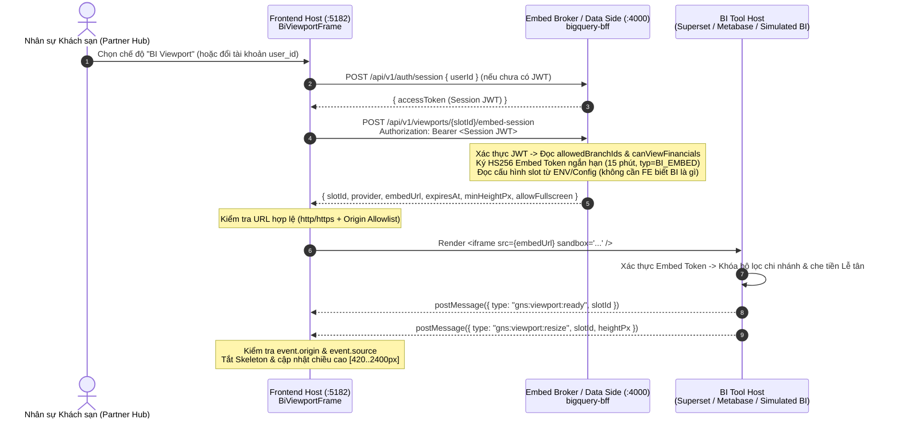

# Thiết Kế Kỹ Thuật: Kiến Trúc BI Viewport Khối Lớn (Decoupled Analytics Shell) Cho Optibide Partner Hub

- **Ngày lập**: `2026-11-26`
- **Phạm vi**: `dashboard/dashboard` (Frontend Host Shell, cổng `:5182`) & `dashboard/bigquery-bff` (Embed Session Broker & Simulated BI Host, cổng `:4000`)
- **Phương án được chọn**: **Phương án B** — Kiến trúc Ổ cắm BI Viewport khối lớn (`BiViewportFrame` + `Viewport Registry` + `BI-Agnostic Embed Session Contract`) chạy song song cùng chế độ `Local JSON` / `BigQuery` hiện hữu để vừa demo sống được ngay với CTO, vừa giữ xanh 100% bộ kiểm thử cũ và sẵn sàng cắm BI tool thật mà không phải sửa code Frontend.

---

## 1. Mục Đích & Bối Cảnh Nghiệp Vụ (Intent & The Why)

Theo định hướng mới nhất từ CTO:
- Hiện tại phía **Frontend** (`dashboard/dashboard`) đang gánh cả 2 vai trò: (1) xây dựng khung ứng dụng & các phân hệ vận hành khách sạn, và (2) vẽ cứng (hardcode) hàng loạt thẻ KPI, biểu đồ Recharts, bảng breakdown và hộp Cố vấn AI.
- Cách làm cũ tạo ra **điểm nghẽn phụ thuộc chéo**: mỗi khi đội **Data Science / BI / AI** muốn thêm biểu đồ phân cụm mới, đổi công thức chỉ số, đổi cách trực quan hóa hoặc thay đổi bộ lọc phân tích, họ bắt buộc phải chờ Frontend sửa React component, cập nhật TypeScript interface và deploy lại.
- **Mục tiêu cốt lõi**: Chuyển các khu vực hiển thị phân tích/dữ liệu trên Partner Hub sang **Viewport khối lớn nhúng từ BI tool** để:
  1. **Đội Data Science & các bên liên quan** có **toàn quyền 100%** điều chỉnh nội dung, biểu đồ, bộ lọc và cách hiển thị ở phía họ.
  2. **Đội Frontend** không phải đụng chạm vào backend, SQL hay data pipeline — chỉ chịu trách nhiệm về khung chứa (Host Shell), xác thực phiên đăng nhập, trạng thái tải/lỗi, toàn màn hình và bố cục responsive.

---

## 2. Quyết Định Đã Chốt Của Chủ Sản Phẩm vs. Đề Xuất Tự Quyết Của Kiến Trúc Sư

### 2.1. Các quyết định đã được người dùng chốt
1. **Nguồn nội dung Viewport**: Nhúng từ **BI tool** (Apache Superset, Metabase, Looker, Power BI hoặc tương đương).
2. **Độ hạt (Granularity)**: **Khối lớn** (coarse-grained blocks/sections hoặc toàn trang) — không chẻ nhỏ thành từng thẻ KPI/chart rời rạc.
3. **Vị trí bộ lọc phân tích**: **Đặt bên trong Viewport** (bộ lọc ngày, bộ lọc chiều phân tích, bộ lọc chi nhánh trong phạm vi quyền nằm trong giao diện BI tool).
4. **Kỳ vọng đồng bộ UI**: **Chấp nhận giao diện mặc định của công cụ BI** bên trong khung Viewport.
5. **Hướng triển khai**: **Phương án B** (kiến trúc ổ cắm BI đầy đủ kèm trang BI giả lập cục bộ để demo sống cho CTO và giữ cơ chế chuyển đổi/fallback an toàn).

### 2.2. Các quyết định kỹ thuật tôi tự quyết ở mục (3) để trình bạn duyệt
- **Hợp đồng 1 endpoint duy nhất không phụ thuộc hãng BI (`BI-Agnostic Embed Session`)**: Frontend chỉ gọi `POST /api/v1/viewports/:slotId/embed-session` với `Authorization: Bearer <session_jwt>` hiện có; không chứa bất kỳ SDK khóa cứng hay bí mật API nào của một hãng BI cụ thể.
- **Phạm vi 2 Slot khối lớn chính** (`overview_analytics` và `deep_analytics`) đăng ký trong `viewportRegistry.ts`, dễ mở rộng thêm slot mới chỉ bằng cấu hình.
- **Bảo mật RBAC bằng Signed Embed Token phía máy chủ**: Dù bộ lọc đặt bên trong BI tool, quyền `allowed_branch_ids` và `can_view_financials` (che doanh thu Lễ tân) vẫn do Server ký cứng vào token nhúng ngắn hạn (`15 phút`), tuyệt đối không tin tham số `?branch_id=` trần trên URL.
- **Thêm lựa chọn thứ 3 `BI Viewport` trên thanh chuyển nguồn Topbar** (`Local JSON` | `BigQuery` | `BI Viewport`), giữ nguyên mặc định `Local JSON` khi khởi động đơn lẻ để bảo toàn 100% bộ 73+ test hiện hữu (theo `AGENTS.md` Mục 5), đồng thời cho phép bật sang `BI Viewport` trong 1 cú click để trình diễn với CTO.
- **Hộp công cụ Demo Swap URL (chỉ phục vụ dev/demo)** gắn gọn trên thanh tiêu đề của khung Viewport để khi họp với CTO có thể dán thử URL BI khác / đổi preset trực tiếp ngay trên màn hình mà không chạm 1 dòng code Frontend.

---

## 3. Mục Tiêu, Phi Mục Tiêu & Chống Mục Tiêu (Goals, Non-Goals & Anti-Goals)

### 3.1. Mục tiêu (Goals)
- Thiết lập ranh giới sạch giữa **Frontend Host Shell** (`dashboard/dashboard`) và **Analytics/BI Provider** (`dashboard/bigquery-bff` hoặc BI tool thật bên ngoài).
- Xây dựng component dùng chung `<BiViewportFrame />` hỗ trợ:
  - Gọi `POST /api/v1/viewports/:slotId/embed-session` theo `(slotId, activeUserId)` (không gọi lại khi đổi bộ lọc vận hành ngoài Shell).
  - Hiển thị Skeleton Loading, nút Tải lại (`Reload`), Toàn màn hình (`Fullscreen`), tự làm mới token trước khi hết hạn (`expiresAt - 60s`), tự điều chỉnh chiều cao an toàn qua `postMessage` (có kiểm tra `origin` & chặn giới hạn chiều cao).
  - Cô lập hoàn toàn sự cố: khi BI server hoặc BFF `:4000` tắt/lỗi, chỉ khung Viewport hiển thị thẻ lỗi gọn kèm nút **Thử lại** và nút **Chuyển về giao diện gốc (Fallback)** — không ảnh hưởng tới các phân hệ vận hành.
- Thay thế **2 khối lớn** khi ở chế độ `BI Viewport`:
  1. **`overview_analytics`** trên trang **Tổng quan (`overview`)**: Thay toàn bộ cụm 5 thẻ KPI + Biểu đồ BigQuery inline + Biểu đồ Doanh thu + Biểu đồ/Bảng trạng thái chào giá + Đánh giá/ELO + 2 khối Cố vấn AI thành **1 khung Viewport lớn**; **ẩn dropdown chọn kỳ (`period-select`) ở bên ngoài** (vì bộ lọc đã đặt bên trong BI tool); **giữ nguyên bảng `Đơn đặt phòng gần đây` (`section-recent-bookings`)** phía dưới vì đây là bảng tác nghiệp có nút mở `BookingDetailModal`.
  2. **`deep_analytics`** trên tab **Kho BigQuery / Phân tích BI (`bigquery_live`)**: Thay toàn bộ màn hình bằng **1 Full-page Viewport**.
- Xây dựng **Simulated BI Tool Host** độc lập tại `dashboard/bigquery-bff` (`GET /bi-embed/render?token=...`) mang giao diện trung tính đặc trưng của công cụ BI (tách biệt hẳn với design Tailwind của Partner Hub), có sẵn:
  - Bộ lọc ngày (`30d` / `7d` / `today`) và bộ lọc Chi nhánh **tự động giới hạn đúng theo `allowedBranchIds` trong token đã ký**.
  - Bộ chuyển mẫu dashboard nội bộ (*Executive Overview*, *GA4 Funnel & Media*, *AI Win/Loss Clusters C1–C4*) mô phỏng việc team Data Science tự đổi toàn bộ biểu đồ trên công cụ BI mà Frontend không hay biết.
  - Tự động ẩn toàn bộ chỉ số doanh thu/tài chính khi `canViewFinancials === false` (`USR-STAFF-02` — Lễ tân).
  - Tự động đọc số liệu từ BigQuery Live hoặc rơi về bản sao dữ liệu seed của BFF nếu máy đang offline GCP, đảm bảo demo & E2E luôn chạy ổn định.

### 3.2. Phi mục tiêu (Non-Goals)
- **Không thay các màn hình vận hành CRUD thành Viewport**: `Lịch phòng (calendar)`, `Sao kê & tài khoản ngân hàng (payout)`, `Quản lý phòng & giá sàn (rooms)`, `Đấu giá (bidding)`, `Tin nhắn khách (messages)`, `Chiến dịch Marketing (marketing_deals / marketing_upsell)` và `Đơn đặt phòng gần đây` + `BookingDetailModal` vẫn do Frontend dựng và vận hành trực tiếp *(chỉ bổ sung cờ che dòng tiền `maskFinancials` cho Lễ tân trong `bi-viewport` / `live-bigquery` và cố định khung `30d` cho bảng đơn gần đây khi bộ lọc kỳ ngoài trang Tổng quan bị ẩn — giữ nguyên 100% hành vi mặc định `Local JSON`)*.
- **Không nhúng SDK riêng của một hãng BI thương mại cụ thể** (như `@superset-ui/embedded-sdk` hay `@looker/embed-sdk`) ở giai đoạn này — giữ thiết kế adapter mở để cắm vào sau chỉ bằng 1 lớp wrapper mỏng khi team DS chốt hãng.
- **Không đồng bộ bộ lọc hai chiều giữa Header Frontend và BI tool** (theo quyết định số 4: bộ lọc phân tích thuộc toàn quyền bên trong BI tool).
- **Không thay đổi schema BigQuery hay chỉnh sửa dữ liệu `master-data/seed/*.json`**.

### 3.3. Chống mục tiêu (Anti-Goals — Làm hỏng mục đích dù code chạy)
- **Lộ dữ liệu chéo chi nhánh (Cross-Branch BOLA)**: Tuyệt đối không cho phép sửa query string `?branch_id=br_songhan` trên URL iframe để xem dữ liệu chi nhánh ngoài quyền `allowedBranchIds`, và không bao giờ nhúng `session_jwt` gốc dài hạn trực tiếp lên URL (chỉ dùng embed token ngắn hạn có phạm vi thu hẹp `typ: "BI_EMBED"`).
- **Lộ doanh thu cho Lễ tân**: Dù ở giao diện BI mặc định, tài khoản `USR-STAFF-02` (`receptionist`, `canViewFinancials: false`) tuyệt đối không được nhận hoặc thấy số tiền doanh thu.
- **XSS / Open Redirect qua Viewport URL**: Không chấp nhận `embedUrl` có scheme nguy hiểm (`javascript:`, `data:`, `blob:`, `file:`) hoặc vượt ra ngoài danh sách origin được phép.
- **Vỡ bố cục ngang (Horizontal Overflow) trên Mobile**: Khung Viewport phải đảm bảo `scrollWidth <= innerWidth` trên đủ 7 kích thước màn hình (`1440×900` $\rightarrow$ `360×800`).
- **Đỏ bộ kiểm thử hiện hữu**: Không được làm hỏng bất kỳ test nào trong 73+ test hiện có khi chạy `npm test` và `npm run build`.

---

## 4. Các Phương Án Đã Cân Nhắc & Lý Do Chọn Phương Án B

| Tiêu chí | Phương án A: Thay cứng ngay (`Hard Replace`) | **Phương án B (Đã chọn): Ổ cắm BI có chế độ Demo/Fallback** | Phương án C: Chỉ viết tài liệu Đặc tả (`Spec Only`) |
| :--- | :--- | :--- | :--- |
| **Chứng minh sống cho CTO** | Tốt — thấy ngay dashboard chỉ còn khung Viewport. | **Rất tốt** — gạt 1 nút là thấy ngay chế độ BI Viewport (kèm đổi thử URL/template BI trực tiếp) và so sánh trực quan được với bản cũ. | Không có giao diện chạy thật để demo. |
| **Độ an toàn với hệ thống hiện tại** | Phá vỡ hàng loạt test E2E hiện có trên `Overview`, phải viết lại toàn bộ ngay lập tức. | **Giữ xanh 100%** toàn bộ 73+ test hiện hữu (mặc định `Local JSON`), đồng thời bổ sung bộ test riêng cho `BI Viewport`. | Không ảnh hưởng code, nhưng kéo dài thời gian chờ đến khi có demo. |
| **Độ sẵn sàng cắm BI thật từ DS** | Cao. | **Cao tương đương A** — khi DS cấp URL BI thật, chỉ cần cấu hình phía BFF (và có thể đặt mặc định sang `bi-viewport` rồi gỡ phần vẽ Recharts cũ sau). | Chỉ dừng ở giấy tờ. |

---

## 5. Kiến Trúc Chi Tiết & Hợp Đồng Giao Tiếp (Viewport Contract)

### 5.1. Sơ đồ luồng xác thực & hiển thị (End-to-End Sequence)



### 5.2. Danh mục Slot khối lớn (`VIEWPORT_REGISTRY`)

| `slotId` | Vị trí gắn trên Partner Hub | Thay thế thành phần nào (khi ở chế độ `BI Viewport`) | Chiều cao mặc định (`minHeightPx`) | Các phần giữ nguyên ở Frontend |
| :--- | :--- | :--- | :---: | :--- |
| **`overview_analytics`** | Trang **Tổng quan (`overview`)** | Toàn bộ: `period-select` ngoài + 5 thẻ KPI + `OverviewBigQueryChartsPanel` + `section-revenue-timeline` + `section-bids-status` + `section-ratings-trust` + 2 khối `AiAdvisorSection` | `780px` | Tiêu đề trang `Tổng quan`, bảng `Đơn đặt phòng gần đây` (`section-recent-bookings`) & `BookingDetailModal` |
| **`deep_analytics`** | Tab **Kho BigQuery / Phân tích BI (`bigquery_live`)** | Toàn bộ nội dung `BigQueryWarehouseView` | `860px` | Khung `PartnerHubShell` (Sidebar + Topbar) |

> **Xử lý thanh công cụ Topbar khi ở chế độ `BI Viewport`**:
> - Dropdown chọn chi nhánh (`topbar-property-select`) trên Header **vẫn giữ nguyên** để phục vụ các phân hệ tác nghiệp (`Lịch phòng`, `Quản lý phòng`, `Đấu giá`, `Tin nhắn`, `Sao kê`, `Marketing`) và bảng `Đơn đặt phòng gần đây`.
> - Tuy nhiên `<BiViewportFrame />` **KHÔNG** phụ thuộc vào `propertyKey` hay `periodKey` của Header — nó chỉ gọi lại `embed-session` khi `slotId` hoặc `activeUserId` (người đang đăng nhập) thay đổi, đảm bảo đúng yêu cầu **bộ lọc phân tích đặt hoàn toàn bên trong BI tool**.

### 5.3. Đặc tả REST API phía Backend/Data (`dashboard/bigquery-bff`)

#### Endpoint 1: `GET /api/v1/viewports/registry` *(Yêu cầu Bearer Session JWT)*
Trả danh sách các slot được cấu hình trên máy chủ (để Frontend hoặc đội vận hành kiểm tra slot nào đã nối BI thật vs. BI giả lập).

```json
{
  "ok": true,
  "slots": [
    {
      "slotId": "overview_analytics",
      "provider": "simulated_bi",
      "mode": "simulated",
      "defaultMinHeightPx": 780,
      "allowFullscreen": true
    },
    {
      "slotId": "deep_analytics",
      "provider": "simulated_bi",
      "mode": "simulated",
      "defaultMinHeightPx": 860,
      "allowFullscreen": true
    }
  ]
}
```

#### Endpoint 2: `POST /api/v1/viewports/:slotId/embed-session` *(Yêu cầu Bearer Session JWT)*
- **Request Body** *(tùy chọn)*: `{ "localeHint": "vi" | "en" | "ko" }` *(chỉ là gợi ý ngôn ngữ giao diện ban đầu nếu BI tool hỗ trợ; không chứa bất kỳ tham số `branchId` hay `role` nào từ client!)*.
- **Response `200 OK`**:
  ```json
  {
    "ok": true,
    "slotId": "overview_analytics",
    "provider": "superset | metabase | looker | generic_iframe | simulated_bi",
    "embedUrl": "http://127.0.0.1:4000/bi-embed/render?token=<signed_embed_token>",
    "guestToken": null,
    "issuedAt": "2026-11-26T07:00:00.000Z",
    "expiresAt": "2026-11-26T07:15:00.000Z",
    "ttlSec": 900,
    "minHeightPx": 780,
    "allowFullscreen": true,
    "scopeSummary": {
      "userId": "USR-MGR-MYKHE",
      "roleKey": "branch_manager",
      "allowedBranchIds": ["br_mykhe"],
      "canViewFinancials": true
    }
  }
  ```
- **Mã lỗi chuẩn**:
  - `401 MISSING_AUTHORIZATION` / `INVALID_TOKEN_SIGNATURE` / `TOKEN_EXPIRED`
  - `404 UNKNOWN_VIEWPORT_SLOT` (nếu `slotId` không nằm trong danh sách cho phép)
  - `503 VIEWPORT_PROVIDER_UNCONFIGURED` — kích hoạt chính xác trong 3 trường hợp:
    1. Biến cấu hình URL của slot mang giá trị `"disabled"` (công tắc ngắt chủ động);
    2. `VIEWPORT_PROVIDER !== "simulated_bi"` nhưng URL của slot đó đang bỏ trống;
    3. URL BI ngoài được cấu hình có `origin` không nằm trong `VIEWPORT_ALLOWED_ORIGINS` (khi `VIEWPORT_ALLOWED_ORIGINS` được thiết lập).
- **Quy tắc truyền Token cho BI ngoài (Chống rò rỉ Secret sang bên thứ 3)**:
  - Với `provider === "simulated_bi"`: BFF tự tạo `<baseUrl>/bi-embed/render?token=<signed_embed_token>` (`guestToken: null`), trong đó `<baseUrl>` tự động chọn `VIEWPORT_PUBLIC_BASE_URL` (nếu cấu hình), hoặc đường dẫn tương đối `/bi-embed/render?token=...` khi request đi qua reverse-proxy/HTTPS tunnel (`*.ts.net`, `*.trycloudflare.com`), hoặc `http://127.0.0.1:4000` khi chạy localhost (để mô phỏng cross-origin thật giữa `:5182` và `:4000`).
  - Với provider ngoài (`superset`, `metabase`, `looker`, `generic_iframe`): BFF **tuyệt đối không** tự tiện nối `?token=<HS256_internal>` vào URL của hãng thứ 3. Chỉ thay thế khi URL cấu hình có chứa placeholder tường minh `{token}` (dành cho micro-app nội bộ dùng chung khóa ký); nếu không có `{token}`, trả nguyên `embedUrl` đã cấu hình. Riêng `provider === "superset"` trả thêm token ngắn hạn vào trường `guestToken` để sẵn sàng nối SDK; các provider khác giữ `guestToken: null`.
- **Cấu hình cắm BI thật & Fallback Offline qua Biến môi trường (Zero Frontend Change)**:
  - `VIEWPORT_OVERVIEW_EMBED_URL` / `VIEWPORT_DEEP_EMBED_URL` (mặc định dùng Simulated BI Host cục bộ; gán `"disabled"` để tắt slot)
  - `VIEWPORT_PUBLIC_BASE_URL` (tùy chọn, dùng khi chạy 2 origin tách biệt ở staging/production)
  - `VIEWPORT_PROVIDER` (`simulated_bi` | `superset` | `metabase` | `looker` | `generic_iframe`)
  - `VIEWPORT_EMBED_TTL_SEC` (mặc định `900` giây = 15 phút, tối đa `3600` giây)
  - `VIEWPORT_ALLOWED_ORIGINS` (danh sách origin cho phép nhúng ở Frontend/BFF)
  - `BFF_OFFLINE_SEED_FALLBACK` (mặc định `true` khi `NODE_ENV !== "production"`, `false` ở production): Cho phép `listRbacProfiles()` (bước `POST /api/v1/auth/session`) và `Simulated BI` tự động rơi về `master-data/seed/` (ánh xạ `partnerId` tất định: `HTL-PORTFOLIO-01` / `HTL-DN-024` / `HTL-KR-011`) **chỉ khi gặp lỗi kết nối/xác thực GCP** — **luôn giữ nguyên và không bao giờ nuốt `CostGuardError`**.

#### Endpoint 3: `GET /bi-embed/render?token=<signed_embed_token>` *(Simulated BI Tool Host)*
- Hoạt động như một máy chủ BI độc lập chạy trên `:4000` (khác origin với Vite `:5182` trên localhost; đồng thời được proxy thêm đường dẫn `/bi-embed` trong `dashboard/dashboard/vite.config.ts` cho cả `server` và `preview` để demo từ xa qua tunnel HTTPS `*.ts.net` / `*.trycloudflare.com` không bị lỗi mixed-content).
- Trả về `Content-Type: text/html; charset=utf-8` cùng header bảo mật:
  - `Content-Security-Policy`: `frame-ancestors` sinh động từ `cfg.corsAllowedOrigins` + origin của host tunnel hợp lệ (`https://*.ts.net`, `https://*.trycloudflare.com`, `'self'`); kèm `default-src 'self' 'unsafe-inline';`
  - `Referrer-Policy: no-referrer`
  - `Cache-Control: no-store`
  - `X-Content-Type-Options: nosniff`
- **Xác thực Token trên Server**:
  - Kiểm tra chữ ký HS256, `typ === "BI_EMBED"`, `exp > now`, và `slotId` hợp lệ. Nếu sai/hết hạn/bị sửa -> trả trang HTML lỗi `401/403` sạch sẽ (không lộ stack trace, không lộ bất kỳ số liệu nào).
- **Tính năng bên trong Simulated BI Tool**:
  - Thanh bộ lọc gốc của BI tool gồm 5 điều khiển tự chủ: **Khoảng thời gian** (`30 ngày` / `7 ngày` / `Hôm nay`), **Chi nhánh** (chỉ liệt kê các `branchId` nằm trong `claims.allowedBranchIds`, cộng thêm tùy chọn `Tất cả chi nhánh được cấp` chỉ khi `claims.canViewChainAll === true`), **Mẫu báo cáo BI (Dashboard Preset)** cho phép chọn nhanh giữa 3 bố cục phân tích khác nhau (*Doanh thu & Đấu giá*, *Phễu GA4 8 Bước & Media*, *Phân cụm AI C1–C4*), **Ngôn ngữ BI (`VI / EN / KO`)** và **Tiền tệ BI (`VND / KRW / USD`)** quy đổi theo tỷ giá chuẩn (`1 / 18.5 / 25.400`), kèm huy hiệu nguồn dữ liệu (`Live BigQuery` hoặc `Seed Snapshot`) để đối chiếu minh bạch.
  - Bảng KPI, biểu đồ SVG thuần gọn nhẹ (không kéo CDN ngoài để chạy 100% offline/sandboxed), bảng phễu GA4 8 bước, và nhận định phân cụm `C1–C4`.
  - Khi `claims.canViewFinancials === false` (`receptionist`): loại bỏ hoàn toàn số liệu doanh thu/GMV ngay từ bước dựng dữ liệu HTML trên Server (không chỉ ẩn CSS) và hiển thị nhãn rõ *Restricted by RBAC Token*.
  - Gửi `window.parent.postMessage({ type: "gns:viewport:ready", slotId }, "*")` và `window.parent.postMessage({ type: "gns:viewport:resize", slotId, heightPx }, "*")` (chỉ chứa metadata layout không nhạy cảm; phía Host App xác thực chặt `event.source === iframeRef.current?.contentWindow` và `event.origin` tương ứng).

### 5.4. Thiết kế Frontend Host (`dashboard/dashboard`)

1. **Mở rộng `DataSourceMode`** trong [bigQueryApiService.ts](file:///Users/iannwendy/Desktop/goodNstay/dashboard/dashboard/src/services/bigQueryApiService.ts) & [PartnerHubShell.tsx](file:///Users/iannwendy/Desktop/goodNstay/dashboard/dashboard/src/components/PartnerHubShell.tsx):
   - `export type DataSourceMode = "local-json" | "live-bigquery" | "bi-viewport";`
   - Nút thứ 3 trên `topbar-data-source-switcher`: **`BI Viewport`** (`data-testid="source-toggle-bi-viewport"`).
   - Giữ `local-json` làm giá trị khởi tạo mặc định (tương thích ngược 100% với toàn bộ test hiện có).
2. **`src/lib/viewportRegistry.ts`**:
   - Khai báo metadata thuần giao diện cho từng `ViewportSlotId` (`"overview_analytics" | "deep_analytics"`), danh sách `DEFAULT_ALLOWED_VIEWPORT_ORIGINS` (hợp nhất thêm `VITE_VIEWPORT_ALLOWED_ORIGINS` và `window.location.origin` khi chạy qua tunnel proxy), hàm kiểm định an toàn URL (`validateViewportEmbedUrl`):
     - Với `embedUrl` do Server cấp: bắt buộc scheme `http:`/`https:` (chặn tuyệt đối `javascript:`, `data:`, `blob:`, `file:`) **và** `origin` nằm trong danh sách cho phép.
     - Với chế độ **Demo Swap URL** (chỉ bật ở môi trường dev/demo `import.meta.env.DEV || VITE_ENABLE_VIEWPORT_DEMO_TOOLS === "true"` và chỉ hiển thị cho vai trò quản lý `canManagePricing === true`, ẩn hoàn toàn với Lễ tân `USR-STAFF-02`): vẫn chặn cứng mọi scheme nguy hiểm, mặc định cho chọn nhanh các preset cục bộ trong allowlist hoặc bật tùy chọn *"Cho phép link HTTPS BI thử nghiệm ngoài allowlist (Dev Demo)"* kèm băng rôn cảnh báo vàng nổi bật **DEV DEMO OVERRIDE**.
3. **`src/services/viewportEmbedService.ts`**:
   - Gọi `POST /api/v1/viewports/:slotId/embed-session` thông qua token phiên từ `ensureSession` (tái sử dụng cơ chế xác thực sẵn có trong `bigQueryApiService.ts` để không nhân đôi logic đăng nhập).
   - Hỗ trợ cơ chế **Demo URL Override** lưu ở `localStorage` (`gns_viewport_demo_overrides_v1`) kèm hàm chuẩn hóa & xóa khôi phục về mặc định server chỉ bằng 1 nút bấm.
4. **`src/components/BiViewportFrame.tsx`**:
   - Props tối giản (tuyệt đối không nhận `bundle`, không nhận `bidRecords`, không nhận công thức KPI!):
     ```ts
     interface BiViewportFrameProps {
       slotId: ViewportSlotId;
       activeUserId: string;
       canUseDemoTools: boolean;
       locale: AppLocale;
       onFallbackToNative: () => void;
     }
     ```
   - Thanh khung tối giản (Chrome Header):
     - Nhãn vị trí Viewport (`BI Viewport · <slotId>`), huy hiệu nhà cung cấp (`provider`), thời hạn token (`Expires in ...`).
     - Các nút thao tác: **Tải lại (`Reload`)**, **Toàn màn hình (`Fullscreen`)**, và nút **Cấu hình Demo (`Swap URL`)** (chỉ hiển thị khi `canUseDemoTools === true` trong môi trường dev/demo để thử trỏ preset/URL BI khác hoặc xem payload hợp đồng JSON thực tế khi demo cho CTO).
   - Thẻ `<iframe>` với **Sandbox thích ứng theo Origin (Chống thoát Sandbox)**:
     - Khi `iframeOrigin !== window.location.origin` (cross-origin thật — localhost `:5182 ↔ :4000` hoặc production `partner.* ↔ bi.*`): dùng `sandbox="allow-scripts allow-same-origin allow-forms allow-downloads"`, xác thực `postMessage` với `event.source === iframeWindow && event.origin === iframeOrigin`.
     - Khi `iframeOrigin === window.location.origin` (same-origin khi demo qua 1 tunnel HTTPS duy nhất): **tự động bỏ `allow-same-origin`**, chỉ dùng `sandbox="allow-scripts allow-forms allow-downloads"` để iframe không thể đọc `localStorage`/DOM của Host App, và xác thực `postMessage` với `event.source === iframeWindow && event.origin === "null"`.
     - Luôn đặt `referrerPolicy="no-referrer"`, `className="w-full border-0 block bg-white"` trong container `w-full min-w-0 overflow-hidden`.
   - Tự làm mới phiên (`setTimeout`) trước `expiresAt` `60` giây (dọn dẹp sạch trong `useEffect` cleanup).
   - Trạng thái lỗi cô lập (khi BFF `:4000` tắt hoặc trả lỗi): hiển thị thông báo rõ ràng theo 3 ngôn ngữ (`vi`/`en`/`ko`) kèm hướng dẫn chạy BFF, nút **Thử lại**, và nút **Quay về giao diện Local JSON**.
5. **Tích hợp vào [App.tsx](file:///Users/iannwendy/Desktop/goodNstay/dashboard/dashboard/src/App.tsx) & [BookingDetailModal.tsx](file:///Users/iannwendy/Desktop/goodNstay/dashboard/dashboard/src/components/BookingDetailModal.tsx) (Quyết định cô lập vận hành & bảo vệ RBAC)**:
   - **Dữ liệu vận hành trong chế độ `bi-viewport`**: Giữ các phân hệ tác nghiệp (`calendar`, `payout`, `rooms`, `bidding`, `messages`, `marketing`) và bảng `section-recent-bookings` đọc từ bundle cục bộ (`Local JSON`) để **tách hoàn toàn khỏi tình trạng sống/chết của BI/BFF** (BFF tắt tuyệt đối không làm tự động bật ngược `dataSourceMode` về `local-json` hay gián đoạn thao tác lễ tân).
   - **Khung ngày của `section-recent-bookings` khi ẩn `period-select`**: Khi `dataSourceMode === "bi-viewport"`, truyền `effectivePeriodKey = "30d"` cho bộ tính bảng đơn gần đây (hiển thị nhãn nhỏ `30 ngày gần nhất`) để tránh kẹt bộ lọc `today` cũ lưu trong `localStorage` khi dropdown `period-select` đã bị ẩn.
   - **Chống lộ doanh thu Lễ tân (`USR-STAFF-02`)**: Mở rộng điều kiện `isOverviewFinancialsMasked = (dataSourceMode === "live-bigquery" || dataSourceMode === "bi-viewport") && !canViewFinancials`, đồng thời truyền `maskFinancials={isOverviewFinancialsMasked}` vào `BookingDetailModal` để che cả thanh *Tác động ròng kỳ này* lẫn dòng tiền doanh thu trong hộp chi tiết đơn khi Lễ tân ở chế độ `bi-viewport` / `live-bigquery` (giữ nguyên 100% hành vi mặc định `local-json`).
   - Khi `activeSection === "overview"` và `dataSourceMode === "bi-viewport"`:
     - Ẩn `period-select` ngoài Header trang Tổng quan.
     - Render `<BiViewportFrame slotId="overview_analytics" ... />` thay thế toàn bộ các khối KPI/Charts/Ratings/AI Advisor.
     - Giữ nguyên `<section data-testid="section-recent-bookings">...</section>` phía dưới.
   - Khi `activeSection === "bigquery_live"` và `dataSourceMode === "bi-viewport"`:
     - Render `<BiViewportFrame slotId="deep_analytics" ... />` chiếm toàn vùng nội dung chính.

### 5.5. Yêu cầu Triển khai Production (Ghi chú bàn giao CTO & DevOps)
- Trong môi trường Production, BI tool thật **bắt buộc chạy trên origin riêng biệt** (ví dụ `https://bi.goodnstay.com`, khác hẳn `https://partner.goodnstay.com`) để thuộc tính `sandbox="allow-scripts allow-same-origin ..."` không thể truy cập `localStorage` hay DOM của Host App.
- Nên thiết lập header `Content-Security-Policy: frame-ancestors https://partner.goodnstay.com` phía BI server và cấu hình `VIEWPORT_ALLOWED_ORIGINS=https://bi.goodnstay.com` phía Frontend/BFF.
- Nếu team DS chọn Apache Superset Embedded SDK cần truyền `guestToken` qua JS SDK thay vì query param URL, chỉ cần bổ sung 1 nhánh adapter theo `session.provider === "superset"` ngay trong `BiViewportFrame.tsx` mà không phải thay đổi API contract hay các màn hình khác.

---

## 6. Chiến Lược Kiểm Thử & Cổng Nghiệm Thu (Verification Gate)

Tuân thủ bắt buộc `AGENTS.md` Mục 5 & `dashboard/dashboard/AGENTS.md`:
1. **BFF Unit & HTTP Integration Tests** (`dashboard/bigquery-bff/tests/`):
   - Cấp phiên thành công `POST /api/v1/viewports/overview_analytics/embed-session` và `deep_analytics` cho đủ 5 tài khoản RBAC (`USR-PARTNER-01`, `USR-MGR-MYKHE`, `USR-MGR-SONGHAN`, `USR-STAFF-02`, `USR-MGR-H11`).
   - Trả `404 UNKNOWN_VIEWPORT_SLOT` cho `slotId` lạ; `401` khi thiếu/sai Session JWT.
   - `GET /bi-embed/render?token=...`:
     - Từ chối token bị sửa chữ ký (`401`), token hết hạn (`401`), hoặc dùng nhầm Session JWT thay vì Embed Token (`401`).
     - Kiểm chứng `USR-MGR-MYKHE` chỉ thấy duy nhất `br_mykhe` trong bộ lọc nội bộ của BI HTML (không rò rỉ `br_songhan` hay `stay_h11`).
     - Kiểm chứng `USR-STAFF-02` (`receptionist`) bị che sạch mọi con số doanh thu trong HTML trả về.
2. **Frontend Unit Tests** (`dashboard/dashboard/tests/unit/viewport-contract.test.ts`):
   - Kiểm chứng `validateViewportEmbedUrl` chặn `javascript:`, `data:`, origin ngoài allowlist, và cho phép origin hợp lệ.
   - Kiểm chứng registry đủ slot `overview_analytics` và `deep_analytics`, cấu hình Demo Override sạch và khôi phục đúng.
3. **Playwright E2E & 7-Viewport Responsive Tests** (`dashboard/dashboard/tests/e2e/bi-viewport.spec.ts` + cập nhật `responsive-matrix.spec.ts` & `tests/TEST_CASES.md`):
   - Chuyển sang `BI Viewport` trên `Overview`: xác nhận `period-select` bị ẩn, `<iframe data-testid="bi-viewport-iframe-overview_analytics">` hiển thị (mocked hoặc live BFF), bảng `Đơn đặt phòng gần đây` vẫn mở được `BookingDetailModal`.
   - Đổi tài khoản sang `USR-MGR-MYKHE` và `USR-STAFF-02`: xác nhận Frontend tự gọi lại `embed-session` theo `userId` mới, không gọi lại khi đổi dropdown chi nhánh ở Header.
   - Chuyển sang tab `Kho BigQuery / Phân tích BI`: xác nhận `deep_analytics` hiển thị full-page.
   - Kiểm tra lỗi mạng/offline BFF: hiển thị card fallback cô lập + bấm nút quay về `Local JSON` khôi phục ngay giao diện gốc mà không crash.
   - Kiểm tra chế độ Demo Swap URL: đổi thử URL hợp lệ và reset lại về mặc định server; chặn URL `javascript:alert(1)`.
   - Kiểm tra không tràn ngang (`scrollWidth <= innerWidth`, `0` console error, `0` page error) trên đủ **7 kích thước màn hình** (`1440×900`, `1280×800`, `1024×768`, `768×1024`, `390×844`, `375×667`, `360×800`).
4. **Cổng hoàn thành**: Chạy toàn bộ test BFF + `npm test` + `npm run build` tại `dashboard/dashboard` đạt **100% PASS**.

---

## 7. Những Phần Để Mở Cho Giai Đoạn Triển Khai (Left to the Builder)

- Cách tổ chức file nội bộ bên trong `dashboard/bigquery-bff/src/viewportService.ts` (tách hàm ký/verify Embed Token và bộ sinh HTML Simulated BI ra module riêng hay gộp gọn).
- Thiết kế trực quan chi tiết của trang Simulated BI HTML (miễn mang phong cách BI tool trung tính đặc trưng như Superset/Metabase, khác biệt rõ với Partner Hub UI, không dùng CDN ngoài và chạy tốt trên mobile `360px`).
- Cách thiết kế trạng thái mở rộng toàn màn hình (`Fullscreen` bằng CSS overlay/modal hay native Fullscreen API có fallback an toàn cho môi trường headless Playwright).
- Cấu trúc bộ chuỗi dịch đa ngôn ngữ (`vi` / `en` / `ko`) cho khung Viewport chrome trong `src/lib/i18n.ts` hoặc helper riêng của `BiViewportFrame.tsx`.
