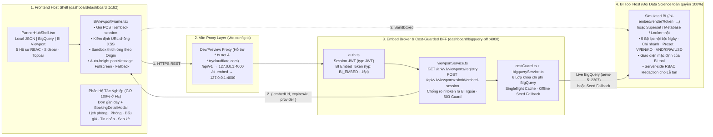

# BÁO CÁO TỔNG HỢP TRIỂN KHAI KIẾN TRÚC BI VIEWPORT KHỐI LỚN (DECOUPLED ANALYTICS SHELL)

> **goodNstay · Optibide Partner Hub** — Tài liệu sống (*Living Document*) giải thích toàn diện kiến trúc tách rời **Frontend Host Shell ↔ BI Viewport**, hợp đồng API không khóa hãng BI, bảo mật đa chi nhánh `user_id × branch_id`, phân tích `/api/v1/health`, nhật ký QA và mục lục chỉ đích danh từng tệp/dòng code trên GitHub.

| Thông tin tài liệu | Chi tiết hiện hành |
| :--- | :--- |
| **Loại tài liệu** | Tài liệu tổng hợp sống (*Living Document*) — bản Markdown xem trực tiếp trên GitHub kèm sơ đồ Mermaid & mục lục link code trực tiếp tới từng dòng |
| **Phiên bản & Ngày cập nhật** | **v1.1** — Cập nhật ngày `26/11/2026` |
| **Định hướng CTO** | Tách ranh giới **Frontend chỉ giữ Khung & Vận hành**; **Data Science / BI toàn quyền 100%** biểu đồ, chỉ số, bộ lọc, ngôn ngữ & tiền tệ bên trong Viewport mà FE không đụng Backend/Data |
| **Hệ thống tích hợp** | Embed Broker & Simulated BI Host `dashboard/bigquery-bff` (`:4000`) ↔ Optibide Partner Hub `dashboard/dashboard` (`:5182`) ↔ HTTPS Tunnel `*.ts.net` / `*.trycloudflare.com` |
| **Chỉ số nổi bật** | **`2 Slot Khối Lớn`** (`overview_analytics`, `deep_analytics`) · **`5 Bộ Lọc Nội Bộ BI`** (Ngày / Chi nhánh / Preset / VI-EN-KO / VND-KRW-USD) · **`HS256 BI_EMBED`** · **`87 / 87`** Test tự động PASS |
| **Đối tượng đọc** | Ban Giám đốc / CTO, đội Data Science / BI, đội Backend và đội Frontend / QA |
| **Trạng thái hiện tại** | **Hoàn tất 100% Phương án B** (Demo sống trên cả `localhost` & HTTPS Tunnel + Sẵn sàng cắm BI tool thật qua ENV không cần sửa code FE) |
| **Người biên soạn** | Nguyễn Bảo Minh (`goodNstay Internship Program 2026`) |

---

## 0. Lịch Sử Phiên Bản (Revision History)

| Phiên bản | Ngày | Nội dung cập nhật & cải tiến chính | Trạng thái |
| :--- | :--- | :--- | :--- |
| **v1.0** | `26/11/2026` | Chốt thiết kế **Phương án B** cùng CTO (qua Builder Check 5 điểm biên): dựng `POST /api/v1/viewports/:slotId/embed-session`, token ký ngắn hạn `typ: "BI_EMBED"`, máy chủ BI giả lập `/bi-embed/render`, component `<BiViewportFrame />`, proxy `/bi-embed` cho tunnel HTTPS, adaptive `sandbox` và che tài chính Lễ tân 2 lớp (`86/86` tests PASS). | **Hoàn tất** |
| **v1.1** | `26/11/2026` | Bổ sung bộ chuyển **Ngôn ngữ (`VI / EN / KO`)** và **Tiền tệ (`VND / KRW / USD` theo tỷ giá chuẩn `1 / 18.5 / 25.400`)** ngay bên trong thanh bộ lọc của BI Viewport, đảm bảo Lễ tân `USR-STAFF-02` đổi tiền tệ vẫn giữ nguyên che RBAC (`TC-VP-07`, tổng **`87/87` tests PASS**); bổ sung giải thích chi tiết `/api/v1/health` và bản đồ code GitHub. | **Hoàn tất** |
| **v1.2+** | *Kế tiếp* | Cắm trực tiếp URL BI thật của đội Data Science (Apache Superset Embedded / Metabase / Looker) qua biến môi trường `VIEWPORT_*_EMBED_URL`, chuyển `BI Viewport` thành chế độ mặc định và dọn bỏ dần các biểu đồ Recharts hardcode cũ khi Production ổn định. | *Đang lập kế hoạch* |

---

## 1. Tóm Tắt Điều Hành (Executive Summary)

Trước đây, phía **Frontend** của Optibide Partner Hub (`dashboard/dashboard`) vừa phải xây dựng các màn hình vận hành khách sạn (Lịch phòng, Quản lý phòng, Đấu giá, Tin nhắn, Sao kê), vừa phải **vẽ cứng (hardcode)** toàn bộ thẻ KPI, biểu đồ Recharts, bảng breakdown và khối Cố vấn AI. Mỗi lần đội **Data Science / BI** muốn thêm biểu đồ phân cụm khách hàng (`C1–C4`), sửa công thức chỉ số hay thay đổi bố cục báo cáo, họ đều bị nghẽn phải nhờ Frontend sửa React/TypeScript và deploy lại.

Theo yêu cầu phân tách trách nhiệm của **CTO**, hệ thống đã triển khai hoàn chỉnh **Kiến trúc BI Viewport Khối Lớn (Phương án B)** — tách rạch ròi:
- **Frontend (`:5182`) = Khung Ứng Dụng (Host Shell) & Ổ Cắm Viewport**: quản lý Sidebar, Topbar, đăng nhập/đổi ca, phân hệ tác nghiệp và khung chứa `<BiViewportFrame />` (không chứa bất kỳ câu SQL, công thức KPI hay mã khóa hãng BI nào).
- **Data Science / BI = Toàn Quyền Nội Dung Bên Trong Viewport**: toàn quyền chỉnh sửa biểu đồ, công thức, mẫu báo cáo, bộ lọc ngày/chi nhánh/ngôn ngữ/tiền tệ trên công cụ BI của họ mà không cần Frontend đụng vào Backend/Data.

### 4 Giá Trị Cốt Lõi Đã Chứng Minh Thực Tế

1. **Tách rời 100% Frontend khỏi Backend & Data**: Component [`BiViewportFrame.tsx`](../../dashboard/dashboard/src/components/BiViewportFrame.tsx) chỉ nhận đúng 5 prop tối giản (`slotId`, `activeUserId`, `canUseDemoTools`, `locale`, `onFallbackToNative`) — không nhận `bundle`, không nhận `bidRecords`, không tính bất kỳ KPI nào.
2. **Thay 2 khối phân tích lớn, giữ nguyên toàn bộ vận hành tác nghiệp**: Gạt nút **`BI Viewport`** trên đầu trang là thấy ngay trang **Tổng quan** thay toàn bộ cụm KPI/Biểu đồ/AI thành 1 khối lớn `overview_analytics` (giữ lại bảng *Đơn đặt phòng gần đây* + `BookingDetailModal` bên dưới) và tab **Kho BigQuery** thành 1 khung toàn trang `deep_analytics`.
3. **Bảo mật đa chi nhánh (`user_id × branch_id`) dù bộ lọc đặt bên trong BI**: Quyền `allowedBranchIds` và `canViewFinancials` được ký cứng phía server bằng token ngắn hạn **`HS256` `typ: "BI_EMBED"`** (15 phút, không thể dùng lẫn với Session JWT); tự động bỏ `allow-same-origin` khi chạy qua 1 tunnel HTTPS duy nhất để chống thoát sandbox; Lễ tân `USR-STAFF-02` bị che doanh thu ở cả 2 lớp (trong HTML BI từ Server lẫn trong `BookingDetailModal`).
4. **Sẵn sàng cắm mọi hãng BI (`Superset` / `Metabase` / `Looker`) không sửa code FE**: Đổi BI tool chỉ cần sửa biến môi trường `VIEWPORT_PROVIDER` & `VIEWPORT_*_EMBED_URL` phía BFF; hỗ trợ thêm hộp **`Đổi URL (Demo)`** dành riêng cho dev/Quản lý để trình diễn đổi nguồn sống ngay trước mặt CTO.

---

## 2. Kiến Trúc Tổng Thể Hệ Thống & Luồng Xác Thực

### 2.1. Sơ đồ phân tầng 4 lớp (Host Shell ↔ Embed Broker ↔ BI Host)



### 2.2. Vì sao chọn Phương án B (`BI-Agnostic Embed Session`) thay vì truyền URL public hay nhúng cứng 1 hãng?

| Cách làm | Vấn đề / Rủi ro | Cách Phương án B giải quyết dứt điểm |
| :--- | :--- | :--- |
| Truyền `?branch_id=br_mykhe` trần trên URL iframe | Người dùng mở F12 đổi sang `?branch_id=br_songhan` là xem trộm doanh thu chi nhánh khác. | Server ký cứng `allowedBranchIds` & `canViewFinancials` vào token `HS256 BI_EMBED` ngắn hạn (`15 phút`); mọi sửa đổi payload đều bị từ chối `HTTP 401`. |
| Khóa cứng SDK của 1 hãng BI trong code React | Nếu đội DS đổi từ Metabase sang Apache Superset hoặc Looker, FE lại phải viết lại từ đầu. | Frontend chỉ biết 1 endpoint duy nhất `POST /api/v1/viewports/:slotId/embed-session`; đổi hãng BI chỉ đổi biến môi trường phía Backend. |
| Thay cứng ngay lập tức (Phương án A) | Phá hỏng bộ 73+ kiểm thử hiện hữu trên trang Tổng quan và mất chế độ đối chiếu với bản gốc. | Thêm nút thứ 3 `BI Viewport` song song `Local JSON` & `BigQuery`: giữ xanh 100% test cũ, demo so sánh trực quan ngay và vẫn sẵn sàng bỏ biểu đồ cũ khi Production chốt BI thật. |

---

## 3. Chi Tiết 2 Khối Viewport Lớn & 5 Bộ Lọc Tự Chủ Trong BI

### 3.1. Bố cục 2 Slot khối lớn đăng ký trong `viewportRegistry.ts`

| `slotId` | Màn hình gắn | Thành phần được thay thế khi bật `BI Viewport` | Chiều cao mặc định | Thành phần giữ lại ở Frontend |
| :--- | :--- | :--- | :---: | :--- |
| **`overview_analytics`** | Trang **Tổng quan (`overview`)** | Dropdown chọn kỳ ngoài (`period-select`), 5 thẻ KPI, `OverviewBigQueryChartsPanel`, Biểu đồ Doanh thu (`section-revenue-timeline`), Biểu đồ/Bảng Chào giá (`section-bids-status`), Đánh giá/ELO (`section-ratings-trust`) và 2 hộp `AiAdvisorSection` | `780px` *(auto-resize `[420..2400px]`)* | Tiêu đề trang, bảng **Đơn đặt phòng gần đây** (ghim cố định khung `30 ngày gần nhất` tránh kẹt bộ lọc `today` cũ) + `BookingDetailModal` |
| **`deep_analytics`** | Tab **Kho BigQuery (`bigquery_live`)** | Toàn bộ màn hình `BigQueryWarehouseView` | `860px` *(auto-resize + Fullscreen)* | Khung `PartnerHubShell` (Sidebar + Topbar) |

### 3.2. Năm (05) điều khiển tự chủ đặt hoàn toàn bên trong BI Viewport

Khi mở trang BI nhúng (`/bi-embed/render?token=...`), đội Data Science & người xem thao tác trực tiếp **5 bộ chọn nội bộ** ngay trong khung BI (độc lập hoàn toàn với bộ lọc ngoài Header của Frontend):

1. **Khoảng thời gian (`#bi-period-filter`)**: `30 ngày gần nhất` / `7 ngày gần nhất` / `Hôm nay`.
2. **Chi nhánh được cấp quyền (`#bi-branch-filter`)**: Sinh động từ danh sách `allowedBranchIds` trong token đã ký; chỉ hiển thị *"Tất cả chi nhánh được cấp"* khi `canViewChainAll = true`.
3. **Mẫu bố cục BI (`#bi-preset-filter`)**: Mô phỏng đội Data Science tự đổi toàn bộ thiết kế báo cáo mà Frontend không sửa 1 dòng code:
   - *Mẫu 1 (`executive`)*: 4 thẻ KPI + Biểu đồ SVG xu hướng Ngày + Bảng cơ cấu 4 trạng thái chào giá.
   - *Mẫu 2 (`funnel`)*: Phễu hành vi GA4 8 bước (`UNNEST(event_params)`) + Bảng tương tác 5 nhóm Ảnh/Video Gallery.
   - *Mẫu 3 (`ai_clusters`)*: Bảng phân cụm từ khóa du khách AI (`C1–C4`) kèm tỷ lệ trúng và tín hiệu chẩn đoán.
4. **Ngôn ngữ BI (`#bi-lang-filter`)**: `Tiếng Việt (vi)` / `English (en)` / `한국어 (ko)` — tự khởi tạo theo `localeHint` ban đầu rồi cho phép đổi độc lập toàn bộ tiêu đề, nhãn, tên chi nhánh, tên bước phễu, danh mục Media và nhận định cụm `C1–C4`.
5. **Tiền tệ BI (`#bi-currency-filter`)**: `VND (₫)` / `KRW (₩)` / `USD ($)` — quy đổi tức thì theo tỷ giá chuẩn từ cấu hình (`VND: 1`, `KRW: 18.5`, `USD: 25.400`) cho *Doanh thu thuần* và *GMV* (nhưng **tuyệt đối không bao giờ mở che cho Lễ tân `USR-STAFF-02`**).

---

## 4. Hợp Đồng API & Hướng Dẫn Cắm BI Tool Thật (Zero Frontend Change)

### 4.1. Bộ 3 Endpoint BI Viewport mới trên `dashboard/bigquery-bff` (`:4000`)

| Endpoint | Xác thực | Hành vi & Mã lỗi chuẩn |
| :--- | :--- | :--- |
| `GET /api/v1/viewports/registry` | `Authorization: Bearer <Session JWT>` | Trả danh sách 2 slot (`overview_analytics`, `deep_analytics`), `provider` và trạng thái (`simulated` / `external` / `disabled`). |
| `POST /api/v1/viewports/:slotId/embed-session` | `Authorization: Bearer <Session JWT>` | Nhận `{ localeHint?, presetHint?, currencyHint? }` *(không nhận `branchId`/`role` từ client)*. Trả `{ ok, slotId, provider, embedUrl, guestToken, issuedAt, expiresAt, ttlSec, minHeightPx, allowFullscreen, scopeSummary }`. Lỗi: `401` (sai/hết hạn JWT), `404 UNKNOWN_VIEWPORT_SLOT`, `503 VIEWPORT_PROVIDER_UNCONFIGURED`. |
| `GET /bi-embed/render?token=<BI_EMBED>` | Token ngắn hạn `typ: "BI_EMBED"` | Trả HTML BI độc lập với header `Content-Security-Policy: frame-ancestors ...`, `Referrer-Policy: no-referrer`, `Cache-Control: no-store`. Từ chối `401` nếu token hết hạn, sai chữ ký hoặc dùng nhầm Session JWT (`typ: "JWT"`). |

### 4.2. Cắm Apache Superset / Metabase / Looker thật bằng biến môi trường

Khi đội Data Science có URL BI thật, chỉ cần cấu hình biến môi trường trên `dashboard/bigquery-bff` — **không sửa 1 dòng code React nào**:

| Biến môi trường | Mặc định | Quy tắc vận hành & Bảo mật |
| :--- | :--- | :--- |
| `VIEWPORT_PROVIDER` | `simulated_bi` | Hỗ trợ: `simulated_bi`, `superset`, `metabase`, `looker`, `generic_iframe`. |
| `VIEWPORT_OVERVIEW_EMBED_URL` | *(trống = Simulated BI)* | URL cho slot `overview_analytics`. Đặt `"disabled"` để ngắt chủ động (`HTTP 503`). |
| `VIEWPORT_DEEP_EMBED_URL` | *(trống = Simulated BI)* | URL cho slot `deep_analytics`. Đặt `"disabled"` để ngắt chủ động (`HTTP 503`). |
| `VIEWPORT_PUBLIC_BASE_URL` | *(tự động nhận diện)* | Origin công khai của BI server khi tách 2 domain Production (vd: `https://bi.goodnstay.com`). |
| `VIEWPORT_EMBED_TTL_SEC` | `900` (`15 phút`) | Tự kẹp trong `[60..3600]` giây. Frontend tự gia hạn phiên trước khi hết hạn `60` giây. |
| `VIEWPORT_ALLOWED_ORIGINS` | *(trống ở local)* | Danh sách origin được phép phía server; URL ngoài allowlist bị chặn bằng `HTTP 503`. |
| `BFF_OFFLINE_SEED_FALLBACK` | `true` (dev) / `false` (prod) | Tự động rơi về `master-data/seed/` cho cả `POST /api/v1/auth/session` lẫn Simulated BI khi máy mất mạng GCP; **không bao giờ** nuốt `CostGuardError`. |

> **Chống rò rỉ Secret sang bên thứ 3**: BFF **không bao giờ** tự ý gắn `?token=<HS256_internal>` vào URL của hãng BI thứ 3. Chỉ thay thế khi URL cấu hình chứa placeholder tường minh `{token}` (cho micro-app nội bộ dùng chung khóa ký). Riêng `VIEWPORT_PROVIDER=superset` cấp token vào trường `guestToken` để sẵn sàng gắn Superset Embedded SDK.

---

## 5. Bảo Mật Đa Chi Nhánh (`user_id × branch_id`), Adaptive Sandbox & Phân Tích `/api/v1/health`

### 5.1. Chính sách Sandbox thích ứng & Ma trận phân quyền 5 hồ sơ

- **Chống thoát Sandbox qua Tunnel**:
  - Trên **Localhost** (`http://localhost:5182` ↔ `http://127.0.0.1:4000`) hoặc **Production 2 domain** (`partner.goodnstay.com` ↔ `bi.goodnstay.com`): iframe chạy cross-origin thật với `sandbox="allow-scripts allow-same-origin allow-forms allow-downloads"`, kiểm tra `postMessage` bằng `event.source === iframeWindow && event.origin === iframeOrigin`.
  - Trên **1 Tunnel HTTPS duy nhất** (`https://*.ts.net` / `*.trycloudflare.com`, proxy `/bi-embed` qua Vite): [`resolveViewportSandboxPolicy`](../../dashboard/dashboard/src/lib/viewportRegistry.ts) **tự động gỡ bỏ `allow-same-origin`** (chỉ giữ `sandbox="allow-scripts allow-forms allow-downloads"`) để iframe không thể đọc `localStorage`/DOM của Host App, và kiểm tra `postMessage` với `event.origin === "null"`.
- **Chống XSS & Open Redirect**: [`validateViewportEmbedUrl`](../../dashboard/dashboard/src/lib/viewportRegistry.ts) chặn tuyệt đối `javascript:`, `data:`, `blob:`, `file:`, `vbscript:` và mọi origin ngoài allowlist. Nút **`Đổi URL (Demo)`** chỉ hiện ở môi trường dev/demo cho vai trò quản lý (`canManagePricing = true`), ẩn hoàn toàn với Lễ tân.

| `user_id` | Vai trò | Phạm vi chi nhánh bên trong BI | Che doanh thu (BI + Đơn gần đây + Modal) | Nút `Đổi URL (Demo)` |
| :--- | :--- | :--- | :---: | :---: |
| **`USR-PARTNER-01`** | Tổng quản lý (`manager`) | `Tất cả (4)` + từng CN (`br_mykhe`, `br_songhan`, `br_anthuong`, `stay_h11`) | Xem đầy đủ (`VND/KRW/USD`) | Có (Dev/Demo) |
| **`USR-MGR-MYKHE`** | Quản lý CN Mỹ Khê (`branch_manager`) | Khóa cứng duy nhất `br_mykhe` | Xem đầy đủ | Có (Dev/Demo) |
| **`USR-MGR-SONGHAN`** | Quản lý CN Sông Hàn (`branch_manager`) | Khóa cứng duy nhất `br_songhan` | Xem đầy đủ | Có (Dev/Demo) |
| **`USR-STAFF-02`** | Lễ tân ca trực (`receptionist`) | Khóa cứng duy nhất `br_mykhe` | **Che sạch cả 2 lớp** (kể cả khi đổi `USD`/`KRW`) | **Ẩn hoàn toàn** |
| **`USR-MGR-H11`** | Quản lý Stay H11 (`branch_manager`) | Khóa cứng duy nhất `stay_h11` | Xem đầy đủ | Có (Dev/Demo) |

### 5.2. Giải thích toàn bộ JSON trả về từ `/api/v1/health`

Endpoint `GET /api/v1/health` (vd: https://bao-minh-nguyens-macbook-pro-m4-pro.tail6930d7.ts.net/api/v1/health) là bảng đồng hồ sống giám sát kết nối BigQuery và **6 lớp khóa chi phí** ([`costGuard.ts`](../../dashboard/bigquery-bff/src/costGuard.ts)):

| Nhóm trường | Tên trường chính | Giá trị cấu hình & Ý nghĩa |
| :--- | :--- | :--- |
| **1. Kết nối GCP** | `ok`, `service`, `gcpProjectId`, `bqLocation`, `timestamp` | BFF `goodnstay-bigquery-bff` đang chạy (`true`), trỏ tới dự án GCP `aevo-512307` vùng `US`, mốc thời gian chuẩn UTC. |
| **2. Trần chi phí 6 lớp (`costGuard`)** | `onDemandRateUsdPerTiB` (`6.25`), `monthlyFreeTierTiB` (`1`), `maxBytesBilledPerQuery` (`26214400` = **25 MiB**), `maxWorstCaseCostPerQueryUsd` (`0.00014901` ≈ **\$0.00015/query**), `enableDryRunPreflight` (`true`), `dailyBilledByteBudget` (`524288000` = **500 MiB/24h**), `dailyBilledBytesUsed`, `dailyBudgetRemainingPct`, `circuitBreakerTripped`, `jobTimeoutMs` (`10000`), `cacheTtlTodaySec` (`60`), `cacheTtlHistorySec` (`900`), `rateLimitPerMin` (`60`), `forceRefreshLimitPerMin` (`10`) | Đảm bảo Lớp 1 (SQL Safety), Lớp 2 (Rate Limit 60/phút), Lớp 3 (RAM Cache 60s–15p + Singleflight), Lớp 4 (Cầu dao 500 MiB/24h ≈ \$0.003/ngày), Lớp 5 (Dry-Run ước tính \$0 trước khi chạy thật) và Lớp 6 (Trần cứng 25 MiB/query + timeout 10s). |
| **3. Bộ đếm vận hành (`costGuard.counters`)** | `totalRequests`, `bffCacheHits`, `singleflightCoalesced`, `liveBqJobsExecuted`, `bqNativeCacheHits`, `dryRunPreflightsRun`, `blockedByCostCeiling`, `blockedByDailyBudget`, `blockedByRateLimit`, `blockedBySqlSafety` | Theo dõi thực tế tỷ lệ trúng RAM Cache BFF (`0ms`, `\$0`), số request đồng thời được gộp (`singleflight`), số job trúng BigQuery Native Cache (`0 byte / \$0`), số lần Dry-Run và số lần các lớp bảo vệ chặn lỗi. |
| **4. Lũy kế chi phí** | `cumulativeBytesProcessed`, `cumulativeBytesBilled`, `cumulativeEstimatedUsd` | Tổng byte quét mới, byte bị tính phí và chi phí USD lũy kế từ khi bật BFF (thực tế chạy trọn bộ kiểm thử vẫn giữ ở **`\$0`** nhờ kết hợp RAM Cache + BigQuery Native Cache). |

---

## 6. Nhật Ký Sự Cố Đã Khắc Phục & Kết Quả Kiểm Định (`87 / 87 PASS`)

### 6.1. Các vấn đề thực tế đã phát hiện và xử lý triệt để trong quá trình triển khai

| Vấn đề phát hiện | Nguyên nhân gốc rễ | Giải pháp xử lý & Kiểm chứng |
| :--- | :--- | :--- |
| Lỗi `HTTP 429 Too Many Requests` khi chạy E2E nối tiếp `TC-VP` $\rightarrow$ `TC-BQ` | `buildSimulatedBiPayload` gọi `getViewportAnalytics` `3 kỳ × 4 chi nhánh = 12 lần` cho 1 lần render iframe và mỗi lần đều trừ 1 nhịp Rate Limit (`60/phút`), làm 5 lượt mở iframe tiêu sạch 60 nhịp. | Bọc toàn bộ dataset BI trong `costGuard.runCachedSingleflight` (TTL `15 phút`), truyền `skipRateLimit = true` cho fan-out nội bộ và chỉ tính đúng **1 nhịp Rate Limit** cho mỗi lượt `/bi-embed/render`. |
| Nguy cơ lộ doanh thu Lễ tân dưới khung BI trong `bi-viewport` | `isOverviewFinancialsMasked` trước đây chỉ bật cho `live-bigquery`, còn `BookingDetailModal` luôn hiện `booking.netRevenueVnd`. | Mở rộng `isOverviewFinancialsMasked` sang cả `bi-viewport` và thêm prop `maskFinancials` cho `BookingDetailModal`; kiểm chứng bằng `TC-VP-04` & `TC-VP-07`. |
| Kẹt bộ lọc `today` ngầm trên bảng *Đơn đặt phòng gần đây* khi ẩn `period-select` | `periodKey` lưu trong `localStorage` giữ giá trị `today` cũ trong khi dropdown ngoài trang Tổng quan đã bị ẩn ở chế độ `BI Viewport`. | Ghim `overviewPeriodKey = "30d"` khi `dataSourceMode === "bi-viewport"` kèm huy hiệu `30 ngày gần nhất`; kiểm chứng ngay trong `TC-VP-01`. |
| Trình duyệt log `console.error 503` khi mô phỏng BFF bảo trì | `TC-VP-05` chủ động chặn route `/embed-session` bằng `HTTP 503` để test thẻ lỗi cô lập. | Bổ sung tùy chọn `ignoreHttp503` trong `e2e-helpers.ts` (tương tự `ignoreHttp403` cho test BOLA `403`). |
| Nguy cơ thoát sandbox khi demo qua 1 tunnel HTTPS `*.ts.net` | Cùng origin proxy `/bi-embed` nếu giữ `allow-same-origin` sẽ cho iframe chạm `localStorage` của Host App. | Thêm proxy `/bi-embed` trong `vite.config.ts` kết hợp `resolveViewportSandboxPolicy` tự bỏ `allow-same-origin` khi same-origin (`TC-VP-UNIT-04`). |

### 6.2. Tổng hợp kết quả kiểm định tự động (`87 / 87 PASS · 0 Lỗi`)

| Hạng mục kiểm định | Phạm vi & Mã kịch bản | Kết quả |
| :--- | :--- | :---: |
| **BFF Unit, Live BigQuery & BI Viewport Broker** (`dashboard/bigquery-bff`) | `TC-LIVE-01..07` (BigQuery thật `aevo-512307`), `TC-BFF-AUTH`, `TC-BFF-COST`, `TC-BFF-VP-AUTH` (`BI_EMBED` vs `JWT`), `TC-BFF-VP-HTTP` (5 hồ sơ RBAC, offline seed fallback, `{token}`, `guestToken`, `503`, `#bi-lang-filter`, `#bi-currency-filter`). | **20 / 20 PASS** |
| **Dashboard Unit, Contract, RBAC & Viewport Guard** (`dashboard/dashboard`) | `TC-BUILD-01` (`tsc --noEmit`), `TC-DATA-01..11`, `TC-OVW`, `TC-MOD`, `TC-UNIT`, `TC-RBAC-01..03`, `TC-VP-UNIT-01..04` (chống XSS `javascript:`/`data:`, allowlist, adaptive sandbox). | **36 / 36 PASS** |
| **Playwright E2E, BI Viewport & Ma Trận 7 Màn Hình** (`dashboard/dashboard`) | `TC-API`, `TC-BQ-01..06`, `TC-UI`, `TC-LEFT`, `TC-FLOW`, 7/7 Viewports (`1440×900` → `360×800`) + **`TC-VP-01..07`** (Overview & Deep Viewport, đổi tài khoản, Lễ tân che 2 lớp, Demo Swap URL, lỗi `503` cô lập, đổi `VI/EN/KO` & `VND/USD/KRW` trong BI). | **31 / 31 PASS** |
| **Production Build & Knowledge Graph** | `tsc -b && vite build` (`0` lỗi) + tự khôi phục `master-data/*.json` + `graphify update .`. | **Đạt (0 lỗi)** |

---

## 7. Lộ Trình Lên Staging & Production (Roadmap)

| Chặng | Đầu việc cụ thể | Phụ thuộc / Phối hợp | Ưu tiên |
| :--- | :--- | :--- | :--- |
| **Chặng 1 — Đội Data Science chọn hãng BI & xuất bản 2 Dashboard đầu tiên** | Dựng 2 dashboard `overview_analytics` và `deep_analytics` trên công cụ BI đã chọn (Apache Superset / Metabase / Looker) nối trực tiếp vào `gns_analytics_mart`. | Team Data Science / BI. | **P0** |
| **Chặng 2 — Cắm BI thật qua biến môi trường (0 dòng sửa FE)** | Đặt `VIEWPORT_PROVIDER`, `VIEWPORT_OVERVIEW_EMBED_URL`, `VIEWPORT_DEEP_EMBED_URL`, `VIEWPORT_ALLOWED_ORIGINS` trên BFF; nếu dùng Superset Embedded SDK, gắn thêm adapter 1 file đọc `session.guestToken` trong `BiViewportFrame.tsx`. | Backend + Data Science. | **P0** |
| **Chặng 3 — Tách 2 Origin Production & Khóa CSP** | Deploy Portal ở `https://partner.goodnstay.com` và BI Server ở `https://bi.goodnstay.com`; đặt `Content-Security-Policy: frame-ancestors https://partner.goodnstay.com` và tắt `BFF_OFFLINE_SEED_FALLBACK=false`, tắt `VITE_ENABLE_VIEWPORT_DEMO_TOOLS`. | DevOps / Infra. | **P1** |
| **Chặng 4 — Chuyển `BI Viewport` thành mặc định & dọn code biểu đồ cũ** | Khi BI thật ổn định trên Staging/Production, đổi giá trị mặc định sang `bi-viewport` và gỡ dần các biểu đồ Recharts hardcode cũ ở Frontend. | CTO + Frontend Team. | **P2** |

---

## 8. Phụ Lục — Mục Lục Link GitHub Trực Tiếp Vào Từng Tệp & Dòng Code

Toàn bộ mã nguồn đã được chia thành **6 commit nguyên tử** trên nhánh `main` (`1fe3813` → `c56585c`) tại kho https://github.com/iannwendy/goodnstayDashAI.

### 8.1. Phía Frontend Host Shell (`dashboard/dashboard`)

- **Component khung chứa `<BiViewportFrame />` (Skeleton, Reload, Fullscreen, Adaptive Sandbox, `postMessage`, Demo Swap URL, Fallback cô lập)**:  
  https://github.com/iannwendy/goodnstayDashAI/blob/main/dashboard/dashboard/src/components/BiViewportFrame.tsx#L130-L370
- **Danh mục 2 Slot khối lớn, kiểm định URL chống XSS (`validateViewportEmbedUrl`) & chính sách Sandbox thích ứng (`resolveViewportSandboxPolicy`)**:  
  https://github.com/iannwendy/goodnstayDashAI/blob/main/dashboard/dashboard/src/lib/viewportRegistry.ts#L127-L246
- **Tầng gọi API xin phiên nhúng (`requestViewportEmbedSession`, `fetchViewportRegistry`)**:  
  https://github.com/iannwendy/goodnstayDashAI/blob/main/dashboard/dashboard/src/services/viewportEmbedService.ts#L34-L92
- **Vị trí gắn `<BiViewportFrame slotId="overview_analytics" />`, ẩn `period-select` ngoài & ghim khung `30d` cho bảng Đơn gần đây trong `App.tsx`**:  
  https://github.com/iannwendy/goodnstayDashAI/blob/main/dashboard/dashboard/src/App.tsx#L939-L978  
  https://github.com/iannwendy/goodnstayDashAI/blob/main/dashboard/dashboard/src/App.tsx#L443-L460
- **Vị trí gắn `<BiViewportFrame slotId="deep_analytics" />` toàn trang cho tab `Kho BigQuery` trong `App.tsx`**:  
  https://github.com/iannwendy/goodnstayDashAI/blob/main/dashboard/dashboard/src/App.tsx#L804-L820
- **Che doanh thu Lễ tân (`isOverviewFinancialsMasked`) cho `bi-viewport` & truyền vào `BookingDetailModal.tsx`**:  
  https://github.com/iannwendy/goodnstayDashAI/blob/main/dashboard/dashboard/src/App.tsx#L705-L710  
  https://github.com/iannwendy/goodnstayDashAI/blob/main/dashboard/dashboard/src/components/BookingDetailModal.tsx#L150-L195
- **Nút thứ 3 `BI Viewport` trên thanh chuyển nguồn Topbar (`PartnerHubShell.tsx`)**:  
  https://github.com/iannwendy/goodnstayDashAI/blob/main/dashboard/dashboard/src/components/PartnerHubShell.tsx#L525-L570
- **Cấu hình Proxy `/api/v1` & `/bi-embed` cho HTTPS Tunnel (`vite.config.ts`)**:  
  https://github.com/iannwendy/goodnstayDashAI/blob/main/dashboard/dashboard/vite.config.ts#L211-L245

### 8.2. Phía Backend Embed Broker & Simulated BI Host (`dashboard/bigquery-bff`)

- **Định tuyến `GET /bi-embed/render`, `GET /api/v1/viewports/registry` & `POST /api/v1/viewports/:slotId/embed-session` (`server.ts`)**:  
  https://github.com/iannwendy/goodnstayDashAI/blob/main/dashboard/bigquery-bff/src/server.ts#L120-L135  
  https://github.com/iannwendy/goodnstayDashAI/blob/main/dashboard/bigquery-bff/src/server.ts#L196-L234
- **Ký & xác thực Token ngắn hạn `HS256` `typ: "BI_EMBED"` (`signViewportEmbedToken` / `verifyViewportEmbedToken` trong `auth.ts`)**:  
  https://github.com/iannwendy/goodnstayDashAI/blob/main/dashboard/bigquery-bff/src/auth.ts#L212-L304
- **Embed Broker (`createViewportEmbedSession`) & Máy chủ BI giả lập kèm 5 bộ lọc nội bộ Ngày / Chi nhánh / Preset / VI-EN-KO / VND-KRW-USD (`renderSimulatedBiViewport` trong `viewportService.ts`)**:  
  https://github.com/iannwendy/goodnstayDashAI/blob/main/dashboard/bigquery-bff/src/viewportService.ts#L145-L232  
  https://github.com/iannwendy/goodnstayDashAI/blob/main/dashboard/bigquery-bff/src/viewportService.ts#L645-L745
- **Cấu hình biến môi trường BI Viewport & Fallback Offline (`config.ts` & `bigqueryService.ts`)**:  
  https://github.com/iannwendy/goodnstayDashAI/blob/main/dashboard/bigquery-bff/src/config.ts#L60-L140  
  https://github.com/iannwendy/goodnstayDashAI/blob/main/dashboard/bigquery-bff/src/bigqueryService.ts#L356-L485
- **Động cơ 6 lớp khóa chi phí BigQuery cung cấp dữ liệu cho `/api/v1/health` (`costGuard.ts`)**:  
  https://github.com/iannwendy/goodnstayDashAI/blob/main/dashboard/bigquery-bff/src/costGuard.ts

### 8.3. Bộ Kiểm Thử Tự Động & Tài Liệu Đặc Tả

- **BFF Unit & HTTP Tests (`viewport-embed.test.ts`)**:  
  https://github.com/iannwendy/goodnstayDashAI/blob/main/dashboard/bigquery-bff/tests/viewport-embed.test.ts
- **Frontend Unit Tests (`viewport-contract.test.ts`)**:  
  https://github.com/iannwendy/goodnstayDashAI/blob/main/dashboard/dashboard/tests/unit/viewport-contract.test.ts
- **Playwright E2E, RBAC, In-Viewport Language/Currency & 7-Viewport Responsive Tests (`bi-viewport.spec.ts`)**:  
  https://github.com/iannwendy/goodnstayDashAI/blob/main/dashboard/dashboard/tests/e2e/bi-viewport.spec.ts
- **Danh mục mã Test Case (`TEST_CASES.md`)**:  
  https://github.com/iannwendy/goodnstayDashAI/blob/main/dashboard/dashboard/tests/TEST_CASES.md
- **Đặc tả thiết kế, Kế hoạch & Hướng dẫn bàn giao CTO**:  
  https://github.com/iannwendy/goodnstayDashAI/blob/main/docs/partner-dashboard/2026-11-26-bi-viewport-architecture-design.md  
  https://github.com/iannwendy/goodnstayDashAI/blob/main/docs/partner-dashboard/2026-11-26-bi-viewport-architecture-plan.md  
  https://github.com/iannwendy/goodnstayDashAI/blob/main/docs/partner-dashboard/goodNstay_BI_Viewport_Integration_And_CTO_Handover_Guide.md

### 8.4. Lệnh chạy Demo trực tiếp & Kiểm chứng nhanh

```bash
# Terminal 1 — Backend Embed Broker & BigQuery BFF (:4000)
cd dashboard/bigquery-bff && npm run dev

# Terminal 2 — Optibide Partner Hub Dashboard (:5182)
cd dashboard/dashboard && npm run dev

# Kiểm thử toàn hệ thống (87/87 PASS)
cd dashboard/bigquery-bff && npm test
cd dashboard/dashboard && npm test && npm run build
```
