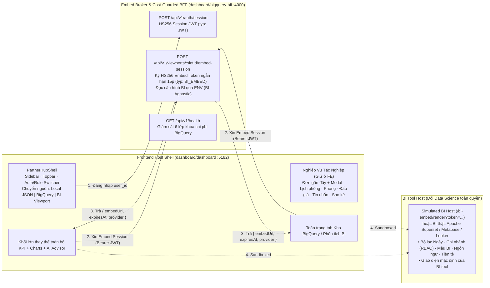

# Hướng Dẫn Kiến Trúc, Tích Hợp & Bàn Giao BI Viewport Khối Lớn — Optibide Partner Hub

> **Đối tượng đọc**: Ban Giám đốc / CTO, đội Data Science / BI, đội Backend và đội Frontend (`goodNstay`).  
> **Trạng thái**: Đã triển khai hoàn chỉnh **Phương án B** và kiểm chứng tự động **`87/87` kiểm thử PASS** (`20/20` BFF + `36/36` Unit/Contract + `31/31` Playwright E2E & Responsive 7 màn hình) + Build Production `0` lỗi.  
> **Tài liệu liên quan**:
> - Đặc tả kỹ thuật: [`2026-11-26-bi-viewport-architecture-design.md`](./2026-11-26-bi-viewport-architecture-design.md)
> - Kế hoạch triển khai: [`2026-11-26-bi-viewport-architecture-plan.md`](./2026-11-26-bi-viewport-architecture-plan.md)
> - Thiết kế BFF BigQuery & RBAC nền tảng: [`../ga4-bigquery/2026-11-23-bigquery-ga4-simulation-bff-and-rbac-viewport-design.md`](../ga4-bigquery/2026-11-23-bigquery-ga4-simulation-bff-and-rbac-viewport-design.md)

---

## 1. Tóm Tắt Kiến Trúc Trong 1 Phút (Decoupled Analytics Shell)

Theo định hướng phân tách trách nhiệm của CTO:
- **Frontend (`dashboard/dashboard`, cổng `:5182`)** chỉ đóng vai trò **Khung Ứng Dụng (Host Shell)** và các **Phân Hệ Tác Nghiệp (CRUD / OLTP)**: thanh điều hướng, đăng nhập/đổi ca, bảng *Đơn đặt phòng gần đây* (`BookingDetailModal`), *Lịch phòng*, *Quản lý phòng & giá sàn*, *Đấu giá trực tiếp*, *Tin nhắn khách*, *Sao kê* và *Marketing*.
- **Đội Data Science / BI** nắm **100% toàn quyền** nội dung bên trong các **Viewport khối lớn**: tự thêm/xóa/đổi biểu đồ, công thức, mẫu báo cáo, bộ lọc ngày, bộ lọc chi nhánh (trong phạm vi quyền), **ngôn ngữ (`VI / EN / KO`)** và **tiền tệ (`VND / KRW / USD`)** mà **Frontend không phải đụng vào Backend/Data và không cần sửa hay deploy lại code Frontend**.



---

## 2. Danh Mục Slot Khối Lớn & Ranh Giới Trách Nhiệm

### 2.1. Hai Slot khối lớn đang đăng ký trong [`viewportRegistry.ts`](../../dashboard/dashboard/src/lib/viewportRegistry.ts)

| `slotId` | Vị trí hiển thị | Thành phần được thay thế khi bật `BI Viewport` | Phần giữ lại ở Frontend |
| :--- | :--- | :--- | :--- |
| **`overview_analytics`** | Trang **Tổng quan (`overview`)** | Dropdown chọn kỳ ngoài (`period-select`), 5 thẻ KPI, `OverviewBigQueryChartsPanel`, Biểu đồ Doanh thu, Biểu đồ/Bảng Chào giá, Đánh giá/ELO và 2 khối Cố vấn AI | Bảng **Đơn đặt phòng gần đây** (ghim khung `30 ngày gần nhất`) + hộp thoại `BookingDetailModal` |
| **`deep_analytics`** | Tab **Kho BigQuery (`bigquery_live`)** | Toàn bộ màn hình `BigQueryWarehouseView` | Khung `PartnerHubShell` (Sidebar + Topbar) |

### 2.2. Các tính năng nội bộ bên trong BI Viewport
- **5 bộ chọn tự chủ nằm ngay trong thanh lọc của BI tool**:
  1. **Khoảng thời gian** (`30 ngày gần nhất` / `7 ngày gần nhất` / `Hôm nay`)
  2. **Chi nhánh được cấp quyền** (chỉ liệt kê đúng các `branchId` nằm trong token đã ký; chỉ có tùy chọn *"Tất cả chi nhánh"* khi `canViewChainAll = true`)
  3. **Mẫu bố cục BI (DS Layout Preset)**: chuyển nhanh giữa *Mẫu 1 · Doanh thu & Đấu giá*, *Mẫu 2 · Phễu GA4 8 Bước & Media*, và *Mẫu 3 · Phân cụm AI Trúng/Rớt (C1–C4)*
  4. **Ngôn ngữ BI** (`Tiếng Việt` / `English` / `한국어`)
  5. **Tiền tệ BI** (`VND ₫` / `KRW ₩` / `USD $` theo tỷ giá chuẩn `1 / 18.5 / 25.400`)
- **Độc lập hoàn toàn với bộ lọc ngoài Header**: Đổi chi nhánh ở thanh Topbar (phục vụ các bảng tác nghiệp) **không** gọi lại `embed-session` của BI Viewport; chỉ khi **đổi tài khoản đăng nhập (`userId`)**, Frontend mới xin phiên BI mới theo quyền RBAC của người mới.

---

## 3. Hợp Đồng Kết Nối API & Hướng Dẫn Cắm BI Tool Thật (Zero Frontend Change)

### 3.1. Danh sách Endpoint phía Backend/Data (`dashboard/bigquery-bff`)

| Method & Path | Xác thực | Mục đích |
| :--- | :--- | :--- |
| `GET /api/v1/health` | Public | Kiểm tra sức khỏe BFF & đồng hồ 6 lớp khóa chi phí BigQuery |
| `POST /api/v1/auth/session` | Public (demo) | Cấp `accessToken` HS256 Session JWT (`typ: "JWT"`) cho `userId` |
| `GET /api/v1/viewports/registry` | `Bearer <JWT>` | Trả danh mục các slot (`overview_analytics`, `deep_analytics`), `provider` và trạng thái (`simulated` / `external` / `disabled`) |
| `POST /api/v1/viewports/:slotId/embed-session` | `Bearer <JWT>` | Cấp phiên nhúng chuẩn không khóa hãng BI (trả `embedUrl`, `guestToken`, `expiresAt`, `minHeightPx`, `scopeSummary`) |
| `GET /bi-embed/render?token=<BI_EMBED>` | Signed Query Token | Máy chủ BI giả lập cục bộ phục vụ Demo CTO & kiểm thử tự động |

#### Payload mẫu của `POST /api/v1/viewports/:slotId/embed-session`
```json
{
  "ok": true,
  "slotId": "overview_analytics",
  "provider": "simulated_bi",
  "embedUrl": "http://127.0.0.1:4000/bi-embed/render?token=<HS256_BI_EMBED_TOKEN>&lang=vi",
  "guestToken": null,
  "issuedAt": "2026-11-26T08:00:00.000Z",
  "expiresAt": "2026-11-26T08:15:00.000Z",
  "ttlSec": 900,
  "minHeightPx": 780,
  "allowFullscreen": true,
  "scopeSummary": {
    "userId": "USR-MGR-MYKHE",
    "partnerId": "HTL-DN-024",
    "roleKey": "branch_manager",
    "allowedBranchIds": ["br_mykhe"],
    "canViewChainAll": false,
    "canViewFinancials": true
  }
}
```

#### Mã lỗi chuẩn
- `401 MISSING_AUTHORIZATION` / `INVALID_TOKEN_SIGNATURE` / `TOKEN_EXPIRED` / `UNSUPPORTED_TOKEN_ALG`
- `404 UNKNOWN_VIEWPORT_SLOT` (nếu `slotId` không tồn tại trong Registry)
- `503 VIEWPORT_PROVIDER_UNCONFIGURED` (khi slot bị gán `"disabled"`, thiếu URL khi dùng provider ngoài, hoặc URL ngoài nằm ngoài `VIEWPORT_ALLOWED_ORIGINS`)

### 3.2. Bảng biến môi trường để đội Data Science cắm BI thật (không sửa code Frontend)

Khi đội Data Science sẵn sàng đưa **Apache Superset**, **Metabase**, **Looker** hoặc BI nội bộ vào vận hành, chỉ cần đặt biến môi trường phía BFF (`dashboard/bigquery-bff`):

| Biến môi trường | Mặc định | Mô tả & Quy tắc an toàn |
| :--- | :--- | :--- |
| `VIEWPORT_PROVIDER` | `simulated_bi` | Chọn 1 trong: `simulated_bi`, `superset`, `metabase`, `looker`, `generic_iframe`. |
| `VIEWPORT_OVERVIEW_EMBED_URL` | *(trống = dùng Simulated BI)* | URL nhúng cho khối `overview_analytics`. Gán `"disabled"` để ngắt chủ động (`503`). |
| `VIEWPORT_DEEP_EMBED_URL` | *(trống = dùng Simulated BI)* | URL nhúng cho khối `deep_analytics`. Gán `"disabled"` để ngắt chủ động (`503`). |
| `VIEWPORT_PUBLIC_BASE_URL` | *(tự động nhận diện)* | Origin công khai của BI server khi chạy tách 2 domain ở Staging/Production (ví dụ `https://bi.goodnstay.com`). |
| `VIEWPORT_EMBED_TTL_SEC` | `900` (`15 phút`) | Thời hạn token nhúng (kẹp cứng trong `[60..3600]` giây). Frontend tự gia hạn trước khi hết hạn `60` giây. |
| `VIEWPORT_ALLOWED_ORIGINS` | *(trống ở local)* | Danh sách origin được phép phía server, phân tách bởi dấu phẩy (ví dụ `https://bi.goodnstay.com`). |
| `BFF_OFFLINE_SEED_FALLBACK` | `true` (dev) / `false` (prod) | Cho phép rơi về `master-data/seed/` khi mất kết nối GCP ở dev/demo; **không bao giờ** nuốt `CostGuardError`. |

> **Chống rò rỉ Secret sang bên thứ 3**: Với provider ngoài, BFF **không tự động nối** `?token=<HS256>` vào URL. Chỉ thay thế khi URL cấu hình có placeholder tường minh `{token}` (dành cho micro-app nội bộ dùng chung khóa ký). Riêng `VIEWPORT_PROVIDER=superset` trả token ngắn hạn vào trường `guestToken` để sẵn sàng nối Superset Embedded SDK.

---

## 4. Ma Trận Bảo Mật & Cô Lập Đa Chi Nhánh (`user_id × branch_id`)

1. **Tách biệt hoàn toàn loại Token (`typ: "BI_EMBED"` vs. `typ: "JWT"`)**:
   - Token nhúng BI có header `{ "alg": "HS256", "typ": "BI_EMBED" }`, thời hạn ngắn `15 phút`, gắn cứng `slotId`, `allowedBranchIds` và `canViewFinancials`.
   - Đem Session JWT dài hạn (`typ: "JWT"`) gắn vào `/bi-embed/render?token=...` bị từ chối ngay `HTTP 401 UNSUPPORTED_TOKEN_ALG`.
2. **Chính sách `sandbox` thích ứng theo Origin (Chống thoát Sandbox)**:
   - **Cross-Origin thật** (`http://localhost:5182` ↔ `http://127.0.0.1:4000` hoặc Production `partner.goodnstay.com` ↔ `bi.goodnstay.com`): dùng `sandbox="allow-scripts allow-same-origin allow-forms allow-downloads"`, xác thực `postMessage` bằng `event.source === iframeWindow && event.origin === iframeOrigin`.
   - **Same-Origin qua 1 Tunnel HTTPS duy nhất** (`*.ts.net` / `*.trycloudflare.com`, proxy `/bi-embed` qua Vite): **tự động gỡ bỏ `allow-same-origin`**, chỉ giữ `sandbox="allow-scripts allow-forms allow-downloads"` để iframe không thể chạm `localStorage`/DOM của ứng dụng chính, và xác thực `postMessage` với `event.origin === "null"`.
3. **Bảo vệ doanh thu Lễ tân (`USR-STAFF-02`, `canViewFinancials = false`) ở cả 2 lớp**:
   - **Trong BI iframe**: Dữ liệu doanh thu/GMV bị loại bỏ thành `null` ngay từ Server; dù đổi sang `VND`, `USD` hay `KRW` vẫn hiển thị nhãn che RBAC.
   - **Ngoài Host Shell**: Thanh *Tác động ròng kỳ này* và hộp `BookingDetailModal` đều che số tiền thành `•••••• ₫ (Đã che)` trong chế độ `bi-viewport` và `live-bigquery`.
4. **Kiểm định URL & Hộp công cụ `Đổi URL (Demo)`**:
   - `validateViewportEmbedUrl` chặn cứng `javascript:`, `data:`, `blob:`, `file:`, `vbscript:` và mọi origin ngoài allowlist.
   - Nút `Đổi URL (Demo)` chỉ hiển thị ở môi trường dev/demo (`import.meta.env.DEV || VITE_ENABLE_VIEWPORT_DEMO_TOOLS === "true"`) và **ẩn hoàn toàn với vai trò Lễ tân (`canManagePricing === false`)**.

---

## 5. Giải Thích Chi Tiết Endpoint Giám Sát `/api/v1/health`

Endpoint `GET /api/v1/health` (ví dụ `https://<tunnel-host>/api/v1/health` hoặc `http://127.0.0.1:4000/api/v1/health`) trả về 4 nhóm thông số theo thời gian thực để CTO và đội kỹ thuật kiểm chứng 6 lớp khóa chi phí BigQuery:

1. **Trạng thái kết nối**:
   - `ok` (`true`): BFF đang hoạt động ổn định (`HTTP 200`).
   - `service` (`"goodnstay-bigquery-bff"`), `gcpProjectId` (`"aevo-512307"`), `bqLocation` (`"US"`), `timestamp` (UTC ISO-8601).
2. **Hàng rào 6 lớp khóa chi phí (`costGuard`)**:
   - `onDemandRateUsdPerTiB` (`6.25`) & `monthlyFreeTierTiB` (`1`): Biểu giá \$6.25/TiB của BigQuery và 1 TiB miễn phí/tháng.
   - `maxBytesBilledPerQuery` (`26214400` = **25 MiB**) & `maxWorstCaseCostPerQueryUsd` (`0.00014901` ≈ **\$0.00015/query**): Trần cứng tối đa mỗi truy vấn (Lớp 6).
   - `enableDryRunPreflight` (`true`): Chạy ước tính nháp **\$0** trước khi thực thi thật (Lớp 5).
   - `dailyBilledByteBudget` (`524288000` = **500 MiB/24h**), `dailyBilledBytesUsed`, `dailyBudgetRemainingPct`, `circuitBreakerTripped`: Cầu dao ngân sách cuộn 24 giờ (Lớp 4).
   - `cacheTtlTodaySec` (`60s`), `cacheTtlHistorySec` (`900s` = 15p), `jobTimeoutMs` (`10000ms`): Cache 2 tầng trên RAM BFF + chống treo job (Lớp 3).
   - `rateLimitPerMin` (`60` req/phút/user) & `forceRefreshLimitPerMin` (`10` lần/phút/user): Chặn vòng lặp gọi liên tục (Lớp 2).
3. **Bộ đếm vận hành (`costGuard.counters`)**:
   - `totalRequests`: Tổng lượt yêu cầu đi qua lớp bảo vệ cache/singleflight.
   - `bffCacheHits`: Số lượt trả tức thì từ RAM BFF (`0ms`, `\$0`, không gọi Google Cloud).
   - `singleflightCoalesced`: Số request trùng lặp gửi cùng lúc được gộp thành 1 truy vấn duy nhất.
   - `liveBqJobsExecuted`, `bqNativeCacheHits`, `dryRunPreflightsRun`: Số job gửi lên BigQuery, số job trúng cache gốc BigQuery (**0 byte / \$0**), và số lần Dry-Run miễn phí.
   - `blockedByCostCeiling`, `blockedByDailyBudget`, `blockedByRateLimit`, `blockedBySqlSafety`: Số lần các lớp chặn kích hoạt (Lớp 1 chặn `SELECT *` / DML / DDL / nối nhiều câu lệnh).
4. **Lũy kế chi phí thực tế**:
   - `cumulativeBytesProcessed`, `cumulativeBytesBilled`, `cumulativeEstimatedUsd`: Tổng byte đọc mới, byte bị tính phí và ước tính USD tích lũy từ khi khởi động BFF.

---

## 6. Hướng Dẫn Khởi Chạy & Kiểm Thử Tự Động

### 6.1. Chạy Local & Demo qua HTTPS Tunnel
```bash
# 1. Khởi chạy Backend BFF & Simulated BI Host (cổng :4000)
cd dashboard/bigquery-bff
npm run build
node dist/src/index.js

# 2. Khởi chạy Frontend Partner Hub (cổng :5182, đã cấu hình proxy /api/v1 & /bi-embed)
cd dashboard/dashboard
npm run dev
```

### 6.2. Chạy toàn bộ cổng kiểm thử nghiệm thu (`87/87 PASS`)
```bash
# Kiểm thử BFF (20/20: 7 Live BigQuery + Auth + 6-Layer Cost Guard + BI Viewport Embed Broker)
cd dashboard/bigquery-bff && npm test

# Kiểm thử Dashboard (36/36 Unit/Contract/TypeScript + 31/31 Playwright E2E/Responsive 7 màn hình) & Build Production
cd dashboard/dashboard && npm test && npm run build
```
