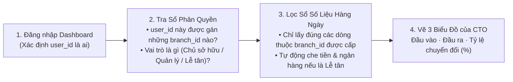

# Giải Pháp Phân Quyền Chi Nhánh (`branch_id`) & Người Dùng (`user_id`) Theo Ý Tưởng Dashboard Của CTO

> **Dành cho**: Quản lý Sản phẩm (PM), Ban Điều hành / CTO, Kinh doanh – Vận hành Đối tác, Thiết kế và Kỹ thuật.  
> **Mục tiêu**: Giải thích ngắn gọn, dễ hiểu cách phân quyền dữ liệu giữa **Chi nhánh / Cơ sở lưu trú (`branch_id`)** và **Tài khoản người dùng (`user_id`)** trên Dashboard, đồng thời làm rõ cách hiện thực hóa chuẩn xác ý tưởng minh họa của CTO trên trang tính `dashboard_sample`.

---

## 1. Giải Mã Ý Tưởng Của CTO Trên Trang Tính `dashboard_sample`

Qua bảng dữ liệu mẫu tháng 11 và 3 biểu đồ đường bên cạnh trên trang `dashboard_sample`, CTO đang đặt nền móng cho **2 nguyên tắc cốt lõi của Partner Dashboard**:

1. **Cách nhìn hiệu suất theo chuỗi thời gian (Công thức 3 biểu đồ song hành)**:
   - Thay vì chỉ đưa ra những con số tổng cộng khô khan, mỗi bước trên hành trình đặt phòng đều cần theo dõi qua **3 đường biểu đồ theo từng ngày**:
     1. **Lượng tiếp cận đầu vào** *(ví dụ: số lượt mở xem)*.
     2. **Lượng hoàn tất đầu ra** *(ví dụ: số lượt gửi yêu cầu / bấm chọn thành công)*.
     3. **Tỷ lệ chuyển đổi (`% = Đầu ra ÷ Đầu vào`)**: Đây là biểu đồ quan trọng nhất giúp chủ khách sạn và hệ thống AI phát hiện ngay ngày nào tỷ lệ chốt bị rơi bất thường để điều chỉnh giá hoặc hình ảnh kịp thời.
2. **Bài toán tách riêng dữ liệu theo từng Chi nhánh (`branch_id`) và Người dùng (`user_id`)**:
   - Tại ngày `01/11/2026`, CTO đã chủ động tách thành 2 dòng ví dụ riêng biệt:
     - Cơ sở `kyle_resort_2` gắn với người dùng `kyle` (*tỷ lệ chuyển đổi đạt `3,30%`*).
     - Cơ sở `minh_hotel_1` gắn với người dùng `minh` (*tỷ lệ chuyển đổi đạt `11,80%`*).
   - **Thông điệp rất rõ**: Dữ liệu toàn sàn tuy nằm chung trong một kho lớn, nhưng khi hiển thị lên Dashboard thì **cơ sở của ai người nấy thấy**. Ngay trên bản nháp trang tính, vì chưa có bộ lọc theo người đăng nhập nên ngày `01/11` đang bị vẽ chồng cả 2 cơ sở lên cùng một đường biểu đồ — đây chính là bài toán phân quyền mà đội Sản phẩm cần chốt.

---

## 2. Phân Biệt Rõ 3 Khái Niệm Cốt Lõi Để Không Bị Nhầm Lẫn

Trong hệ thống chỉ dùng 2 khóa định danh chính bên phía đối tác là **`branch_id`** và **`user_id`**, nhưng cần tách bạch rõ với du khách đi đặt phòng:

| Khái niệm | Hiểu đơn giản là gì? | Ví dụ thực tế ngoài đời |
| :--- | :--- | :--- |
| **1. Chi nhánh / Cơ sở lưu trú (`branch_id`)** | Từng tòa khách sạn, resort hoặc căn hộ cụ thể tại một địa chỉ xác định. | Cơ sở số 1 của Minh, Resort số 2 của Kyle. **Mọi phòng trống, báo giá đấu thầu, tương tác của khách và doanh thu đều gắn trực tiếp vào từng `branch_id` này.** |
| **2. Người dùng phía Đối tác (`user_id` trên Dashboard)** | Tài khoản của con người phía khách sạn đăng nhập vào Dashboard để làm việc. | Anh Kyle (Chủ sở hữu cả Resort 1 và Resort 2), anh Nam (Quản lý riêng Resort 2), chị Hà (Lễ tân trực quầy tại Resort 2). |
| **3. Du khách đặt phòng (Người dùng trên ứng dụng tìm phòng)** | Khách đi du lịch mở trang `goodNstay` để tìm và đặt phòng. | Người tạo ra lượt xem, lượt bấm chọn và thanh toán — **hoàn toàn độc lập, không phải `user_id` dùng để phân quyền trên Dashboard khách sạn**. |

---

## 3. Giải Quyết Bài Toán Phân Quyền `branch_id` & `user_id` Như Thế Nào?

### 3.1 Vì sao không ghi cứng "1 Chi nhánh = 1 Người dùng" trực tiếp vào từng dòng số liệu?
Trên bảng nháp ý tưởng, để minh họa nhanh, mỗi dòng ngày `01/11` đang đặt `branch_id` đi liền với đúng 1 `user_id`. Tuy nhiên ngoài thực tế vận hành khách sạn luôn xảy ra **quan hệ nhiều-nhiều**:
- **Một người dùng (`user_id`) quản lý nhiều chi nhánh (`branch_id`)**: Ví dụ anh `kyle` sở hữu cả `kyle_resort_1`, `kyle_resort_2` và `kyle_resort_3` — anh ấy cần xem tổng hợp tất cả cơ sở của mình hoặc bấm chọn xem lẻ từng cơ sở mà không cần tạo thêm bất kỳ cấp trung gian nào khác.
- **Một chi nhánh (`branch_id`) có nhiều người dùng (`user_id`) cùng làm việc với quyền hạn khác nhau**: Cùng làm tại `kyle_resort_2`, nhưng tài khoản Quản lý được xem tiền và chỉnh giá thầu; còn tài khoản Lễ tân trực quầy chỉ được xem lịch nhận phòng và trả lời khách, **không được thấy doanh thu hay số tài khoản ngân hàng của anh Kyle**.

Nếu ghi cứng cột `user_id` vào bảng số liệu hàng ngày: một cơ sở có 4 nhân viên sẽ làm dữ liệu bị nhân bản gấp 4 lần, và khi đổi nhân sự hoặc thêm quản lý mới sẽ làm rối toàn bộ lịch sử thống kê.

### 3.2 Giải pháp chuẩn: Tách thành "Sổ Số Liệu Theo Chi Nhánh" và "Sổ Phân Quyền Người Dùng"

Hệ thống giải quyết gọn nhẹ bằng cách tách làm **2 bảng riêng biệt** và khớp nối tự động ngay lúc người dùng đăng nhập:

- **Bảng 1 — Sổ Số Liệu Thống Kê Hàng Ngày**: Chỉ ghi theo **`Ngày` + `Chi nhánh (branch_id)`**. Mỗi cơ sở lưu trú trong một ngày chỉ có **đúng 1 dòng số liệu duy nhất**, sạch sẽ tuyệt đối dù cơ sở đó có 1 hay 10 nhân viên đăng nhập.
- **Bảng 2 — Sổ Phân Quyền Người Dùng**: Là bảng nối giữa **`user_id`** và danh sách **`branch_id` được phép truy cập**, kèm theo **Vai trò thao tác**. Muốn cấp thêm chi nhánh cho ai hay thu hồi quyền nhân viên nghỉ việc chỉ cần sửa 1 dòng tại bảng này là có hiệu lực tức thì.

---

## 4. Bảng Quy Tắc Phân Quyền Mẫu Cho Đội Quản Lý Sản Phẩm (PM)

Chỉ với cặp `user_id` và danh sách `branch_id` được cấp, đội Sản phẩm giải quyết trọn vẹn mọi mô hình từ khách sạn đơn lẻ đến ông chủ có nhiều cơ sở:

| Vai trò của `user_id` | Danh sách `branch_id` được gán | Xem Biểu đồ Hành vi & Tỷ lệ chuyển đổi | Xem Doanh thu & Sao kê Ngân hàng | Chỉnh Giá sàn, Đấu giá Tự động & Khuyến mãi | Xem Lịch phòng, Nhận trả phòng & Chat với khách |
| :--- | :--- | :---: | :---: | :---: | :---: |
| **1. Chủ sở hữu (1 hoặc nhiều cơ sở)** | Toàn bộ các `branch_id` thuộc sở hữu *(có nút xem Gộp tất cả cơ sở của mình hoặc xem lẻ từng nơi)* | Có | **Có đầy đủ** | **Có toàn quyền** | Có |
| **2. Quản lý Chi nhánh** | **Chỉ đúng `branch_id`** được giao phụ trách *(tự động ẩn các cơ sở khác)* | Có *(của chi nhánh mình)* | **Có** *(chỉ của chi nhánh mình)* | **Có** *(trong chi nhánh mình)* | Có |
| **3. Kế toán Đối soát** | Các `branch_id` được giao đối soát | Chỉ xem tổng quan đơn | **Có đầy đủ** *(xem & tải sao kê)* | **Không** *(chỉ xem, không sửa giá)* | Không cần thao tác |
| **4. Lễ tân Ca trực** | **Chỉ đúng `branch_id`** đang đứng quầy | Không *(hoặc chỉ xem lượng khách đến trong ngày)* | **Không (Ẩn hoàn toàn số tiền & ngân hàng)** | **Không (Khóa nút chỉnh giá)** | **Có** *(nghiệp vụ chính hàng ngày)* |

---

## 5. Ba Lưu Ý Nghiệp Vụ Để Hiện Thực Hóa Chuẩn Ý Tưởng Của CTO

Khi chuyển từ bản phác thảo `dashboard_sample` của CTO sang biểu đồ thực tế trên Dashboard, có **3 điểm cần thống nhất chung**:

1. **Tách rõ "Nhu cầu Thị trường Khu vực" và "Hiệu suất Riêng của từng `branch_id`"**:
   - Ở bước đầu tiên trên trang tính mẫu (*du khách mới mở biểu mẫu tìm phòng và bấm gửi yêu cầu*), lúc này du khách mới chỉ chọn khu vực muốn đến (ví dụ: *Quận Sơn Trà, Đà Nẵng*) chứ **chưa chọn riêng cơ sở của anh Kyle hay anh Minh**.
   - Vì vậy:
     - Số lượng khách tìm phòng tại khu vực sẽ hiển thị như **"Nhiệt kế nhu cầu thị trường quanh bạn"** (mọi `branch_id` nằm trong khu vực đó đều được tham khảo sức nóng của thị trường).
     - Từ bước khách sạn gửi chào giá trở đi (*Thẻ giá hiện lên màn hình khách $\rightarrow$ Khách bấm Xem chi tiết $\rightarrow$ Khách bấm Chọn $\rightarrow$ Khách Thanh toán*), cả 3 biểu đồ **Đầu vào – Đầu ra – Tỷ lệ %** đều được tính **riêng biệt 100% theo từng `branch_id`**.
2. **Đảm bảo Tỷ lệ chuyển đổi (`Ratio %`) luôn nằm trong khoảng `0% – 100%`**:
   - Trên bảng nháp đang dùng số giả lập ngẫu nhiên nên xuất hiện vài ngày số hoàn tất lớn hơn số mở xem, làm tỷ lệ vượt trên `100%` (như ngày `15/11` là `132%`, ngày `21/11` là `443%`).
   - Khi nối dữ liệu thật, hệ thống đếm theo **số phiên yêu cầu / số đề nghị duy nhất** (không đếm trùng khi một khách bấm nhiều lần), đảm bảo đường tỷ lệ chuyển đổi luôn chuẩn xác từ `0%` đến `100%`.
3. **Tự động nhận diện giao diện theo số lượng `branch_id` mà `user_id` nắm giữ**:
   - Nếu `user_id` được gán **từ 2 `branch_id` trở lên** (như anh Kyle có 2 resort), thanh chọn phía trên tự động mở tùy chọn **"Tất cả cơ sở của tôi"** kèm danh sách từng chi nhánh để chuyển đổi tức thì.
   - Nếu `user_id` chỉ được gán **đúng 1 `branch_id`** (khách sạn đơn lẻ, Quản lý chi nhánh hoặc Lễ tân), hệ thống tự khóa sẵn vào đúng cơ sở đó ngay khi mở trang — giao diện gọn nhẹ và tuyệt đối không lộ số liệu sang cơ sở khác.
