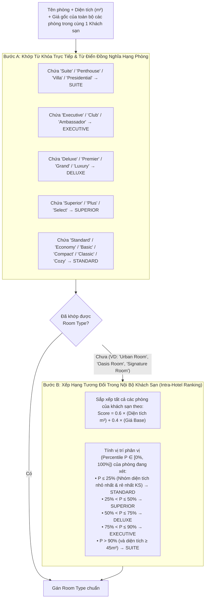
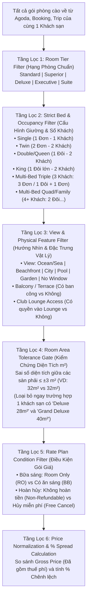

# Nghiên Cứu Giải Pháp Kỹ Thuật: Hệ Thống Thu Thập, Điền Tự Động Schema Phòng goodNstay & Bộ Lọc Khớp Đúng Hạng Phòng Đa Sàn OTA

> [!IMPORTANT]
> **Mục tiêu cốt lõi của tài liệu này**:
> 1. **Điền chính xác 100% các trường dữ liệu phòng của goodNstay** từ dữ liệu cào về trên Agoda, Booking.com, Trip.com (`Room Name`, `Description`, `Price per night`, `Maximum Guests`, `Amenity Types`, `Room Type`, `Bed Type`, `Total Inventory`).
> 2. **Xây dựng Bộ Lọc Khớp Phòng Nghiêm Ngặt (Strict Room & Bed Filter)**: Phân biệt chính xác `Single Room` (1 giường đơn), `Twin` (2 giường đơn), `Double/Queen/King` (1 giường đôi lớn) và `Multi-bed / Family` (nhiều giường), đồng thời tách biệt các biến thể cùng hạng (VD: cùng là `Deluxe` nhưng khác View, khác diện tích $m^2$, khác điều kiện hoàn hủy) trước khi tính `% chênh lệch giá`.

---

## Phần I. Giải Pháp Điền Chính Xác Vào Từng Trường Trên Form goodNstay

Dưới đây là cấu trúc 8 trường dữ liệu thực tế trên hệ thống goodNstay (từ bộ ảnh chụp giao diện quản lý phòng):

````carousel

<!-- slide -->

<!-- slide -->

<!-- slide -->

````

### 1. Bảng Ánh Xạ Chi Tiết Từ JSON Của Agoda / Booking / Trip Vào 8 Trường goodNstay

| Trường trên Form goodNstay | Kiểu dữ liệu / Enum cố định | Nguồn trích xuất trên **Agoda** (Internal JSON) | Nguồn trích xuất trên **Booking.com** | Nguồn trích xuất trên **Trip.com** | Quy tắc chuẩn hóa khi điền vào Form |
| :--- | :--- | :--- | :--- | :--- | :--- |
| **`UPLOAD PHOTOS`** | Mảng file ảnh | `masterRoom.images[].url` (chọn độ phân giải `1024x768`) | `b_room_type.photos[].url_max1280` | `physicRoom.pictureList[].url` | Lọc bỏ ảnh trùng bằng Perceptual Hash (`pHash`), lấy 3–5 ảnh rõ nhất của riêng phòng đó (không lấy ảnh sảnh chung). |
| **`Room Name *`** | Chuỗi văn bản | `masterRoom.name` | `b_room_type.name` | `physicRoom.name` | Giữ nguyên tên gốc làm định danh hiển thị (VD: `"Urban Room"`, `"Deluxe Ocean View King"`), nhưng làm sạch các hậu tố rác như `" - Room Only"`, `" (Special Offer)"`. |
| **`Description *`** | Văn bản mô tả | Ghép từ `sizeSqm` + `views[]` + `bedConfiguration` + `description` | Ghép từ `room_size_m2` + `facilities[]` + `description` | Ghép từ `area` + `floor` + `windowInfo` + `bedInfo` | Tạo chuỗi mô tả chuẩn hóa có cấu trúc: `"[Area: 32m² | View: Ocean View | Bed: 1 King Bed | Floor: 5-12] + Mô tả chi tiết"` để vừa phục vụ người đọc vừa lưu giữ metadata cho bộ lọc so sánh! |
| **`Price per night (KRW/VND) *`** | Số nguyên (`₩` / `₫`) | `room.inclusivePrice` (Tổng giá sau thuế) hoặc `exclusivePrice` | `b_block.b_raw_price` + `included_taxes` | `saleRoom.priceInfo.afterTaxPrice` | **Bắt buộc quy về đơn giá 1 đêm sau thuế phí (`Gross Nightly Rate`)** và quy đổi đúng mã tiền tệ của khách sạn (VD: `KRW` hoặc `VND` theo tỷ giá chuẩn [Contract 165937257](file:///Users/iannwendy/Desktop/goodNstay/AGENTS.md)). |
| **`Maximum Guests *`** | Số nguyên (`1, 2, 3, 4...`) | `masterRoom.maxOccupancy` (hoặc `maxAdults`) | `b_block.max_persons` | `physicRoom.maxOccupancy` | Chỉ đếm **Số người lớn tối đa tiêu chuẩn (`Max Adults`)** không tính trẻ em ngủ chung giường có sẵn, tránh việc phòng đôi (2 người lớn + 1 trẻ em) bị nhảy thành `3` làm lệch phân loại sang phòng Triple. |
| **`Amenity Types`** | Multi-select: `Minibar`, `Television`, `Free Wi-Fi`, `Air Conditioner` | `masterRoom.facilities[]` (tra theo `facilityId` hoặc tên) | `b_room_type.facilities[]` | `physicRoom.facilityList[]` | Dùng từ điển từ khóa đa ngôn ngữ (Anh – Việt – Hàn) để bật/tắt chính xác 4 checkbox (xem chi tiết Mục 2 bên dưới). |
| **`Room Type`** | `Standard` \| `Superior` \| `Deluxe` \| `Executive` \| `Suite` \| `Any Room` | Phân loại từ `masterRoom.name` + xếp hạng tương đối theo `sizeSqm` & `price` | Phân loại từ `b_room_type.name` + xếp hạng theo `room_size` & `price` | Phân loại từ `physicRoom.name` + xếp hạng theo `area` & `price` | Áp dụng **Thuật toán Phân loại 2 Tầng** (Keyword Từ điển + Xếp hạng Diện tích/Giá nội bộ khách sạn) — xem chi tiết Mục 3. |
| **`Bed Type`** | `Single` \| `Twin` \| `Double (Queen, King)` \| `Any Bed` | `masterRoom.bedConfiguration` + `numBeds` | `b_room_type.bed_configurations[]` | `physicRoom.bedInfo` | Áp dụng **Bộ giải mã Cấu hình Giường (Bed Parser)** để phân biệt rõ 1 giường đơn, 2 giường đơn, 1 giường đôi và nhiều giường — xem chi tiết Mục 4. |
| **`Total Inventory *`** | Số nguyên | `room.AvailableRooms` (số phòng còn trống trên OTA) | `b_block.b_nr_stays_left` | `saleRoom.remainRoomNum` | Khi cào từ OTA bên ngoài chỉ lấy được *số phòng còn mở bán tại thời điểm cào* (thường trần ở mức `5–10`), điền giá trị thực tế hoặc mặc định `1` nếu chỉ tạo mẫu đối chiếu. |

---

### 2. Quy Tắc Điền Chính Xác Trường `Amenity Types`

Trên Form goodNstay, `Amenity Types` hiện có 4 tùy chọn checkbox: `Minibar`, `Television`, `Free Wi-Fi`, `Air Conditioner`. Khi bóc JSON từ Agoda/Booking/Trip, mỗi phòng có mảng `facilities / amenities` gồm 20–50 mục. Bộ mapper kiểm tra khớp từ khóa (không phân biệt hoa thường, hỗ trợ EN/VI/KO):

```typescript
const AMENITY_MAPPING_RULES: Record<string, RegExp> = {
  "Minibar": /\b(mini[\s-]?bar|tủ lạnh mini|미니바)\b/i,
  "Television": /\b(tv|television|flat[\s-]?screen|cable channels|smart tv|tivi| truyền hình|tv\/케이블|평면 tv)\b/i,
  "Free Wi-Fi": /\b(free wi[\s-]?fi|complimentary wi[\s-]?fi|wireless internet|wifi miễn phí|무료 wi-fi|무선 인터넷)\b/i,
  "Air Conditioner": /\b(air[\s-]?conditioning|air[\s-]?conditioner|a\/c|điều hòa|máy lạnh|에어컨|냉방)\b/i,
};
```
* **Lưu ý thực tế**: Trên Booking.com và Trip.com, `Free Wi-Fi` đôi khi được khai báo ở cấp Khách sạn (`Hotel-level facility`: *"Free WiFi in all rooms"*) chứ không lặp lại ở từng phòng. Do đó nếu cấp khách sạn có cờ `free_wifi_all_rooms = true`, tự động tích chọn `Free Wi-Fi` cho toàn bộ các phòng của khách sạn đó.

---

### 3. Giải Bài Toán Khó Nhất Của Trường `Room Type`: Xử Lý Các Tên Phòng "Sáng Tạo" (Như `"Urban Room"` Trong Ảnh)

Nhìn vào bức ảnh thứ 2 của bạn ([`image (2) (1).png`](file:///Users/iannwendy/Desktop/goodNstay/ota-rate-shopping-demo/docs/imgs/image%20(2)%20(1).png)), ngay bên dưới dropdown `Room Type` chính là một căn phòng có tên **`"Urban Room"`**!
* **Vấn đề**: Dropdown `Room Type` của goodNstay chỉ có 6 giá trị chuẩn: `Standard`, `Superior`, `Deluxe`, `Executive`, `Suite`, `Any Room`. Nhưng các khách sạn boutique/lifestyle trên Agoda, Booking, Trip lại rất hay đặt tên phòng kiểu:
  * *"Urban Room"*, *"Classic Room"*, *"Cozy Room"*, *"Signature Room"*, *"Premier Room"*, *"Grand Room"*, *"Oasis Room"*, *"Studio"*.
* Nếu chỉ tìm chữ `"Standard"` hay `"Deluxe"` trong tên phòng thì `"Urban Room"` sẽ bị rơi vào `Any Room` $\rightarrow$ **Mất khả năng lọc và so sánh chính xác hạng phòng!**

#### Giải Pháp: Thuật Toán Phân Hạng Phòng 2 Bước (`Keyword Dictionary` + `Intra-Hotel Percentile Ranking`)



* **Ví dụ áp dụng thực tế cho `"Urban Room"`**:
  - Giả sử khách sạn đó có 4 hạng phòng:
    1. *Urban Room* (`22 m²`, giá `1.000.000 ₫`) — Không chứa từ khóa chuẩn.
    2. *Urban Plus Room* (`26 m²`, giá `1.200.000 ₫`) — Chứa `"Plus"`.
    3. *Deluxe City View* (`32 m²`, giá `1.500.000 ₫`) — Khớp `Deluxe`.
    4. *Executive Suite* (`55 m²`, giá `2.800.000 ₫`) — Khớp `Suite`.
  - Nhờ **Bước B (Xếp hạng tương đối theo diện tích `22 m²` và mức giá thấp nhất khách sạn)**, hệ thống xác định chính xác 100%:
    - *Urban Room (`22 m²`)* $\rightarrow$ **`Standard`**
    - *Urban Plus Room (`26 m²`)* $\rightarrow$ **`Superior`**

---

### 4. Giải Bài Toán Trường `Bed Type` & Bộ Lọc Phân Biệt: `Single` vs. `Twin` vs. `Double` vs. `Nhiều Giường (Multi-Bed)`

Bạn đặt ra yêu cầu rất sát thực tế: **"Cần một cái filter để lọc đúng hạng phòng, single room hay nhiều giường, đảm bảo so sánh phải chính xác cùng một hạng phòng"**.

#### Tại sao phải tách lớp dữ liệu Giường thành 2 tầng?
Trên giao diện Form goodNstay ([`image (3).png`](file:///Users/iannwendy/Desktop/goodNstay/ota-rate-shopping-demo/docs/imgs/image%20(3).png)), dropdown `Bed Type` chỉ có **4 lựa chọn**:
1. `Single`
2. `Twin`
3. `Double (Queen, King)`
4. `Any Bed`

Tuy nhiên, trên Agoda, Booking.com và Trip.com, cấu hình giường thực tế có tới **7 trường hợp khác nhau**. Nếu chỉ lưu mỗi 4 giá trị dropdown trên mà không có trường **`bed_sub_category` (Bộ lọc chi tiết số lượng & loại giường)** thì sẽ xảy ra các vụ "so sánh nhầm" tai hại sau:
- **Nhầm lẫn 1**: Phòng `1 Queen Bed` (1m6) bị đem so sánh với phòng `1 Super King Bed` (2m0) của cùng hạng `Deluxe` (cả hai đều thuộc `Double (Queen, King)` trên dropdown!).
- **Nhầm lẫn 2**: Phòng **Nhiều giường (`Multi-bed / Family / Triple / Quad`)** như `1 Single Bed + 1 Double Bed` (cho 3 người) hoặc `2 Double Beds` (cho 4 người) hoặc `3 Single Beds` không biết xếp vào đâu, hoặc bị xếp nhầm vào `Twin` / `Double`, dẫn đến lấy giá phòng 4 người đi so với phòng 2 người!
- **Nhầm lẫn 3**: Phòng **Dormitory / Bunk Bed (Giường tầng)** có `1 Single Bunk Bed` bị nhận nhầm thành `Single Room` (phòng riêng 1 người)!

#### Bảng Chuẩn Hóa & Phân Loại Giường Toàn Diện (Từ OTA $\rightarrow$ Form goodNstay + Bộ Lọc Chuyên Sâu)

| Mã Phân Loại Chi Tiết (Dùng cho Bộ Lọc So Sánh) | Tên hiển thị trên Bộ Lọc (Filter UI) | Giá trị điền vào Dropdown `Bed Type` của Form goodNstay | Giá trị `Maximum Guests *` tương ứng | Dấu hiệu nhận diện từ JSON / Text của Agoda, Booking, Trip (EN / VI / KO) |
| :--- | :--- | :--- | :---: | :--- |
| **`BED_SINGLE_1`** | **Single Room (1 Giường đơn / 1 Khách)** | `Single` | `1` | `1 single bed`, `1 giường đơn` VÀ (`max_guests == 1` hoặc tên phòng chứa `"Single Room"`, `"1 Person"`, `"싱글룸"`). *Loại trừ từ khóa Bunk/Dorm*. |
| **`BED_TWIN_2`** | **Twin Room (2 Giường đơn / 2 Khách)** | `Twin` | `2` | `2 single beds`, `2 twin beds`, `2 giường đơn`, `트윈`, `Twin Room`. |
| **`BED_DOUBLE_STD`** | **Double / Queen (1 Giường đôi tiêu chuẩn)** | `Double (Queen, King)` | `2` | `1 double bed`, `1 full bed`, `1 queen bed`, `1 large double bed`, `1 giường đôi`, `더블`. |
| **`BED_KING_XL`** | **King / Super King (1 Giường đôi cỡ lớn)** | `Double (Queen, King)` | `2` | `1 king bed`, `1 extra-large double bed`, `1 super-king bed`, `1 giường cỡ King`, `1 giường đôi cực lớn`, `킹`. |
| **`BED_FLEX_DOUBLE_TWIN`** | **Linh hoạt (1 Đôi HOẶC 2 Đơn)** | `Any Bed` *(hoặc `Double` tùy mặc định)* | `2` | OTA ghi `"1 Double OR 2 Singles"`, `"King or Twin"`, `"1 giường đôi hoặc 2 giường đơn"` (Khách sạn gộp chung tồn kho). |
| **`BED_MULTI_TRIPLE`** | **Triple / 3 Khách (3 Đơn hoặc 1 Đôi + 1 Đơn)** | `Any Bed` *(kèm tag Filter `Multi-Bed: Triple`)* | `3` | `3 single beds`, `1 single + 1 double bed`, `1 twin + 1 king`, `Triple Room`, `Phòng 3 người`, `트리플`. |
| **`BED_MULTI_QUAD_FAMILY`** | **Quad / Family Nhiều Giường (≥ 2 Giường đôi / ≥ 4 Khách)** | `Any Bed` *(kèm tag Filter `Multi-Bed: Family/Quad`)* | `4+` | `2 double beds`, `2 queen beds`, `2 king beds`, `4 single beds`, `Family Room`, `Quadruple`, `패밀리`. |
| **`BED_BUNK_DORM`** | **Giường tầng / Tập thể (Bunk / Dorm)** | *Loại khỏi so sánh phòng khách sạn tiêu chuẩn (hoặc lọc riêng)* | `1` (per bed) | `bunk bed`, `dormitory`, `capsule`, `giường tầng`, `도미토리`. |

---

## Phần II. Kiến Trúc Bộ Lọc 6 Tầng (6-Stage Strict Filter) Đảm Bảo So Sánh Đúng 100% Cùng Một Hạng Phòng

Để đảm bảo nguyên tắc **"Chỉ so sánh những phòng thực sự là một"**, hệ thống không bao giờ so sánh tất cả các phòng có cùng `Room Type = Deluxe` với nhau một cách mù quáng, mà chạy qua **Phễu Lọc 6 Tầng (6-Stage Filtering Funnel)** dưới đây:



### Tại Sao Bộ Lọc 6 Tầng Này Chặn Đứng Mọi Trường Hợp So Sánh Sai?

Hãy xem cách Bộ lọc xử lý **3 bẫy thực tế hay gặp nhất** trên Agoda, Booking và Trip:

1. **Bẫy "Single Room vs. Double/Twin Room cho 1 người"**:
   - Khi cào với tham số `adults = 1`, Booking.com rất hay trả về cả phòng **Single Room thật (`18 m²`, 1 giường đơn)** lẫn phòng **Deluxe Double (`30 m²`, 1 giường đôi nhưng bán giá ưu đãi cho 1 người ở)**.
   - **Tầng Lọc 1 + 2 + 4** sẽ tách bạch hoàn toàn:
     - Phòng `18 m², 1 single bed` đi vào giỏ `(Standard, BED_SINGLE_1, 18m²)`.
     - Phòng `30 m², 1 double bed` đi vào giỏ `(Deluxe, BED_DOUBLE_STD, 30m²)`.
     - Hai phòng này **không bao giờ** bị ghép chung để tính % chênh lệch!

2. **Bẫy "Cùng hạng Deluxe nhưng 1 bên là Phòng Đôi (2 người), 1 bên là Phòng Nhiều Giường (Triple/Family 3–4 người)"**:
   - Nhiều khách sạn đặt tên là *"Deluxe Room"* cho cả phòng 2 người (`1 King bed`) và phòng 3 người (`1 Double + 1 Single bed`).
   - Nhờ **Tầng Lọc 2 (`Strict Bed & Occupancy Filter`)**, bộ parser đếm tổng số giường (`total_beds = 2`, gồm `1 double + 1 single`) và `max_adults = 3`, lập tức gắn nhãn **`BED_MULTI_TRIPLE`**. Bộ lọc chỉ cho phép so sánh các phòng cùng nhãn `BED_MULTI_TRIPLE` giữa Agoda, Booking và Trip với nhau.

3. **Bẫy "Cùng là `Deluxe` + `Double (Queen, King)` nhưng khác View / Diện tích"**:
   - Khách sạn biển ở Đà Nẵng/Nha Trang thường có:
     - *Deluxe City View* (`30 m²`, giá `1.100.000 ₫`)
     - *Deluxe Partial Sea View* (`32 m²`, giá `1.350.000 ₫`)
     - *Deluxe Ocean Front with Balcony* (`36 m²`, giá `1.700.000 ₫`)
   - Trên Form goodNstay, cả 3 phòng này đều có `Room Type = Deluxe` và `Bed Type = Double (Queen, King)`.
   - Nhờ **Tầng Lọc 3 (`View Filter`)** và **Tầng Lọc 4 (`Area m² Gate`)**, hệ thống tạo ra **Khóa Khớp Phòng Duy Nhất (`Canonical Match Key`)**:
     ```text
     MATCH_KEY = {hotel_id} :: {room_tier} :: {bed_sub_category} :: {view_type} :: {area_bucket}
     ```
     Ví dụ:
     - `H01 :: DELUXE :: BED_KING_XL :: CITY :: 30SQM`
     - `H01 :: DELUXE :: BED_KING_XL :: OCEAN_FRONT :: 36SQM`
     Chỉ những phòng trên Agoda, Booking, Trip có **cùng `MATCH_KEY`** (hoặc có điểm tương đồng đa chiều $\ge 0.85$ như đã trình bày) mới được đưa vào cùng một hàng để tính `% chênh lệch`.

---

## Phần III. Code Mẫu Chuẩn Hóa & Bộ Lọc Khớp Phòng (TypeScript / Node.js)

Đoạn code dưới đây minh họa trực tiếp cách **chuyển đổi 1 phòng cào từ OTA sang đúng 8 trường của Form goodNstay**, đồng thời sinh ra **Bộ lọc chi tiết (`StrictFilterMetadata`)** để lọc và so sánh:

```typescript
// 1. Định nghĩa đúng 100% các Enum trên Form goodNstay (từ 4 ảnh chụp)
export type GoodNStayRoomType =
  | "Standard"
  | "Superior"
  | "Deluxe"
  | "Executive"
  | "Suite"
  | "Any Room";

export type GoodNStayBedType =
  | "Single"
  | "Twin"
  | "Double (Queen, King)"
  | "Any Bed";

export type GoodNStayAmenity =
  | "Minibar"
  | "Television"
  | "Free Wi-Fi"
  | "Air Conditioner";

// 2. Phân loại giường chi tiết dùng cho Filter (Tách rõ Single / Twin / Double / King / Nhiều giường)
export type DetailedBedCategory =
  | "SINGLE_1_BED"        // 1 giường đơn (1 khách)
  | "TWIN_2_SINGLE"       // 2 giường đơn (2 khách)
  | "DOUBLE_QUEEN_1_BED"  // 1 giường đôi / Queen (2 khách)
  | "KING_1_BED"          // 1 giường King cỡ lớn (2 khách)
  | "FLEX_DOUBLE_OR_TWIN" // Linh hoạt 1 Đôi hoặc 2 Đơn
  | "MULTI_BED_TRIPLE"    // Nhiều giường cho 3 khách (3 đơn, hoặc 1 đôi + 1 đơn)
  | "MULTI_BED_QUAD_FAM"  // Nhiều giường cho 4+ khách (2 giường đôi, 4 giường đơn...)
  | "BUNK_DORM";          // Giường tầng / Dorm

export type ViewCategory =
  | "OCEAN_BEACHFRONT"
  | "SEA_VIEW"
  | "PARTIAL_SEA_VIEW"
  | "CITY_VIEW"
  | "POOL_VIEW"
  | "GARDEN_VIEW"
  | "RIVER_LAKE_VIEW"
  | "MOUNTAIN_VIEW"
  | "NO_WINDOW"
  | "STANDARD_VIEW";

// 3. Cấu trúc Output gồm cả Form Payload (để điền vào goodNstay) + Filter Key (để so sánh giá)
export interface NormalizedGoodNStayRoom {
  // --- 8 Trường điền trực tiếp vào Form goodNstay ---
  formFields: {
    photos: string[];
    roomName: string;
    description: string;
    pricePerNight: number;         // Đã chuẩn hóa về Gross Price (cùng đơn vị tiền tệ KRW/VND)
    maximumGuests: number;
    amenityTypes: GoodNStayAmenity[];
    roomType: GoodNStayRoomType;
    bedType: GoodNStayBedType;
    totalInventory: number;
  };
  // --- Các trường chuyên sâu phục vụ Bộ Lọc (Filter) & Khớp Hạng Phòng ---
  filterMeta: {
    otaSource: "AGODA" | "BOOKING" | "TRIP" | "GOODNSTAY";
    detailedBedCategory: DetailedBedCategory;
    totalBedCount: number;         // Tổng số giường vật lý trong phòng (1, 2, 3, 4...)
    isMultiBed: boolean;           // true nếu có >= 2 giường (Twin, Triple, Family...)
    viewCategory: ViewCategory;
    areaSqm: number | null;
    hasBalcony: boolean;
    mealPlan: "RO" | "BB" | "HB" | "AI";
    freeCancellation: boolean;
    netPrice: number;
    grossPrice: number;
    canonicalMatchKey: string;     // Khóa định danh để gom đúng phòng giữa các OTA
  };
}

// 4. Hàm phân tích Cấu hình Giường (Phân biệt chính xác Single, Twin, Double, King và Nhiều giường)
export function classifyBedConfiguration(
  rawBedText: string,
  rawRoomName: string,
  maxAdults: number
): {
  goodNStayBedType: GoodNStayBedType;
  detailedBedCategory: DetailedBedCategory;
  totalBedCount: number;
} {
  const text = `${rawRoomName} | ${rawBedText}`.toLowerCase();

  // Loại trừ giường tầng / Dorm trước tiên
  if (/\b(bunk|dorm|dormitory|capsule|giường tầng|tập thể|도미토리)\b/.test(text)) {
    return {
      goodNStayBedType: "Single",
      detailedBedCategory: "BUNK_DORM",
      totalBedCount: 1,
    };
  }

  // Đếm số lượng từng loại giường xuất hiện trong chuỗi mô tả giường của OTA
  // VD: "1 single bed and 1 large double bed" hoặc "2 double beds"
  const singleMatch = text.match(/(\d+)\s*(?:single|twin|giường đơn|싱글)/);
  const doubleMatch = text.match(
    /(\d+)\s*(?:extra-large double|large double|double|queen|king|full|giường đôi|giường cỡ king|더블|킹|퀸)/
  );

  const singleCount = singleMatch ? parseInt(singleMatch[1], 10) : 0;
  const doubleCount = doubleMatch ? parseInt(doubleMatch[1], 10) : 0;

  // Kiểm tra trường hợp OTA ghi "1 Double OR 2 Singles" (Linh hoạt)
  const isOrFlexible = /\b(or|hoặc|또는)\b/.test(rawBedText.toLowerCase()) && singleCount > 0 && doubleCount > 0;
  if (isOrFlexible) {
    return {
      goodNStayBedType: "Any Bed",
      detailedBedCategory: "FLEX_DOUBLE_OR_TWIN",
      totalBedCount: 1,
    };
  }

  const totalBeds = singleCount + doubleCount;

  // Trường hợp NHIỀU GIƯỜNG cho Gia đình / Nhóm (Triple / Quad / Family)
  if (
    (singleCount >= 1 && doubleCount >= 1) || // VD: 1 giường đơn + 1 giường đôi (Triple)
    singleCount >= 3 ||                       // VD: 3 giường đơn
    doubleCount >= 2 ||                       // VD: 2 giường đôi (Quad/Family)
    maxAdults >= 3 ||
    /\b(triple|quad|quadruple|family|3 người|4 người|gia đình|트리플|패밀리)\b/.test(text)
  ) {
    const isQuadOrMore = doubleCount >= 2 || totalBeds >= 4 || maxAdults >= 4;
    return {
      goodNStayBedType: "Any Bed",
      detailedBedCategory: isQuadOrMore ? "MULTI_BED_QUAD_FAM" : "MULTI_BED_TRIPLE",
      totalBedCount: Math.max(totalBeds, isQuadOrMore ? 2 : 2),
    };
  }

  // Trường hợp TWIN (2 giường đơn cho 2 khách)
  if (singleCount === 2 || /\b(twin|2 giường đơn|트윈)\b/.test(text)) {
    return {
      goodNStayBedType: "Twin",
      detailedBedCategory: "TWIN_2_SINGLE",
      totalBedCount: 2,
    };
  }

  // Trường hợp SINGLE ROOM (1 giường đơn cho 1 khách)
  if (
    (singleCount === 1 && doubleCount === 0) ||
    maxAdults === 1 ||
    /\b(single room|phòng đơn|1 person|싱글룸)\b/.test(text)
  ) {
    return {
      goodNStayBedType: "Single",
      detailedBedCategory: "SINGLE_1_BED",
      totalBedCount: 1,
    };
  }

  // Trường hợp 1 GIƯỜNG ĐÔI LỚN (Phân biệt King vs Double/Queen cho Filter, nhưng cùng điền "Double (Queen, King)" vào Form)
  if (/\b(king|extra-large double|super[\s-]?king|cỡ king|cực lớn|킹)\b/.test(text)) {
    return {
      goodNStayBedType: "Double (Queen, King)",
      detailedBedCategory: "KING_1_BED",
      totalBedCount: 1,
    };
  }

  return {
    goodNStayBedType: "Double (Queen, King)",
    detailedBedCategory: "DOUBLE_QUEEN_1_BED",
    totalBedCount: 1,
  };
}
```

---

## Phần IV. Thiết Kế Giao Diện Bộ Lọc (Filter Bar) Khi Đối Chiếu Giá Giữa Các Nền Tảng

Khi hiển thị bảng so sánh giá giữa **goodNstay – Agoda – Booking.com – Trip.com**, thanh Filter cần có **5 bộ lọc kết hợp** (như hình bên dưới) để người vận hành hoặc thuật toán tự động khóa chặt phạm vi so sánh:

| Bộ lọc (Filter Control) | Các tùy chọn trong Filter | Tác dụng trong việc chống so sánh lệch |
| :--- | :--- | :--- |
| **1. `Room Type` (Theo chuẩn goodNstay)** | `All` $\mid$ `Standard` $\mid$ `Superior` $\mid$ `Deluxe` $\mid$ `Executive` $\mid$ `Suite` | Lọc đúng phân khúc hạng phòng trên Form goodNstay. |
| **2. `Bed & Capacity Filter` (Bộ lọc Đơn / Đôi / Nhiều giường)** | • **Single Room** (1 Giường đơn · 1 Khách)<br/>• **Double / King** (1 Giường đôi · 2 Khách)<br/>• **Twin Room** (2 Giường đơn · 2 Khách)<br/>• **Multi-Bed: Triple** (1 Đôi + 1 Đơn / 3 Đơn · 3 Khách)<br/>• **Multi-Bed: Family/Quad** (≥ 2 Giường đôi · 4+ Khách) | Giải quyết triệt để yêu cầu tách bạch phòng đơn (`Single`), phòng 2 giường đơn (`Twin`), phòng 1 giường đôi (`Double/King`) và phòng nhiều giường (`Multi-bed`). |
| **3. `View & Feature Filter` (Hướng nhìn & Ban công)** | `All Views` $\mid$ `Ocean / Sea View` $\mid$ `City View` $\mid$ `Pool / Garden View` $\mid$ `No Window` + Toggle `Has Balcony` | Ngăn chặn việc lấy *Deluxe City View* đi so với *Deluxe Sea View*. |
| **4. `Rate Condition` (Điều kiện gói giá)** | • `Room Only (Không ăn sáng)` vs `Breakfast Included (Có ăn sáng)`<br/>• `Non-Refundable (Không hoàn tiền)` vs `Free Cancellation (Hủy miễn phí)` | Đảm bảo chỉ tính `% chênh lệch` giữa các gói giá có **cùng quyền lợi**. |
| **5. `Price Basis` (Cơ sở tính giá)** | • **`Final Landed Price (Sau thuế & phí)`** *(Khuyên dùng mặc định)*<br/>• `Base Net Price (Trước thuế & phí)` | Loại bỏ hiện tượng Agoda nhìn có vẻ rẻ hơn 15.5% do chưa cộng thuế VAT và phí phục vụ. |
